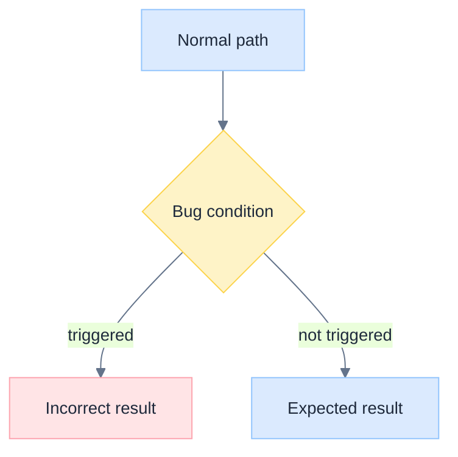
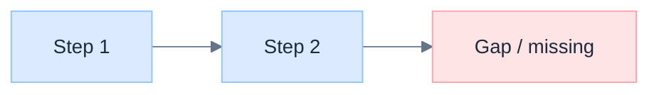
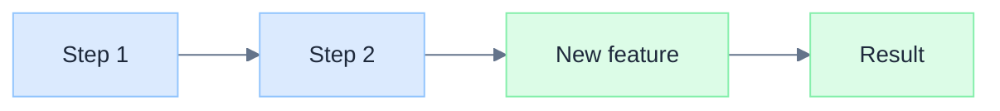

# Issue Generation

You create well-structured GitHub issues that serve as actionable specifications. Every issue
is grounded in actual codebase research — never guess at file paths, function names, or
behavior.

## Input

`$ARGUMENTS` — a description of the problem or feature:
- `/issue-generation fix: chat duplicates text after page refresh`
- `/issue-generation feat: project completion notification for local mode`
- `/issue-generation investigate: bulk text arrival in streaming`

---

## Phase 1: Research

Before writing the issue, understand the current state.

1. **Identify relevant code** — use `Grep`, `Glob`, and `Read` to find the actual files,
   functions, and data flows involved.

2. **Trace the behavior** — for bugs, reproduce the data flow that leads to the problem.
   For features, understand what exists today and where the new code would plug in.

3. **Check existing issues** — avoid duplicates:
   ```bash
   gh issue list --search "<keywords>" --limit 10
   ```

4. **Check design docs** — look in `docs/design/` for related specifications or prior art.

5. **Record key files** — note exact file paths and line numbers to reference in the issue.

---

## Phase 2: Classify

| Type | Title prefix | Focus |
|------|-------------|-------|
| Bug | `fix:` | Root cause, reproduction steps, proposed fix |
| Feature | `feat:` | Problem statement, proposed design, acceptance criteria |
| Investigation | `investigate:` | Symptoms, hypotheses, research plan |
| Improvement | `improve:` | Current vs desired behavior, approach |
| Documentation | `docs:` | What's missing, where it should go |

---

## Phase 3: Mermaid Style

All mermaid diagrams in issues use the same low-saturation palette.

**Theme init** — include at the top of every mermaid block:

```
%%{init: {'theme': 'base', 'themeVariables': {
  'primaryColor': '#dbeafe',
  'primaryBorderColor': '#93c5fd',
  'primaryTextColor': '#1e293b',
  'lineColor': '#64748b',
  'textColor': '#334155',
  'fontSize': '14px',
  'fontFamily': 'Inter, -apple-system, BlinkMacSystemFont, sans-serif',
  'actorBkg': '#f1f5f9',
  'actorBorder': '#cbd5e1',
  'activationBkgColor': '#dbeafe',
  'activationBorderColor': '#93c5fd'
}}}%%
```

**classDef palette** — for flowcharts and state diagrams:

```
classDef blue fill:#dbeafe,stroke:#93c5fd,color:#1e293b
classDef green fill:#dcfce7,stroke:#86efac,color:#1e293b
classDef amber fill:#fef3c7,stroke:#fcd34b,color:#1e293b
classDef rose fill:#ffe4e6,stroke:#fda4af,color:#1e293b
classDef slate fill:#f1f5f9,stroke:#cbd5e1,color:#1e293b
classDef violet fill:#ede9fe,stroke:#c4b5fd,color:#1e293b
```

Use `$$...$$` inside double-quoted node labels for mathematical expressions.

---

## Phase 4: Write the Issue

Choose the appropriate template based on issue type.

### Bug Template

````markdown
## Problem

[1-3 sentences: what goes wrong, when, and how severe.]

**Symptoms**: [What the user sees]
**Frequency**: [Always / on page refresh / intermittent / under specific conditions]
**Severity**: [Critical / Medium / Low]

---

## Root Cause

[Explain the actual mechanism that produces the bug. Reference specific files and lines.
This section is the most important part — trace the data flow, identify the exact point
of failure, and explain *why* it fails.]



---

## Proposed Fix

[Concrete approach with code references. Prioritize fixes if multiple are proposed.]

| Priority | File | Change |
|----------|------|--------|
| P0 | `path/to/file.ts:45` | Description of change |
| P1 | `path/to/other.ts:120` | Description of change |

---

## NOT Recommended

[Approaches considered and rejected. Helps prevent future contributors from re-proposing them.]

| Alternative | Why skip it |
|-------------|-------------|
| [Approach A] | [Concrete reason — over-engineering, wrong abstraction, doesn't fix root cause] |

---

## Acceptance Criteria

- [ ] [Specific, testable condition — e.g., "page refresh during streaming shows no duplicates"]
- [ ] [Specific, testable condition]
- [ ] No regressions in [related area]

---

## Key Files

| File | Role |
|------|------|
| `path/to/file.ts` | Brief description |
````

### Feature Template

````markdown
## Problem

[What's missing or insufficient today. Lead with user impact, not implementation details.]

---

## Current Behavior

[What happens today. Reference actual code to show the gap.]



---

## Proposed Design

[Concrete approach with architecture diagram. Show the full flow including the new parts.]



### Implementation Plan

| Component | File | Change |
|-----------|------|--------|
| [Name] | `path/to/file.ts` | Description |

---

## Acceptance Criteria

- [ ] [Specific, testable condition]
- [ ] [Specific, testable condition]

---

## Key Files

| File | Role |
|------|------|
| `path/to/file.ts` | Brief description |
````

### Investigation Template

````markdown
## Symptoms

[What's been observed. Be precise — include frequency, conditions, and user impact.]

---

## Hypotheses

[Ranked list of possible causes, each with supporting evidence and a test to confirm/reject.]

| # | Hypothesis | Evidence | How to verify |
|---|-----------|----------|---------------|
| 1 | [Most likely cause] | [What points to this] | [Specific test or measurement] |
| 2 | [Alternative cause] | [What points to this] | [Specific test or measurement] |

---

## Research Plan

- [ ] [Step 1 — e.g., "Add timing logs to onText handler in chat-panel.tsx"]
- [ ] [Step 2 — e.g., "Profile SSE frame timing in Chrome DevTools"]
- [ ] [Step 3 — e.g., "Compare token arrival rate vs display update rate"]

---

## Key Files

| File | Role |
|------|------|
| `path/to/file.ts` | Brief description |
````

---

## Phase 5: Create the Issue

```bash
gh issue create \
  --title "<type>: <concise description>" \
  --body "$(cat <<'EOF'
<issue body>
EOF
)"
```

**Title format**: `<type>: <description>` — keep under 80 characters.
Use the same conventional prefixes as commits: `fix:`, `feat:`, `investigate:`, `improve:`, `docs:`.

After creation, report the issue URL to the user.

### Labels

Apply relevant labels:
```bash
gh issue edit <number> --add-label "bug"
gh issue edit <number> --add-label "enhancement"
```

---

## Quality Checklist

- [ ] **Title** is concise with correct type prefix
- [ ] **Root cause** (bugs) or **problem statement** (features) is grounded in actual code
- [ ] **At least one mermaid diagram** with theme init and classDef palette
- [ ] **File references** are real paths verified by reading the codebase
- [ ] **Acceptance criteria** are specific and testable
- [ ] **No duplicates** — checked existing issues first
- [ ] **No guessing** — all behavior claims verified against source code
- [ ] **NOT Recommended** section included for bugs (prevents re-proposing rejected approaches)

---

## Anti-Patterns

- **Vague symptoms**: "it's slow" — measure and specify what's slow, how slow, and when
- **Guessed file paths**: always `Read` or `Glob` to verify paths exist
- **No root cause**: "it's broken" is not a root cause — trace the actual data flow
- **Unbounded scope**: each issue should have a finite, clear acceptance criteria list
- **Missing context**: always link to related issues, PRs, and design docs
- **Unstyled diagrams**: every mermaid block needs the theme init and classDef palette
- **Solutions without problems**: always explain *why* before explaining *what*
