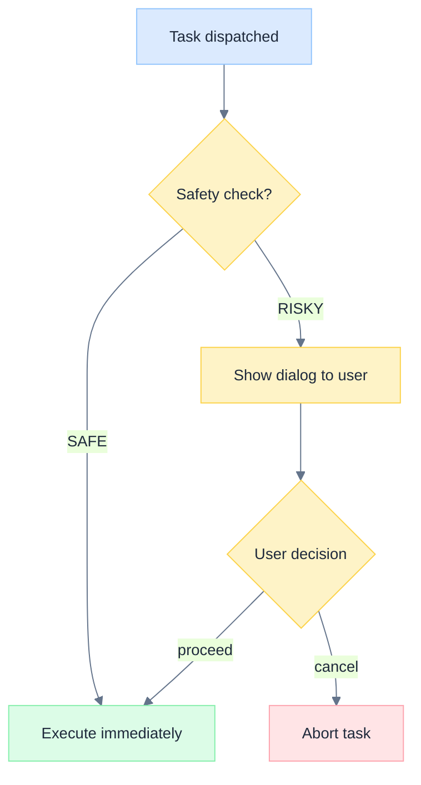
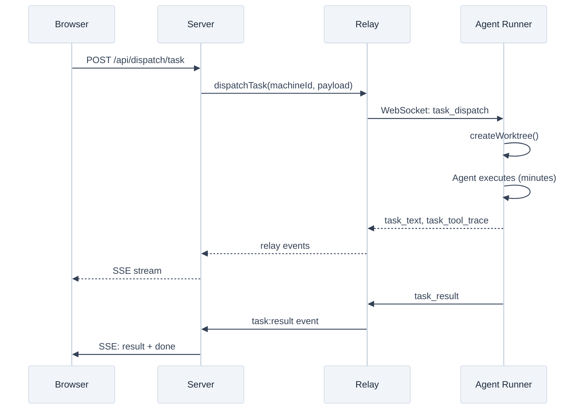
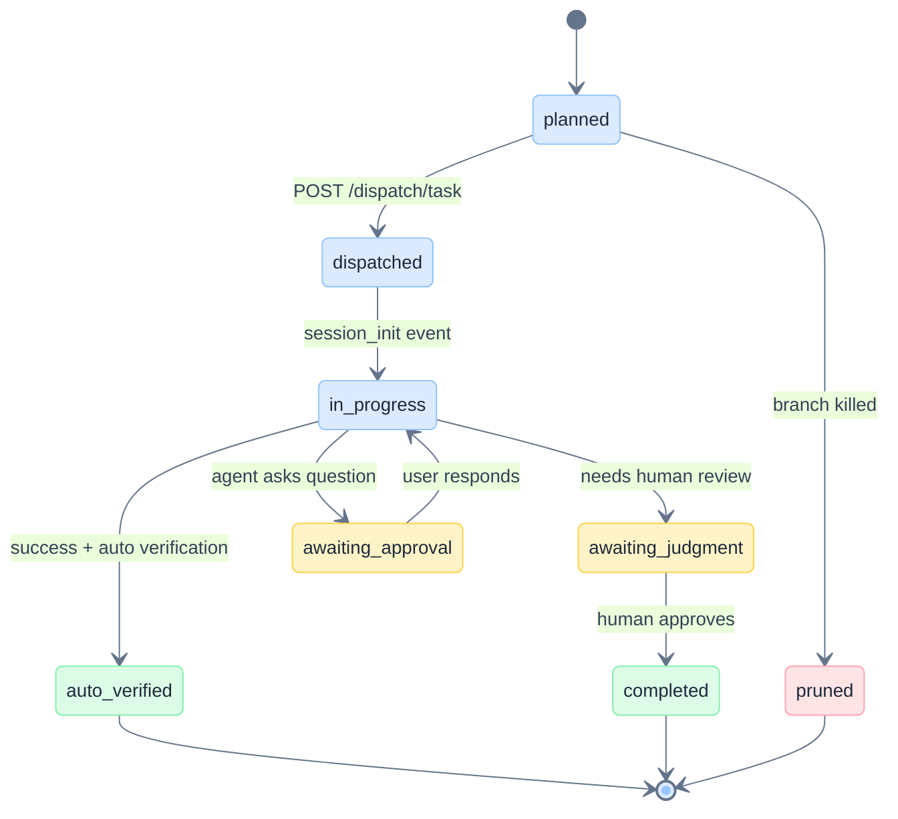

```mermaid
gantt
    title Parallel Execution Timeline
    dateFormat X
    axisFormat %s

    section Task A
    Execute      :a1, 0, 60
    Merge        :a2, after a1, 2

    section Task B
    Execute      :b1, 5, 55
    Wait for lock :b2, after a2, 1
    Merge        :b3, after b2, 2
```

# Wiki Documentation Skill

Write comprehensive technical documentation for the Astro developer wiki. Every page you produce must meet the quality bar described below.

## Output Location

- **Wiki pages**: `/Users/zhuoran_cisco/Documents/agent_tools/astro-wiki/{Page-Name}.md`
- **Design docs**: `/Users/zhuoran_cisco/Documents/agent_tools/astro/docs/design/{NAME}.md`

After writing wiki pages, commit and push:
```bash
cd /Users/zhuoran_cisco/Documents/agent_tools/astro-wiki
git add *.md && git commit -m "docs: <description>" && git push origin master
```

## Quality Standards

### 1. Read Code Before Writing

NEVER guess implementation details. Always read the actual source code before describing behavior. Use `Read`, `Grep`, and `Glob` to understand the real implementation. Verify:
- Function names and signatures
- Exact constants and thresholds
- Actual control flow and error handling
- Database column names and types

### 2. Mermaid Diagrams (Required)

Every page MUST include at least 2 mermaid diagrams. Use the right diagram type for the content.
Every mermaid diagram MUST include the theme init directive and use the classDef palette.

**Theme init** — include at the top of every mermaid block:

```
%%{init: {'theme': 'base', 'themeVariables': {
  'primaryColor': '#dbeafe',
  'primaryBorderColor': '#93c5fd',
  'primaryTextColor': '#1e293b',
  'lineColor': '#64748b',
  'textColor': '#334155',
  'fontSize': '14px',
  'fontFamily': 'Inter, -apple-system, BlinkMacSystemFont, sans-serif',
  'actorBkg': '#f1f5f9',
  'actorBorder': '#cbd5e1',
  'activationBkgColor': '#dbeafe',
  'activationBorderColor': '#93c5fd'
}}}%%
```

**classDef palette** — add after theme init in flowcharts and state diagrams.
Apply to nodes via `:::className` suffix:

```
classDef blue fill:#dbeafe,stroke:#93c5fd,color:#1e293b
classDef green fill:#dcfce7,stroke:#86efac,color:#1e293b
classDef amber fill:#fef3c7,stroke:#fcd34b,color:#1e293b
classDef rose fill:#ffe4e6,stroke:#fda4af,color:#1e293b
classDef slate fill:#f1f5f9,stroke:#cbd5e1,color:#1e293b
classDef violet fill:#ede9fe,stroke:#c4b5fd,color:#1e293b
```

| Role | Fill | Border | Use for |
|------|------|--------|---------|
| Blue | `#dbeafe` | `#93c5fd` | Default nodes, main flow |
| Green | `#dcfce7` | `#86efac` | Success, completion |
| Amber | `#fef3c7` | `#fcd34b` | Decisions, attention |
| Rose | `#ffe4e6` | `#fda4af` | Failures, errors |
| Slate | `#f1f5f9` | `#cbd5e1` | Background, context |
| Violet | `#ede9fe` | `#c4b5fd` | Highlights, special states |

**LaTeX math** — use `$$...$$` inside double-quoted node labels for formulas:

```
A["$$T_{total} = \max(T_i)$$"] --> B["$$O(n \log n)$$"]
```

**Flowcharts** — for decision trees, branching logic, if/else flows:
````markdown

````

**Sequence diagrams** — for multi-component interactions, request/response flows, event pipelines:
````markdown

````

**State diagrams** — for lifecycle states and transitions:
````markdown

````

**Gantt/timeline** — for comparing before/after architectures:
````markdown

````

### 3. ASCII Diagrams in Collapsible Blocks

ASCII diagrams are **always wrapped in `<details>` blocks** so mermaid diagrams take visual priority. ASCII serves as a fallback for non-mermaid renderers.

**Required pattern** — every ASCII diagram code block must be wrapped like this:

```markdown
<details>
<summary>Text diagram</summary>

\```
+---------------------------+
|  ASCII diagram goes here  |
+---------------------------+
\```

</details>
```

For before/after comparisons, use side-by-side or stacked ASCII art with box-drawing characters, wrapped in `<details>`:

```markdown
<details>
<summary>Text diagram</summary>

\```
Previous (serialized):
Task A: [===== lock held: worktree + execute + merge =====]
Task B:                                                     [===== lock held =====]

New (parallel with merge-only lock):
Task A: [── worktree ── execute ──────────────────][merge]
Task B:   [── worktree ── execute ────────────][wait][merge]
\```

</details>
```

**NEVER leave an ASCII diagram code block unwrapped.** Mermaid diagrams are always shown directly (no `<details>`). Only ASCII/text diagrams go inside collapsible blocks.

### 4. Rich Tables

Use tables for:
- **Configuration/constants**: name, value, purpose
- **API endpoints**: method, path, description
- **Status/type enums**: value, who sets it, when, what happens next
- **Comparison matrices**: feature x mode grid
- **File references**: file path, role/purpose

Always align columns and use consistent formatting.

### 5. Page Structure

Every wiki page follows this template:

```markdown
# Page Title

> One-sentence description of what this page covers.

---

## Overview

Brief context paragraph. What is this component/concept? Why does it exist?

## Section 1: Core Concept

Explanation with mermaid diagram.

### Subsection

Details, tables, code examples.

---

## Section 2: Detailed Flow

Sequence diagram or flowchart showing the step-by-step process.

---

## Section N: Edge Cases / Known Gaps

Table of corner cases and how they're handled.

---

## Key Files

| File | Role |
|------|------|
| `path/to/file.ts` | Brief description |

---

*See also: [[Related Page 1]] | [[Related Page 2]]*
```

### 6. Cross-References

Use Obsidian-compatible wiki links: `[[Page Name]]` or `[[Page Name#Section]]`.

Every page must link to:
- At least 2 related pages
- The parent overview page (if it's a sub-page)
- Key files table with actual file paths

### 7. Code Examples

Include TypeScript code snippets for key interfaces, types, and function signatures:

```typescript
// From packages/core/src/db/schema.ts
interface UsageMetrics {
  durationMs: number;
  inputTokens: number;
  outputTokens: number;
  totalCost: number;
  model: string;
  numTurns: number;
}
```

### 8. Section Separators

Use `---` between major sections for visual clarity.

### 9. No Emoji

Do not use emoji in documentation. Use text labels, badges in tables, and formatting for emphasis instead.

## Diagram Selection Guide

| Content Type | Best Diagram | Example |
|-------------|-------------|---------|
| Request/response between components | `sequenceDiagram` | Browser -> Server -> Relay -> Agent |
| Decision tree / branching logic | `flowchart TD` | Safety tier classification |
| State machine / lifecycle | `stateDiagram-v2` | Task status transitions |
| Before/after comparison | ASCII timeline | Lock scope reduction |
| Data flow pipeline | `flowchart LR` | Event persistence pipeline |
| Component architecture | ASCII box diagram | Four-process system |
| Timeline/scheduling | `gantt` | Parallel task execution |
| Mathematical relationships | flowchart + LaTeX | Complexity or cost formulas |

## Wiki Structure Reference

The Astro wiki has these sections (see `_Sidebar.md`):

- **Architecture**: Overview, Backend, Frontend, Agent Runner, Data Model
- **AI Pathways**: AI Pathways, Plan Generation, Project Chat, Task Execution, Summarization
- **Execution Lifecycle**: Execution Lifecycle, Relay Protocol, Streaming Events, Execution Guardrails
- **AI Safeguards**: AI Safeguards, Safety Tiers, Approval System, YOLO Mode
- **GitHub Workflow**: GitHub Workflow, Git Worktrees, Branch Model, Delivery Modes
- **Observability**: Observability, Event Persistence, Refresh Recovery, Cost Tracking
- **Skills & Compute**: Skills System, Compute Backends
- **Infrastructure**: Infrastructure, Database Schema, Deployment, Environment Variables
- **Reference**: Glossary, API Reference, MCP Tools

## Source Code Locations

Key directories to read from when writing documentation:

| Domain | Code Location |
|--------|--------------|
| Database schema | `packages/core/src/db/schema.ts` |
| Prompt templates | `packages/core/src/prompt-templates.ts` |
| Dispatch logic | `server/routes/dispatch.ts`, `server/lib/dispatch/` |
| Agent routes | `server/routes/agent.ts` |
| Relay server | `server/lib/relay-server.ts` |
| Streaming events | `server/lib/streaming-event-log.ts` |
| Frontend stores | `src/stores/` |
| SSE parsing | `src/lib/sse-parser.ts` |
| Event hydration | `src/lib/streaming-event-hydrator.ts` |
| Agent runner | `packages/agent-runner/src/` |
| Provider adapters | `packages/agent-runner/src/providers/` |
| Worktree management | `packages/agent-runner/src/lib/worktree.ts` |
| Safety checks | `packages/agent-runner/src/lib/workdir-safety.ts` |
| Skills | `skills/`, `server/lib/skill-manager.ts` |
