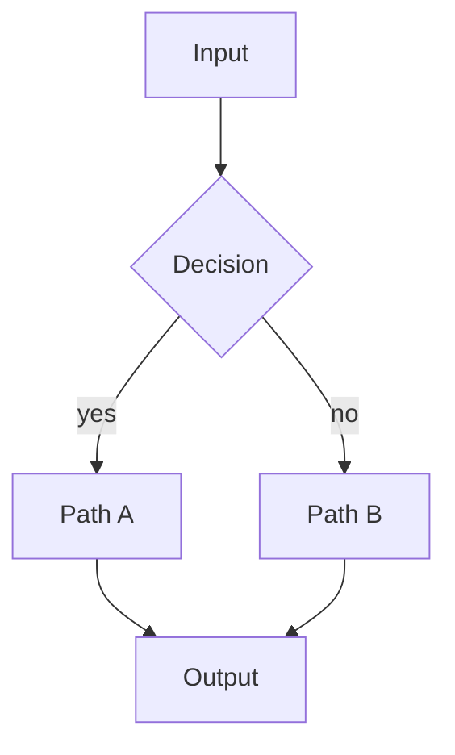
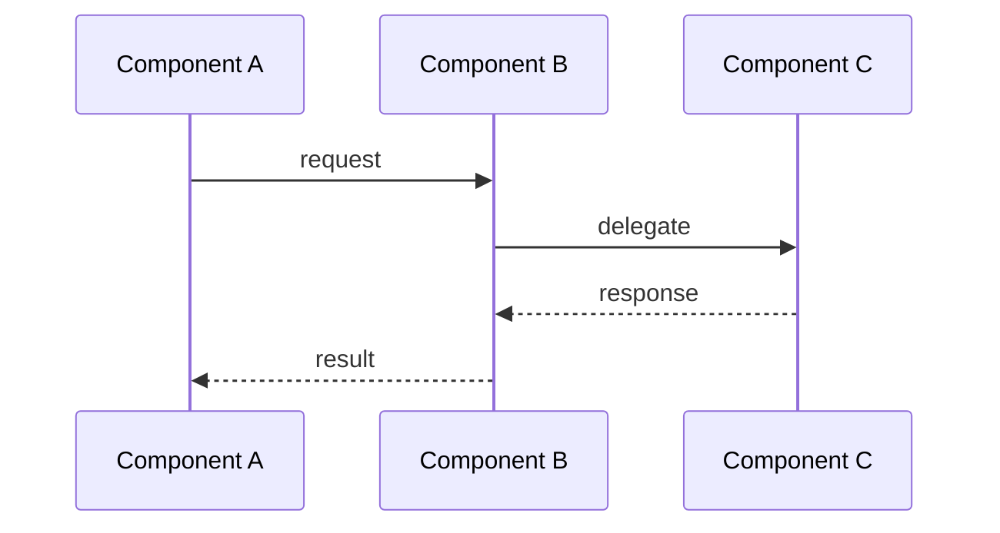
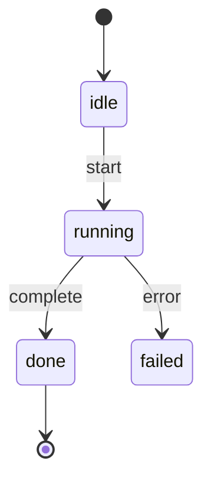

```mermaid
gantt
    title Execution Timeline
    dateFormat X
    axisFormat %s

    section Task A
    Execute      :a1, 0, 60
    Merge        :a2, after a1, 2

    section Task B
    Execute      :b1, 5, 55
    Merge        :b3, after a2, 2
```

# PR Submission

You write pull request descriptions that serve as **design documents**. A great PR description
lets reviewers understand not just *what* changed, but *why* it was designed this way, what
alternatives were considered, and how to verify correctness.

## Input

`$ARGUMENTS` — a PR number, branch name, or "current branch":
- `/pr-submission 721` or `/pr-submission #721` — update an existing PR's description
- `/pr-submission feat/my-feature` — create a PR from this branch
- `/pr-submission current` — create/update PR for the current branch

---

## Phase 0: Understand the Change

Before writing anything, **read the code**.

1. **Identify the diff scope**:
   ```bash
   git log --oneline main...HEAD
   git diff main...HEAD --stat
   ```

2. **Read every changed file** — not just the diff, but enough surrounding context to
   understand the design. Use `Read`, `Grep`, and `Glob`.

3. **Identify the architectural pattern** — is this a:
   - New feature (needs architecture explanation)
   - Bug fix (needs root cause analysis)
   - Refactor (needs before/after comparison)
   - Infrastructure change (needs operational impact)

4. **Check for design docs** — look in `docs/design/` or similar locations for related
   documentation that should be referenced or updated.

5. **Check for related issues/PRs** — look at recent git history and linked issues:
   ```bash
   git log --oneline -20
   gh issue list --label "related-label"
   ```

---

## Phase 1: Structure the PR Description

Every PR description follows this structure. Skip sections that don't apply, but always
include Summary, the relevant detail sections, and Test Plan.

### Template

````markdown
## Summary

[1-3 sentences: what changed and why. Lead with the user-visible or architectural impact,
not implementation details.]

### What changed

- **item 1** — brief description of the change and its purpose
- **item 2** — brief description
- ...

---

## [Architecture / Design / Root Cause] Section

[Choose the appropriate heading based on PR type:]
- **New feature**: "Architecture" or "Design"
- **Bug fix**: "Root Cause" or "Problem"
- **Refactor**: "Before / After"
- **Performance**: "Bottleneck Analysis"

[This is the core of the PR description. Use diagrams, tables, and code snippets
to explain the design. See Phase 2 for diagram guidelines.]

---

## [Detailed Flow / Implementation] Section(s)

[Break down the implementation into logical sections. Each major component or mode
gets its own subsection with appropriate diagrams.]

---

## Edge Cases / Error Handling

[Table or list of corner cases and how they're handled. Reviewers care about these.]

---

## Test Plan

- [ ] Test case 1 — what it verifies
- [ ] Test case 2 — what it verifies
- ...
````

---

## Phase 2: Diagrams and Visual Elements

Every non-trivial PR MUST include visual elements. Choose the right format for the content.

### Mermaid Diagrams

Use mermaid for rendered diagrams on GitHub. Always test that syntax is valid.

**Flowcharts** — for decision trees, branching logic, system flows:
````markdown

````

**Sequence diagrams** — for multi-component interactions, request/response flows:
````markdown

````

**State diagrams** — for lifecycle states and transitions:
````markdown

````

**Gantt charts** — for timeline comparisons, parallel execution:
````markdown

````

### ASCII Timelines

For before/after comparisons that need horizontal layout (mermaid gantt renders vertically):

```
Previous (serialized):
Task A: [===== entire operation =====]
Task B:                                [===== entire operation =====]

New (parallel):
Task A: [── execute ──────────][merge]
Task B:   [── execute ────][wait][merge]
```

### ASCII Branch Diagrams

For git branch flows:

```
main ── A ── B
              │
              └── feature/branch ── C ── D
                    │
                    ├── task-1 (worktree)
                    └── task-2 (worktree)
```

### Tables

Use tables for:
- **Comparison matrices**: feature x mode, before x after
- **Configuration**: name, value, purpose
- **API surface**: endpoint, method, description
- **Error handling**: scenario, behavior, recovery

Always align columns consistently:

```markdown
| Scenario | Previous Behavior | New Behavior |
|---|---|---|
| Two parallel tasks | Serialized (minutes) | Parallel execution, merge-only lock (seconds) |
| Conflict detected | Silent failure | Explicit error with conflicting files listed |
```

---

## Phase 3: Writing Guidelines

### Lead with Impact

Bad: "This PR modifies task-executor.ts to change when the branch lock is acquired."
Good: "Tasks in the same project now execute in parallel, reducing wall-clock time from
N x task_duration to max(task_duration). The branch lock scope narrowed from entire
execution to merge-only."

### Explain the "Why"

For every design decision, briefly explain why this approach was chosen over alternatives.
Reviewers should understand the tradeoffs.

### Use Concrete Examples

Instead of abstract descriptions, show real data flows:

```
Task 1: ensureProjectBranch() → git branch astro/7b19a9 main → created
Task 2: ensureProjectBranch() → git branch astro/7b19a9 main → "already exists" → OK
```

### Link to Code

Reference specific files and line numbers when explaining implementation:

> The merge lock is acquired in `task-executor.ts:1050` and held only during the
> `localMergeIntoProjectBranch()` call (~1 second), not the entire execution.

### Keep Test Plan Actionable

Each test plan item should describe:
- What scenario is tested
- What the expected outcome is
- Whether it's automated or manual

```markdown
- [x] Two parallel tasks with non-overlapping files → both merge successfully (automated)
- [x] Conflict detection → second merge fails cleanly, project branch unchanged (automated)
- [ ] Manual: dispatch 3 tasks simultaneously via UI → all complete without errors
```

---

## Phase 4: Create or Update the PR

### Creating a New PR

```bash
# Ensure branch is pushed
git push -u origin <branch-name>

# Create PR with the description
gh pr create --title "<type>: <concise title>" --body "$(cat <<'EOF'
<PR body content>
EOF
)"
```

**Title format**: Keep under 70 characters. Use conventional commit prefix:
- `feat:` — new feature
- `fix:` — bug fix
- `refactor:` — code restructuring
- `chore:` — maintenance, dependency updates
- `test:` — test additions/changes
- `docs:` — documentation only

### Updating an Existing PR

```bash
gh pr edit <number> --body "$(cat <<'EOF'
<updated PR body>
EOF
)"
```

### Pre-submission Checklist

Before creating/updating the PR, verify:

1. **Build passes**: `npm run build` (or equivalent)
2. **Lint passes**: `npm run lint`
3. **Tests pass**: `npm test`
4. **No unintended files**: `git diff --stat main...HEAD` — check for accidental inclusions
5. **Commit history is clean**: `git log --oneline main...HEAD` — logical commits, no WIP
6. **Branch is up to date**: `git fetch origin main && git rebase origin/main`

---

## Phase 5: Post-Submission

After creating the PR:

1. **Verify rendering** — check that mermaid diagrams render correctly on GitHub:
   ```bash
   gh pr view <number> --web
   ```

2. **Add labels** if applicable:
   ```bash
   gh pr edit <number> --add-label "enhancement"
   ```

3. **Link related issues**:
   ```bash
   gh pr edit <number> --body "$(gh pr view <number> --json body --jq .body)

   Closes #<issue-number>"
   ```

---

## Quality Checklist

Before submitting, verify the PR description meets these standards:

- [ ] **Summary** is 1-3 sentences, leads with impact
- [ ] **At least one diagram** (mermaid or ASCII) for non-trivial changes
- [ ] **Before/after comparison** for behavioral changes
- [ ] **Edge cases documented** in a table or list
- [ ] **Test plan** with actionable items and expected outcomes
- [ ] **No guessing** — all technical details verified against actual code
- [ ] **File references** include actual paths, not guessed ones
- [ ] **Mermaid syntax** is valid (test locally or in GitHub preview)

---

## Anti-Patterns

Do NOT write PR descriptions that:

- **Just list files changed** — reviewers can see the diff; explain *why*
- **Copy-paste code into the description** — reference files/lines instead
- **Use vague language** — "improved performance" → "reduced lock hold time from minutes to <1s"
- **Skip the test plan** — every PR needs verification steps
- **Include emoji** — use text labels and formatting instead
- **Over-explain obvious changes** — a one-line typo fix doesn't need a mermaid diagram
- **Guess at implementation** — always read the code first
