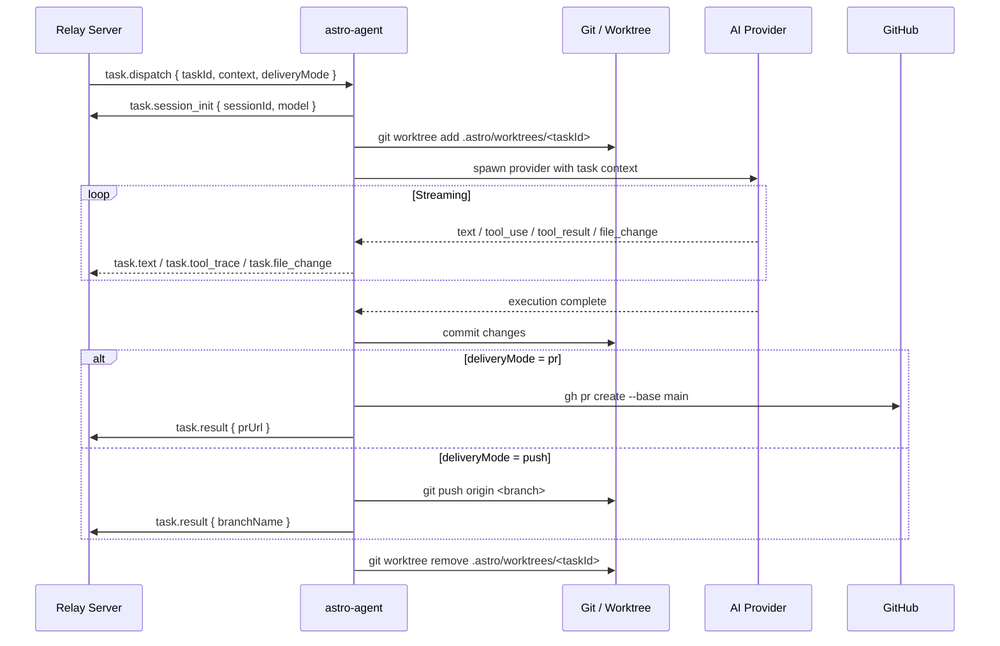

## Overview

The **agent runner** (`@astroanywhere/agent`, binary: `astro-agent`) is the component that executes AI tasks on registered machines. It is a separate process (or separate machine) that:

1. Connects to the Astro relay server via WebSocket
2. Receives task dispatches from the backend
3. Executes tasks using a configured AI provider (Claude Code, Claude CLI, Codex)
4. Streams structured events back via WebSocket
5. Manages git worktrees for task isolation
6. Handles delivery (PR creation, branch push, direct changes)

The agent runner is a **git submodule** at `packages/agent-runner/`, pointing to `github.com/astro-anywhere/astro-agent` (npm: `@astroanywhere/agent`).

---

## Architecture

```
Astro Backend
    │  WebSocket task.dispatch
    ▼
astro-agent (on registered machine)
    │
    ├── Workspace Prep
    │   ├── Validate git state
    │   ├── Create worktree (.astro/worktrees/<executionId>/)
    │   └── Configure MCP server connection
    │
    ├── Provider Selection
    │   ├── Base Provider (local shell / Docker / K8s)
    │   └── Slurm Provider (HPC batch jobs)
    │
    ├── AI Execution
    │   ├── Spawn coding agent with task + context
    │   ├── Stream events back via WebSocket
    │   └── Monitor for abort/steer signals
    │
    └── Delivery
        ├── pr     → gh pr create
        ├── push   → git push origin <branch>
        ├── branch → git checkout -b <branch>
        ├── copy   → copy changed files to working dir
        └── direct → work directly in working directory
```

---

## Execution Flow



---

## Providers

### Base Provider

Executes tasks directly via the AI SDK in a local shell. Supports three execution strategies:

| Strategy | Use Case | How |
|----------|---------|-----|
| `direct` | Local development, cloud VMs | Runs agent in the worktree directory |
| `docker` | Containerized execution | Mounts worktree into Docker container |
| `k8s-exec` | Kubernetes pods | `kubectl exec` into a running pod |

### Slurm Provider

Submits tasks as Slurm batch jobs on HPC clusters. The login node submits `sbatch` scripts; compute nodes run the actual agent.

```bash
# Register a machine with the Slurm provider
astro-agent register \
  --provider slurm \
  --slurm-partition gpu \
  --slurm-account my-allocation \
  --slurm-mem 32G \
  --slurm-cpus 8 \
  --slurm-time 4:00:00
```

**Slurm execution flow:**

```
astro-agent (login node)
    │  sbatch job_script.sh
    ▼
SLURM scheduler
    │  assigns compute node
    ▼
compute node
    │  runs astro-agent task <taskId>
    └── streams results back to relay via SSH tunnel
```

---

## Workspace Model

Each task runs in an **isolated git worktree** to prevent interference between concurrent tasks.

```
project-root/
└── .astro/
    ├── config.json            # Project-level agent config
    └── worktrees/
        ├── exec-abc123/       # Worktree for execution abc123
        │   └── (full git checkout of project)
        └── exec-def456/       # Worktree for execution def456
            └── (full git checkout of project)
```

### Worktree Strategies

| Strategy | Behavior | Best For |
|----------|---------|---------|
| `reference` | Shared `.git` objects, lightweight | Most cases |
| `copy` | Full copy of working tree | When tool modifies `.git` internals |
| `direct` | No worktree — works in main working dir | Single-task projects |

### Delivery Modes

After the AI completes its work, the delivery mode controls how changes are returned:

| Mode | Action | Use Case |
|------|--------|---------|
| `pr` | `gh pr create --base main` | Code review workflow |
| `push` | Push to a feature branch | Direct branch workflow |
| `branch` | Create branch, no push | Local review first |
| `copy` | Copy changed files to working dir | Non-git workflows |
| `direct` | Modify working directory in-place | Experimental mode |

---

## Safety Checks

Before accepting any task, the agent runner performs:

1. **Git state validation** — checks for uncommitted changes in the target directory
2. **Concurrent task limits** — respects `maxConcurrentTasks` per provider
3. **Disk space check** — ensures sufficient space for worktree creation
4. **Worktree cleanup** — removes stale worktrees from previous failed executions

---

## Streaming Events

The agent runner emits structured events during execution. All events are JSON with a `type` field:

| Event | Direction | Description |
|-------|-----------|-------------|
| `task.session_init` | Agent → Relay | Session started; includes model name |
| `task.text` | Agent → Relay | Agent text output |
| `task.tool_trace` | Agent → Relay | Tool call with name + input + output |
| `task.file_change` | Agent → Relay | File modified/created/deleted |
| `task.progress` | Agent → Relay | Progress percentage (0–100) |
| `task.stdout` | Agent → Relay | Raw stdout/stderr lines |
| `task.result` | Agent → Relay | Final result with status and metrics |
| `task.steer.ack` | Agent → Relay | Acknowledged steering message |
| `task.dispatch` | Relay → Agent | New task to execute |
| `task.abort` | Relay → Agent | Cancel running task |
| `task.steer` | Relay → Agent | Real-time guidance injection |

### Persistence

The relay forwards all events to the backend, which persists them to the `streaming_events` table (append-only, seq-indexed). This enables:
- Live activity feed in the browser
- Page-refresh recovery via `useRestoredExecution`
- Post-execution replay and analysis

---

## Heartbeat Protocol

The agent runner sends a heartbeat every 30 seconds to maintain its presence in the relay:

```
Agent                     Relay                    Redis
  │── machine.heartbeat ──▶│── SET relay:machines ──▶│ TTL=5min
  │◀─ heartbeat_ack ────── │                         │
  │                        │                         │
  │  (30s interval)        │                         │
  │── machine.heartbeat ──▶│── SET relay:machines ──▶│ TTL refreshed
```

If no heartbeat is received for 5 minutes, the machine is marked offline in Redis. Ghost entries are pruned at relay startup.

---

## Machine Registration

Machines use the OAuth2 Device Authorization Grant (RFC 8628) for secure registration without embedding credentials:

<Steps>
  <Step title="Request device code">
    ```bash
    astro-agent register --server https://api.astroanywhere.com
    ```
    The agent runner calls `POST /api/device/authorize` and receives a `device_code` and `user_code`.
  </Step>
  <Step title="Authorize in browser">
    Open `https://astroanywhere.com/device` and enter the `user_code`. This links the machine to your team.
  </Step>
  <Step title="Poll for token">
    The agent runner polls `POST /api/device/token` until the user approves. On success, it receives a JWT stored in `~/.config/astro-agent/`.
  </Step>
  <Step title="Connect to relay">
    The agent runner opens `wss://api.astroanywhere.com/relay` with the JWT in the `Authorization` header, then sends `machine.register` with capabilities.
  </Step>
</Steps>

---

## MCP Integration

The agent runner exposes a local MCP server that the AI provider (e.g., Claude Code) connects to. This enables:

- **Approval requests**: agent calls `ask_user_question` → prompt appears in the browser → human approves/rejects
- **Context access**: agent reads project vision doc and task context via MCP tools
- **Real-time steering**: human sends guidance that interrupts the agent mid-task

---

## Configuration

Agent runner configuration is stored in `~/.config/astro-agent/config.json`:

```json
{
  "server": "wss://api.astroanywhere.com",
  "token": "<jwt>",
  "machineId": "machine-abc123",
  "name": "My Laptop",
  "provider": "claude-code",
  "maxConcurrentTasks": 2,
  "labels": ["gpu", "high-memory"]
}
```

Per-project configuration lives in `<projectDir>/.astro/config.json`:

```json
{
  "deliveryMode": "pr",
  "worktreeStrategy": "reference",
  "defaultMachineId": "machine-abc123"
}
```

---

## Development Workflow

The agent runner is a git submodule with its own repository. When making changes:

<Warning>
Do not edit files in `packages/agent-runner/` directly — they are managed by the submodule. Work in the standalone repo at `github.com/astro-anywhere/astro-agent`.
</Warning>

```bash
# 1. Work in the standalone repo
cd ~/path/to/astro-agent
git checkout dev
git checkout -b fix/my-feature

# 2. Build and test
npm run build

# 3. PR to dev branch
git push origin fix/my-feature
gh pr create --base dev

# 4. After merging dev → main, update submodule pointer in astro repo
cd ~/path/to/astro
cd packages/agent-runner && git checkout main && git pull && cd ../..
git add packages/agent-runner
git commit -m "chore: update agent-runner submodule to latest main"
```
