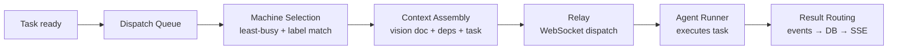

## Overview

The Astro backend is a **Hono.js** server running on Node.js (port 3001). It handles REST API routes, SSE streaming, WebSocket relay coordination, and the dispatch engine that routes tasks to agent runners.

The backend is **stateless by design** — no per-request or per-session state is kept in memory. All persistent state lives in Postgres (via Drizzle ORM) or Redis (for cross-instance coordination).

---

## Directory Structure

```
server/
├── index.ts               # Entry point: starts Hono + relay server
├── routes/
│   ├── data.ts            # Data CRUD API (/api/data/*)
│   ├── dispatch.ts        # Task dispatch (/api/dispatch)
│   ├── stream.ts          # SSE streaming (/api/stream/*)
│   ├── chat.ts            # Chat/plan generation (/api/chat)
│   ├── auth.ts            # WebAuthn passkey auth
│   ├── teams.ts           # Team management
│   ├── machines.ts        # Machine registry
│   ├── device-auth.ts     # OAuth2 Device Authorization Grant
│   ├── mcp.ts             # MCP server integration
│   ├── observations.ts    # Execution trace data
│   ├── connected-accounts.ts  # OAuth integrations
│   ├── github.ts          # GitHub integration
│   ├── notifications.ts   # Persistent notifications
│   └── ...                # 27 route files total
├── lib/
│   ├── db/                # Re-export shims → packages/core/src/db/
│   ├── dispatch/          # Dispatch engine (queue, routing, context)
│   ├── relay-server.ts    # WebSocket relay (port 3002)
│   ├── redis-pubsub.ts    # Redis pub/sub adapter
│   ├── machine-registry.ts # In-memory WebSocket handle registry
│   ├── feature-flags.ts   # Backend feature flag check
│   ├── mcp/               # MCP server (ask_user_question tool)
│   └── streaming-event-log.ts  # SSE event persistence
└── middleware/
    ├── auth.ts            # requireAuth (JWT validation)
    ├── cors.ts            # CORS (allows astroanywhere.com only)
    └── error.ts           # Error handling middleware
```

---

## Middleware Stack

Every request passes through:

```
Request
  → CORS middleware (allows https://astroanywhere.com in prod)
  → Logger middleware
  → Route handler
      → requireAuth middleware (on protected routes)
      → Business logic
  → Error middleware
  → Response
```

### Authentication

```typescript
import { requireAuth } from '../middleware/auth'

// All routes must include this — no exceptions
route.use('/*', requireAuth)

// requireAuth resolves userId and teamId from JWT
// Local mode: fixed UUID constants (no login required)
// Server mode: validates JWT, looks up team_members
```

<Warning>
Every new route file must call `route.use('/*', requireAuth)`. Missing this middleware is the most common cause of 401 errors and data leaks.
</Warning>

---

## API Routes

### Data API (`/api/data/*`)

The primary CRUD interface for all application data. Supports slim mode to exclude large fields during global loads:

```typescript
GET  /api/data/plan?slim=1           // All plan nodes (slim: no content/executionOutput)
GET  /api/data/plan/:projectId       // Full plan for one project
POST /api/data/plan                  // Create/update plan nodes
GET  /api/data/executions?slim=1     // All executions (slim: no streamText)
GET  /api/data/projects              // All projects
POST /api/data/projects              // Create/update a project
GET  /api/data/profile               // User profile
GET  /api/data/machines              // Registered machines
```

**Slim mode implementation** (`server/routes/data.ts`):

```typescript
const slim = c.req.query('slim') === '1'

const node = {
  ...planNode,
  content: slim ? null : planNode.content,
  executionOutput: slim ? null : planNode.executionOutput,
  streamText: slim ? null : planNode.streamText,
}
```

When adding a new large-text column to `plan_nodes` or `task_executions`, always add it to the slim exclusion list and handle `null` gracefully in the frontend.

### Dispatch API (`/api/dispatch`)

```typescript
POST /api/dispatch
  Body: { planNodeId: string, machineId?: string }
  → Creates task_execution record in DB
  → Assembles context (vision doc + dependencies + task description)
  → Sends task.dispatch WebSocket message via relay
  Response: { executionId: string }
```

### SSE Streaming (`/api/stream/*`)

```typescript
GET /api/stream/:executionId
  → SSE stream for a running execution
  → Events: init, session_init, text, tool_use, tool_result,
             file_change, progress, result, error, done, heartbeat

GET /api/chat
POST /api/chat
  → SSE stream for plan generation / chat
  → Events: text, tool_use, tool_result, plan_result, done, error
```

### Key Route Groups

| Route | Description |
|-------|-------------|
| `GET /api/health` | Health check; returns DB and Redis status |
| `POST /api/chat` | Chat with plan AI (SSE response) |
| `POST /api/dispatch` | Dispatch task to agent runner |
| `GET /api/stream/:id` | SSE stream for execution |
| `GET /api/observations` | Execution trace data |
| `GET /api/machines` | Registered machines list |
| `POST /api/machines/register` | Register a new machine |
| `GET /api/connected-accounts` | OAuth integrations |
| `POST /api/device/authorize` | Device code authorization (RFC 8628) |
| `GET /api/notifications` | Persistent notifications |
| `GET /api/community` | Community marketplace |

---

## Dispatch Engine

The dispatch engine routes tasks from the queue to available agent runners.



### Context Assembly

Before dispatching, the backend assembles context from:

1. **Vision document** — the project's `visionDoc` field, injected at the top of every session
2. **Dependency outputs** — the `executionOutput` of completed dependency tasks
3. **Task description** — title, description, and acceptance criteria
4. **Machine instructions** — team-scoped markdown documents
5. **File tree** — cached `git ls-files` output for path autocomplete

Context assembly logic lives in `packages/core/src/dispatch/` (shared between frontend and backend for types).

### Queue Persistence

The dispatch queue is persisted to the `dispatch_queue_entries` table so it survives restarts:

| Field | Description |
|-------|-------------|
| `id` | UUID |
| `plan_node_id` | Task to dispatch |
| `project_id` | Owning project |
| `priority` | Queue priority |
| `status` | `pending`, `running`, `done` |
| `created_at` | Enqueue time |

---

## Database Layer

### Drizzle ORM

All database access uses Drizzle ORM. The schema source of truth is `packages/core/src/db/schema.ts`. The `server/lib/db/` files are thin re-export shims:

```typescript
// server/lib/db/schema.ts (re-export shim)
export * from '@astro/core/db/schema'
```

<Warning>
If you add a new table to `packages/core/src/db/schema.ts`, you must also export it from `server/lib/db/schema.ts`. Missing the re-export causes `undefined` imports in route files.
</Warning>

### Two Database Backends

```typescript
// Determined at startup by isLocalMode()
if (isLocalMode()) {
  // PGlite: Postgres compiled to WASM, runs in-process
  // Data stored in ~/.astro/pglite/
  db = new PGliteDB()
} else {
  // postgres-js: connects to Supabase / any Postgres
  db = new PostgresDB(process.env.DATABASE_URL)
}
```

The Drizzle query layer is identical for both backends.

### Schema Change Checklist

When modifying the database schema, always do all four steps in the same commit:

<Steps>
  <Step title="Edit packages/core/src/db/schema.ts">
    The Drizzle ORM source of truth. All 38 tables are defined here.
  </Step>
  <Step title="Export from server/lib/db/schema.ts">
    Add the new export to the re-export shim. All 50+ route files import from here.
  </Step>
  <Step title="Run npx drizzle-kit generate">
    Generates PGlite migration in the `drizzle/` folder for local mode.
  </Step>
  <Step title="Write supabase/migrations/YYYYMMDDHHMMSS_description.sql">
    Production migration. Use `IF NOT EXISTS` to make it safe to run twice.
  </Step>
</Steps>

After merging to main, run `npm run db:push` to apply to production Supabase.

---

## SSE Event Broadcasting

All streaming events are both forwarded to the browser via SSE and persisted to the `streaming_events` table for page-refresh recovery.

```typescript
// server/lib/streaming-event-log.ts
class StreamingEventLog {
  async append(executionId: string, event: StreamingEvent): Promise<void> {
    // 1. Insert into streaming_events (append-only, seq-indexed)
    await db.insert(streamingEvents).values({
      executionId,
      seq: nextSeq(),
      type: event.type,
      data: event,
    })
    // 2. Publish to SSE subscribers
    await sseBuffer.publish(executionId, event)
  }
}
```

### Catch-Up on Reconnect

When a browser reconnects to an SSE stream mid-execution, it provides the last seen sequence number:

```
GET /api/stream/:executionId?since=42
→ Returns all events with seq > 42, then streams new events live
```

---

## Multi-Instance Considerations

Fly.io runs 2 backend instances with round-robin HTTP. Key rules:

| Rule | Reason |
|------|--------|
| Never store request state in memory | Lost on restart, invisible to other instance |
| Use DB for all persistent state | Postgres is shared across instances |
| Use Redis pub/sub for relay coordination | WebSocket connections are per-instance |
| Check `_fromProxy` on relay responses | Prevents infinite echo loops |

### Redis Pub/Sub

When a browser's HTTP request hits Instance B but the target machine's WebSocket is connected to Instance A:

```
Browser → Instance B (HTTP /api/dispatch)
  Instance B → Redis: publish relay:dispatch { machineId, payload }
  Instance A: subscribes to relay:dispatch
  Instance A → Machine: WebSocket task.dispatch
  Machine → Instance A: task.result
  Instance A → Redis: publish relay:result { executionId, event }
  Instance B: subscribes to relay:result
  Instance B → Browser: SSE event
```

The `_fromProxy: true` flag on relay responses tells the receiver not to re-publish to Redis.

---

## MCP Server

The backend runs an MCP (Model Context Protocol) server at `server/lib/mcp/astro-tools-server.ts`. This provides the `ask_user_question` tool that agent runners can call to request human input:

```
Agent calls ask_user_question → MCP server → Backend → SSE → Browser approval UI
```

15 MCP tools are available. See `docs/mcp/tools-reference.md` for the full list.

---

## Feature Flags (Backend)

```typescript
import { hasFeature } from '../lib/feature-flags'

// In a route handler:
if (!hasFeature(team?.featureFlags, 'my-feature')) {
  return c.json({ error: 'Not available' }, 403)
}
```

`GLOBAL_DEFAULTS` in `server/lib/feature-flags.ts` must match `src/hooks/use-feature-flag.ts`.
