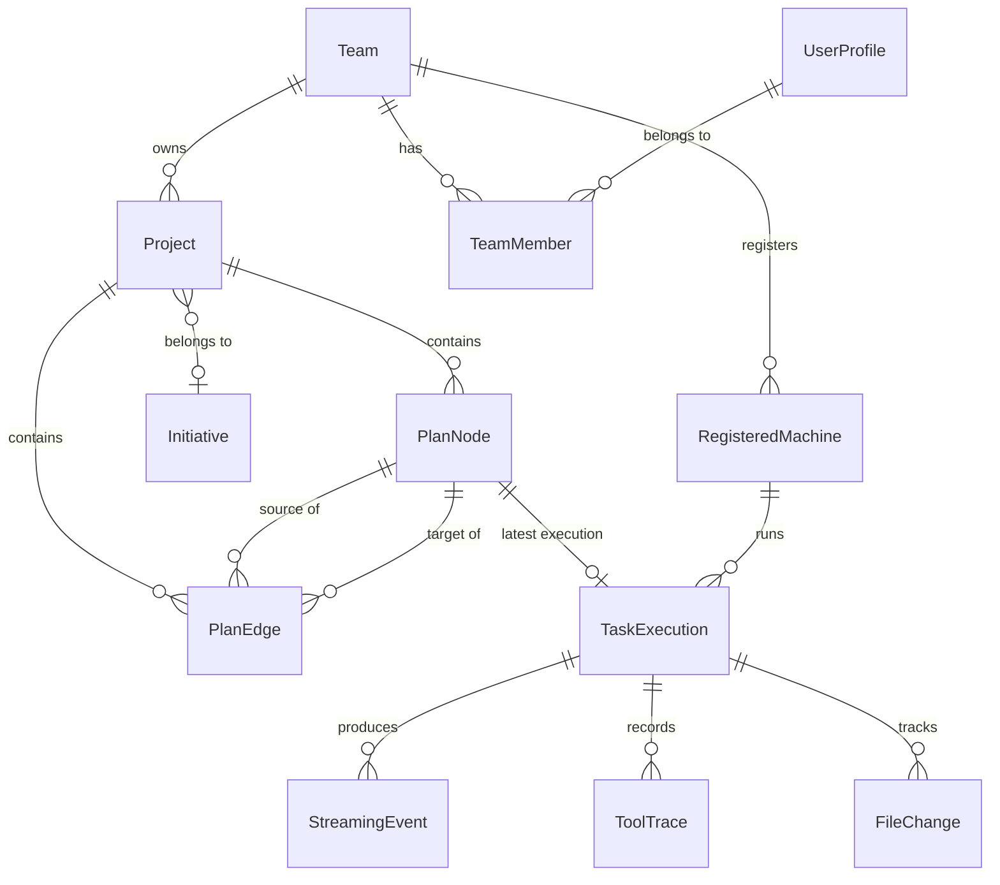
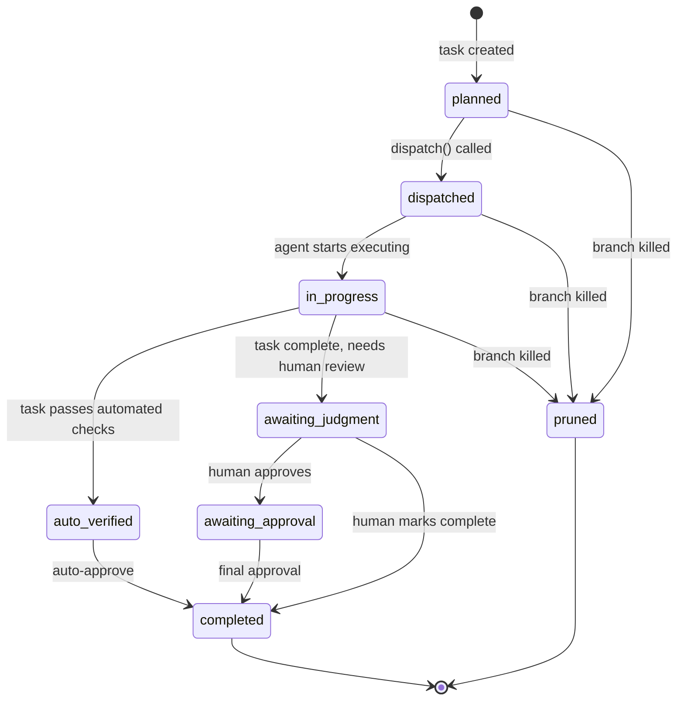

## Overview

Astro uses **Drizzle ORM** as the query layer over either PGlite (local mode, Postgres-in-WASM) or postgres-js (server mode, Supabase). The schema source of truth is `packages/core/src/db/schema.ts`. All TypeScript types are defined in `packages/core/src/types.ts` and re-exported via `src/types/index.ts` for the frontend.

The database has **38 tables** covering projects, plan graphs, executions, users, teams, machines, authentication, and integrations.

---

## Entity Relationships



---

## Core Types

### Project

```typescript
interface Project {
  id: string                  // UUID
  number?: number             // Auto-incrementing display number (#3)
  name: string
  description: string
  visionDoc: string           // Injected into every AI session
  status: 'active' | 'archived'
  startDate?: string          // ISO YYYY-MM-DD
  targetDate?: string
  teamId?: string             // Owning team
  initiativeId?: string       // FK to Initiative

  // Workspace
  sourceDirectory?: string    // Absolute path to repo on disk
  repository?: string         // Git SSH URL
  deliveryMode?: DeliveryMode // 'pr' | 'push' | 'branch' | 'copy' | 'direct'
  worktreeStrategy?: WorktreeStrategy  // 'copy' | 'reference' | 'direct'
  defaultMachineId?: string

  // GitHub
  githubOwner?: string
  githubRepo?: string
  githubRepoId?: number

  createdAt: Date
  updatedAt: Date
}
```

### PlanNode (Task)

```typescript
interface PlanNode {
  id: string                   // UUID
  number?: number              // Auto-incrementing display number (#5)
  projectId: string
  type: 'milestone' | 'task' | 'branch' | 'decision'
  title: string
  description: string
  status: PlanNodeStatus

  // Graph
  parentId: string | null
  dependencies: string[]       // Array of PlanNode IDs
  position: { x: number; y: number }

  // Planning
  startDate?: string           // ISO YYYY-MM-DD (planned)
  endDate?: string             // ISO YYYY-MM-DD (planned)
  dueDate?: string             // ISO YYYY-MM-DD (deadline)
  priority?: Priority          // 'urgent' | 'high' | 'medium' | 'low' | 'none'
  estimate?: Estimate          // 'XS' | 'S' | 'M' | 'L' | 'XL'
  milestoneId?: string
  verification: 'auto' | 'human'

  // Execution (populated when task runs)
  executionId?: string
  executionOutput?: string     // Excluded from slim loads
  executionError?: string
  executionStartedAt?: Date
  executionCompletedAt?: Date
  actualStartDate?: Date
  actualEndDate?: Date

  // Git / PR metadata
  branchName?: string
  prUrl?: string
  prNumber?: number
  mergeQueueStatus?: 'queued' | 'testing' | 'merged' | 'failed'

  // Rich content (excluded from slim loads)
  content?: string             // TipTap HTML
  attachments?: TaskAttachment[]
  links?: TaskLink[]
  acceptanceCriteria?: AcceptanceCriterion[]

  createdAt: Date
  updatedAt: Date
}
```

### PlanEdge

```typescript
interface PlanEdge {
  id: string
  source: string               // PlanNode ID
  target: string               // PlanNode ID
  type: 'dependency' | 'branch'
  deletedAt?: Date
}
```

- **`dependency`**: target depends on source (source must complete before target can start)
- **`branch`**: target is an alternative exploration path from source

### TaskExecution

```typescript
interface TaskExecution {
  executionId: string          // Unique execution ID
  nodeId: string               // FK to PlanNode
  projectId: string
  status: 'pending' | 'running' | 'success' | 'failure' | 'cancelled'
  streamText: string           // Accumulated stdout; excluded from slim loads
  error?: string
  startedAt: Date
  completedAt?: Date

  machineId?: string
  computeBackend?: 'direct' | 'slurm' | 'docker' | 'k8s-exec'
  metrics?: UsageMetrics       // cost, tokens, model, turns

  // Git / PR
  branchName?: string
  prUrl?: string

  // Delivery
  deliveryStatus?: 'success' | 'failed' | 'skipped'
  deliveryError?: string

  // Post-completion
  summary?: ExecutionSummary
}
```

---

## PlanNode Status Lifecycle



| Status | Description |
|--------|-------------|
| `planned` | Task created, not yet dispatched |
| `dispatched` | Sent to dispatch queue, waiting for agent |
| `in_progress` | Agent actively executing |
| `auto_verified` | Passed automated verification (tests/build); awaiting auto-close |
| `awaiting_judgment` | Needs human review before completion |
| `awaiting_approval` | Optional approval gate before marking complete |
| `completed` | Terminal success state |
| `pruned` | Terminal cancelled state (branch killed) |

---

## Key Database Tables

<Tabs>
  <Tab title="Core Entities">
    ### `projects`
    Top-level project containers.

    | Column | Type | Notes |
    |--------|------|-------|
    | `id` | UUID PK | |
    | `team_id` | UUID FK | → `teams.id` |
    | `name` | TEXT | |
    | `description` | TEXT | |
    | `vision_doc` | TEXT | Injected into agent sessions |
    | `status` | TEXT | `active` \| `archived` |
    | `source_directory` | TEXT | Absolute path on disk |
    | `delivery_mode` | TEXT | `pr` \| `push` \| `branch` \| `copy` \| `direct` |
    | `default_machine_id` | UUID | FK → `registered_machines.id` |

    ### `plan_nodes`
    Individual tasks in the plan graph.

    | Column | Type | Notes |
    |--------|------|-------|
    | `id` | UUID PK | |
    | `project_id` | UUID FK | → `projects.id` |
    | `type` | TEXT | `milestone` \| `task` \| `branch` \| `decision` |
    | `title` | TEXT | |
    | `status` | TEXT | See lifecycle above |
    | `start_date` | TEXT | ISO YYYY-MM-DD |
    | `end_date` | TEXT | ISO YYYY-MM-DD |
    | `execution_id` | UUID | FK → `task_executions.id` |
    | `content` | TEXT | TipTap HTML; excluded from slim loads |
    | `execution_output` | TEXT | Agent output; excluded from slim loads |

    ### `plan_edges`
    Directed edges in the plan graph.

    | Column | Type | Notes |
    |--------|------|-------|
    | `id` | UUID PK | |
    | `project_id` | UUID FK | |
    | `source` | UUID | FK → `plan_nodes.id` |
    | `target` | UUID | FK → `plan_nodes.id` |
    | `type` | TEXT | `dependency` \| `branch` |
  </Tab>
  <Tab title="Execution">
    ### `task_executions`
    Records of each execution attempt.

    | Column | Type | Notes |
    |--------|------|-------|
    | `id` | UUID PK | |
    | `plan_node_id` | UUID FK | |
    | `project_id` | UUID FK | |
    | `status` | TEXT | `pending` \| `running` \| `success` \| `failure` \| `cancelled` |
    | `stream_text` | TEXT | Excluded from slim loads |
    | `machine_id` | UUID FK | → `registered_machines.id` |
    | `compute_backend` | TEXT | `direct` \| `slurm` \| `docker` |
    | `delivery_status` | TEXT | `success` \| `failed` \| `skipped` |
    | `summary` | JSONB | AI-generated completion summary |
    | `started_at` | TIMESTAMPTZ | |
    | `completed_at` | TIMESTAMPTZ | |

    ### `streaming_events`
    Append-only log of all events per execution. Enables page-refresh recovery.

    | Column | Type | Notes |
    |--------|------|-------|
    | `id` | UUID PK | |
    | `execution_id` | UUID FK | |
    | `seq` | INT | Monotonic sequence number |
    | `type` | TEXT | `text` \| `tool_use` \| `tool_result` \| etc. |
    | `data` | JSONB | Full event payload |
    | `created_at` | TIMESTAMPTZ | |

    ### `tool_traces`
    Detailed tool call records.

    | Column | Type | Notes |
    |--------|------|-------|
    | `id` | UUID PK | |
    | `execution_id` | UUID FK | |
    | `tool_name` | TEXT | e.g., `Bash`, `Read`, `Write` |
    | `input` | JSONB | Tool call arguments |
    | `output` | TEXT | Tool result |
    | `duration_ms` | INT | Execution time |

    ### `file_changes`
    Files modified during an execution.

    | Column | Type | Notes |
    |--------|------|-------|
    | `id` | UUID PK | |
    | `execution_id` | UUID FK | |
    | `path` | TEXT | Relative file path |
    | `operation` | TEXT | `create` \| `modify` \| `delete` |
    | `diff` | TEXT | Unified diff |
  </Tab>
  <Tab title="Teams & Users">
    ### `teams`
    Billing and access control unit.

    | Column | Type | Notes |
    |--------|------|-------|
    | `id` | UUID PK | |
    | `name` | TEXT | |
    | `feature_flags` | JSONB | Per-team feature flag overrides |
    | `plan` | TEXT | `free` \| `pro` \| `enterprise` |

    ### `team_members`
    Many-to-many between users and teams.

    | Column | Type | Notes |
    |--------|------|-------|
    | `team_id` | UUID FK | |
    | `user_id` | UUID FK | |
    | `role` | TEXT | `owner` \| `admin` \| `member` |

    ### `user_profiles`
    User identity and preferences.

    | Column | Type | Notes |
    |--------|------|-------|
    | `id` | UUID PK | Matches Supabase auth.users.id |
    | `name` | TEXT | |
    | `email` | TEXT | |
    | `avatar_url` | TEXT | |

    ### `registered_machines`
    Agent runner registrations.

    | Column | Type | Notes |
    |--------|------|-------|
    | `id` | UUID PK | |
    | `team_id` | UUID FK | |
    | `name` | TEXT | Human-readable label |
    | `provider` | TEXT | `local` \| `slurm` |
    | `labels` | TEXT[] | Capability tags (e.g., `gpu`, `high-memory`) |
    | `last_seen_at` | TIMESTAMPTZ | Updated by heartbeat |
  </Tab>
  <Tab title="Auth & Sessions">
    ### `passkey_credentials`
    WebAuthn credential storage.

    | Column | Type | Notes |
    |--------|------|-------|
    | `id` | UUID PK | |
    | `user_id` | UUID FK | |
    | `credential_id` | TEXT | WebAuthn credential ID (base64url) |
    | `public_key` | BYTEA | COSE-encoded public key |
    | `counter` | INT | Signature counter |

    ### `device_codes`
    OAuth2 Device Authorization Grant state.

    | Column | Type | Notes |
    |--------|------|-------|
    | `device_code` | TEXT PK | |
    | `user_code` | TEXT | Shown to user (e.g., `ABCD-1234`) |
    | `team_id` | UUID | Resolved on user approval |
    | `expires_at` | TIMESTAMPTZ | 10-minute TTL |
    | `status` | TEXT | `pending` \| `approved` \| `denied` \| `expired` |

    ### `dispatch_queue_entries`
    Persisted dispatch queue (survives restarts).

    | Column | Type | Notes |
    |--------|------|-------|
    | `id` | UUID PK | |
    | `plan_node_id` | UUID FK | |
    | `project_id` | UUID FK | |
    | `priority` | INT | Lower = higher priority |
    | `status` | TEXT | `pending` \| `running` \| `done` |
  </Tab>
</Tabs>

---

## Slim Loading

The data API supports `?slim=1` to minimize initial page load (1–5 MB instead of 50+ MB):

```typescript
// server/routes/data.ts
const slim = c.req.query('slim') === '1'

const node = {
  ...planNode,
  content:         slim ? null : planNode.content,
  executionOutput: slim ? null : planNode.executionOutput,
}

const execution = {
  ...taskExecution,
  streamText: slim ? null : taskExecution.streamText,
}
```

Frontend handles `null` gracefully — components check before rendering large content fields. Per-project full loads are triggered by `useProjectData()` on navigation.

---

## Schema Change Checklist

When adding or modifying tables:

<Steps>
  <Step title="Edit packages/core/src/db/schema.ts">
    The Drizzle ORM source of truth. Add new `pgTable()` definitions here.
  </Step>
  <Step title="Export from server/lib/db/schema.ts">
    Add the new table to the re-export shim. All 50+ route files import from here. Missing this causes `undefined` at runtime.
  </Step>
  <Step title="Run npx drizzle-kit generate">
    Generates PGlite migration in `drizzle/` for local mode.
  </Step>
  <Step title="Write supabase/migrations/YYYYMMDDHHMMSS_description.sql">
    Production migration. Use `IF NOT EXISTS`. Enable RLS. Add `team_id` policies.

    ```sql
    CREATE TABLE IF NOT EXISTS my_table (
      id UUID PRIMARY KEY DEFAULT gen_random_uuid(),
      team_id UUID NOT NULL REFERENCES teams(id) ON DELETE CASCADE,
      name TEXT NOT NULL,
      created_at TIMESTAMPTZ NOT NULL DEFAULT now()
    );

    ALTER TABLE my_table ENABLE ROW LEVEL SECURITY;

    DO $$ BEGIN
      IF NOT EXISTS (SELECT 1 FROM pg_policies WHERE policyname = 'my_table_select') THEN
        CREATE POLICY my_table_select ON my_table FOR SELECT
          USING (team_id IN (
            SELECT team_id FROM team_members WHERE user_id = auth.uid()
          ));
      END IF;
    END $$;
    ```
  </Step>
</Steps>

After merging to main, push to production: `npm run db:push`.

---

## Common Mistakes

| Mistake | What Breaks |
|---------|-------------|
| Forgot Supabase migration | Local mode works; production crashes at startup |
| Forgot `db:push` after merge | Code deployed but schema is stale — queries fail |
| Forgot re-export shim | `import { myTable }` returns `undefined` |
| Forgot `drizzle-kit generate` | PGlite missing the new table |
| Forgot `IF NOT EXISTS` | Migration fails if run twice |
| Applied SQL via Supabase dashboard | Creates orphan migration history |
| Duplicate migration timestamps | `supabase db push` gets confused |
