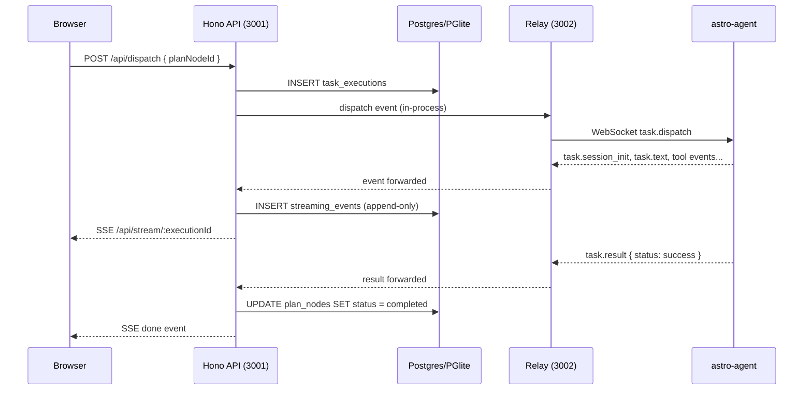

## System Components

Astro is composed of four logical components. In local mode they all run on the same machine; in production they span CDN, cloud, and user hardware.

```
┌──────────────────────────────────────────────────────────────────────┐
│  FRONTEND — Browser (React 19 + Vite 7 SPA)                         │
│  Cloudflare Pages (prod) · localhost:5173 (dev)                      │
│  Plan Graph · Activity Feed · Chat · Timeline · Settings             │
└─────────────────────────┬──────────────────────────────┬─────────────┘
                          │ HTTP REST + SSE              │ SSE (events)
                          ▼                              ▼
┌──────────────────────────────────────────────────────────────────────┐
│  BACKEND — Hono API Server (Node.js)                                 │
│  Fly.io (prod) · localhost:3001 (dev)                                │
│  Routes · Auth · Dispatch Engine · MCP Server · SSE Broadcasting     │
└────────┬──────────────────┬───────────────────────────┬──────────────┘
         │                  │                           │
    ┌────▼────┐       ┌─────▼──────┐            ┌──────▼──────┐
    │ PGlite  │       │  Postgres   │            │    Redis    │
    │ (local) │       │ (Supabase)  │            │  (pub/sub)  │
    └─────────┘       └────────────┘            └─────────────┘
                                                       │
┌──────────────────────────────────────────────────────▼──────────────┐
│  RELAY — WebSocket Hub                                               │
│  port 3002 (same Fly.io VM in prod)                                  │
│  Machine registry · Task routing · Heartbeat · Redis pub/sub         │
└──────────────────────────────┬──────────────────────────────────────┘
                               │ WebSocket (ws:// local · wss:// prod)
              ┌────────────────┼────────────────┐
         ┌────▼────┐     ┌────▼────┐      ┌────▼────┐
         │ Laptop  │     │  HPC    │      │  Cloud  │
         │  Agent  │     │  Agent  │      │  Agent  │
         └─────────┘     └─────────┘      └─────────┘
```

<CardGroup cols={2}>
  <Card title="Frontend" icon="browser" href="/architecture/frontend">
    React 19 + Vite 7 SPA. 29 Zustand stores. Plan graph with React Flow. SSE event consumption.
  </Card>
  <Card title="Backend" icon="server" href="/architecture/backend">
    Hono.js on Node.js. 27 route files. Drizzle ORM. Dispatch engine. SSE broadcasting.
  </Card>
  <Card title="Agent Runner" icon="robot" href="/architecture/agent-runner">
    `astro-agent` binary. Runs on registered machines. Executes AI tasks in git worktrees.
  </Card>
  <Card title="Relay Server" icon="arrows-left-right" href="/architecture/relay-server">
    WebSocket hub on port 3002. Bridges backend dispatch to agent runners. Redis-scaled.
  </Card>
</CardGroup>

---

## Data Flow



### Step-by-step

1. **Stores load on mount** — `DataLoader` calls `GET /api/data/*?slim=1`, excluding large fields (`content`, `executionOutput`). Teams load first to set the `X-Team-Id` header.
2. **Project creation** triggers AI plan generation via SSE (`POST /api/chat`).
3. **Backend streams** Claude Agent SDK output as Server-Sent Events; events persisted to `streaming_events` table.
4. **Plan nodes/edges** stored in Zustand and rendered in React Flow graph.
5. **Task dispatch** — Dispatch Engine selects best available machine, assembles context (vision doc + dependencies), sends via relay.
6. **Results stream back** via WebSocket relay, persisted to `streaming_events`, then forwarded as SSE to the browser.
7. **Page refresh** — `useRestoredExecution` hydrates from `streaming_events` table for seamless recovery.

---

## Three Operating Modes

<Tabs>
  <Tab title="Local Mode">
    All four components run on the **same machine**. Zero external dependencies.

    ```
    localhost:5173  Frontend (Vite dev)
    localhost:3001  Backend (Hono + PGlite in-process)
    localhost:3002  Relay (WebSocket, no JWT)
    local process   astro-agent (started automatically)
    ```

    - **Database**: PGlite (Postgres compiled to WASM, data in `~/.astro/pglite/`)
    - **Auth**: Fixed UUID for user and team — no login required
    - **Relay**: `ws://localhost:3002`, no TLS, no JWT
    - **Start**: `npm run dev:local`
  </Tab>
  <Tab title="Dev Mode">
    Local Supabase (Docker) + Cloudflare tunnel for HTTPS/WebAuthn.

    ```
    localhost:5173       Frontend
    localhost:3001       Backend (postgres-js → local Supabase)
    localhost:3002       Relay (JWT auth)
    Cloudflare tunnel    Exposes localhost via HTTPS for TouchID
    ```

    - **Database**: Local Supabase (Docker)
    - **Auth**: WebAuthn/passkey via Cloudflare tunnel (HTTPS required)
    - **Start**: `npm run dev:dev` (requires `CLOUDFLARED_DOMAIN` in `.env`)
  </Tab>
  <Tab title="Production">
    Remote Supabase + Fly.io backend + Cloudflare Pages frontend.

    ```
    Cloudflare Pages   Frontend (CDN)
    Fly.io (×2)        Backend + Relay (round-robin)
    Supabase (remote)  Postgres
    Upstash Redis      Cross-instance pub/sub
    ```

    - **Database**: Remote Supabase Postgres
    - **Auth**: WebAuthn/passkey (JWT tokens)
    - **Scaling**: 2 Fly.io instances with Redis pub/sub for cross-instance relay
    - **Deploy**: `npm run deploy`
  </Tab>
</Tabs>

### Mode Detection

```typescript
// server/lib/app-mode.ts  (and src/lib/app-mode.ts for frontend)
export function isLocalMode(): boolean {
  // 1. ASTRO_LOCAL_MODE=true → explicit override
  // 2. Supabase env vars absent → auto-detect
  // 3. Otherwise → server mode
}
```

The frontend and backend both call `isLocalMode()` — there is no mode branching in route or component logic.

---

## Design Principles

### Server Is Stateless

The Hono server stores **no per-request or per-session state in memory**. All persistent state lives in Postgres (or Redis for cross-instance coordination). Fly.io runs 2 instances with round-robin HTTP — state on Instance A is invisible to Instance B.

| Anti-pattern | Problem | Correct Alternative |
|-------------|---------|-------------------|
| `const sessions = new Map()` | Lost on restart | Store in DB |
| `let currentTask = ...` at module scope | Shared across all requests | Read from DB per-request |
| In-memory cache without TTL | Grows unbounded | Use Redis with TTL |
| Global "who is logged in" | Meaningless with round-robin | Auth token in request header |

**Exception**: `machineRegistry` stores live WebSocket handles — inherently per-process. Authoritative machine data lives in Redis and the `registered_machines` table.

### Frontend Derives State from DB

Do not use in-memory React state to encode information that already exists in the store/DB. Derive decisions from observable store fields (execution status, plan nodes) backed by the database. Transient UI-only state (modal open/closed, input text) is fine, but routing and data decisions must come from store state.

### Lazy Loading

Large fields are excluded from the global slim load and fetched per-project on navigation.

| Phase | Endpoint | Excludes |
|-------|---------|---------|
| Global slim load | `GET /api/data/plan?slim=1` | `content`, `executionOutput` |
| Global slim load | `GET /api/data/executions?slim=1` | `streamText` |
| Per-project full load | `GET /api/data/plan/:projectId` | Nothing |

### Unified Execution Path

All AI execution flows through the relay to agent runners. The backend **never** calls AI SDKs directly — it builds prompts and dispatches via WebSocket. No `if (useRelay) ... else ...` branching exists in the codebase.

---

## Tech Stack

| Layer | Technology | Notes |
|-------|-----------|-------|
| **Frontend** | Vite 7 + React 19 + TypeScript | Strict mode, `@/` path alias |
| **Styling** | Tailwind CSS v4 | `@tailwindcss/vite` plugin (not postcss) |
| **Routing** | React Router v7 | `react-router` package |
| **State** | Zustand 5 | 29 stores, persisted via `dataClient` |
| **Graph** | @xyflow/react | Plan graph visualization |
| **UI Components** | shadcn/ui pattern | Manual Radix primitives |
| **Icons** | lucide-react | |
| **Backend** | Hono.js on Node.js | Port 3001 |
| **ORM** | Drizzle ORM | Schema in `packages/core/src/db/schema.ts` |
| **DB (local)** | PGlite | Postgres-in-WASM, zero install |
| **DB (server)** | postgres-js → Supabase | |
| **AI** | @anthropic-ai/claude-agent-sdk | Plan gen + chat |
| **Deploy (frontend)** | Cloudflare Pages | |
| **Deploy (backend)** | Fly.io | 2 instances |
| **Cross-instance** | Redis (Upstash) | pub/sub for relay coordination |

---

## Further Reading

<CardGroup cols={3}>
  <Card title="Frontend" icon="browser" href="/architecture/frontend">
    React 19, Zustand stores, React Flow graph
  </Card>
  <Card title="Backend" icon="server" href="/architecture/backend">
    Hono routes, dispatch engine, SSE streaming
  </Card>
  <Card title="Agent Runner" icon="robot" href="/architecture/agent-runner">
    Providers, worktrees, streaming events
  </Card>
  <Card title="Relay Server" icon="arrows-left-right" href="/architecture/relay-server">
    WebSocket hub, heartbeat, Redis scaling
  </Card>
  <Card title="Data Model" icon="database" href="/architecture/data-model">
    Schema tables, relationships, status lifecycle
  </Card>
</CardGroup>
