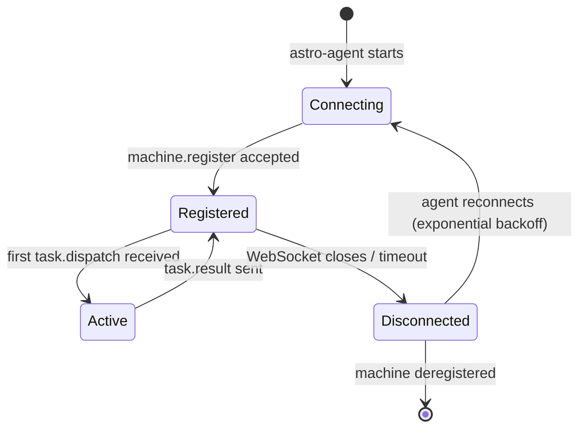

## Overview

The relay server (`server/lib/relay-server.ts`) runs on **port 3002** alongside the Hono API. It maintains persistent WebSocket connections to registered `astro-agent` instances and provides real-time bidirectional communication between the backend dispatch engine and agent runners.

In production, the relay runs on the same Fly.io VM as the backend. Redis pub/sub bridges the two Fly.io instances so that a dispatch request hitting Instance B can still reach a machine connected to Instance A.

---

## Responsibilities

| Responsibility | Description |
|----------------|-------------|
| Machine registration | Accept WebSocket connections from `astro-agent` |
| Presence tracking | Maintain machine online/offline state in memory + Redis |
| Task dispatch | Route `task.dispatch` messages to the correct machine |
| Event relay | Forward streaming events from agents to the backend |
| Heartbeat monitoring | Detect dead connections and mark machines offline |
| Redis pub/sub | Bridge messages across multiple backend instances |

---

## Architecture

```
┌─────────────────────────────────────────────────────────┐
│                 Fly.io Instance A                        │
│                                                         │
│  ┌──────────────────┐     ┌──────────────────────────┐  │
│  │  Hono API        │────▶│  Relay Server (3002)     │  │
│  │  (3001)          │     │                          │  │
│  └──────────────────┘     │  machineRegistry         │  │
│           │               │  { machineId → WsHandle }│  │
│           │               └──────────┬───────────────┘  │
│           │                          │ WebSocket         │
└───────────┼──────────────────────────┼──────────────────┘
            │                          │
            ▼ Redis pub/sub            ▼ WebSocket (wss://)
┌─────────────────────────────────────────────────────────┐
│                 Fly.io Instance B                        │  ┌─────────────┐
│                                                         │  │ astro-agent │
│  ┌──────────────────┐     ┌──────────────────────────┐  │  │ (Machine A) │
│  │  Hono API        │────▶│  Relay Server (3002)     │  │  └──────┬──────┘
│  │  (3001)          │     │                          │  │         │ wss://
│  └──────────────────┘     │  machineRegistry (empty  │  │         │
│                           │  for machines on inst A) │  │  connected to
└───────────────────────────┴──────────────────────────┘  │  Instance A
                                                           │
                                    Redis: relay:machines hash
                                    { machineId: instanceId }
```

---

## Machine Presence: Two Layers

Machine presence is tracked at two layers to handle the per-process nature of WebSocket connections:

| Layer | Storage | TTL | Purpose |
|-------|---------|-----|---------|
| `machineRegistry` (in-memory) | Per Fly.io process | None (evicted on disconnect) | Holds live WebSocket handles |
| `relay:machines` Redis hash | Cross-instance | 5 minutes (refreshed by heartbeat) | Authoritative presence check |
| `registered_machines` DB table | Persistent Postgres | None | Machine metadata and history |

### `isMachineReachable()`

```typescript
// server/lib/relay-server.ts
async function isMachineReachable(machineId: string): Promise<boolean> {
  // 1. Check in-memory registry (local WebSocket connection)
  if (machineRegistry.has(machineId)) return true
  // 2. Check Redis hash (any instance)
  const entry = await redis.hget('relay:machines', machineId)
  return entry !== null
}
```

Always call `isMachineReachable()` before attempting task dispatch.

---

## WebSocket Protocol

All messages are JSON objects with a `type` field and an ISO 8601 `timestamp`.

### Machine → Relay Messages

<Tabs>
  <Tab title="machine.register">
    ```json
    {
      "type": "machine.register",
      "timestamp": "2026-03-17T12:00:00Z",
      "machineId": "machine-abc123",
      "machineInfo": {
        "name": "Dev Laptop",
        "environmentType": "local",
        "providers": [{
          "type": "claude-code",
          "status": "available",
          "maxConcurrentTasks": 3,
          "currentTasks": 0
        }],
        "resources": {
          "cpuCores": 8,
          "memoryMB": 16384
        },
        "load": {
          "cpuPercent": 20,
          "memoryPercent": 45,
          "activeTasks": 0
        }
      }
    }
    ```
  </Tab>
  <Tab title="machine.heartbeat">
    ```json
    {
      "type": "machine.heartbeat",
      "timestamp": "2026-03-17T12:00:30Z",
      "machineId": "machine-abc123",
      "load": {
        "cpuPercent": 35,
        "memoryPercent": 52,
        "activeTasks": 2,
        "queuedTasks": 1
      }
    }
    ```
    Sent every 30 seconds. Resets the 5-minute TTL in Redis.
  </Tab>
  <Tab title="task.result">
    ```json
    {
      "type": "task.result",
      "timestamp": "2026-03-17T12:05:00Z",
      "result": {
        "taskId": "exec-xyz789",
        "status": "success",
        "exitCode": 0,
        "output": "All tests passed",
        "error": null,
        "duration": 120000,
        "metrics": {
          "inputTokens": 1500,
          "outputTokens": 800,
          "estimatedCostUsd": 0.015
        }
      }
    }
    ```
  </Tab>
  <Tab title="task.text">
    ```json
    {
      "type": "task.text",
      "timestamp": "2026-03-17T12:02:15Z",
      "taskId": "exec-xyz789",
      "text": "Analysis complete. Found 3 issues.",
      "sequence": 42
    }
    ```
  </Tab>
  <Tab title="task.tool_trace">
    ```json
    {
      "type": "task.tool_trace",
      "timestamp": "2026-03-17T12:02:10Z",
      "taskId": "exec-xyz789",
      "toolName": "Bash",
      "input": { "command": "npm test" },
      "output": "Tests passed: 42/42",
      "duration": 8500
    }
    ```
  </Tab>
</Tabs>

### Relay → Machine Messages

<Tabs>
  <Tab title="task.dispatch">
    ```json
    {
      "type": "task.dispatch",
      "timestamp": "2026-03-17T12:00:00Z",
      "taskId": "exec-xyz789",
      "task": {
        "title": "Add authentication middleware",
        "description": "Implement JWT validation...",
        "projectId": "proj-123",
        "context": {
          "visionDoc": "...",
          "dependencies": [...],
          "machineInstructions": "..."
        },
        "deliveryMode": "pr",
        "worktreeStrategy": "reference",
        "workingDirectory": "/home/user/myproject"
      }
    }
    ```
  </Tab>
  <Tab title="task.abort">
    ```json
    {
      "type": "task.abort",
      "timestamp": "2026-03-17T12:03:00Z",
      "taskId": "exec-xyz789",
      "reason": "User requested cancellation"
    }
    ```
  </Tab>
  <Tab title="task.steer">
    ```json
    {
      "type": "task.steer",
      "timestamp": "2026-03-17T12:02:30Z",
      "taskId": "exec-xyz789",
      "message": "Focus on the authentication logic first",
      "interrupt": false
    }
    ```
    Real-time guidance injected into a running agent session.
  </Tab>
  <Tab title="heartbeat_ack">
    ```json
    {
      "type": "heartbeat_ack",
      "timestamp": "2026-03-17T12:00:30Z"
    }
    ```
  </Tab>
</Tabs>

---

## Heartbeat Protocol

```
Agent                    Relay                    Redis
  │                        │                         │
  │── machine.heartbeat ──▶│                         │
  │                        │── HSET relay:machines ─▶│ TTL=5min
  │                        │── EXPIRE machine key ──▶│
  │◀── heartbeat_ack ──────│                         │
  │                        │                         │
  │  (30 second interval)  │                         │
  │── machine.heartbeat ──▶│── EXPIRE machine key ──▶│ TTL reset
  │◀── heartbeat_ack ──────│                         │
  │                        │                         │
  │  (machine goes offline)│                         │
  │                        │                         │
  │  (5 minutes later)     │   TTL expires           │
  │                        │◀─── key eviction ───────│
  │                        │   mark machine offline  │
```

Ghost entries (machines that crashed without unregistering) are cleaned up:
- On relay startup (prune stale Redis entries)
- On TTL expiry (Redis automatic cleanup)

---

## Redis Pub/Sub: Cross-Instance Relay

With 2 Fly.io instances, WebSocket connections are per-instance. Redis pub/sub bridges them.

### Channels

| Channel | Publisher | Subscriber | Payload |
|---------|-----------|-----------|---------|
| `relay:dispatch` | Backend (Instance B) | All instances | Task dispatch for a machine on any instance |
| `relay:result` | Relay (Instance A) | All instances | Task result to route back to SSE subscriber |
| `relay:event` | Relay (Instance A) | All instances | Streaming event to forward to SSE |
| `relay:steer` | Backend (Instance B) | All instances | Steering message for a running task |
| `relay:abort` | Backend (Instance B) | All instances | Abort signal for a running task |

### `_fromProxy` Guard

Every Redis-relayed message includes `_fromProxy: true`. The receiving instance checks this flag before re-publishing to prevent infinite echo loops:

```typescript
// server/lib/relay-server.ts
redisSubscriber.on('message', (channel, data) => {
  const msg = JSON.parse(data)
  if (msg._fromProxy) return  // Never remove this check
  handleRelayMessage(msg)
})
```

### Key Patterns

| Key | Format | TTL | Purpose |
|-----|--------|-----|---------|
| `relay:machines` | Hash | 5 min per field | Machine presence |
| `relay:machine:<id>` | String | 5 min | Per-machine metadata |
| `relay:task:<id>` | String | 1 hour | Active task routing info |

---

## Connection Lifecycle



### Reconnection Strategy

The agent runner uses exponential backoff for reconnects:

```
1st retry:   2s
2nd retry:   4s
3rd retry:   8s
4th retry:  16s
5th+ retry: 30s (cap)
```

On reconnect, the agent re-sends `machine.register` with its current capabilities and any in-progress task IDs (for state recovery).

---

## Authentication

| Mode | Auth Method |
|------|-------------|
| Local | None — relay accepts all connections |
| Dev / Prod | JWT in `Authorization: Bearer <token>` WebSocket header |

The JWT is obtained via the Device Authorization Grant flow and stored in `~/.config/astro-agent/config.json`.

---

## Troubleshooting

| Symptom | Likely Cause | Check |
|---------|-------------|-------|
| Machine shows as offline immediately | JWT expired or invalid | Re-register: `astro-agent register` |
| Tasks dispatched but never start | Machine connected to wrong instance | Check `relay:machines` Redis hash |
| Infinite log spam with same `correlationId` | Missing `_fromProxy` guard | Check relay-server.ts proxy handler |
| Machine disconnects after 5 minutes | Heartbeat not reaching relay | Check firewall rules for port 3002 |
| Ghost machines in Redis | Crash without unregister | Restart relay; startup cleanup will prune |
