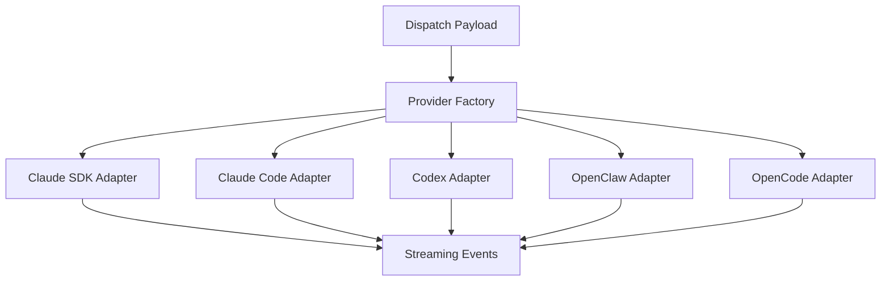

The Astro agent runner uses a provider adapter system to support multiple AI coding agents. Each provider adapter translates between Astro's dispatch protocol and the provider's native interface — whether that is an in-process SDK, a CLI tool, or an RPC endpoint.

## Available Providers

| Provider | Adapter Type | Execution Model | Observability | Status |
|----------|-------------|-----------------|---------------|--------|
| **Claude Code (SDK)** | `claude-sdk` | In-process via npm SDK | Full: streaming events, tool traces, file changes, approvals, steering, MCP | Production |
| **Claude Code (CLI)** | `claude-code` | Spawns CLI with `--output-format stream-json` | Full: JSONL parsing, tool_use/result correlation | Production |
| **Codex** | `codex` | Spawns `codex --json` | Good: turn-based events, item tracking | Tested |
| **OpenClaw** | `openclaw` | Spawns `openclaw agent --mode rpc --json` | Basic: JSONL events, metrics | Experimental |
| **OpenCode** | `opencode` | Spawns `opencode run --print --output-format json` | Basic: JSONL events, metrics | Experimental |

## Provider Architecture

All providers implement a common `ProviderAdapter` interface:



The factory function selects the right adapter based on the `providerType` field in the dispatch payload:

```typescript
createProviderAdapter(
  type: ProviderType,
  hpcCapability?: HpcCapability,
  openclawBridge?: OpenClawBridge
): ProviderAdapter | null
```

Each adapter normalizes provider-specific output into Astro's standard streaming event format (`init`, `text`, `tool_use`, `tool_result`, `file_change`, `progress`, `result`, `error`, `done`), so the rest of the system does not need to know which provider is running.

---

## Claude Code (SDK)

The recommended provider for production use. Runs the Claude Agent SDK in-process for maximum observability and control.

**Requirements:**
- Node.js 18+
- `@anthropic-ai/claude-agent-sdk` package
- Valid Anthropic API key or Claude authentication

**Capabilities:**
- Full streaming events with tool call details
- Real-time file change tracking
- MCP tool integration (approvals, questions)
- Steering support (guidance, redirect, pause, resume)
- Detailed token usage and cost metrics

**When to use:** Default choice for most workloads. Best observability, supports all Astro features including dynamic approvals and mid-execution steering.

---

## Claude Code (CLI)

Spawns the `claude` CLI as a subprocess with `--output-format stream-json`. Useful when you want to use an existing Claude Code installation.

**Requirements:**
- `claude` CLI installed and authenticated
- Accessible in `$PATH`

**Capabilities:**
- JSONL output parsing with tool_use/result correlation
- File change detection
- Streaming text output

**When to use:** When you already have Claude Code CLI installed and prefer not to manage SDK dependencies.

---

## Codex

Spawns the OpenAI Codex CLI as a subprocess with JSON output.

**Requirements:**
- `codex` CLI installed
- OpenAI API key configured

**Capabilities:**
- Turn-based event tracking
- Item-level progress monitoring
- JSON output parsing

**When to use:** When you prefer OpenAI models or have existing Codex workflows.

---

## OpenClaw

Spawns the OpenClaw agent in RPC mode with JSON output. OpenClaw provides an open-source agent framework with its own skill and tool system.

**Requirements:**
- `openclaw` CLI installed
- OpenClaw configuration

**Capabilities:**
- JSONL event streaming
- Basic metrics collection
- RPC-mode communication

<Note>
  OpenClaw integration is experimental. Core functionality works but has not been extensively tested in production environments.
</Note>

**When to use:** When you want to use OpenClaw's agent framework and skill ecosystem within Astro's planning layer.

---

## OpenCode

Spawns the OpenCode CLI with JSON output for agent execution.

**Requirements:**
- `opencode` CLI installed
- Provider-specific API keys configured

**Capabilities:**
- JSONL event streaming
- Basic metrics collection

<Note>
  OpenCode integration is experimental. Core functionality works but has not been extensively tested in production environments.
</Note>

**When to use:** When you want to use OpenCode's multi-provider agent framework.

---

## Provider Selection

When dispatching a task, you can specify which provider to use:

<Tabs>
  <Tab title="CLI">
    ```bash
    # Use Claude SDK (default)
    astro-cli task dispatch <id> --project-id <pid> --provider claude-sdk

    # Use Claude CLI
    astro-cli task dispatch <id> --project-id <pid> --provider claude-code

    # Use Codex
    astro-cli task dispatch <id> --project-id <pid> --provider codex
    ```
  </Tab>
  <Tab title="Web UI">
    Select the provider in the dispatch dialog when sending a task to a machine. Available providers are determined by what is installed on the target machine.
  </Tab>
</Tabs>

If no provider is specified, the agent runner uses the first available provider in this priority order:

1. `claude-sdk` (if SDK is installed)
2. `claude-code` (if CLI is available)
3. `codex` (if installed)
4. `openclaw` / `opencode` (if installed)

## Provider Discovery

The agent runner detects installed providers at startup and reports them to the relay server. You can see which providers are available on each machine:

```bash
# List all providers across all machines
astro-cli env providers

# Show providers for a specific machine
astro-cli env show <machine-id>
```

## AI Provider Pathways

Astro routes AI requests through different pathways depending on the use case:

### Class A: Agentic (Multi-turn, Tools, File Access)

| Pathway | Endpoint | Description |
|---------|----------|-------------|
| Task Execution | `POST /api/dispatch/task` | Full agent session with tools, file access, and delivery |
| Playground | `POST /api/dispatch/task` | Ephemeral execution with steering support |
| Interactive Plan | `POST /api/dispatch/task` | AI brainstorms and generates plan graph nodes |
| HPC/SLURM | `POST /api/relay/slurm/dispatch` | Agent session running on HPC compute nodes |

### Class B: Conversational (Chat, Read-only)

| Pathway | Endpoint | Description |
|---------|----------|-------------|
| Project Chat | `POST /api/chat/project` | Chat with AI about a project (vision doc, plan, team context) |
| Task Chat | `POST /api/chat/task` | Chat about a specific task (branch, PR context) |
| Playground Chat | `POST /api/chat/playground` | Continue an ephemeral session |

### Class C: Lightweight (Single-turn)

| Pathway | Endpoint | Description |
|---------|----------|-------------|
| Execution Summary | `POST /api/summarize/execution` | Generate markdown summary from streaming events |
| Plan Extraction | `POST /api/extract/plan` | Parse plan text into structured nodes and edges |
| Code Review | `POST /api/review/code` | Review branch diff and provide feedback |

### Class D: Internal (Background)

| Pathway | Description |
|---------|-------------|
| Background Replan | Analyze execution results and suggest plan improvements |

Class A pathways inject the full codebase context, vision document, and dependency outputs. Class B pathways provide limited context (titles, descriptions, branch names). Class C pathways operate on specific artifacts.

## SLURM Provider Integration

When running on HPC clusters, providers work together with the SLURM execution strategy. The agent runner:

1. Submits an `sbatch` job with the requested resources (GPUs, memory, time)
2. The job starts on a compute node and runs the AI provider
3. Events stream back via the relay server
4. Results are delivered when the SLURM job completes

```bash
astro-cli task dispatch <id> --project-id <pid> \
  --provider claude-sdk \
  --slurm --slurm-partition gpu \
  --slurm-gpus 2 --slurm-gpu-type A100 \
  --slurm-mem 64G --slurm-time 4:00:00
```

See [HPC/SLURM Integration](/integrations/hpc-slurm) for detailed cluster configuration.

## Writing a Custom Provider

To add a new AI provider, implement the `ProviderAdapter` interface:

```typescript
interface ProviderAdapter {
  /** Human-readable provider name */
  name: string;

  /** Provider type identifier */
  type: ProviderType;

  /** Check if this provider is available on the current machine */
  isAvailable(): Promise<boolean>;

  /** Execute a task and stream events */
  execute(params: {
    task: TaskPayload;
    workingDirectory: string;
    onEvent: (event: StreamingEvent) => void;
    signal?: AbortSignal;
  }): Promise<ExecutionResult>;

  /** Cancel a running execution */
  cancel(executionId: string): Promise<void>;
}
```

<Steps>
  <Step title="Create the adapter file">
    Add a new file in `packages/agent-runner/src/providers/`:

    ```bash
    touch packages/agent-runner/src/providers/my-provider-adapter.ts
    ```
  </Step>
  <Step title="Implement the interface">
    Your adapter must:
    - Detect availability (check if the CLI/SDK is installed)
    - Start the agent process with the task context
    - Parse provider-specific output into Astro streaming events
    - Handle cancellation via AbortSignal
    - Return usage metrics (tokens, cost, model) in the result
  </Step>
  <Step title="Register the provider">
    Add your provider to the factory in `packages/agent-runner/src/providers/index.ts`:

    ```typescript
    case 'my-provider':
      return new MyProviderAdapter();
    ```
  </Step>
  <Step title="Normalize events">
    Map your provider's output to Astro's standard event types:

    | Your Provider Output | Astro Event |
    |---------------------|-------------|
    | Text/message output | `text` |
    | Tool/function call | `tool_use` |
    | Tool/function result | `tool_result` |
    | File created/modified | `file_change` |
    | Completion | `result` |
    | Error | `error` |
  </Step>
</Steps>

<Warning>
  Token extraction and cost calculation must happen in the adapter, not on the server. The server receives already-parsed streaming events and does not know how to interpret provider-specific output formats.
</Warning>

## Next Steps

<CardGroup cols={2}>
  <Card title="Agent Runner" icon="robot" href="/cli/agent-runner">
    Learn about the agent runner's execution lifecycle and safety features.
  </Card>
  <Card title="HPC/SLURM" icon="microchip" href="/integrations/hpc-slurm">
    Configure SLURM clusters for GPU and HPC workloads.
  </Card>
  <Card title="Dispatch API" icon="bolt" href="/api-reference/dispatch-api">
    API reference for task dispatch, execution control, and device auth.
  </Card>
  <Card title="MCP Tools" icon="wrench" href="/features/mcp-tools">
    All 15 built-in MCP tools available to agents during execution.
  </Card>
</CardGroup>
