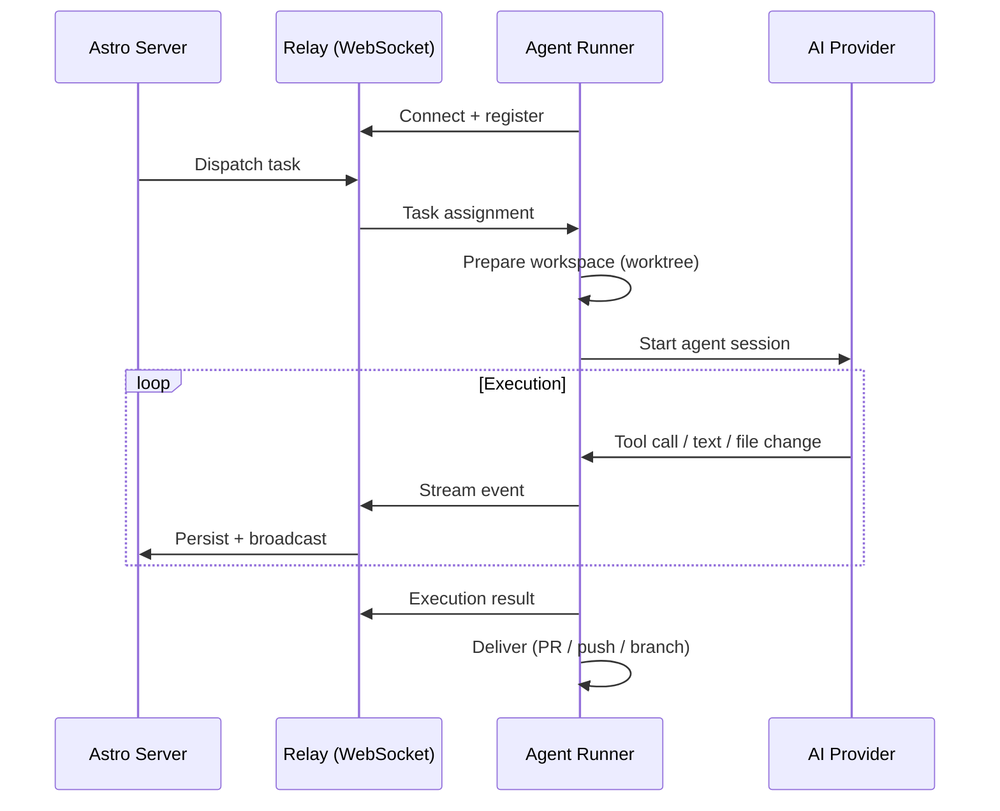

The Astro agent runner (`@astroanywhere/agent`) is a lightweight daemon that runs on your machines — laptops, servers, or HPC clusters — and executes tasks dispatched from Astro. It connects to the Astro relay server via WebSocket, receives task assignments, runs AI coding agents, and streams results back in real time.

## What the Agent Runner Does



The agent runner handles:

| Responsibility | Details |
|---------------|---------|
| **Machine registration** | Registers with the relay server, reports capabilities, providers, and hardware |
| **Workspace preparation** | Creates git worktrees for isolation, clones repos, sets up working directories |
| **Agent execution** | Starts AI coding agents (Claude Code, Codex, etc.) with full context injection |
| **Event streaming** | Streams text, tool calls, file changes, and progress to the server in real time |
| **Delivery** | Creates PRs, pushes branches, or delivers code via the configured delivery mode |
| **Safety checks** | Validates working directories, sandbox execution, and resource limits |

## Installation

```bash
npm install -g @astroanywhere/agent
```

This installs the `astro-agent` binary. Verify:

```bash
astro-agent --version
```

## Setup

The setup command configures the agent runner for first use. It handles authentication, server discovery, and optional integrations.

```bash
astro-agent setup
```

<Steps>
  <Step title="Run setup">
    ```bash
    astro-agent setup --auto-start
    ```

    The `--auto-start` flag automatically starts the agent after setup completes.
  </Step>
  <Step title="Authenticate">
    Setup initiates a device code authentication flow. Follow the prompts to authorize the agent in your browser.
  </Step>
  <Step title="Verify connection">
    ```bash
    astro-agent status
    ```
    Confirms the agent is running and connected to the relay server.
  </Step>
</Steps>

### Setup Options

<ParamField path="--api" type="string">
  Astro API server URL (default: production).
</ParamField>

<ParamField path="--relay" type="string">
  Relay WebSocket URL (default: derived from API URL).
</ParamField>

<ParamField path="--hostname" type="string">
  Custom hostname for this machine (default: system hostname).
</ParamField>

<ParamField path="--skip-auth" type="boolean">
  Skip the authentication step (use if already authenticated).
</ParamField>

<ParamField path="--non-interactive" type="boolean">
  Run without prompts (uses defaults for all options).
</ParamField>

<ParamField path="--with-ssh-config" type="boolean">
  Configure SSH host discovery for remote execution.
</ParamField>

<ParamField path="--auto-start" type="boolean">
  Start the agent immediately after setup.
</ParamField>

<ParamField path="--install-mcp" type="boolean">
  Install the MCP server integration for Claude Code.
</ParamField>

<ParamField path="--verbose" type="boolean">
  Show detailed output during setup.
</ParamField>

## Starting and Stopping

### Start

By default, the agent runs as a background process:

```bash
# Start in background (default)
astro-agent start

# Start in foreground (useful for debugging)
astro-agent start --foreground
```

<ParamField path="-f, --foreground" type="boolean">
  Run in the foreground instead of daemonizing.
</ParamField>

<ParamField path="--relay" type="string">
  Override the relay WebSocket URL.
</ParamField>

<ParamField path="--max-tasks" type="number">
  Maximum concurrent tasks (default: based on system resources).
</ParamField>

<ParamField path="--log-level" type="string">
  Log verbosity: `debug`, `info`, `warn`, `error`.
</ParamField>

<ParamField path="--preserve-worktrees" type="boolean">
  Do not clean up git worktrees after execution.
</ParamField>

<ParamField path="--allow-non-git" type="boolean">
  Allow execution in directories that are not git repositories.
</ParamField>

<ParamField path="--sandbox" type="boolean">
  Enable sandboxed execution mode.
</ParamField>

<ParamField path="--max-sandbox-size" type="string">
  Maximum sandbox size (e.g., `5G`).
</ParamField>

### Stop

```bash
astro-agent stop
```

<Warning>
  Both `setup` and `start` unconditionally stop any existing agent process before proceeding. You do not need to manually stop an old agent before starting a new one.
</Warning>

### Status

```bash
astro-agent status
```

Shows whether the agent is running, its PID, connected relay, registered providers, and current task count.

### Logs

View background mode logs:

```bash
astro-agent logs
```

## Execution Lifecycle

When the agent runner receives a task, it goes through a well-defined lifecycle:

<Steps>
  <Step title="Task received">
    The relay server forwards a dispatch payload containing the task description, project context, vision document, dependency outputs, and delivery configuration.
  </Step>
  <Step title="Workspace preparation">
    The agent creates an isolated workspace using git worktrees (or copies, depending on configuration). This ensures the main branch is never modified directly.

    | Strategy | When Used |
    |----------|-----------|
    | `reference` | Default. Creates a linked worktree (fast, shares `.git`) |
    | `copy` | Sandboxed mode. Full copy of the repository |
    | `direct` | Non-git directories or when `--allow-non-git` is set |
  </Step>
  <Step title="Provider selection">
    The agent selects the appropriate AI provider based on the dispatch payload. See [Agent Providers](/cli/agent-providers) for details on available providers.
  </Step>
  <Step title="Agent session">
    The provider adapter starts an AI agent session with the full context:
    - Vision document (product/research description)
    - Task description and acceptance criteria
    - Dependency outputs from upstream tasks
    - Machine instructions (team-scoped guidance)
    - MCP tools for dynamic approvals

    The agent runs in a tool loop — making tool calls, reading/writing files, running commands — until the task is complete.
  </Step>
  <Step title="Event streaming">
    All events are streamed in real time via the relay server:

    | Event Type | Description |
    |-----------|-------------|
    | `init` | Execution started |
    | `session_init` | Agent session created |
    | `text` | Text output from the agent |
    | `tool_use` | Agent is calling a tool |
    | `tool_result` | Tool call completed |
    | `file_change` | File was created, modified, or deleted |
    | `progress` | Progress update (subroutine, percentage) |
    | `result` | Execution completed successfully |
    | `error` | Execution failed |
    | `aborted` | Execution was cancelled |
    | `heartbeat` | Keep-alive signal |
    | `done` | Stream finished |
  </Step>
  <Step title="Delivery">
    After successful execution, the agent delivers the results according to the project's delivery mode:

    | Mode | Behavior |
    |------|----------|
    | `pr` | Creates a GitHub pull request from the worktree branch |
    | `push` | Pushes changes directly to the target branch |
    | `branch` | Pushes to a new branch without creating a PR |
    | `copy` | Copies changed files to the original working directory |
    | `direct` | Changes are made directly in the working directory |
  </Step>
</Steps>

## Execution Strategies

The agent runner supports multiple execution strategies for running tasks in different environments:

| Strategy | Environment | Detection |
|----------|-------------|-----------|
| **Direct** | Local machine | Always available (fallback) |
| **SLURM** | HPC clusters | Auto-detects `sbatch`, `squeue` binaries |
| **Docker** | Containers | Auto-detects Docker daemon |
| **Kubernetes** | K8s clusters | Auto-detects `kubectl` and cluster context |
| **SSH** | Remote hosts | Discovers hosts from SSH config |

The agent detects available strategies at startup and reports them to the relay server. When dispatching tasks, you can target specific strategies:

```bash
# Dispatch to SLURM
astro-cli task dispatch <id> --project-id <id> \
  --slurm --slurm-partition gpu --slurm-gpus 2

# The agent runner will use SLURM strategy automatically
```

For SSH, the agent discovers remote hosts from your `~/.ssh/config` and registers each as a separate execution target.

## MCP Integration

The agent runner includes an MCP (Model Context Protocol) server that provides tools to the AI agent during execution:

```bash
# Install MCP integration during setup
astro-agent setup --install-mcp

# Or install separately
astro-agent mcp
```

The MCP server provides the `ask_user_question` tool, which enables the AI agent to request approval or ask questions during execution. These appear as real-time notifications in the Astro web UI.

## Safety and Guardrails

The agent runner includes several safety mechanisms:

| Guardrail | Description |
|-----------|-------------|
| **Working directory validation** | Validates that the working directory exists, is writable, and is safe for execution |
| **Git worktree isolation** | Tasks run in isolated worktrees — the main branch is never modified directly |
| **Sandbox mode** | Optional containerized execution with resource limits |
| **Max concurrent tasks** | Limits the number of simultaneous executions to prevent resource exhaustion |
| **Dispatch verification** | Validates dispatch payloads before starting execution |
| **Branch locking** | Prevents concurrent writes to the same branch |

<Warning>
  Safety messages displayed in the terminal must not contain emoji characters. The frontend renders safety indicators with CSS styling (icons, colored borders), and embedded emoji would duplicate the visual cues.
</Warning>

## Configuration Files

| File | Location | Purpose |
|------|----------|---------|
| Agent config | `~/.config/astro-agent/config.json` | Server URLs, auth tokens, machine settings |
| Agent data | `~/.astro/` | Worktree storage, execution logs |

## Next Steps

<CardGroup cols={2}>
  <Card title="Agent Providers" icon="plug" href="/cli/agent-providers">
    Configure Claude Code, Codex, OpenClaw, and other AI providers.
  </Card>
  <Card title="Connect a Machine" icon="server" href="/tutorials/connect-machine">
    Step-by-step tutorial for connecting your first machine.
  </Card>
  <Card title="Dispatch and Execute" icon="play" href="/tutorials/dispatch-and-execute">
    Tutorial: dispatch tasks and watch them execute.
  </Card>
  <Card title="HPC/SLURM Integration" icon="microchip" href="/integrations/hpc-slurm">
    Configure SLURM clusters for HPC workloads.
  </Card>
</CardGroup>
