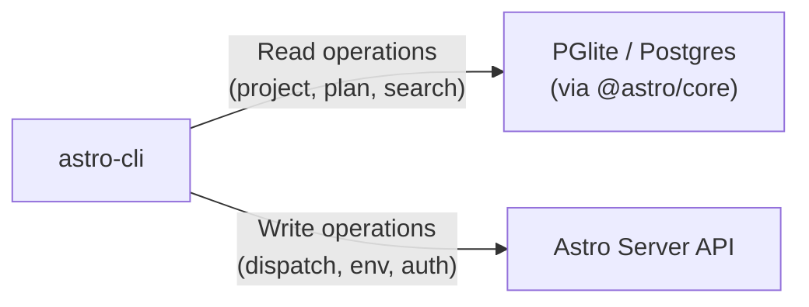

The Astro CLI (`@astroanywhere/cli`) gives you full control over your Astro workspace from the terminal. It covers everything the web UI does — creating projects, managing plan graphs, dispatching tasks to machines, watching execution output, and searching across your workspace — plus a Terminal UI (TUI) for interactive workflows.

## What the CLI Provides

| Capability | Description |
|-----------|-------------|
| **Project management** | Create, list, update, and delete projects with vision documents |
| **Plan graph operations** | Create nodes, render dependency trees, export to Mermaid/DOT/JSON |
| **Task dispatch** | Send tasks to connected machines with provider and SLURM options |
| **Real-time streaming** | Watch task output and activity feeds via SSE |
| **Machine management** | List connected machines, set defaults, check relay status |
| **Search** | Fuzzy search across projects, tasks, and executions |
| **Observability** | View execution traces, tool calls, token usage, and cost breakdowns |
| **Interactive TUI** | Full terminal UI for visual project and task management |

## Installation

Install the CLI globally via npm:

```bash
npm install -g @astroanywhere/cli
```

This installs the `astro-cli` binary. Verify the installation:

```bash
astro-cli --version
```

## Authentication

The CLI uses OAuth2 Device Authorization (RFC 8628) for authentication. This is the same flow used by GitHub CLI and similar tools — you get a code, open a browser, and confirm.

<Steps>
  <Step title="Start the login flow">
    ```bash
    astro-cli login
    ```
    The CLI prints a device code and opens your browser to the authorization page.
  </Step>
  <Step title="Confirm in browser">
    Enter the device code on the authorization page and approve access.
  </Step>
  <Step title="Verify authentication">
    ```bash
    astro-cli whoami
    ```
    This prints your user ID and confirms the token is valid.
  </Step>
</Steps>

To log out and clear stored tokens:

```bash
astro-cli logout
```

Tokens are stored in the CLI config file at `~/.config/astro-cli/config.json`.

## Global Options

Every command supports these flags:

| Flag | Description |
|------|-------------|
| `--json` | Machine-readable JSON output (useful for piping to `jq` or other tools) |
| `--quiet` | Suppress spinners and decorative output |
| `--server-url <url>` | Override the Astro server URL (defaults to production) |

```bash
# Pipe project list to jq
astro-cli project list --json | jq '.[].name'

# Point at a local dev server
astro-cli --server-url http://localhost:3001 project list
```

## Configuration

The CLI stores its configuration in `~/.config/astro-cli/config.json`. You can view and modify it with the `config` commands:

```bash
# Show all configuration
astro-cli config show

# Set the default machine for dispatch
astro-cli config set default-machine my-workstation

# Override the server URL permanently
astro-cli config set server-url http://localhost:3001
```

Available configuration keys:

| Key | Description |
|-----|-------------|
| `server-url` | Astro server URL (default: production) |
| `default-machine` | Default machine for task dispatch |
| `auth-token` | Authentication token (set automatically by `login`) |
| `refresh-token` | Refresh token (set automatically by `login`) |

## Terminal UI (TUI)

Launch the interactive terminal interface:

```bash
astro-cli tui
```

The TUI provides a visual, keyboard-driven interface for browsing projects, viewing plan graphs, dispatching tasks, and monitoring executions — all without leaving your terminal.

## Architecture

The CLI uses a dual data-access strategy:



- **Read operations** query the database directly via `@astro/core` and Drizzle ORM, avoiding HTTP overhead for listing projects, viewing plans, and searching.
- **Write operations** that need the relay server (task dispatch, machine management, authentication) go through the Astro server API via HTTP and SSE.

This means most CLI commands work offline or with a local PGlite database, while dispatch and machine commands require a running server.

## Shell Completion

Enable tab completion for bash or zsh:

```bash
# Generate completion script
astro-cli completion

# Add to your shell profile
astro-cli completion >> ~/.bashrc   # bash
astro-cli completion >> ~/.zshrc    # zsh
```

## Command Groups

The CLI organizes commands into logical groups:

<CardGroup cols={2}>
  <Card title="Project Commands" icon="folder" href="/cli/cli-commands#project-commands">
    Create, list, update, delete projects and chat with AI about them.
  </Card>
  <Card title="Plan Commands" icon="diagram-project" href="/cli/cli-commands#plan-commands">
    Manage plan nodes, render dependency trees, export graphs, generate plans with AI.
  </Card>
  <Card title="Task Commands" icon="list-check" href="/cli/cli-commands#task-commands">
    Dispatch tasks, watch output, steer running executions, cancel jobs.
  </Card>
  <Card title="Environment Commands" icon="server" href="/cli/cli-commands#environment-commands">
    Manage connected machines, check relay status, view providers and clusters.
  </Card>
  <Card title="Search & Activity" icon="magnifying-glass" href="/cli/cli-commands#search">
    Fuzzy search across your workspace and watch real-time activity feeds.
  </Card>
  <Card title="Observability" icon="chart-line" href="/cli/cli-commands#trace-commands">
    View execution traces, tool call timelines, token usage, and cost breakdowns.
  </Card>
</CardGroup>

## Next Steps

<CardGroup cols={2}>
  <Card title="Command Reference" icon="book" href="/cli/cli-commands">
    Full reference for every CLI command, option, and output format.
  </Card>
  <Card title="Agent Runner" icon="robot" href="/cli/agent-runner">
    Install and configure the agent runner on your machines.
  </Card>
  <Card title="Agent Providers" icon="plug" href="/cli/agent-providers">
    Configure Claude Code, Codex, OpenClaw, and other AI providers.
  </Card>
  <Card title="Using the CLI Tutorial" icon="graduation-cap" href="/tutorials/using-the-cli">
    Step-by-step tutorial for common CLI workflows.
  </Card>
</CardGroup>
