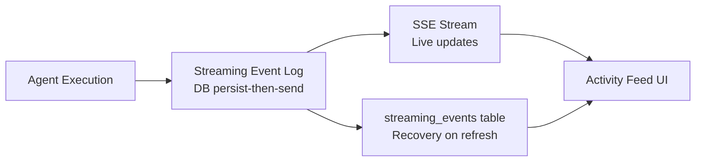

## Overview

The activity feed is Astro's window into what agents are doing. Every event emitted during task execution — LLM output tokens, tool calls, file changes, approval requests, and steering messages — is streamed live to the UI and persisted to the database so that nothing is lost on page refresh.



---

## Event Types

The activity feed tracks two categories of events:

### Execution Events (Agent-side)

| Event Type | Description |
|------------|-------------|
| `text` | LLM output tokens — the agent's reasoning and responses |
| `tool_use` | Agent calls a tool (e.g., `bash`, `edit`, `read`) |
| `tool_result` | Result returned from a tool call |
| `file_change` | File created, modified, or deleted (with diff) |
| `progress` | Progress percentage and message |
| `init` | Execution started — machine, provider, compute backend |
| `session_init` | Claude session initialized — session ID and model |
| `result` | Final execution result — status, summary, PR URL |
| `error` | Execution error — message and recoverability |
| `steer_message` | User sent a steering message mid-execution |
| `approval_request` | Agent asked a question via `ask_user_question` |
| `approval_response` | User responded to an approval request |

### Project-Level Activity Events

Separate from execution events, the activity store tracks higher-level project events:

| Event Type | Description |
|------------|-------------|
| `task.created` | New task added to the plan |
| `task.started` | Task dispatched to an agent |
| `task.completed` | Task marked complete |
| `task.failed` | Task execution failed |
| `task.cancelled` | Task cancelled |
| `project.created` | Project created |
| `project.updated` | Project settings changed |
| `plan.refined` | AI refined the plan |
| `milestone.created` | Milestone added |
| `milestone.updated` | Milestone updated |
| `milestone.deleted` | Milestone removed |
| `vision.updated` | Vision document updated |
| `repo.configured` | Repository or working directory set |

---

## Activity Blocks

Events are grouped and rendered as **Display Blocks** in the UI. The `groupActivityEvents()` function coalesces related events into structured blocks:

| Block Type | Events Grouped | Display |
|-----------|----------------|---------|
| `TextBlock` | Consecutive `text` events | Streamed markdown |
| `ToolBlock` | `tool_use` + `tool_result` pair | Collapsible tool call with input/output |
| `ToolGroupBlock` | Multiple consecutive tool calls | Expandable grouped view |
| `FileChangeBlock` | `file_change` events | Diff view with lines added/removed |
| `ApprovalBlock` | `approval_request` + response | Inline approval card |
| `SteerBlock` | `steer_message` | User message in thread |
| `ErrorBlock` | `error` events | Error message with recovery hint |

### Using Activity Blocks in Code

```typescript
import { groupActivityEvents } from "@/components/activity-blocks"
import type { TaskActivityEvent } from "@/types"

// Group raw events into display blocks
const displayBlocks = groupActivityEvents(activityEvents)

// Render blocks
displayBlocks.forEach(block => {
  switch (block.type) {
    case 'text': return <TextBlock block={block} />
    case 'tool': return <ToolBlock block={block} />
    case 'file_change': return <FileChangeBlock block={block} />
    // ...
  }
})
```

---

## Real-Time Streaming

During active execution, events stream to the browser via **Server-Sent Events (SSE)**. The SSE connection is opened when you navigate to a task's detail page and closed when you leave.

### Persist-Then-Send Pattern

Every event is written to the `streaming_events` table **before** being sent via SSE:

```
Agent emits event
    ↓
streamingEventLog.append(executionId, eventType, data)
    ↓ (writes to DB, returns seq number)
stream.writeSSE({ id: String(seq), event, data })
    ↓
Browser receives event
```

This guarantee means: if the browser receives an event, it's already in the database. If the write fails, the SSE event is never sent — no data visible to the user that isn't recoverable.

### Text Batching

LLM tokens arrive one at a time. To avoid overwhelming the database, Astro batches text:

1. `appendText()` accumulates tokens in an in-memory buffer
2. Before any structural event, `flushText()` writes one consolidated `text` row
3. On stream abort (page navigation), `flushText()` is called to prevent data loss

---

## Page Refresh Recovery

Astro survives page refreshes without losing execution state. The recovery system uses two layers:

```
┌─────────────────────────────────────────────────────┐
│  Layer 1: Live SSE                                  │
│  EventSource → realtime-store / execution-store     │
│  (in-memory, fast, lost on refresh)                 │
├─────────────────────────────────────────────────────┤
│  Layer 2: streaming_events table                    │
│  Append-only log, seq-indexed, survives refresh     │
└─────────────────────────────────────────────────────┘
```

### How Recovery Works

On page load, the `useRestoredExecution` hook:

1. Detects tasks still in `in_progress` or `awaiting_approval` status
2. Fetches all persisted events from `streaming_events` via `fetchStreamingEventsCatchUp()`
3. Hydrates the activity feed from the DB events (same rendering pipeline as live events)
4. Reconnects the SSE stream with a `Last-Event-ID` header pointing to the last known sequence

This means a page refresh during a 30-minute agent execution shows the complete history — not a blank screen.

### SSE Reconnect with Catch-Up

If the SSE connection drops mid-stream, the browser automatically reconnects. The `Last-Event-ID` header tells the server which sequence number was last received. The server replays all missed events in order before resuming the live stream.

```
Browser reconnects with Last-Event-ID: 47
    ↓
Server queries: SELECT * FROM streaming_events WHERE seq > 47 ORDER BY seq
    ↓
Sends missed events 48, 49, 50...
    ↓
Resumes live stream
```

---

## Project Activity Feed

The project overview page shows a summarized activity feed of project-level events (not execution events). This is managed by the `activity-store` (Zustand), which:

- Keeps the last 1,000 activities per project
- Persists via `dataClient` → `/api/data/*` → Drizzle ORM
- Provides project-filtered queries

### Adding Activity Events

```typescript
import { useActivityStore } from "@/stores/activity-store"

const addActivity = useActivityStore((s) => s.addActivity)

addActivity({
  projectId: project.id,
  type: "milestone.created",
  title: "Created milestone: MVP Launch",
  description: "Complete core features for initial release",
  nodeId: milestoneId, // optional — links to a plan node
})
```

### Querying Recent Activity

```typescript
const recentActivities = useActivityStore((s) =>
  s.getProjectActivities(projectId, 5)
)
```

The activity dialog supports filtering by category (Tasks, Project, Milestones, Resources) and shows up to 100 entries with relative timestamps.

---

## Persisted Events Reference

| Event Type | Persisted | Notes |
|------------|-----------|-------|
| `init` | Yes | Execution context |
| `text` | Yes (batched) | Concatenated LLM output |
| `session_init` | Yes | Session and model info |
| `progress` | Yes | Progress percentage |
| `tool_use` | Yes | Tool name and input |
| `tool_result` | Yes | Tool output and success |
| `file_change` | Yes | Path, action, diff |
| `result` | Yes | Final status and summary |
| `approval_request` | Yes | Question and options |
| `approval_response` | Yes | User's answer |
| `steer_message` | Yes | User steering input |
| `error` | Yes | Error message |
| `heartbeat` | No | SSE keepalive only |
| `done` | No | Stream termination signal |
| `aborted` | No | Flows through `result` with failure status |

---

## Troubleshooting

| Symptom | Cause | Fix |
|---------|-------|-----|
| Activity feed blank after refresh | Hydration failed | Check `streaming_events` table for the `executionId` |
| Duplicate events appearing | SSE reconnect overlap | Deduplication by `seq` should handle; check `useRestoredExecution` |
| Old events missing from feed | Text buffer not flushed | Check `streamingEventLog.flushText()` is called on stream close |
| Events visible but status stuck | `result` event not persisted | Verify persistence pipeline includes `result` event type |
