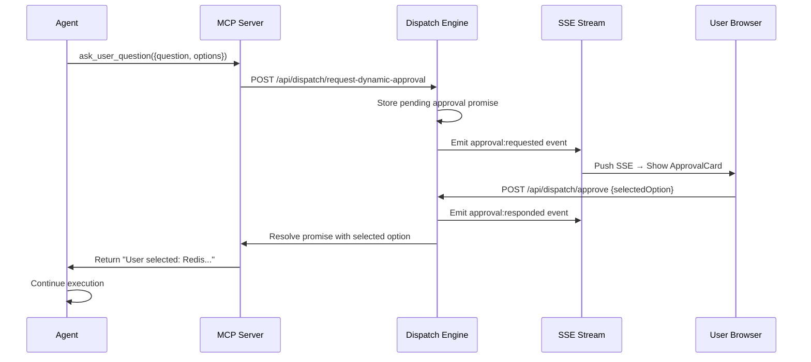

## Overview

The approval system lets agents pause execution when they encounter decisions that require human input. Instead of making assumptions or blocking indefinitely, the agent presents options to the user and waits for a response before continuing.

There are three complementary patterns for incorporating user decisions:

<CardGroup cols={3}>
  <Card title="Dynamic Tool Approvals" icon="bolt">
    Agent calls `ask_user_question` at runtime when it discovers an unexpected decision point
  </Card>
  <Card title="Procedure-Level Gates" icon="shield">
    Predefined approval checkpoints in structured workflows — always pauses at known decision points
  </Card>
  <Card title="Agent-Driven Decisions" icon="robot">
    Agent notes options and proceeds with a recommendation; user steers via chat if needed
  </Card>
</CardGroup>

---

## Dynamic Tool-Based Approvals

The most flexible pattern: the agent calls the `ask_user_question` MCP tool whenever it encounters a decision during execution. Execution pauses until the user responds.

**When to use:**
- Multiple implementation approaches are equally valid
- Architectural decisions that depend on user preferences
- Trade-offs where priorities aren't clear from context

**How it works:**

```javascript
// Agent calls during execution:
ask_user_question({
  question: "Which database should we use for caching?",
  options: [
    "Redis (fast, in-memory, requires separate service)",
    "SQLite (embedded, simple, slower at scale)",
    "PostgreSQL (consistent with main DB, more overhead)"
  ]
})

// → Task status changes to awaiting_approval
// → User sees approval card in dashboard or task detail
// → User selects an option
// → Tool returns: "User selected: Redis (fast, in-memory, requires separate service)"
// → Execution resumes with the user's choice
```

### Approval Flow



The task's status is set to `awaiting_approval` during the pause, making the pending decision visible anywhere in the UI.

---

## Procedure-Level Approvals

Predefined approval gates embedded in structured workflow definitions. The procedure specifies exactly where to pause and what choices to present.

**When to use:**
- Multi-step workflows with known decision points
- Critical operations that should never run automatically (e.g., deploy to production)
- Structured processes where stakeholder sign-off is required

### Binary Approval

A simple approve/reject gate with no options:

```typescript
{
  name: 'deploy',
  promptTemplate: 'Create and merge PR for production deployment.',
  requiresApproval: true,
  approvalMessage: 'Approve deployment to production?',
  // No approvalOptions → binary approve/reject
}
```

User sees:

```
┌─────────────────────────────────────────────────┐
│  ⚠️  Approval Required                          │
│                                                  │
│  Approve deployment to production?               │
│                                                  │
│              [Reject]    [Approve]               │
└─────────────────────────────────────────────────┘
```

### Multi-Choice Approval

Present 2–5 options. The selected option is injected as `{{approvalResult}}` into subsequent subroutine prompts:

```typescript
{
  name: 'choose-architecture',
  promptTemplate: 'Implement using: {{approvalResult}}',
  requiresApproval: true,
  approvalMessage: 'Which database should we use?',
  approvalOptions: [
    'PostgreSQL (relational, ACID compliance)',
    'MongoDB (flexible schema, horizontal scaling)',
    'SQLite (embedded, zero-config)',
  ],
}
```

User sees:

```
┌─────────────────────────────────────────────────┐
│  ⚠️  Approval Required                          │
│                                                  │
│  Which database should we use?                   │
│                                                  │
│  ○ PostgreSQL (relational, ACID compliance)      │
│  ○ MongoDB (flexible schema, horizontal scaling) │
│  ○ SQLite (embedded, zero-config)                │
│                                                  │
│              [Cancel]    [Confirm]               │
└─────────────────────────────────────────────────┘
```

### Full Procedure Example

```typescript
{
  name: 'feature-implementation',
  subroutines: [
    {
      name: 'plan',
      promptTemplate: 'Analyze the codebase and identify 2-3 implementation approaches.',
      singleTurn: true,
    },
    {
      name: 'choose-approach',
      promptTemplate: 'Implement the feature using: {{approvalResult}}',
      requiresApproval: true,
      approvalMessage: 'Which implementation approach should I use?',
      approvalOptions: [
        'Approach 1: Minimal change to existing code',
        'Approach 2: Refactor for cleaner architecture',
        'Approach 3: Build new abstraction layer',
      ],
    },
    {
      name: 'implement',
      promptTemplate: 'Implement the chosen approach with full test coverage.',
      usesValidationLoop: true,
      validationCommand: 'npm test',
    },
  ],
}
```

---

## Agent-Driven Decisions

The lightest-weight pattern: the agent notes decision points in its output and proceeds with a recommendation. No execution pause required.

The agent is guided via system prompt to:
- List options with explicit trade-offs
- State a clear recommendation
- Proceed unless the user steers otherwise via chat

**Example agent output:**

```
I need to choose a state management solution for the new feature.

Options:
1. Zustand — Lightweight (2KB), already used in the project, simple API
2. Redux Toolkit — More structured, better DevTools, steeper learning curve
3. React Context — Native, no dependencies, but more boilerplate

Recommendation: Zustand, since it's already used elsewhere in the codebase.
Proceeding unless you'd like a different approach.
```

The user can:
- Do nothing and let the agent continue
- Send a steering message: "Actually, use Redux Toolkit for better debugging"
- The agent receives the message and adjusts course

---

## User Interface

### Dashboard (Needs Attention)

Pending approvals surface in the **Needs Attention** section of the dashboard. Each pending approval shows:
- Task name and project
- The approval question
- Radio buttons (multi-choice) or Approve/Reject buttons (binary)

### Task Detail Page

When viewing a task in `awaiting_approval` status, the `ApprovalCard` appears at the top of the page above the activity feed. Submitting the approval immediately resumes execution.

### Real-Time Notifications

SSE events push approval requests to all connected browser tabs for the current user. You do not need to be on the specific task page to receive incoming approval requests.

---

## Status Reference

| Status | Description |
|--------|-------------|
| `planned` | Ready to execute |
| `dispatched` | Sent to agent |
| `in_progress` | Agent actively working |
| `awaiting_approval` | **Paused** — waiting for user response |
| `awaiting_judgment` | Completed — needs human review |
| `auto_verified` | Completed — tests passed |
| `completed` | Done and accepted |
| `pruned` | Branch cut |

<Note>
Approval requests time out after **5 minutes** by default. If no response is received, the execution fails with a timeout error and the task transitions to an error state.
</Note>

---

## API Reference

### Submit an Approval Response

```http
POST /api/dispatch/approve
Authorization: Bearer <token>
Content-Type: application/json

{
  "approvalId": "approval-node123-1234567890",
  "approved": true,
  "selectedOption": "Approach 2: Refactor for cleaner architecture"
}
```

Response:
```json
{ "success": true }
```

---

## Choosing the Right Pattern

| Scenario | Recommended Pattern |
|----------|-------------------|
| Agent discovers an unexpected choice mid-execution | Dynamic tool (`ask_user_question`) |
| Known "deploy to prod?" gate in a workflow | Procedure-level binary approval |
| Architecture decision the agent can recommend | Agent-driven decision |
| High-stakes choice the user must own | Procedure-level multi-choice |
| Blocking confirmation before a destructive action | Procedure-level binary approval |
