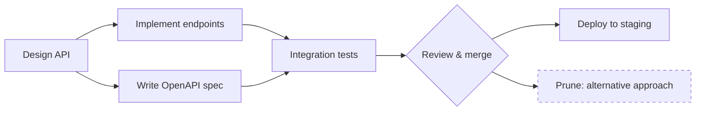

## Overview

The plan graph is Astro's core data model — a **directed acyclic graph (DAG)** of tasks, milestones, and decisions. Unlike flat issue lists, the graph explicitly encodes:

- **Linear sequences** — Task A must complete before Task B starts
- **Branching exploration** — Multiple parallel hypothesis branches running simultaneously
- **Merging paths** — Results from multiple tasks feeding into a single downstream task
- **Decision points** — Nodes where human judgment determines which branch continues



---

## Node Types

Every node in the graph has a **type** that controls how it appears, how it's dispatched, and how it's verified.

| Type | Description | Verification |
|------|-------------|-------------|
| `task` | Unit of executable work dispatched to an agent | Auto or human |
| `milestone` | Checkpoint marking a significant deliverable | Human judgment |
| `branch` | Parallel exploration branch (speculative) | Auto when children complete |
| `decision` | Decision point requiring human choice | Human judgment always |

### Task Nodes

Tasks are the primary unit of work. Each task carries:

- **Title** — Short, actionable description
- **Description** — Full context injected into the agent's execution prompt
- **Priority** — `critical`, `high`, `normal`, or `low`
- **Estimate** — Size: `XS`, `S`, `M`, `L`, or `XL`
- **Environment** — `local`, `remote`, `hpc`, or `cloud`
- **Verification** — `auto` (tests pass) or `human` (requires judgment)
- **Due date** — Optional target date (`YYYY-MM-DD`)

### Milestone Nodes

Milestones group related tasks into a deliverable checkpoint. They appear in the timeline view and track progress toward larger goals. Associate tasks with a milestone via the `milestoneId` field.

---

## Edge Types

Edges connect nodes and define execution ordering.

| Type | Description |
|------|-------------|
| `dependency` | Target cannot start until source reaches a terminal status |
| `branch` | Marks the start of a speculative or parallel branch |

A task with multiple incoming edges is blocked until **all** predecessors reach a terminal status (`completed`, `auto_verified`, or `pruned`).

---

## Task Status Lifecycle

Tasks move through a well-defined state machine:

```
planned → dispatched → in_progress → auto_verified → completed
                                   ↘               ↗
                                     awaiting_approval
                                     awaiting_judgment

planned → pruned   (branch cut)
```

| Status | Description |
|--------|-------------|
| `planned` | Created, not yet dispatched |
| `dispatched` | Sent to agent runner, queued for execution |
| `in_progress` | Agent actively working |
| `awaiting_approval` | Paused — agent called `ask_user_question`, waiting for user response |
| `awaiting_judgment` | Completed — awaiting human review before closing |
| `auto_verified` | Completed — validation command (e.g., `npm test`) passed automatically |
| `completed` | Done and accepted |
| `pruned` | Branch was cut; task will not execute |

---

## Graph Operations

### Adding Nodes

Use the **+** button in the plan view toolbar, or right-click empty canvas space. You can also type in the chat panel to ask the AI to add tasks to the plan.

When creating a task, you can immediately set dependencies by connecting it to existing nodes in the graph.

### Creating Dependencies

Hover over any task node to reveal **connection handles** on the edges. Drag from a source node's handle to a target node to create a dependency edge.

Agents can also programmatically create dependencies during execution via the [MCP `create_dependency` tool](/features/mcp-tools).

### Editing Nodes

Click any node to open its detail panel. From there you can edit:
- Title and description
- Priority, estimate, and due date
- Verification method and execution environment

### Branch Pruning

Right-click any task or milestone → **Prune Branch**. This:

1. Sets the task status to `pruned`
2. Recursively prunes all downstream dependents
3. Cancels any running executions in the pruned subtree
4. Preserves the pruned history for future reference

<Warning>
Pruning cascades — all downstream tasks are pruned automatically. To restore a pruned task, manually set its status back to `planned` from the detail panel.
</Warning>

---

## Verification Tiers

Astro uses a **tiered verification** model to decide when human attention is required.

### Auto-Verification

Tasks with `verification: "auto"` close automatically when a validation command passes (e.g., `npm test`, `pytest`). No human review required.

```typescript
{
  name: 'run-tests',
  promptTemplate: 'Run the test suite and fix any failures.',
  usesValidationLoop: true,
  validationCommand: 'npm test',
}
```

The agent will retry until the validation command exits with code 0 — or until a timeout is reached.

### Human Judgment

Tasks with `verification: "human"` move to `awaiting_judgment` when the agent reports completion. A human must review the output and explicitly mark the task `completed`.

Use human verification for:
- Product or design decisions ("Does this look right?")
- Security-sensitive changes
- Cases where automated test coverage is insufficient

### Decision Nodes

Decision nodes (`type: "decision"`) always require human judgment. They represent explicit branching points where the plan cannot proceed automatically. The plan is blocked at a decision node until a human selects a branch.

---

## Graph Visualization

The plan graph renders via `@xyflow/react` (React Flow). Interactive controls:

| Action | How |
|--------|-----|
| Pan | Click and drag on empty canvas |
| Zoom | Scroll wheel or pinch gesture |
| Select node | Click on node |
| Multi-select | Shift+click or drag selection box |
| Open detail panel | Click on node |
| Context menu | Right-click on node |
| Fit to screen | Press `F` or use the toolbar button |

### Layout Modes

- **Graph view** (default) — Nodes positioned in a directed layout; drag to rearrange
- **Timeline view** — Gantt-style layout on a date axis

Switch with **View → Timeline** in the toolbar. In timeline view, tasks are positioned by their `startDate`/`endDate`. Tasks without explicit dates fall back to topological-sort positioning.

---

## AI-Assisted Planning

When you create a new project, Astro's AI generates an initial plan graph by decomposing your vision document. The AI:

1. Reads your project description and vision doc
2. Generates tasks with dependencies in the correct order
3. Assigns estimates (`XS`–`XL`) and start/end dates
4. Streams the plan directly into the graph view

You can refine the plan anytime via the **chat panel** in plan view — ask the AI to add tasks, split a task into subtasks, or reorganize dependencies.

---

## Exporting & Importing Plans

Plans can be exported as `.astro.json` files for sharing or version control.

**Export** (from Plan View header → Export):
- Strips execution state and machine-specific paths
- Resets all statuses to `planned`
- Downloads as `{project-name}.astro.json`

**Import** (from Projects page → Import):
- Generates new UUIDs for all nodes and edges
- Remaps all dependency references automatically
- Reports warnings for any unmapped references

This makes it easy to share plan templates with teammates or fork community plans from the marketplace.
