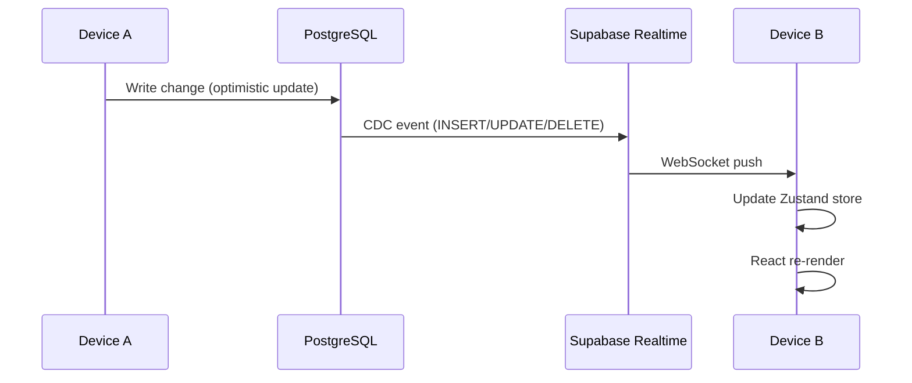

## Overview

Real-time sync enables automatic synchronization of data across multiple devices for the same user. When you make a change on one device, it appears on your other devices within ~120–450ms — no page refresh required.

The system uses **Supabase Realtime** (PostgreSQL Change Data Capture over WebSockets) to propagate database changes to all connected clients.



**End-to-end latency:** ~120–450ms from action to cross-device update.

<Note>
Real-time sync is automatically disabled in local mode (PGlite, no Supabase). It activates when users authenticate in Dev or Production mode.
</Note>

---

## Subscribed Tables

Astro maintains real-time subscriptions on the following tables:

| Table | Events | Scope | Description |
|-------|--------|-------|-------------|
| `projects` | INSERT, UPDATE, DELETE | Own + shared projects | Full project sync |
| `plan_nodes` | INSERT, UPDATE, DELETE | Accessible projects | Task and milestone sync |
| `plan_edges` | INSERT, UPDATE, DELETE | Accessible projects | Dependency graph sync |
| `user_profiles` | INSERT, UPDATE | Own profile only | User settings |
| `display_settings` | INSERT, UPDATE | Per-user per-view | UI preferences |
| `task_chat_sessions` | INSERT, UPDATE, DELETE | Own sessions | Chat session metadata |
| `task_chat_messages` | INSERT, UPDATE | Own sessions | Chat messages |

All subscriptions respect Row-Level Security (RLS). Users only receive events for data they are permitted to access.

---

## Data Flow

### Optimistic Updates

Zustand stores apply changes **optimistically** before the API call completes:

```
User action
  → Zustand store update (immediate, local)
  → API call to /api/data/*
  → PostgreSQL write
  → Supabase CDC event
  → Realtime push to other devices
  → Other devices update their Zustand stores
```

The local device doesn't wait for the Supabase event because it already applied the optimistic update.

### Preventing Infinite Loops

When the local device receives its own CDC event (Supabase sends events to all subscribers, including the writer), the sync handler uses direct `setState()` instead of calling store action methods:

```typescript
// Good: direct state update — no API call triggered
case 'UPDATE':
  const project = mapProject(payload.new)
  const store = useProjectStore.getState()
  const updated = store.projects.map(p => p.id === project.id ? project : p)
  useProjectStore.setState({ projects: updated })

// Bad: would trigger another API write → infinite loop
case 'UPDATE':
  useProjectStore.getState().updateProject(project) // ❌ triggers API call
```

### Deduplication

Optimistic updates mean the local device already has the change in memory. When the CDC event arrives, the handler checks for existing records before inserting:

```typescript
case 'INSERT':
  const node = mapNode(payload.new)
  const store = usePlanStore.getState()
  if (!store.nodes.some(n => n.id === node.id)) {
    usePlanStore.setState({ nodes: [...store.nodes, node] })
  }
```

### Field Mapping

The database uses `snake_case` column names; the frontend uses `camelCase`. Mapping functions (`mapNode()`, `mapProject()`, etc.) handle the conversion automatically.

---

## Lifecycle

### Setup (on authentication)

1. User signs in via WebAuthn/passkey
2. `auth-store.initialize()` detects the authenticated session
3. `setupRealtimeSync()` is called
4. Seven Supabase channels are created (one per table)
5. INSERT/UPDATE/DELETE handlers are registered for each channel

### Teardown (on sign-out)

1. `auth-store.signOut()` calls `teardownRealtimeSync()`
2. All active channels are removed via `supabase.removeChannel()`
3. Client state is cleared and `realtimeSyncEnabled` is set to `false`

### Reconnection

Supabase Realtime handles reconnection automatically with exponential backoff. Events missed during a disconnect are **not replayed** — if you need to catch up after a lengthy disconnect, refresh the page to trigger a full data load.

---

## Configuration

### Environment Variables

```bash
VITE_SUPABASE_URL=https://your-project.supabase.co
VITE_SUPABASE_ANON_KEY=eyJhbGc...  # Public anon key (RLS enforced)
VITE_ASTRO_LOCAL_MODE=true         # Set to disable real-time sync
```

### Database Setup

Tables must be included in the `supabase_realtime` publication:

```sql
-- Verify tables are published
SELECT tablename
FROM pg_publication_tables
WHERE pubname = 'supabase_realtime';

-- Expected output includes:
-- projects, plan_nodes, plan_edges, task_executions,
-- user_profiles, display_settings, task_chat_sessions, task_chat_messages
```

---

## Performance

| Metric | Value |
|--------|-------|
| Idle bandwidth | ~1–2 KB/s (heartbeats) |
| Active editing | ~5–10 KB/s |
| Per-event payload | ~200–500 bytes |
| Memory overhead | ~100 KB (7 subscriptions) |
| Per-event CPU | ~5–10 ms |
| End-to-end latency | 120–450 ms |

---

## Debugging

### Check Sync Status

```typescript
import { isRealtimeSyncEnabled, getClientId } from '@/lib/realtime-sync'

console.log('Sync enabled:', isRealtimeSyncEnabled())
console.log('Client ID:', getClientId())
```

### Subscription Status (Browser Console)

When sync is active, you'll see these log lines:

```
[realtime-sync] projects subscription status: SUBSCRIBED
[realtime-sync] plan_nodes subscription status: SUBSCRIBED
[realtime-sync] plan_edges subscription status: SUBSCRIBED
...
```

| Status | Meaning |
|--------|---------|
| `SUBSCRIBED` | Healthy, receiving events |
| `TIMED_OUT` | Network issue — reconnecting |
| `CLOSED` | Auth issue — check JWT |
| `CHANNEL_ERROR` | Subscription error — check server logs |

### Troubleshooting

| Problem | Cause | Fix |
|---------|-------|-----|
| No updates appearing on Device B | Sync not enabled or auth issue | Check env vars; verify not in local mode |
| Duplicate items appearing | Deduplication logic not matching | Verify `id` field mapping in `mapNode()`/`mapProject()` |
| Stale data after reconnect | Missed events not replayed | Refresh page or call `store.load()` to re-fetch from API |
| High bandwidth usage | Channel leak — setup called multiple times | Ensure `teardownRealtimeSync()` is called before re-setup |

---

## Conflict Resolution

Astro currently uses **last-write-wins** for all tables. If two devices write to the same field simultaneously, the later write wins. There is no operational transform or merge strategy.

**Planned improvements:**
- Operational Transform for text fields (e.g., task descriptions)
- Presence tracking (see who else is viewing a project)
- Conflict resolution UI for simultaneous edits
- Selective sync (subscribe only to currently open projects)

---

## Security

All Supabase Realtime subscriptions use the same JWT token as REST API calls. Row-Level Security policies on each table ensure that:

- Users only receive CDC events for rows they can `SELECT`
- Team members only see projects their team owns or has been shared with
- Private projects are never broadcast to other users
