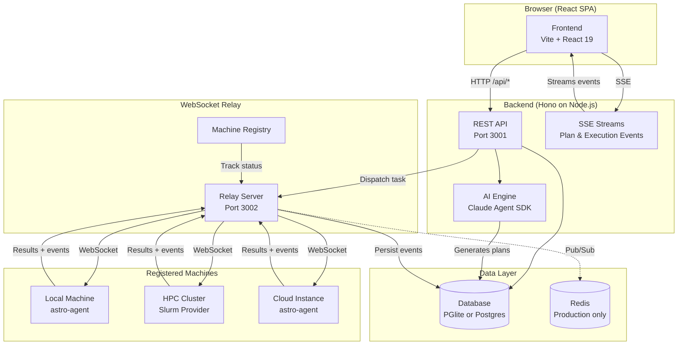
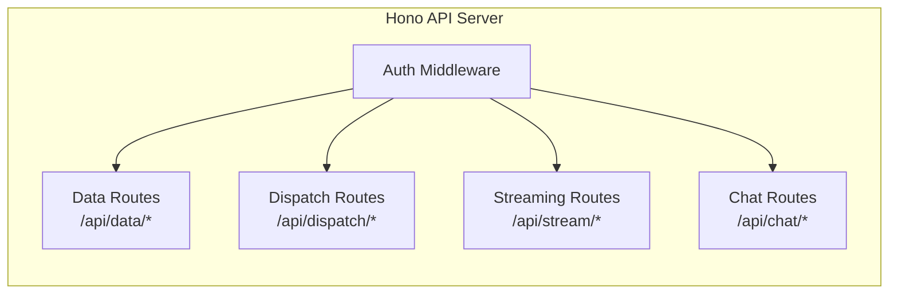
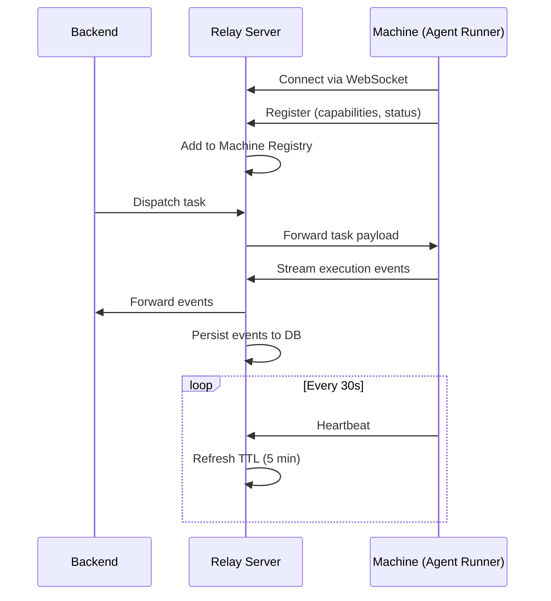

Astro is composed of four main components that work together to turn high-level goals into executed tasks. This page gives you a bird's-eye view of how they connect.

## System Architecture

## Component Breakdown

### Frontend

The frontend is a React 19 single-page application built with Vite, using Tailwind CSS for styling and Zustand for state management.

| Technology | Purpose |
|-----------|---------|
| **React 19** | UI framework |
| **Vite 7** | Build tool and dev server (port 5173) |
| **Tailwind CSS v4** | Utility-first styling |
| **Zustand 5** | State management with ~29 stores |
| **@xyflow/react** | Plan graph visualization (React Flow) |
| **cmdk** | Command palette |

The frontend communicates with the backend exclusively through HTTP (`/api/*` endpoints) and Server-Sent Events (SSE) for real-time streaming. In development, Vite proxies `/api` requests to `localhost:3001`.

### Backend

The backend is a Hono.js application running on Node.js (port 3001). It handles API requests, AI plan generation, and event persistence.

Key responsibilities:
- **Data API** — CRUD operations for projects, plan nodes, edges, executions, and all other entities via `/api/data/*`
- **Plan generation** — Uses the Claude Agent SDK to decompose goals into plan graphs
- **Task dispatch** — Routes tasks to registered machines via the relay server
- **Event streaming** — Delivers real-time SSE events for plan generation and task execution
- **Event persistence** — Stores all streaming events in the `streaming_events` table for recovery

<Note>
  The backend is **stateless by design**. No per-request or per-session state is stored in memory. All persistent state lives in the database or Redis. This allows Fly.io to run multiple instances with round-robin load balancing.
</Note>

### Relay Server

The relay server (port 3002) maintains persistent WebSocket connections to registered machines. It acts as a communication hub between the backend and agent runners.

The relay handles:
- **Machine registration** — Machines connect and advertise their capabilities
- **Task routing** — The backend tells the relay which machine should receive a task
- **Event forwarding** — Execution events flow from machines through the relay to the backend and frontend
- **Health monitoring** — Heartbeat checks with a 5-minute TTL detect disconnected machines

In production, **Redis pub/sub** coordinates multiple relay instances. In local development, a single relay instance handles everything without Redis.

### Agent Runner

The agent runner (`astro-agent`) is a lightweight process that runs on each registered machine. It:

1. Connects to the relay server via WebSocket
2. Receives task dispatch payloads
3. Sets up an isolated workspace (git worktree by default)
4. Launches an AI agent (e.g., Claude Code) with the assembled context
5. Streams execution events back through the relay
6. Reports results and usage metrics

The agent runner is **agent-agnostic** — it wraps existing AI agents rather than implementing its own. This means you get the latest capabilities of tools like Claude Code without waiting for Astro to update.

## Data Flow

Here's how a typical task moves through the system from creation to completion:

<Steps>

### You create a project

You describe your goal in the frontend. The backend sends it to Claude via the Agent SDK, which generates a plan graph (nodes + edges). The graph is stored in the database and rendered in the frontend.

### You dispatch a task

You click "Dispatch" on a plan node. The backend checks that all dependencies are satisfied, selects a machine from the registry, and sends the task payload to the relay server.

### The agent executes

The relay forwards the task to the registered machine. The agent runner sets up a workspace, launches the AI agent with your vision document and dependency context, and begins execution.

### Events stream back

As the agent works, execution events (text, tool calls, file changes) stream from the machine → relay → backend → frontend via SSE. Events are simultaneously persisted to the `streaming_events` table.

### You verify the result

When execution completes, the task enters verification. If automated checks pass (tests, build), it auto-closes. Otherwise, you review the result and approve or reject it.

</Steps>

## Database Layer

Astro uses **Drizzle ORM** with two database backends:

| Mode | Database | Notes |
|------|----------|-------|
| **Local** | PGlite (Postgres-in-WASM) | Runs in the backend process, persists to `~/.astro/pglite/` |
| **Dev / Prod** | PostgreSQL (via Supabase) | Full Postgres with RLS, Realtime, and Auth |

Both backends share the same Drizzle schema (`packages/core/src/db/schema.ts`), so your code works identically across modes.

Key tables:

| Table | Purpose |
|-------|---------|
| `projects` | Project metadata and vision documents |
| `plan_nodes` | Individual tasks, milestones, and decisions |
| `plan_edges` | Dependencies between nodes |
| `task_executions` | Execution records with status and output |
| `streaming_events` | Persisted SSE events for recovery |
| `registered_machines` | Machine registry (authoritative store) |
| `teams` / `team_members` | Multi-user team management |

## Lazy Loading

Astro uses a two-phase loading strategy to keep the UI responsive:

| Phase | When | What Loads | What's Excluded |
|-------|------|-----------|----------------|
| **Slim global** | App startup | All projects, plan nodes (metadata), executions (metadata) | `content`, `executionOutput`, `streamText` |
| **Full per-project** | User opens a project | Full plan nodes + full executions for that project | Nothing |

This means the dashboard loads fast even with hundreds of projects, and full content is only fetched when you drill into a specific project.

## Next Steps

<CardGroup cols={2}>
  <Card title="Frontend Architecture" icon="browser" href="/architecture/frontend">
    Deep dive into React components, stores, and routing.
  </Card>
  <Card title="Backend Architecture" icon="server" href="/architecture/backend">
    API routes, middleware, and the dispatch engine.
  </Card>
  <Card title="Relay Server" icon="tower-broadcast" href="/architecture/relay-server">
    WebSocket relay, machine registry, and Redis coordination.
  </Card>
  <Card title="Data Model" icon="database" href="/architecture/data-model">
    Complete schema reference with all tables and relationships.
  </Card>
</CardGroup>
