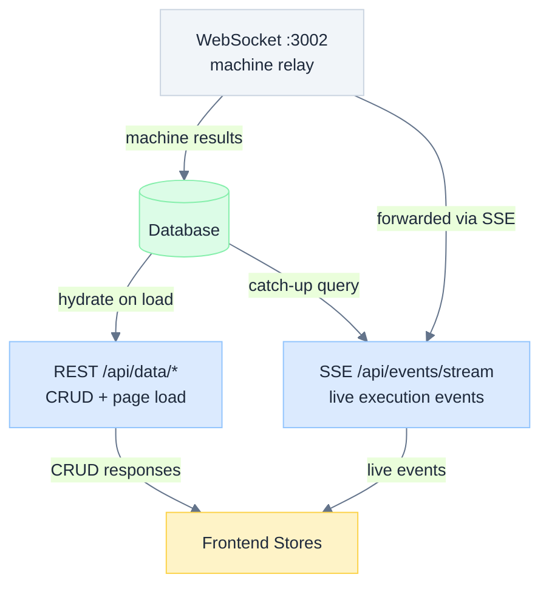

# Data Persistence & Recovery

How Astro ensures no data is lost when browsers refresh, networks drop, or servers restart.

## Ground Truth: The Database

Every piece of user-facing state in Astro is backed by the database. The database is the **single source of truth** regardless of operating mode:

| Mode | Database | Storage | Multi-user |
|------|----------|---------|-----------|
| Local | PGlite (Postgres-in-WASM) | `~/.astro/pglite/` on disk | No |
| Dev | Local Supabase (Docker) | Docker volume | Yes (with RLS) |
| Production | Remote Supabase PostgreSQL | Cloud | Yes (with RLS) |

All three modes use identical Drizzle ORM schemas and the same application code. The only difference is the database driver.

## Three Delivery Channels

Data reaches the browser through three channels, each with different characteristics:



### Channel 1: REST (HTTP)

**Used for**: Creating/reading/updating/deleting projects, plan nodes, edges, settings, profiles.

**Recovery**: Idempotent. Refresh the page and all stores re-hydrate from the database.

**Key files**: `src/lib/data-client.ts` → `server/routes/data.ts` → `packages/core/src/db/schema.ts`

### Channel 2: SSE (Server-Sent Events)

**Used for**: Live streaming during task execution, AI chat, machine status updates.

**Recovery**: Events persisted to `streaming_events` table. On reconnect, client fetches missed events via the catch-up API.

**Key files**: `src/lib/sse-parser.ts` → `server/routes/events.ts` → `server/lib/streaming-event-log.ts`

### Channel 3: WebSocket (Machine Relay)

**Used for**: Backend ↔ Agent Runner communication. Not directly visible to the browser.

**Recovery**: Machines reconnect automatically. Queued tasks re-dispatch on reconnect.

**Key files**: `server/lib/relay-server.ts` → `server/lib/dispatch/dispatch-engine.ts`

## The Streaming Events Table

The critical piece that makes recovery work is the `streaming_events` table — an append-only log of every execution event:

```sql
streaming_events
├── seq           INTEGER  (auto-incrementing, immutable)
├── execution_id  TEXT     (which execution)
├── event_type    TEXT     (init, text, tool_use, tool_result, file_change, result, ...)
├── data          JSONB    (event payload)
└── created_at    TIMESTAMP
```

**Index**: `(execution_id, seq)` — allows fast range queries for catch-up.

### How Persistence Works

```
Machine sends event via WebSocket
    ↓
Backend receives event
    ├─ StreamingEventLog.append()  →  INSERT INTO streaming_events
    ├─ EventBuffer.push()          →  in-memory ring buffer
    └─ SSE.write()                 →  push to connected browser
```

Text events are **batched**: consecutive `text` events accumulate in memory and flush as a single row at structural boundaries (tool calls, file changes). This keeps the table compact.

### How Catch-Up Works

```
Browser reconnects after SSE drop
    ↓
GET /api/events/catch-up?executionIds=X,Y&afterSeq=123&limit=2000
    ↓
Backend:
  SELECT * FROM streaming_events
  WHERE execution_id IN ('X', 'Y') AND seq > 123
  ORDER BY seq LIMIT 2000
    ↓
Response: { events: [...], lastSeq: 456, hasMore: false }
    ↓
Frontend: hydrateStreamingEvents(events)
  ├─ Reconstruct stdout from 'text' events
  ├─ Pair tool_use ↔ tool_result by name
  ├─ Extract file changes and approvals
  └─ Merge with existing store state
```

## Recovery Scenarios

### Page Refresh (F5)

1. Page loads → `DataLoader` fetches all stores via REST (projects, plan nodes, executions, chat)
2. `useRestoredExecution()` hook detects `executionId` on nodes but no live SSE data
3. Calls catch-up API → hydrates full execution timeline from `streaming_events`
4. UI renders as if the user never left
5. If task is still running: re-opens SSE stream for live events

### Network Hiccup

1. SSE `EventSource` fires error event
2. `execution-store` tracks reconnect attempts with exponential backoff
3. On reconnect: sends `afterSeq` from last received event
4. Backend responds with only the missed events
5. No duplicates (seq is monotonically increasing)

### Server Restart

1. All SSE connections drop simultaneously
2. Same recovery as network hiccup — clients reconnect with `afterSeq`
3. Events persisted to DB survive the restart
4. Any in-memory state (EventBuffer ring buffer) is lost, but DB has everything

### Machine Goes Offline

1. Relay detects heartbeat timeout
2. Emits `machine:disconnected` to all SSE clients
3. Running task stays in `running` status (machine may come back)
4. If machine reconnects: re-registers, queued tasks re-dispatch
5. If timeout exceeded: task marked `failure` with descriptive error

### Multi-Instance Production

1. Task dispatched on Instance A, SSE served by Instance B
2. Instance A persists events to shared PostgreSQL
3. Instance A publishes to Redis Pub/Sub → Instance B forwards to SSE
4. If Instance B restarts: client reconnects (may hit Instance C)
5. Instance C serves catch-up from same shared PostgreSQL — no data loss

## Consistency Guarantees

| Guarantee | How |
|-----------|-----|
| No lost events | Every event INSERTed to `streaming_events` before SSE delivery |
| No duplicates | `seq` column provides total ordering; client tracks `lastSeq` |
| Ordering preserved | `seq` is `GENERATED ALWAYS AS IDENTITY` — monotonically increasing |
| Cross-instance consistency | All instances read/write same PostgreSQL (or same PGlite file) |
| Team isolation | `teamScopeFilter()` on every REST query; RLS policies in production |

## Index Coverage

All tables have database indexes for their primary query patterns. This is critical for PGlite (local mode) which only gets indexes defined in the Drizzle schema.

The `tests/index-drift.test.ts` verifies that every Drizzle index has a matching Supabase migration index, and vice versa. The `tests/schema-drift.test.ts` verifies table/column parity.

See `docs/design/DATA_FLOW.md` for the complete data flow architecture and `docs/design/DATA_MODEL.md` for table definitions.
