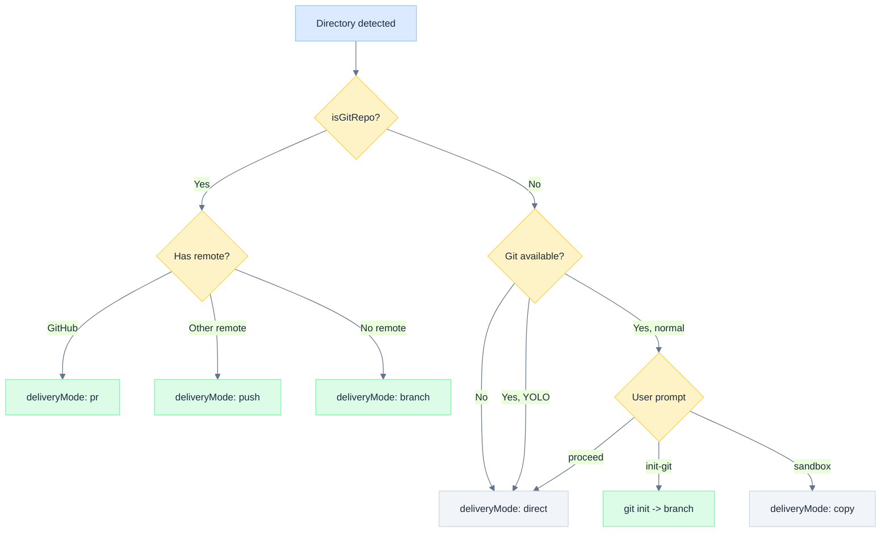
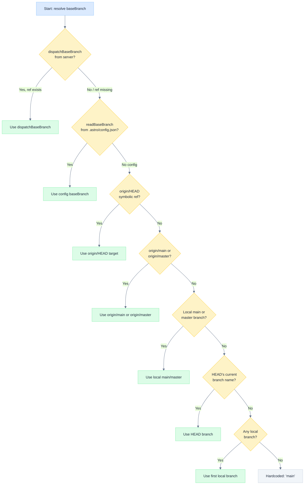
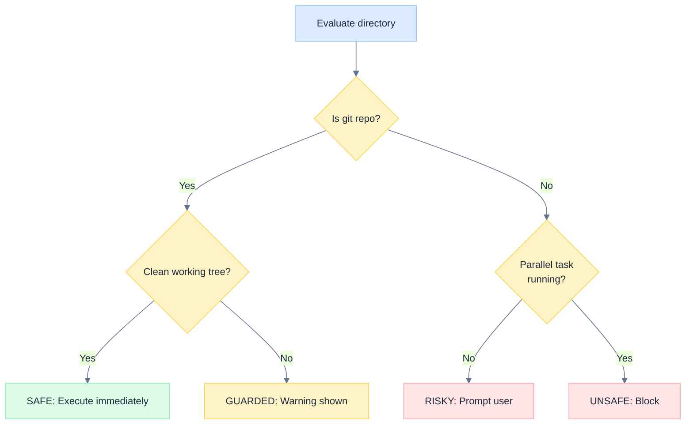
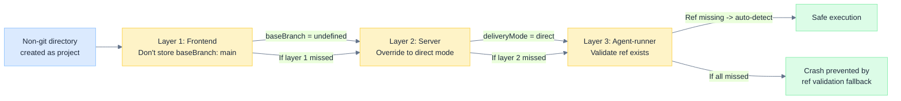
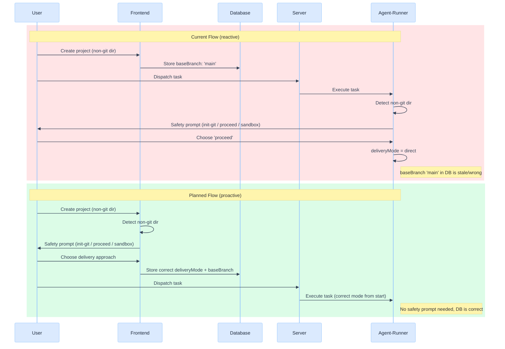

# Delivery Mode Safety

> How Astro selects delivery mode and baseBranch for task execution, with defense-in-depth against non-git directory crashes.

---

## Problem

When creating a project pointing at a non-git directory, the frontend stores `baseBranch: 'main'` as a default. The agent-runner trusts this value without validation. If the directory later gains a git repo (via agent `git init` or safety `init-git`) with a non-standard default branch, `git branch astro/<id> main` crashes because `main` doesn't exist.

The delivery mode override (safety decision to direct mode) doesn't fire for builtin templates because they skip the safety prompt, so `approvedSafetyDirs` is never populated.

---

## Delivery Mode Decision Matrix

| Directory State | Git Available | YOLO Mode | Delivery Mode | baseBranch | Parallel Tasks |
|---|---|---|---|---|---|
| Git repo with remote (GitHub) | Yes | N/A | `pr` | Auto-detected | Yes (worktrees) |
| Git repo with remote (other) | Yes | N/A | `push` | Auto-detected | Yes (worktrees) |
| Git repo, local only | Yes | N/A | `branch` | Auto-detected | Yes (worktrees) |
| Git repo, uncommitted changes | Yes | N/A | `branch` (warned) | Auto-detected | Yes if worktree, No otherwise |
| Non-git dir, normal mode | Yes | Off | Prompt -> `direct` or init-git | Set after init / undefined | Depends on choice |
| Non-git dir, YOLO mode | Yes | On | `direct` (auto) | undefined | No (serial lock) |
| Non-git dir, no git binary | No | N/A | `direct` (auto) | undefined | No (serial lock) |
| Builtin template, non-git | Yes | N/A | `direct` (recommended) | undefined | No (serial lock) |

### Decision Flowchart



---

## baseBranch Resolution Chain

The agent-runner resolves the base branch through a prioritized chain defined in `worktree.ts`. Each step falls through to the next if it cannot produce a valid ref:

```
dispatchBaseBranch (from server, NOW VALIDATED -- ref must exist)
  | (if ref doesn't exist, discard)
readBaseBranch (from .astro/config.json)
  | (if no config)
getDefaultBranch auto-detection:
  1. origin/HEAD symbolic ref
  2. origin/main or origin/master
  3. Local main or master branch
  4. HEAD's current branch name
  5. Any local branch (first found) <-- NEW
  6. 'main' (hardcoded last resort)
```

### Resolution Flowchart



---

## Safety Tier System

| Tier | Condition | Behavior |
|---|---|---|
| SAFE | Git repo, clean working tree | Execute immediately, worktree isolation |
| GUARDED | Git repo, uncommitted changes | Warning shown, proceed with worktree |
| RISKY | Non-git directory | Prompt: init-git / proceed / sandbox / cancel |
| UNSAFE | Non-git + parallel task running | Block until current task completes |

### Safety Tier Flowchart



---

## Three-Layer Defense

| Layer | Location | What it prevents |
|---|---|---|
| Frontend | `project-new-plan.tsx` | Don't store `baseBranch: 'main'` for non-git dirs |
| Server | `dispatch.ts` | Override delivery mode when safety decision = 'proceed' |
| Agent-runner | `worktree.ts` | Validate baseBranch ref exists before using it |

Any single layer prevents the crash. All three together provide defense-in-depth.

### Defense-in-Depth Diagram



---

## Planned Improvement: Upfront Safety Decision

**Current flow:** Create project -> dispatch task -> agent-runner safety check -> user decides

**Problem:** baseBranch already stored in DB, builtin templates skip safety check

**Planned flow:** Create project -> detect non-git dir -> prompt user upfront -> store correct deliveryMode + baseBranch

**Benefits:** Decision before any dispatch, correct DB state, YOLO auto-direct

### Current vs. Planned Flow



---

## Edge Cases

- **Agent creates git repo during execution** -- Directory state changes mid-project. The safety tier evaluated at dispatch time no longer reflects reality. Subsequent tasks should re-evaluate.
- **Server restart** -- `approvedSafetyDirs` cache cleared. The delivery mode override doesn't fire for existing projects that previously had safety decisions. Must rely on agent-runner validation layer.
- **Stale DB data from before fix** -- Projects created before the three-layer defense was implemented may have `baseBranch: 'main'` for non-git dirs. The agent-runner validates the ref and falls back to auto-detect.
- **Builtin templates** -- `skipSafetyCheck=true` means the safety decision is never cached in `approvedSafetyDirs`. The server-layer override never fires. Must rely on agent-runner validation as the last line of defense.
- **Race condition on parallel dispatch** -- Two tasks dispatched simultaneously for a non-git dir could both attempt to `git init`. The serial lock (UNSAFE tier) prevents this.
- **Worktree cleanup failure** -- If a worktree branch is left behind from a crashed task, the next task may fail to create a worktree with the same name. The agent-runner implements force-remove + prune as a fallback cleanup path.

---

## Key Files

| File | Role |
|---|---|
| `server/routes/dispatch.ts` | Dispatch pipeline, delivery mode resolution, safety cache |
| `packages/agent-runner/src/lib/worktree.ts` | baseBranch validation, worktree creation |
| `packages/agent-runner/src/lib/workdir-safety.ts` | Safety tier detection |
| `packages/agent-runner/src/lib/task-executor.ts` | Workspace preparation, delivery mode handling |
| `src/pages/project-new-plan.tsx` | Project creation, baseBranch default |
| `src/lib/project-source.ts` | ProjectSource resolution |

---

*See also: WORKSPACE_V2.md | SAFETY_CHECK.md | YOLO_MODE.md | GIT_WORKTREE.md | EXECUTION_GUARDRAILS.md*
