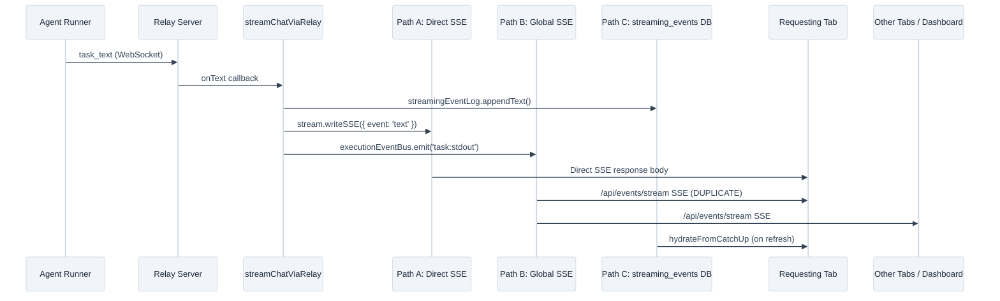
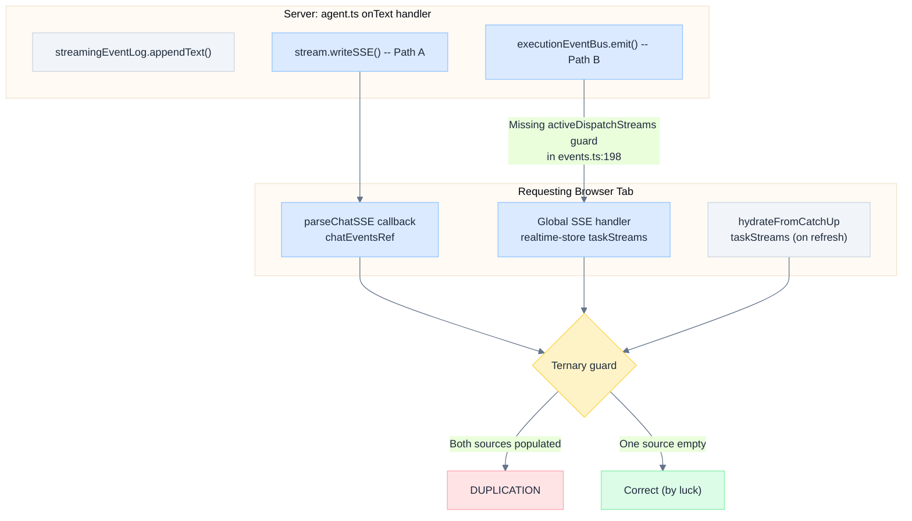
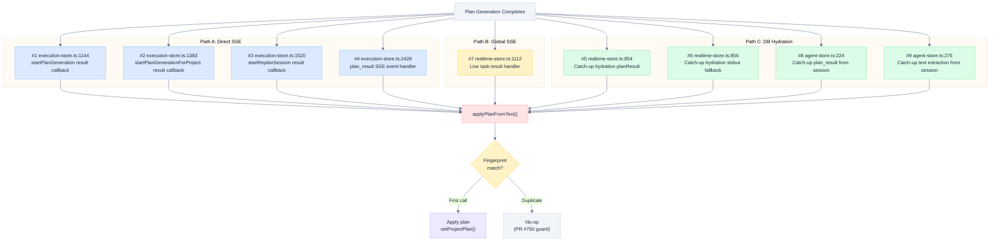
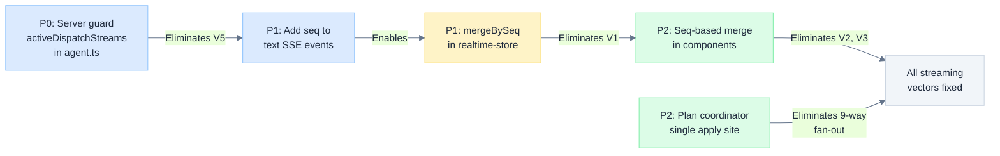

# Event Duplication Analysis

> Deep dive into why streaming events and plan applications are duplicated, tracing the three parallel event delivery pathways from server to UI, the missing deduplication guards, and the `applyPlanFromText` fan-out problem.

---

## Overview

Astro's streaming architecture delivers agent events (text, tool calls, file changes, plan results) through **three parallel pathways** from server to browser. Each pathway serves a different consumer and exists for a legitimate reason. Duplication occurs because the pathways were not designed with mutual exclusion -- the same browser tab receives events from multiple paths simultaneously, and the client-side merge logic uses fragile heuristics (timestamps, ternary guards) instead of stable identity-based deduplication.

Two distinct duplication problems exist:

1. **Streaming event duplication** (Issue #757): Text blocks, tool calls, and file changes appear twice in the activity timeline.
2. **Plan application duplication** (PR #750): `applyPlanFromText()` is called up to 9 times for the same plan, creating duplicate milestones.

Both stem from the same architectural root: events fan out through multiple paths and converge on the same consumer without coordination.

---

## The Three Event Pathways



### Path A: Direct SSE Response

| Property | Value |
|----------|-------|
| Server code | `stream.writeSSE()` in `server/routes/agent.ts:152` |
| Transport | HTTP response body of the initiating POST request |
| Client consumer | `parseChatSSE` callbacks in execution-store |
| Scope | Single browser tab that initiated the request |
| Lifetime | Lives and dies with the HTTP request |
| Error handling | `catch(() => { alive = false })` -- request-scoped |

**Why it exists:** SSE is a request/response pattern. When the browser `POST`s to `/api/agent/plan-chat`, the response body IS the event stream. The calling code needs direct callbacks for error handling, `AbortController` abort, and the `done` event to know when streaming ends. A broadcast channel cannot provide request-scoped error handling or abort semantics.

### Path B: Global SSE via executionEventBus

| Property | Value |
|----------|-------|
| Server code | `executionEventBus.emit('task:stdout')` in `server/routes/agent.ts:153` |
| Transport | Long-lived `EventSource` connected to `GET /api/events/stream` |
| Client consumer | `realtime-store.ts` global SSE handler |
| Scope | All authenticated clients for the user/team |
| Lifetime | Persistent connection, survives individual requests |
| Error handling | `EventSource.onerror` with reconnect backoff |

**Why it exists:** Other consumers need to know what is happening. The dashboard "Active Tasks" view, the sidebar execution badge, and team members watching the same project -- none of these initiated the request. They are connected via the long-lived `/api/events/stream` EventSource. Without Path B, only the tab that started the task would see anything.

### Path C: streaming_events DB Persistence

| Property | Value |
|----------|-------|
| Server code | `streamingEventLog.appendText()` in `server/routes/agent.ts:151` |
| Transport | DB insert, fetched via `GET /api/events/catch-up` on demand |
| Client consumer | `hydrateFromCatchUp` in `realtime-store.ts` |
| Scope | Permanent record (7-day retention) |
| Lifetime | Survives page refresh, app kill, network death |
| Error handling | Persist-then-send pattern guarantees durability |

**Why it exists:** The browser is unreliable. Page refresh, tab close, network blip, mobile app suspend -- all kill Paths A and B. The only way to recover is from durable storage. The `streaming_events` table is the source of truth for reconstruction.

### Consumer Requirement Matrix

| Consumer | Needs Path A | Needs Path B | Needs Path C |
|----------|:---:|:---:|:---:|
| Requesting tab (live streaming) | **Yes** | No | No |
| Dashboard / other tabs (live) | No | **Yes** | No |
| Team members watching project | No | **Yes** | No |
| Same tab after page refresh | No | No | **Yes** |
| Mobile app after suspend | No | No | **Yes** |
| New device opening execution | No | No | **Yes** |

**The three paths cannot be collapsed into one** because they serve fundamentally different consumers with different lifetime requirements. The problem is not that three paths exist -- it is that **two paths deliver to the same consumer simultaneously** during live streaming.

---

## Why Duplication Happens

### The Server-Side Emission Pattern

Every event handler in `streamChatViaRelay` (`server/routes/agent.ts`) emits to all three paths unconditionally:

```typescript
// server/routes/agent.ts:148-153
const onText = (msg: TaskTextMessage) => {
  if (!alive || msg.taskId !== opts.taskId) return
  lastActivity = Date.now()
  streamingEventLog.appendText(persistId, msg.text)       // Path C: DB
  stream.writeSSE({ event: 'text', data: msg.text })      // Path A: Direct SSE
  executionEventBus.emit('task:stdout', { ... })           // Path B: Global SSE
}
```

The same pattern repeats for `onToolTrace` (line 219-238), `onFileChange` (line 240-260), and `onSessionInit` (line 262+). Every event type is triple-emitted.

### The Missing Guard

The server has a mechanism to prevent duplication: `activeDispatchStreams`. When a direct SSE stream (Path A) is active, relay-direct handlers in `events.ts` skip events for that task:

```typescript
// server/routes/events.ts:496-501 -- relay-direct handlers HAVE the guard
const onRelayText = (msg: TaskTextMessage) => {
  if (!alive || activeDispatchStreams.has(msg.taskId)) return  // GUARDED
  if (!isTaskOwnedByUser(msg.taskId)) return
  throttle.write(msg.taskId, msg.text)
}
```

But the `executionEventBus`-sourced handlers at lines 198-258 do **NOT** have this guard:

```typescript
// server/routes/events.ts:198-202 -- executionEventBus handlers LACK the guard
const onTaskStdout = (msg: TaskStdoutMessage) => {
  if (!alive) return                                        // NO activeDispatchStreams check
  if (!isTaskOwnedByUser(msg.output.taskId)) return
  throttle.write(msg.output.taskId, msg.output.data)
}
```

The same missing guard affects all four `executionEventBus` handlers:

| Handler | Line | Has `activeDispatchStreams` guard? |
|---------|------|:---:|
| `onTaskStdout` | `events.ts:198` | **No** |
| `onTaskToolTrace` | `events.ts:229` | **No** |
| `onTaskFileChange` | `events.ts:244` | **No** |
| `onTaskSessionInit` | `events.ts:259` | **No** |
| `onRelayText` | `events.ts:496` | Yes |
| `onRelaySessionInit` | `events.ts:502` | Yes |
| `onRelayToolTrace` | `events.ts:520` | Yes |
| `onRelayFileChange` | `events.ts:533` | Yes |

**Result:** During live streaming, the requesting browser tab receives every event twice -- once via Path A (direct SSE response) and once via Path B (global SSE via `executionEventBus`).

### The Fragile Client-Side Guards

The client attempts to prevent duplicate rendering through three mechanisms, all of which are unreliable.

#### Guard 1: Ternary Source Selection

```typescript
// src/components/plan-generation/plan-generation.tsx:177
const chatEvents = chatEventsRef.current.length > 0
  ? chatEventsRef.current    // Path A events
  : hydratedChatEvents       // Path B+C events
```

```typescript
// src/pages/playground.tsx:307-311
const chatEvents = liveChatEvents.length > 0
  ? liveChatEvents           // Path B: global SSE -> realtime store
  : chatEventsRef.current.length > 0
    ? chatEventsRef.current  // Path A: direct SSE callbacks
    : hydratedChatEvents     // Path C: DB hydration
```

These ternaries pick **one source at a time**, hiding duplication when the chosen source has data. But they are race conditions:

- Between `flushChatEvents()` and the next render, `chatEventsRef` briefly empties, falling through to the Path B data
- After page refresh, global SSE reconnect races against DB hydration -- both populate their respective sources during a window where the other is empty
- The `activityEvents` from `useRestoredExecution` can overlap with `chatEvents` when both derive from the same streaming events via different paths

#### Guard 2: Timestamp-Based Merge

```typescript
// src/stores/realtime-store.ts:765-780
function mergeByTimestamp<T extends { timestamp: Date }>(
  hydrated: T[],
  live: T[],
): T[] {
  const lastHydratedTime = new Date(hydrated[hydrated.length - 1].timestamp).getTime()
  const newLiveItems = live.filter(
    item => new Date(item.timestamp).getTime() > lastHydratedTime + 1000
  )
  return newLiveItems.length > 0 ? [...hydrated, ...newLiveItems] : hydrated
}
```

This uses a **1-second tolerance** -- events within 1 second of the last hydrated event are dropped. Problems:

- Events from different sources have fundamentally different timestamps (server-assigned vs client-assigned)
- Text events have **no unique ID** -- only `tool_use`, `tool_result`, and `file_change` get `seq` from the DB (via SSE `id` field)
- Two events 1.1 seconds apart are treated as distinct even if they are the same event from two paths
- Two legitimate distinct events within 1 second are incorrectly dropped



### The Five Duplication Vectors

| Vector | Location | Mechanism | Trigger |
|--------|----------|-----------|---------|
| V1 | `realtime-store.ts:537` | `mergeByTimestamp` 1s tolerance fails | Page refresh during streaming |
| V2 | `plan-generation.tsx:177` | Ternary race between `chatEventsRef` and `hydratedChatEvents` | Live streaming + render cycle |
| V3 | `playground.tsx:307-311` | Three-way ternary race | Live streaming + render cycle |
| V4 | `unified-activity-view.tsx:214-237` | Manual session message reconstruction overlaps with hydrated events | Page refresh in task detail |
| V5 | `agent.ts:148-153` | `executionEventBus.emit` has no `activeDispatchStreams` guard | Every live streaming session |

Vector 5 is the **root cause** that enables Vectors 1-4. If the server did not double-deliver events, the client-side guards would not need to exist.

---

## The `applyPlanFromText` 9 Call Sites Problem

When a plan generation session completes, the plan result is a terminal event that arrives through multiple paths. Every Zustand store that tracks execution state independently watches for this event and calls `applyPlanFromText()`:



### Complete Call Site Map

| # | File | Line | Path | Trigger | When Active |
|---|------|------|------|---------|-------------|
| 1 | `execution-store.ts` | 1144 | A | `result` SSE callback in `startPlanGeneration` | New project plan generation |
| 2 | `execution-store.ts` | 1383 | A | `result` SSE callback in `startPlanGenerationForProject` | Existing project plan generation |
| 3 | `execution-store.ts` | 1520 | A | `result` SSE callback in `startReplanSession` | Replan session |
| 4 | `execution-store.ts` | 2428 | A | `plan_result` SSE event in `processSSEStreamWithReconnect` | All plan sessions (structured result) |
| 5 | `realtime-store.ts` | 854 | C | `hydrateFromCatchUp` with `planResult` field | Page refresh after plan completes |
| 6 | `realtime-store.ts` | 856 | C | `hydrateFromCatchUp` stdout fallback (regex) | Page refresh when `planResult` missing |
| 7 | `realtime-store.ts` | 1112 | B | Live `task:result` global SSE handler | All plan sessions (live) |
| 8 | `agent-store.ts` | 224 | C | Catch-up recovery from session's `plan_result` events | Page refresh / agent-store mount |
| 9 | `agent-store.ts` | 276 | C | Catch-up recovery from session's accumulated text | Page refresh / agent-store mount |

### Why This Is a Design Flaw

This is not an inevitable consequence of the three-path architecture. It is a **missing abstraction**: there is no single "plan completed" coordinator on the client side.

Each Zustand store (`execution-store`, `realtime-store`, `agent-store`) independently:
1. Watches for plan completion via its own event path
2. Extracts the plan JSON
3. Calls `applyPlanFromText()` to apply it to `plan-store`

There is no shared knowledge of whether the plan has already been applied. The stores do not communicate through a coordinated event bus -- they each react to events from their own pathway independently.

**The fingerprint guard (PR #750) is a band-aid.** It works by detecting duplicate content at the `applyPlanFromText` function boundary:

```typescript
// src/lib/plan-extraction.ts:60-64
const fp = planFingerprint(planJson)
if (lastAppliedFingerprint.get(projectId) === fp) {
  return { applied: true, nodeCount: planJson.nodes.length }
}
```

This is compensating for a missing architectural layer. The 9 call sites still all fire, perform JSON extraction, build node arrays, and call the function -- only to be rejected at the gate. The redundant work is wasteful and the indirection makes the data flow hard to reason about.

### The Correct Pattern

A single coordinator should own plan application:

<details>
<summary>Text diagram</summary>

```
Current (9 independent consumers):

  execution-store ──────┐
  execution-store ──────┤
  execution-store ──────┤
  execution-store ──────┼──> applyPlanFromText() ──> plan-store
  realtime-store  ──────┤        (fingerprint gate rejects 8 of 9)
  realtime-store  ──────┤
  realtime-store  ──────┤
  agent-store     ──────┤
  agent-store     ──────┘

Proposed (single coordinator):

  execution-store ──┐
  realtime-store  ──┼──> planCompletionCoordinator ──> applyPlanFromText() ──> plan-store
  agent-store     ──┘        (first arrival wins,        (called exactly once)
                              emits 'plan:applied' event)
```

</details>

The coordinator would:
1. Accept "plan completed" signals from any store/path
2. Apply the plan exactly once (first arrival wins)
3. Emit a `plan:applied` event that other stores subscribe to for status updates
4. Reject subsequent signals for the same `projectId + executionId` pair

This eliminates the need for the fingerprint guard entirely and reduces the cognitive overhead from 9 interacting call sites to 1.

---

## The Fix

### P0: Server-Side -- Eliminate Double Delivery

Add the `activeDispatchStreams` guard to `executionEventBus.emit` calls in `agent.ts`, matching the pattern already used by relay-direct handlers in `events.ts`:

```typescript
// server/routes/agent.ts -- proposed fix for onText (line 148-154)
const onText = (msg: TaskTextMessage) => {
  if (!alive || msg.taskId !== opts.taskId) return
  lastActivity = Date.now()
  streamingEventLog.appendText(persistId, msg.text)
  stream.writeSSE({ event: 'text', data: msg.text }).catch(() => { alive = false })
  // Only emit to global bus if no active dispatch stream prevents double-delivery
  if (!activeDispatchStreams.has(opts.taskId)) {
    executionEventBus.emit('task:stdout', { output: { taskId: opts.taskId, data: msg.text, stream: 'stdout', timestamp: new Date() } })
  }
}
```

Apply the same guard to `onToolTrace` (line 228, 236), `onFileChange` (line 259), and `onSessionInit`.

**Impact:** Eliminates Vector 5 at the source. The requesting tab receives events via Path A only; other tabs receive via Path B only. No overlap.

**Risk:** If `activeDispatchStreams` is not cleaned up properly (e.g., server crash before `cleanupAll()`), Path B would stop delivering events for that task. Mitigated by the existing `stream.onAbort` cleanup in `agent.ts:308-312`.

### P1: Client-Side -- Replace Timestamp Merge with Seq-Based Merge

Replace `mergeByTimestamp` in `realtime-store.ts:765` with identity-based deduplication using the `seq` field from `streaming_events`:

```typescript
// Proposed replacement for mergeByTimestamp
function mergeBySeq<T extends { seq?: number; timestamp: Date }>(
  hydrated: T[],
  live: T[],
): T[] {
  if (live.length === 0) return hydrated
  if (hydrated.length === 0) return live

  const hydratedSeqs = new Set(
    hydrated.filter(e => e.seq != null).map(e => e.seq!)
  )
  const maxHydratedSeq = Math.max(...hydratedSeqs, 0)

  const newLive = live.filter(e =>
    e.seq == null || (!hydratedSeqs.has(e.seq) && e.seq > maxHydratedSeq)
  )

  return [...hydrated, ...newLive]
}
```

**Prerequisite:** Add `seq` field to `TaskActivityEvent` type. Extract it from the SSE event `id` field (already present for `tool_use`, `tool_result`, `file_change`; needs to be added for `text` events).

**Impact:** Eliminates Vector 1. Hydrated events (from DB) and live events (from SSE) are deduplicated by their stable DB sequence number instead of by fragile timestamp comparison.

### P2: Client-Side -- Consolidate Plan Application

Replace the 9 independent `applyPlanFromText` call sites with a single `planCompletionCoordinator`:

1. Create a `src/lib/plan-completion-coordinator.ts` module
2. Expose `onPlanCompleted(projectId, planJson, source)` -- applies once, rejects duplicates
3. Replace all 9 call sites with calls to `onPlanCompleted`
4. Remove the fingerprint guard from `applyPlanFromText` (the coordinator handles dedup)

**Impact:** Eliminates the 9-way fan-out, makes the data flow traceable, and removes the fingerprint band-aid.

### P2: Client-Side -- Replace Ternary Guards with Seq-Based Merge

Replace the ternary source-selection in `plan-generation.tsx:177` and `playground.tsx:307-311` with a unified merge that combines all sources and deduplicates by `seq`:

```typescript
// Proposed replacement for ternary guard
const allActivityEvents = useMemo(() => {
  const allSources = [
    ...chatEventsRef.current,
    ...liveChatEvents,
    ...hydratedChatEvents,
  ]
  return deduplicateBySeq([...activityEvents, ...allSources])
}, [activityEvents, chatEventsVersion, liveChatEvents, hydratedChatEvents])
```

**Impact:** Eliminates Vectors 2 and 3. No more race conditions between source selection.

---

## Fix Priority and Dependencies



| Priority | Change | Vectors Fixed | Risk |
|----------|--------|:---:|------|
| P0 | Add `activeDispatchStreams` guard to `executionEventBus.emit` calls in `agent.ts` | V5 | Low -- mirrors existing pattern in `events.ts` |
| P1 | Add `seq` to text SSE events; replace `mergeByTimestamp` with `mergeBySeq` | V1 | Medium -- requires `TaskActivityEvent` type change |
| P2 | Replace ternary guards with seq-based merge in components | V2, V3 | Medium -- UI behavior change requires testing |
| P2 | Consolidate `applyPlanFromText` to single coordinator | Plan duplication | Low -- pure refactor behind fingerprint guard |

---

## Key Files

> **Note:** The unified streaming pipeline (Phase 2) resolved many of the duplication vectors described here. See [`docs/design/UNIFIED_STREAMING_PIPELINE.md`](UNIFIED_STREAMING_PIPELINE.md) for the current architecture. The old dual-path SSE consumers (`src/lib/sse-parser.ts`, `src/hooks/use-restored-execution.ts`, `src/hooks/use-chat-activity-events.ts`, `src/hooks/use-chat-stream-events.ts`) have been removed and replaced by the unified `useStreamEvents()` hook. `server/lib/execution-context-store.ts` has been superseded by project-ownership SSE filtering.

| File | Role |
|------|------|
| `server/routes/agent.ts` | `streamChatViaRelay` -- server-side event emission |
| `server/routes/events.ts` | SSE endpoint with project-ownership filtering |
| `src/hooks/use-stream-events.ts` | **Unified hook** -- replaces old dual-path SSE consumers |
| `src/stores/realtime-store.ts` | Global SSE bus, taskStreams state |
| `src/stores/execution-store.ts` | Plan generation orchestration |
| `src/lib/plan-extraction.ts` | `applyPlanFromText` with fingerprint idempotency guard (PR #750) |
| `src/lib/streaming-event-hydrator.ts` | Hydrates `streaming_events` rows into typed activity events |

---

## Related

- [[Refresh Robustness]] (`docs/design/REFRESH_ROBUSTNESS.md`) -- Three-layer recovery architecture
- [[Streaming Events]] -- Event persistence contract and hydration
- Issue #757 -- Systematic event duplication across all AI streaming pathways
- Issue #706 -- Original report of text duplication after page refresh
- PR #750 -- Fingerprint-based plan application idempotency guard
- PR #734 -- Fixed primary duplication vector in `useRestoredExecution`

---

*Last updated: 2026-03-08*
