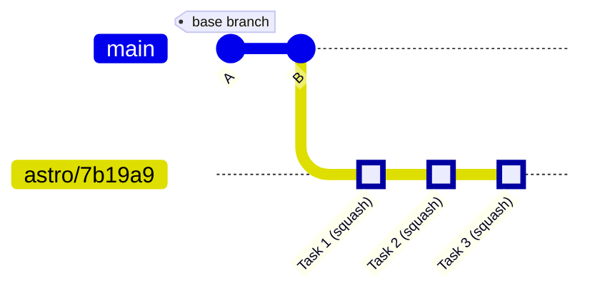
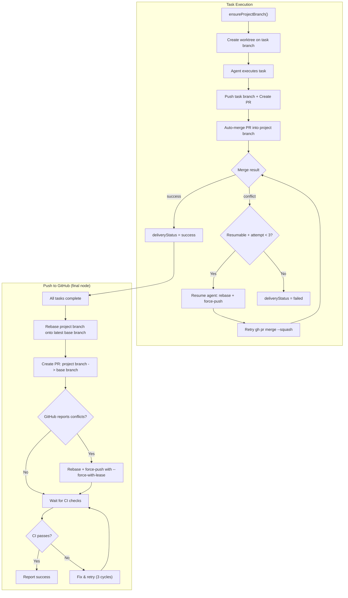
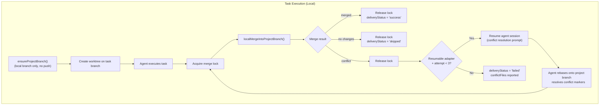
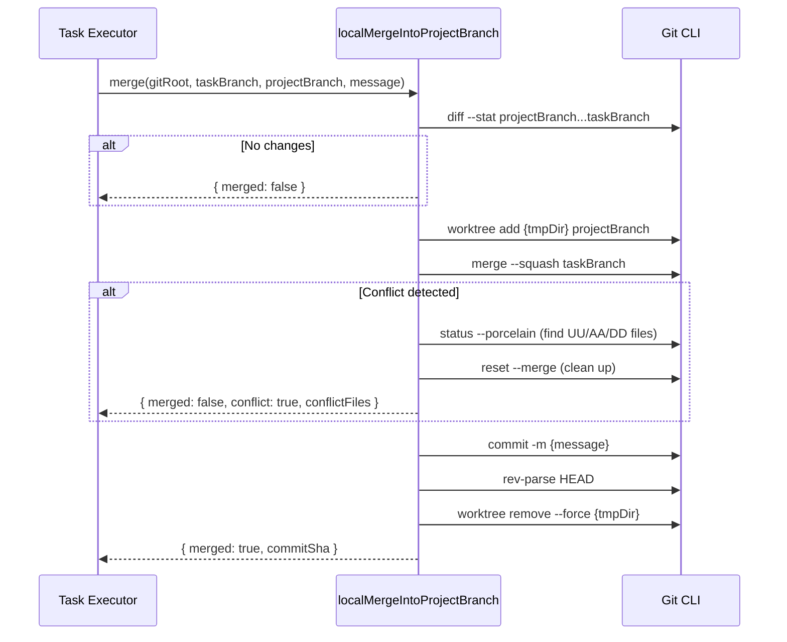
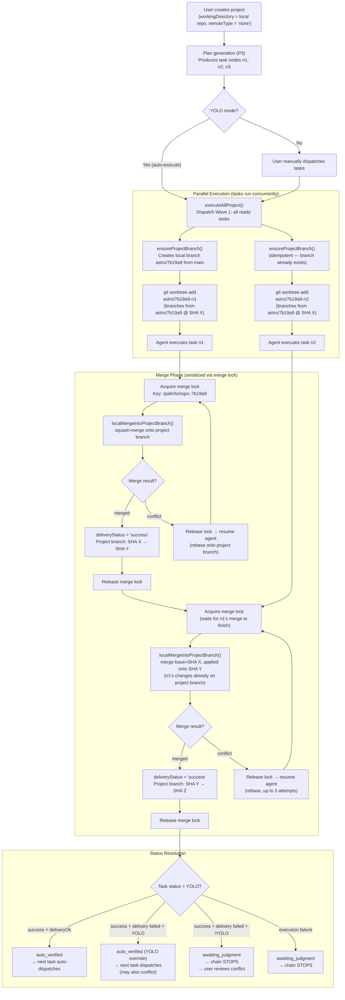
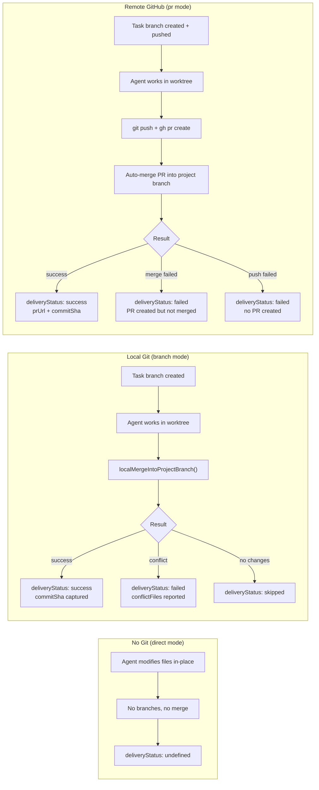
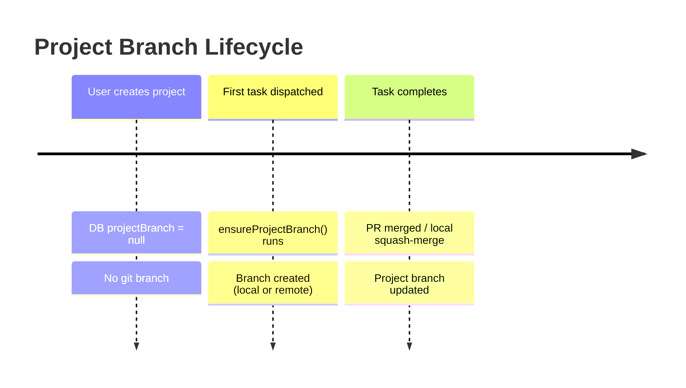
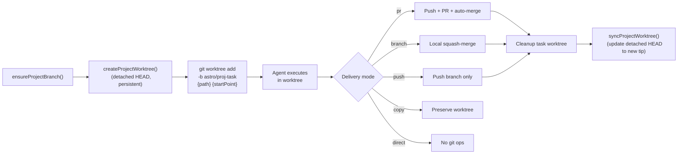
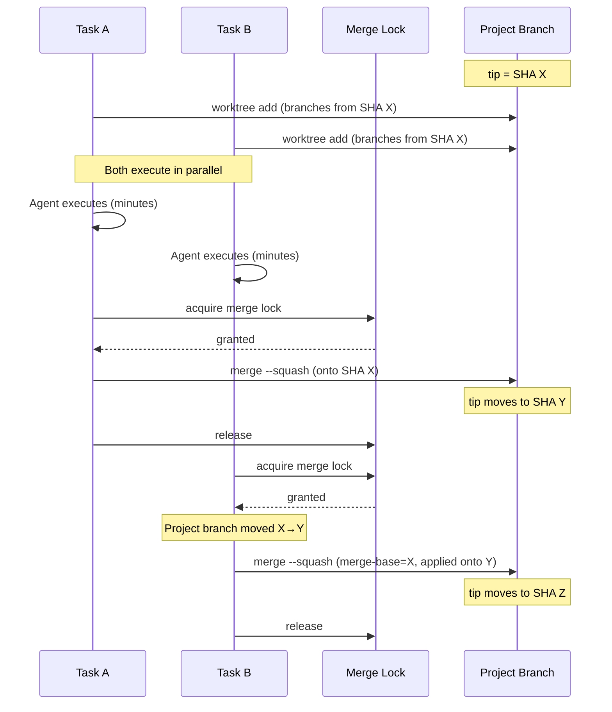

# Accumulative Project Branch Model

## Overview

Astro uses an **accumulative project branch model** for task delivery. All task work in a project is collected on a shared **project branch**. Each task creates a per-task branch, merges into the project branch, and subsequent tasks branch from the updated project branch tip — building on prior work.

The model supports two delivery backends:

| Backend | Trigger | Merge Mechanism | Push Node? |
|---------|---------|-----------------|------------|
| **GitHub** (`remoteType != 'none'`) | Repo has a remote (GitHub/GitLab/etc.) | Per-task PRs + auto-merge | Yes |
| **Local Git** (`remoteType == 'none'`) | Repo has no remote (`git init` only) | Local squash-merge via temp worktree | No |

Both backends share the same branch structure and worktree isolation — only the merge and delivery mechanism differs.

## Branch Structure



### Branch Naming

| Branch Type | Pattern | Example |
|-------------|---------|---------|
| Project branch | `astro/{shortProjectId}` | `astro/7b19a9` |
| Task branch | `astro/{shortProjectId}-{shortNodeId}` | `astro/7b19a9-n7` |

- `shortProjectId`: First 6 hex chars of the project UUID (after stripping hyphens)
- `shortNodeId`: Either `n{number}` (server-assigned node number) or last 6 hex chars of the node UUID
- `<base branch>`: Configured in project source settings (e.g., `main`, `develop`). Defaults to `main`.

## GitHub Mode (Remote Repos)

For repos with a remote, task branches create PRs against the project branch and auto-merge them. A final "Push to GitHub" task node opens a PR from the project branch to the base branch.



### Detailed Flow

```
<base branch> ──────────────────────────────────────── <base branch> (unchanged)
  |
  └── astro/7b19a9  (project branch, accumulates all task work)
        |
        ├── astro/7b19a9-n1  →  PR #1 → auto-merge → astro/7b19a9
        ├── astro/7b19a9-n2  →  PR #2 → auto-merge → astro/7b19a9
        ├── astro/7b19a9-n3  →  PR #3 → auto-merge → astro/7b19a9
        |
        └── "Push to GitHub" task  →  PR: astro/7b19a9 → <base branch>
```

### "Push to GitHub" Task Node

When a project has a GitHub repo configured (`githubOwner` + `githubRepo`), AI-generated plans include an explicit **"Push to GitHub"** task node. This node:

1. Is a regular `task` (type: `task`, not a milestone) — an agent executes it
2. Depends on ALL other task nodes (always the very last step)
3. Opens a PR from `astro/{shortProjectId}` → `<base branch>`
4. Waits for CI checks (tests, lint, AI code review) and fixes failures (up to 3 retry cycles)
5. Auto-wires when users add new tasks — new tasks become dependencies of the Push node
6. Is re-triggerable: users can reset and re-run after adding more tasks

When this node exists, the `project-completion-hook` is disabled to prevent duplicate PRs.

| Project Configuration | Push Node? |
|-----------------------|------------|
| GitHub repo configured (`githubOwner` + `githubRepo` set) | Yes |
| Local-only workdir (no GitHub repo) | No |
| Playground projects | No |

## Local Git Mode (No Remote)

For repos with no remote (`git init` only, `remoteType='none'`), the same accumulative branch model is used — but merges happen locally via `git merge --squash` in a temporary worktree, with no pushes or PRs.



### How Local Merge Works

The `localMergeIntoProjectBranch()` function performs a squash-merge without disturbing the user's main checkout or any existing worktrees:



Key design decisions:
- **Temporary worktree**: The merge happens in `.astro/tmp-merge/merge-{timestamp}`, never touching the user's working tree
- **Squash merge**: All task commits are squashed into a single commit on the project branch, keeping history clean
- **`reset --merge` for conflicts**: After a failed `merge --squash`, `merge --abort` does NOT work (no MERGE_HEAD). We use `git reset --merge` instead
- **No push**: `ensureProjectBranch()` detects the absence of remotes and creates the branch locally only
- **Project branch is the deliverable**: Unlike GitHub mode where the final PR merges into `main`, in local mode the project branch IS the deliverable. It is never deleted

### Local Mode E2E Example

```
Initial state:
  main ── A ── B

Task 1 dispatched:
  main ── A ── B
                |
                └── astro/7b19a9 (created from main)
                      |
                      └── astro/7b19a9-n1 (worktree)
                            Agent adds file-a.txt, commits

After Task 1 merge:
  main ── A ── B
                |
                └── astro/7b19a9 ── [squash: file-a.txt]
                      Task branch cleaned up

Task 2 dispatched (branches from updated project branch):
  main ── A ── B
                |
                └── astro/7b19a9 ── [squash: file-a.txt]
                      |
                      └── astro/7b19a9-n2 (worktree, has file-a.txt!)
                            Agent adds file-b.txt, commits

After Task 2 merge:
  main ── A ── B
                |
                └── astro/7b19a9 ── [squash: file-a.txt] ── [squash: file-b.txt]
                      Both task outputs accumulated
                      User can: git checkout astro/7b19a9

  main is UNTOUCHED — user inspects results on the project branch
```

### Branch Workflow: Complete Lifecycle (Local Git)

The following diagram shows the full lifecycle of branches in local git mode, including parallel task execution, merge-only locking, merge outcomes, and how delivery status feeds back into YOLO/non-YOLO auto-verification.



**Branch state after both tasks succeed:**

```
main ─── A ─── B                              (untouched)
               │
               └── astro/7b19a9               (project branch, accumulates work)
                     │
                     ├── [squash: n1 work]     (file-a.txt added)
                     │
                     └── [squash: n2 work]     (file-b.txt added, sees file-a.txt)
                           │
                           User inspects: git checkout astro/7b19a9
```

**Branch state after merge conflict on n2 (agent resolves):**

```
main ─── A ─── B                              (untouched)
               │
               └── astro/7b19a9               (project branch)
                     │
                     ├── [squash: n1 work]     (n1 merged first)
                     │
                     └── [squash: n2 work]     (n2 merged after agent resolved conflict)
                           Agent was resumed with conflict prompt,
                           rebased onto project branch, resolved markers,
                           merge retried successfully (attempt 2/3)
```

**Branch state after persistent conflict (3 failed attempts):**

```
main ─── A ─── B                              (untouched)
               │
               └── astro/7b19a9               (project branch)
                     │
                     └── [squash: n1 work]     (only n1 merged)
                           │
                           astro/7b19a9-n2     (task branch, NOT merged)
                                               conflict in: shared-file.ts
                                               deliveryStatus = 'failed'
                                               3 resolution attempts exhausted
                                               → planning problem, not execution
```

### Pre-Merge Rebase (Conflict Avoidance)

Before attempting the squash merge, `tryPreMergeRebase()` proactively rebases the task branch onto the latest project branch tip. This handles the common case where the project branch moved forward (another task merged) but changes don't overlap — the rebase succeeds silently and the subsequent merge is guaranteed clean.

```
Without pre-rebase:  merge → conflict → resume agent → rebase → retry merge
With pre-rebase:     rebase (auto) → merge (clean on first try)
```

**Branch mode:** `tryPreMergeRebase(workdir, projectBranch, false)` — local rebase before acquiring the merge lock.

**PR mode:** `tryPreMergeRebase(workdir, baseBranch, true)` — fetches from origin + rebases before the initial push. No force-push needed since the branch hasn't been pushed yet.

On any failure (conflicts or git errors), the rebase is silently aborted and the existing merge retry loop handles it. This is a best-effort optimization, not a required step.

### Merge Conflict Resolution (Agent Resume)

When a merge conflict is detected *after* the pre-rebase attempt, the agent session is **resumed** with conflict resolution instructions. The agent rebases onto the project branch, resolves conflict markers, and the merge is retried — up to 3 attempts (`MAX_MERGE_ATTEMPTS = 3`).

**Branch mode:** Merge lock released during resolution (agent may take minutes), re-acquired for each retry attempt. Agent runs `git rebase <projectBranch>`, resolves conflicts, then `git rebase --continue`.

**PR mode:** On `autoMergeFailed`, agent is resumed to `git rebase origin/<target>`, resolve conflicts, and `git push --force-with-lease`. Retry calls `mergePullRequest()` directly.

**"Push to GitHub" node:** The prompt explicitly instructs the agent to rebase the project branch onto the latest base branch before creating the PR, and to resolve conflicts if GitHub reports them after PR creation.

**Security:** Branch names and file paths in conflict resolution prompts are sanitized via `sanitizeGitRef()` to strip shell metacharacters before embedding in command examples (defense-in-depth).

All 4 providers support session resume via `isResumableAdapter()` — each implements `resumeTask()` and `getTaskContext()`. If the adapter is not resumable or has no active session, the executor falls back to immediate failure.

Persistent merge conflicts (3 failed attempts) indicate a **planning problem** — tasks were decomposed with overlapping changes. The correct response is to re-plan, not to keep retrying.

See `docs/design/MERGE_CONFLICT_RESOLUTION.md` for the full design with sequence diagrams and prompt examples.

### Three Delivery Scenarios Compared



### Differences from GitHub Mode

| Aspect | GitHub Mode | Local Git Mode |
|--------|-------------|----------------|
| `deliveryMode` | `pr` | `branch` |
| Merge mechanism | GitHub PR API + auto-merge | `git merge --squash` in temp worktree |
| `ensureProjectBranch()` | Creates branch + pushes to origin | Creates local branch only |
| `getDefaultBranch()` | Checks `origin/HEAD`, `origin/main`, `origin/master` | Also checks local branches and `HEAD` |
| `git fetch origin` | Fetches latest refs | Fails silently (no remote) |
| `deleteRemoteBranch()` | Deletes stale remote task branch | Fails silently (no remote) |
| Push node | Yes — creates final PR to base branch | No — project branch is the deliverable |
| Prompt injection | Includes "Push to GitHub" node instructions | Omits push instructions |
| `commitAfterSha` | Captured from remote after PR merge | Captured from local squash commit |

## Shared Infrastructure

Both modes share:

### Branch Creation Timing

The project branch is **lazily created** — it does NOT exist when the project is created in Astro. It only appears when the first task is dispatched for execution.



**Where `projectBranch` is computed and stored:**

1. **`dispatch.ts`** (server): Computes `projectBranch = astro/${shortProjectId}` when dispatching. Persists it to the `projects` table (idempotent — only sets if `projectBranch` is null).
2. **`ensureProjectBranch()`** (agent-runner): On the machine executing the task. Checks if the branch exists (remote or local). If not, creates it.
3. **`<base branch>` source**: Comes from `project.source.baseBranch` in the DB. Set when the project is created or when the repo is configured. Defaults to `main`.

### Worktree Lifecycle



**First task**: `ensureProjectBranch()` creates the project branch. `createProjectWorktree()` creates a persistent worktree at `.astro/worktrees/{shortProjectId}/` using `--detach`. Task worktree branches from the project branch.

**Subsequent tasks**: Branch exists (idempotent check). `git fetch origin` (if remote) ensures latest tip. Task worktree branches from updated project branch — includes all prior merged task work.

**After merge**: Task worktree cleaned up (directory removed, task branch deleted). `syncProjectWorktree()` updates the persistent project worktree's detached HEAD to the new project branch tip.

**Project worktree cleanup**: Only when the project branch is deleted. `cleanupProjectWorktree()` removes the directory and prunes.

### Project Worktree (Persistent)

Each project gets a **persistent project worktree** at `.astro/worktrees/{shortProjectId}/` that mirrors the project branch on disk. This enables file browsing after task worktrees are cleaned up.

```
.astro/worktrees/
├── abc123/                  ← persistent project worktree (detached HEAD at project branch tip)
├── abc123-n1/               ← task worktree (temporary, cleaned up after merge)
└── abc123-n2/               ← task worktree (temporary, cleaned up after merge)
```

**Why detached HEAD?** The local merge mechanism (`localMergeIntoProjectBranch()`) creates a temporary worktree that checks out the project branch for the squash-merge. Git prevents the same branch from being checked out in two worktrees simultaneously. By using a detached HEAD for the project worktree, the project branch ref remains free for the temporary merge worktree.

**Sync mechanism:** After each successful merge:

```bash
git -C .astro/worktrees/{shortProjectId}/ checkout --detach refs/heads/astro/{shortProjectId}
```

This updates the working tree files to match the latest project branch state. For remote mode, a `git fetch` is performed first.

**User-facing value:**

- File browser always points to `.astro/worktrees/{shortProjectId}/` for browsing project files
- Completion messages include the worktree path: "Browse files at `.astro/worktrees/abc123/`"
- Visible in the OS file manager when "show hidden files" is enabled
- Multiple projects each get their own worktree — no branch switching needed

### Merge-Only Lock (Parallel Execution)

Tasks in the same project execute **in parallel** and serialize only at merge time via a short-held **merge lock**.

```
Merge lock key: {resolvedWorkdir}::{shortProjectId}
Lock held: only during squash-merge (seconds, not minutes)
```

**How parallel execution works:**



**Why no explicit rebase is needed:** `git merge --squash` computes the diff from the merge-base (SHA X where the task branched) and applies it onto the current project branch tip (SHA Y, which includes Task A's work). If the changes don't overlap, the merge succeeds. If they do overlap, git reports a conflict and `deliveryStatus='failed'`.

**Race condition handling:** When two parallel tasks both call `ensureProjectBranch()` simultaneously (first-ever dispatch for a project), the second call may fail with "branch already exists". This is handled gracefully — `ensureProjectBranch()` catches the error and proceeds.

**Comparison with the previous approach:**

| Aspect | Previous (execution-wide lock) | Current (merge-only lock) |
|--------|-------------------------------|--------------------------|
| Lock scope | Worktree creation → execution → merge | Merge only |
| Lock duration | Minutes (full agent execution) | Seconds (squash merge) |
| Parallelism | None — tasks fully serialize | Full — tasks execute in parallel |
| Task B sees Task A's changes | Always (branched after A merged) | At merge time (squash merge resolves) |
| Merge conflicts | Impossible (sequential execution) | Possible (reported as delivery failure) |

## GitHub Mode: Multi-Round Workflow

### Round 1: AI generates plan, user adds task, everything runs

```
                        +-----------------------------------------------------+
                        |              PLAN GENERATION                         |
                        |  AI generates:                                       |
                        |    n1: "Setup database"                              |
                        |    n2: "Build API endpoints"                         |
                        |    n3: "Push to GitHub"  (depends on n1, n2)         |
                        +------------------------+----------------------------+
                                                 |
                        +------------------------v----------------------------+
                        |              USER ADDS TASK                          |
                        |  User adds: n4: "Add frontend tests"                |
                        |  Auto-wire: n4 -> n3 (Push depends on n4 too)       |
                        +------------------------+----------------------------+
                                                 |
                        +------------------------v----------------------------+
                        |              TASK EXECUTION                          |
                        |  Create project branch: astro/7b19a9                 |
                        |                                                      |
                        |  n1: worktree -> PR #1 -> auto-merge -> proj branch  |
                        |  n2: worktree -> PR #2 -> auto-merge -> proj branch  |
                        |  n4: worktree -> PR #4 -> auto-merge -> proj branch  |
                        +------------------------+----------------------------+
                                                 |
                        +------------------------v----------------------------+
                        |         "PUSH TO GITHUB" EXECUTION                   |
                        |  1. gh pr list --head astro/7b19a9 -> none           |
                        |  2. gh pr create --base main --head astro/7b19a9     |
                        |  3. gh pr checks --watch -> Lint fails!              |
                        |  4. Fix & retry (cycle 1/3) -> all pass              |
                        +------------------------+----------------------------+
                                                 |
                        +------------------------v----------------------------+
                        |              POST-ROUND 1                            |
                        |  PR #5: astro/7b19a9 -> main (open, CI passing)      |
                        |  User merges PR #5                                   |
                        |  GitHub auto-deletes astro/7b19a9                    |
                        +------------------------------------------------------+
```

### Round 2: User adds more tasks after branch was deleted

```
Round 1 result:
  main  -- A -- B -- C -- D -- E -- F  (includes all Round 1 work)

Round 2 (astro/7b19a9 was deleted when PR merged):
  ensureProjectBranch() re-creates astro/7b19a9 from main
  Only new work (n5) appears as delta

  main  -- A -- B -- C -- D -- E -- F
                                     |
                                     +-- astro/7b19a9 -- G  (only Round 2 work)
                                                          |
                        PR #7: astro/7b19a9 -> main  [OPEN, clean delta]
```

### Robustness

| Scenario | System Behavior |
|----------|-----------------|
| Project branch deleted after merge | `ensureProjectBranch()` re-creates it from `<base branch>` (which already has prior work) |
| PR already merged | Agent detects merged state via `gh pr list`, creates a new PR |
| CI fails on final PR | Agent reads failures, fixes code, pushes to project branch, retries (3 cycles) |
| AI reviewer requests changes | Agent reads review comments via GitHub API, addresses feedback, pushes fixes |
| User adds tasks after plan generation | Auto-wiring keeps Push node as the final dependency |
| User resets Push node and re-runs | Works idempotently — checks for existing PR first |
| Multiple rounds of execution | Each round creates clean delta PRs because the project branch rebases from `<base branch>` |
| Concurrent projects on same repo | Distinct project branches (`astro/7b19a9`, `astro/3c4d5e`) — independent |

## Reset / Re-execution Behavior

When a task is reset:

1. **PR closed** (GitHub mode): Per-task PR closed via GitHub API
2. **Task branch deleted**: Remote task branch deleted (GitHub) or local branch deleted
3. **Project branch preserved**: Guard prevents deletion of `astro/{shortProjectId}`
4. **DB fields cleared**: `prUrl`, `prNumber`, `branchName`, `commitBeforeSha`, `commitAfterSha` set to null
5. **Re-execution**: New worktree branches from current project branch tip (includes other tasks' work)

### Corner Case: Reset Middle Task

If Tasks 1, 2, 3 completed and Task 2 is reset:
- Tasks 1 and 3's changes remain on the project branch
- Re-executing Task 2 will branch from the project branch tip (which includes Tasks 1+3)
- Task 2's new work merges on top of the existing work

## Delivery Modes

| Mode | Behavior | Merge Mechanism |
|------|----------|-----------------|
| `pr` | Push task branch + create PR + auto-merge into project branch | GitHub PR API |
| `push` | Push task branch to origin (no PR). **Used by "Push to GitHub" node.** | None |
| `branch` | Commit locally + squash-merge into project branch (if available) | `localMergeIntoProjectBranch()` |
| `copy` | Worktree preserved, no git operations | None |
| `direct` | No worktree, work in-place | None |

**Mode derivation**: `deriveDeliveryMode()` in `src/lib/project-source.ts` (frontend) and `packages/agent-runner/src/lib/repo-utils.ts` (agent-runner) maps `remoteType='none'` to `deliveryMode='branch'`.

## Schema

### `projects` table additions

| Column | Type | Description |
|--------|------|-------------|
| `project_branch` | text | Project branch name (e.g., `astro/7b19a9`) |
| `project_pr_url` | text | Final PR URL |
| `project_pr_number` | integer | Final PR number |

### `plan_nodes` table additions

| Column | Type | Description |
|--------|------|-------------|
| `commit_before_sha` | text | Project branch SHA before task's merge |
| `commit_after_sha` | text | Project branch SHA after task's merge |

All columns nullable. Migration: `supabase/migrations/20260302000000_project_branch_model.sql`.

## Key Files

| File | Role |
|------|------|
| `packages/core/src/prompt-templates.ts` | `GitHubContextForPrompt` interface, `buildInteractivePlanPrompt()` injects Push node instructions + conflict resolution guidance |
| `server/routes/dispatch.ts` | Computes `projectBranch`, detects Push nodes, injects special dispatch instructions |
| `server/routes/agent.ts` | Passes GitHub context to plan generation prompts |
| `src/stores/plan-store.ts` | Auto-wires new tasks as dependencies of Push node |
| `packages/agent-runner/src/lib/worktree.ts` | `ensureProjectBranch()` (remote + local), `createProjectWorktree()`, `syncProjectWorktree()`, `cleanupProjectWorktree()` |
| `packages/agent-runner/src/lib/git-pr.ts` | `mergePullRequest()`, auto-merge + SHA capture |
| `packages/agent-runner/src/lib/local-merge.ts` | `localMergeIntoProjectBranch()` — local squash-merge for no-remote repos |
| `packages/agent-runner/src/lib/workdir-safety.ts` | `repoHasRemote()` — detects whether repo has remotes |
| `packages/agent-runner/src/lib/branch-lock.ts` | `BranchLockManager` — merge-only lock for parallel execution |
| `packages/agent-runner/src/lib/task-executor.ts` | Delivery phase: merge retry loops (branch + PR modes), conflict resolution via session resume |
| `server/lib/events/hooks/pr-creation-hook.ts` | Persists commit SHAs |
| `server/lib/events/hooks/project-completion-hook.ts` | Legacy fallback: creates final PR on project completion (skipped when Push node exists) |
