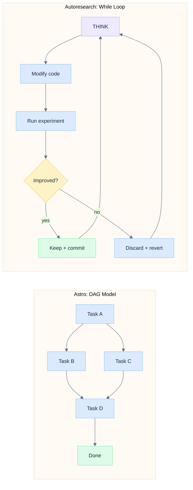

# Iterative Research Loops in Astro

> How autoresearch's while-loop pattern is incorporated into Astro's DAG architecture.

---

## Overview

Iterative research loops (autoresearch) are a pattern where an AI agent repeatedly
modifies an experiment, runs it, evaluates a metric, and decides whether to keep or
discard the change. Astro encapsulates this pattern in a **loop node** — a single node
in the plan DAG that internally manages an iterate/evaluate/decide cycle.

The key design constraint: Astro's plan model is a **directed acyclic graph** (DAG) where
each node is dispatched once and transitions through a lifecycle (planned -> dispatched ->
in_progress -> completed). A while-loop is fundamentally cyclic. The loop node resolves
this by hiding the cycle inside a single DAG node — the DAG stays acyclic, but the node
internally resets and re-dispatches itself.

---

## Architecture

### The Two Paradigms



| Property | Astro DAG | Autoresearch Loop |
|----------|-----------|-------------------|
| Termination | All leaf nodes complete | Human interrupts or metric threshold |
| Structure | Predetermined graph | Dynamic, unbounded iteration |
| Context flow | Upstream outputs injected into downstream | Cumulative: all prior results inform next step |
| Evaluation | Tiered verification (auto/human) | Single metric (val_loss, val_bpb) |
| Concurrency | Parallel independent branches | One experiment at a time (per agent) |

### Loop Node as DAG Primitive

A loop node is a `type: 'loop'` plan node with additional fields:

| Field | Type | Description |
|-------|------|-------------|
| `loopConfig` | `LoopConfig` (JSONB) | Iteration rules, stop conditions, task template |
| `loopStatus` | `'iterating' \| 'stopped' \| null` | Current state of the loop |
| `loopCurrentIteration` | `number` | Which iteration is in progress |
| `loopBestMetricValue` | `number` | Best metric seen across all iterations |
| `loopBestIteration` | `number` | Which iteration produced the best metric |

Loop iterations are tracked in a separate `loop_iterations` table (one row per iteration)
with: `iteration`, `metricValue`, `metricName`, `status` (keep/discard/crash/running/aborted),
`description`, `diff`, `executionId`, `completedAt`.

### Internal Cycle Within a DAG Node

```
DAG level:          [upstream tasks] --> [Loop Node] --> [downstream tasks]

Inside the loop node:

  +-----------------------------------------------------------+
  |                                                           |
  |   planned --> dispatched --> in_progress --> result        |
  |      ^                                        |           |
  |      |            +------------+               |           |
  |      +------------| advanceLoop|<--------------+           |
  |                   | keep/drop  |                           |
  |                   +-----+------+                           |
  |                         |                                  |
  |                   stop? --> yes --> auto_verified ----------+--> downstream
  |                         |
  |                         +--> no --> reset to planned (next iteration)
  |                                                           |
  +-----------------------------------------------------------+
```

Each iteration goes through the standard dispatch lifecycle. When the iteration completes,
the loop controller evaluates the metric and either:
- **Continues**: resets the node to `planned`, increments the iteration counter, dispatches again
- **Stops**: sets the node to `auto_verified`, which triggers downstream DAG dispatch

From the DAG's perspective, the loop node is a single node that takes a long time to
complete. Upstream dependencies are resolved before the first iteration. Downstream
nodes wait until the loop stops.

---

## Implementation

### Controller Design (Stateless, Event-Driven)

The loop controller (`server/lib/loop-controller.ts`) has no in-memory state. It is invoked
at two points:

1. **`startLoop(nodeId, projectId)`** — Called by `autoDispatchDownstream` in `server/routes/data.ts`
   when a loop node's dependencies are satisfied. Initializes loop state, creates iteration 1
   record, dispatches via `serverSideDispatch`.

2. **`advanceLoop(nodeId, projectId, result)`** — Called from the `onResult` handler in
   `server/routes/dispatch.ts` when an iteration completes. Extracts metric, evaluates stop
   condition, dispatches next iteration or completes the loop.

All state lives in the database (`plan_nodes` + `loop_iterations`). This means:
- Server restarts don't lose loop state
- The execution watchdog can detect and recover stuck loop iterations
- Multiple server instances can participate in loop execution

### Dispatch Integration

The outer `POST /task` handler in `dispatch.ts` already loads `dbNode` from the database.
Loop-specific fields are passed through the `params` object to `dispatchViaRelay`, avoiding
a redundant DB query:

```typescript
// In POST /task handler (has dbNode in scope)
dispatchViaRelay(c, {
  // ... standard params ...
  nodeType: dbNode?.type,
  loopConfig: dbNode?.loopConfig as LoopConfig | undefined,
  loopStatus: dbNode?.loopStatus,
  loopCurrentIteration: dbNode?.loopCurrentIteration,
})
```

Inside `dispatchViaRelay`, these are used for two purposes:

**1. Iteration context injection** — Before each iteration, the controller builds a context
block injected into the agent's prompt:

```markdown
## Loop Iteration Context (auto-generated)
You are on iteration 5 of an optimization loop (max: 20).

### Best so far
val_loss: 1.62 (iteration 4: increased n_embd to 128)

### Recent history (last 4)
| Iter | val_loss | Status  | Description                    |
|------|----------|---------|--------------------------------|
| 1    | 1.95     | keep    | Baseline config                |
| 2    | 1.78     | keep    | n_embd=128, n_layer=6          |
| 3    | 1.82     | discard | lr=3e-4, too low               |
| 4    | 1.62     | keep    | cosine schedule, dropout=0.2   |

### Your task
[taskTemplate from loopConfig]
```

**2. Configurable activity timeout** — Loop iterations can override the default 2-hour timeout
via `loopConfig.iterationTimeoutMinutes` (typical: 15 minutes for ML training runs).

### Loop Advance Logic

In `dispatch.ts`, the loop check runs regardless of `finalNodeStatus`:

```typescript
// After execution completes (onResult handler)
if (loopCheck?.type === 'loop' && loopCheck.loopStatus === 'iterating') {
  const { advanceLoop } = await import('../lib/loop-controller.js')
  advanceLoop(nodeId, projectId, { ... }).catch(...)
} else if (finalNodeStatus === 'auto_verified' || finalNodeStatus === 'completed') {
  autoDispatchDownstream(projectId, nodeId).catch(...)
}
```

This ensures loops advance even when YOLO mode is off and the iteration doesn't get
auto-verified. The loop controller determines the iteration outcome from the execution
output, not from the node status.

### Metric Extraction

The controller extracts the target metric from the agent's execution output using two strategies:

1. **Regex**: Looks for `metric_name: <number>` pattern (e.g., `val_loss: 1.6234`)
2. **JSON fallback**: Parses JSON objects in output looking for the metric key

The training script just needs to print the metric — no special API required.

### Stop Conditions

Three conditions, checked after each iteration (first match wins):

| Condition | Example | Description |
|-----------|---------|-------------|
| Max iterations | `maxIterations: 20` | Hard cap |
| Threshold | `threshold: 1.5, direction: minimize` | Stop when metric passes target |
| Plateau | `plateauWindow: 5` | Stop when no improvement in N consecutive iterations |

### Circular Dependency Resolution

`loop-controller.ts` -> `autoDispatchDownstream` (in `data.ts`) and
`dispatch.ts` -> `advanceLoop` (in `loop-controller.ts`) form a cycle.
Resolved with dynamic `await import()` at call sites.

### Feature Flag

Loop nodes are gated behind the `loop-nodes` feature flag (team-level, `teams.feature_flags` JSONB):
- **Frontend**: `plan-canvas.tsx` checks `useFeatureFlag('loop-nodes')`. When disabled,
  loop nodes render as regular task nodes.
- **Backend**: No server-side gating — loop fields are always processed if present.
- **Sync**: `scripts/sync-feature-flags.ts` enables the flag for internal teams.

---

## Database Schema

### plan_nodes (additional columns)

```sql
ALTER TABLE plan_nodes
  ADD COLUMN loop_config JSONB,
  ADD COLUMN loop_status TEXT,
  ADD COLUMN loop_current_iteration INTEGER,
  ADD COLUMN loop_best_metric_value REAL,
  ADD COLUMN loop_best_iteration INTEGER;
```

### loop_iterations (new table)

```sql
CREATE TABLE loop_iterations (
  id UUID PRIMARY KEY DEFAULT gen_random_uuid(),
  node_id TEXT NOT NULL,
  project_id TEXT NOT NULL,
  iteration INTEGER NOT NULL,
  execution_id TEXT,
  metric_value REAL,
  metric_name TEXT,
  status TEXT,  -- 'keep' | 'discard' | 'crash' | 'running' | 'aborted'
  description TEXT,
  diff TEXT,
  created_at TIMESTAMPTZ DEFAULT now(),
  completed_at TIMESTAMPTZ
);

-- RLS policies for user isolation
ALTER TABLE loop_iterations ENABLE ROW LEVEL SECURITY;
```

Migration: `supabase/migrations/20260315100000_add_loop_nodes.sql`

---

## Mapping Autoresearch to Astro

| Autoresearch Concept | Astro Equivalent |
|---------------------|------------------|
| `program.md` | `loopConfig.taskTemplate` + vision doc |
| `train.py` | Working directory file (managed by agent) |
| `results.tsv` | `loop_iterations` table, injected as context |
| `LOOP FOREVER` | Loop node with `maxIterations: 999`, `autonomousMode: true` |
| `git reset` on discard | Iteration marked `discard`, agent sees it failed in history |
| `val_bpb` metric | Extracted from output via `stopCondition.metric` regex |
| `if improved: keep` | `advanceLoop` compares metric to best, sets keep/discard |
| Timeout per run | `loopConfig.iterationTimeoutMinutes` overrides 2-hour default |

**Key insight:** Autoresearch's `program.md` splits into two concerns:
1. **Structural** (loop mechanics, metrics, logging, timeouts) -> `loopConfig` fields
2. **Creative** (what to try, constraints, strategy) -> `taskTemplate` text

---

## Autoresearch Demos

Two demo configurations exist in `astro-autoresearch/` (separate repo to prevent data leakage):

### Demo 1: Karpathy Replication

Given: `trainer.py` (character-level transformer) + `config.json` (initial hyperparameters).
Goal: Minimize `val_loss` by modifying config and architecture across iterations.
Baseline: ~1.95. Target: ~1.5-1.6.

**Setup**: Copy `trainer.py` + `config.json` to an isolated experiment folder. Point the
Astro project's working directory there. Create a loop node with `loop-config.json`.

### Demo 2: End-to-End

A two-node DAG:
1. **Task node**: Receives a research problem prompt, generates `trainer.py`, `config.json`, `eval.py`
2. **Loop node**: Depends on Task 1. Iteratively optimizes the generated experiment code.

**Setup**: Point working directory to an empty folder. The agent creates everything from the prompt.

**Isolation**: Each demo must use a separate working directory. If the agent can see other
demo files, it could read solutions instead of discovering them.

---

## Edge Cases

| Scenario | Behavior |
|----------|----------|
| Agent crashes mid-iteration | Marked `crash` in loop_iterations, next iteration dispatched |
| Metric not found in output | Iteration 1: keep (baseline). Later: discard |
| All iterations discard | Loop completes at maxIterations with "no improvement" |
| Human stops loop | Current iteration aborted, loop marked `stopped`, node `auto_verified` |
| Server restarts mid-loop | Execution watchdog detects stale iteration, resets. Loop resumes on next dispatch. |
| Loop node pruned (branch killed) | Current iteration cancelled, standard pruning applies |
| 5+ consecutive discards | Plateau detection stops the loop |

---

## Known Gaps

| Gap | Issue | Status |
|-----|-------|--------|
| CLI has no loop support | #1011 | Open |
| Startup reconciliation for orphaned iterations too slow | #1010 | Open |
| No git diff tracking between iterations (keep/discard branching) | — | Future |
| No parallel iteration exploration (try N configs simultaneously) | — | Future |
| No metric visualization in UI (chart over iterations) | — | Future |
| No cross-loop coordination (swarm mode) | — | Future |
| AI plan generation doesn't propose loop nodes | — | Future |

---

## Key Files

| File | Role |
|------|------|
| `server/lib/loop-controller.ts` | Core loop logic: start, advance, stop, metric extraction |
| `server/routes/dispatch.ts` | Loop params passing, advanceLoop call in onResult |
| `server/routes/data.ts` | CRUD for loop nodes, GET /loop-iterations, POST /loop/stop, autoDispatchDownstream |
| `packages/core/src/types.ts` | LoopConfig and LoopIteration type definitions |
| `packages/core/src/db/schema.ts` | Drizzle schema for plan_nodes loop columns + loop_iterations |
| `supabase/migrations/20260315100000_add_loop_nodes.sql` | Supabase migration |
| `src/components/plan-graph/plan-canvas.tsx` | Feature flag gating in frontend |
| `server/lib/feature-flags.ts` | GLOBAL_DEFAULTS with loop-nodes flag |
| `src/lib/feature-flags.ts` | Frontend useFeatureFlag hook |

---

*See also: [ARCHITECTURE.md](ARCHITECTURE.md) | [WORKSPACE_V2.md](WORKSPACE_V2.md)*
