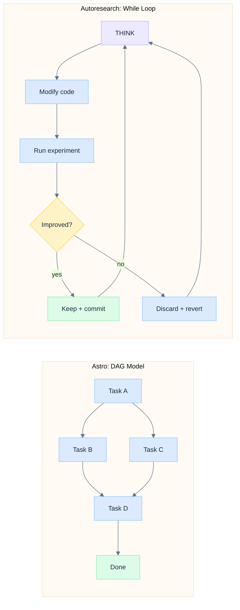
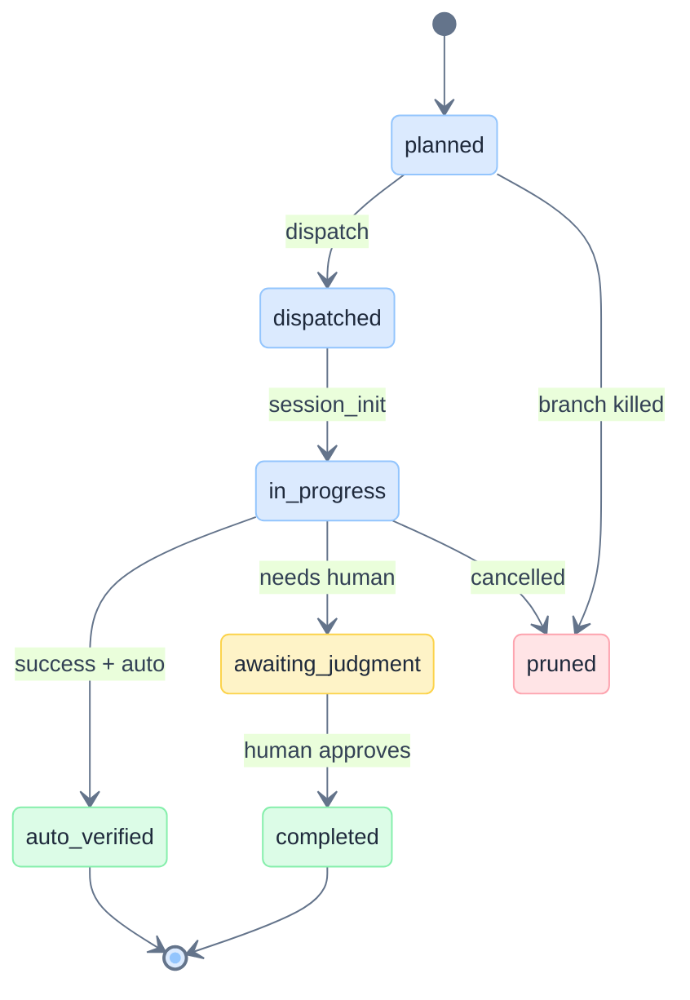
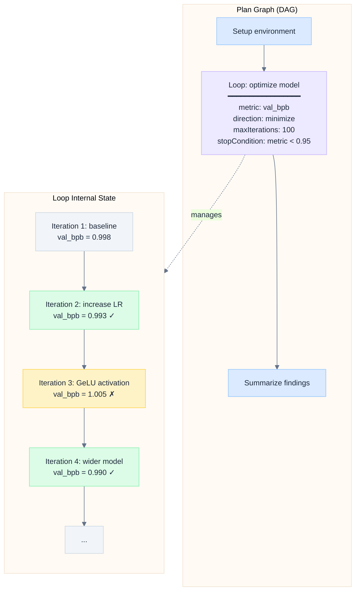
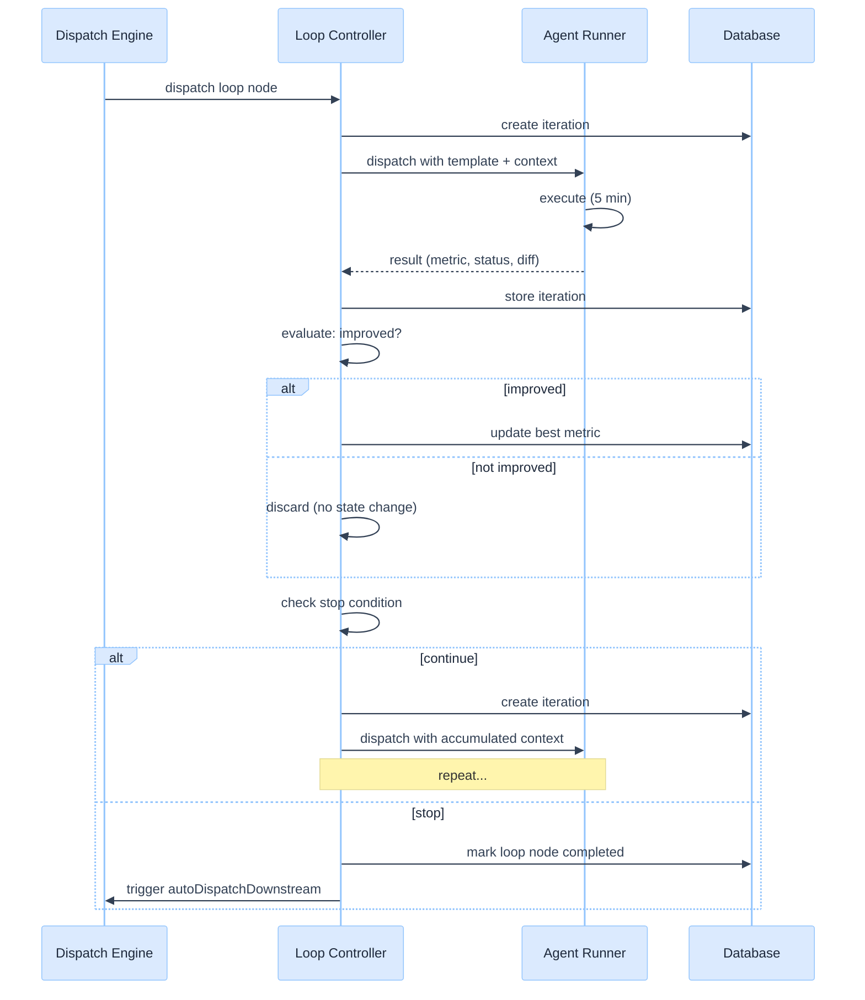
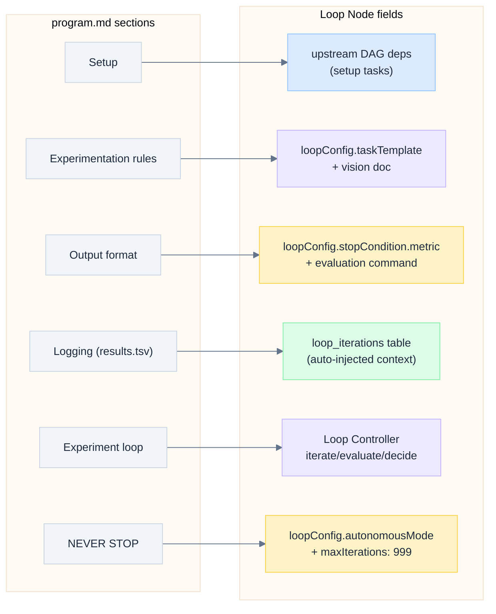
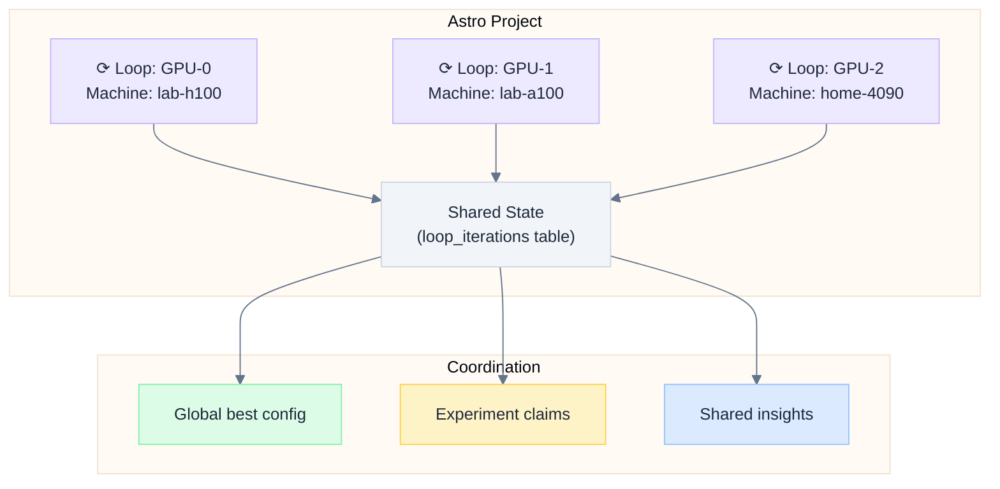

# Iterative Research Loops in Astro

> Design analysis for incorporating autonomous, iterative research loops (inspired by Karpathy's autoresearch) into Astro's DAG-based planning architecture.

---

## Overview

[Autoresearch](https://github.com/karpathy/autoresearch) is a paradigm where an AI agent autonomously runs an experiment loop: modify code, execute, evaluate, keep or discard, repeat indefinitely. The [autoresearch-at-home](https://github.com/karpathy/autoresearch-at-home) fork extends this to a distributed swarm of agents coordinating via shared memory.

Astro's current architecture models work as a **directed acyclic graph** (DAG) of tasks with topological dependency resolution. This document analyzes the tension between DAG-based planning and iterative loops, and proposes architectural extensions that enable autoresearch-style workflows without breaking the existing model.

---

## The Two Paradigms



| Property | Astro DAG | Autoresearch Loop |
|----------|-----------|-------------------|
| Termination | All leaf nodes complete | Human interrupts or context exhaustion |
| Structure | Predetermined graph | Dynamic, unbounded iteration |
| Branching | Explicit branch nodes | Implicit keep/discard decisions |
| Context flow | Upstream outputs injected into downstream | Cumulative: all prior results inform next step |
| Evaluation | Tiered verification (auto/human) | Single metric (val_bpb) |
| Concurrency | Parallel independent branches | One experiment at a time (per agent) |
| State | Per-task execution records | Git branch + results.tsv |

---

## What Autoresearch Actually Does

### Solo Mode (`program.md`)

The core is a `LOOP FOREVER`:

1. **Think** — review results.tsv, decide what to try next
2. **Edit** — modify `train.py` (the single mutable file)
3. **Commit** — snapshot the change
4. **Run** — `uv run train.py > run.log 2>&1` (fixed 5-min budget)
5. **Evaluate** — extract val_bpb from run.log
6. **Decide** — if improved: keep commit, advance branch; if worse: `git reset`
7. **Log** — append to results.tsv
8. **Repeat** — go to step 1, never stop

Key insight: the agent has **full autonomy** within the loop. No human approval gates. The keep/discard decision is mechanical (compare single metric). The creative work is in step 1 (thinking) and step 2 (editing).

### Collaborative Mode (`collab.md` + `coordinator.py`)

Adds coordination across multiple agents on different GPUs:

- **Claim** — before starting, claim the experiment to prevent duplicates (semantic similarity check, 15-min TTL)
- **Publish** — after every experiment, publish result + full source + reasoning to shared memory
- **Sync** — periodically pull the global best config and adopt it
- **Hypotheses** — share untested ideas for other agents to pick up
- **Insights** — share observations and learnings

The coordination layer (Ensue) is **additive** — if it goes down, agents continue solo.

---

## Astro's Current Architecture

### Plan Graph: Strictly DAG



Key constraints from the codebase:

| Component | File | Behavior |
|-----------|------|----------|
| Dependency resolution | `packages/core/src/dispatch/context-assembler.ts:266` | `resolveDependencies()` checks upstream status; only dispatches when all deps are `completed` or `auto_verified` |
| Auto-dispatch | `server/routes/data.ts:980` | `autoDispatchDownstream()` fires after task completion; walks DAG edges to find ready tasks |
| Node types | `packages/core/src/types.ts:250` | `'milestone' \| 'task' \| 'branch' \| 'decision'` — no loop type |
| Edge types | `packages/core/src/db/schema.ts:202` | `'dependency' \| 'branch'` — no back-edge type |
| Cycle handling | `src/lib/graph-utils.ts:184` | Frontend `layoutGraph()` gracefully handles cycles (Kahn's algorithm with fallback) but dispatch would deadlock |
| Re-run | `server/lib/cron-scheduler.ts:254` | `resetNodeIfTerminal()` resets `completed` back to `planned` for cron re-dispatch |

### Existing Building Blocks

Astro already has primitives that partially support iterative patterns:

1. **Cron scheduler** (`server/routes/schedules.ts`) — can re-run a task or project on a schedule, with `resetNodeIfTerminal()` to clear execution state before re-dispatch
2. **Server-side dispatch** (`server/lib/server-side-dispatch.ts`) — programmatic task dispatch without user interaction
3. **Branch pruning** — killing a branch cancels all downstream tasks
4. **Acceptance criteria** — `planNodes.acceptanceCriteria` supports `autoVerifiable: boolean` with custom commands
5. **Vision/context injection** — persistent document injected into every agent session

---

## The Gap: What Autoresearch Needs That Astro Lacks

| Capability | Autoresearch | Astro Today | Gap |
|------------|-------------|-------------|-----|
| Unbounded iteration | `LOOP FOREVER` | Tasks execute once (or on cron schedule) | No native loop-until-condition |
| Metric-driven decisions | `if val_bpb improved: keep` | Human judgment or binary pass/fail | No metric evaluation + conditional branching |
| Cumulative context | Agent sees all prior results in results.tsv | Each task sees only direct upstream outputs | No accumulation across iterations |
| Keep/discard with git | `git reset` on failure, advance on success | Worktree per task, PR per task | No "revert this execution, try again" primitive |
| Autonomous operation | "NEVER STOP" | Human approval gates | YOLO mode exists but is per-dispatch, not per-loop |
| Experiment coordination | Claim, publish, sync global best | No multi-agent coordination for the same goal | No shared experiment state |

---

## Proposed Approach: Loop Nodes

Rather than abandoning the DAG model, extend it with a new node type that encapsulates iterative behavior within a DAG-compatible container.

### Option A: Loop Node (Recommended)

Introduce a `loop` node type that represents a bounded iterative process within the plan graph. From the DAG's perspective, a loop node is a single node with dependencies and dependents. Internally, it manages repeated execution of a task template.



**Schema extension:**

```typescript
// New fields on plan_nodes for loop configuration
loopConfig: jsonb('loop_config').$type<{
  maxIterations: number        // Hard cap (e.g., 100)
  stopCondition?: {            // Optional early termination
    metric: string             // Name of metric to track (e.g., "val_bpb")
    direction: 'minimize' | 'maximize'
    threshold?: number         // Stop when metric passes threshold
    plateauWindow?: number     // Stop after N iterations without improvement
  }
  taskTemplate: string         // The task description template for each iteration
  evaluationCommand?: string   // Shell command to extract metric from output (e.g., grep "^val_bpb:" run.log)
  iterationTimeoutMinutes?: number  // Kill iteration if it exceeds this (default: 10)
  contextFile?: string         // File path for cumulative results (like results.tsv)
  autonomousMode: boolean      // Skip approval gates between iterations
}>()

// New table for loop iteration history
export const loopIterations = pgTable('loop_iterations', {
  id: uuid('id').primaryKey().defaultRandom(),
  nodeId: text('node_id').notNull(),         // The loop node's clientId
  projectId: uuid('project_id').notNull(),
  iteration: integer('iteration').notNull(),
  executionId: text('execution_id'),
  metricValue: real('metric_value'),
  status: text('status').notNull(),          // 'keep' | 'discard' | 'crash'
  description: text('description'),
  diff: text('diff'),                        // Code changes made
  createdAt: timestamp('created_at').notNull().defaultNow(),
})
```

**How it works within the DAG:**

1. Loop node has normal DAG dependencies — waits for upstream tasks to complete
2. When dispatched, the loop controller starts iterating:
   - Each iteration resets the task's execution state (like `resetNodeIfTerminal`)
   - Dispatches the task with accumulated context (all prior iteration results)
   - Evaluates the metric from execution output
   - Decides keep/discard
   - Checks stop condition
3. When the loop terminates (max iterations, stop condition, or human interrupt), the node transitions to `completed`
4. Downstream DAG tasks then execute normally

**DAG compatibility:** The graph remains acyclic. The loop is an internal implementation detail of a single node — no back-edges exist in the plan graph. The topological sort, dependency resolution, and auto-dispatch all work unchanged.

### Option B: Back-Edge with Cycle Detection (Not Recommended)

Allow explicit back-edges in the plan graph, creating actual cycles. Add cycle detection and max-iteration guards to prevent infinite loops.

**Why not:** This breaks the fundamental DAG invariant. Every component that walks the graph (layout, dependency resolution, auto-dispatch, context assembly, branch pruning) would need cycle-aware logic. The blast radius is enormous. The loop node approach achieves the same result with zero impact on existing code.

### Option C: External Loop Orchestrator (Simpler but Less Integrated)

Keep the plan graph as-is. Add an external orchestrator (similar to the cron scheduler) that repeatedly resets and re-dispatches a task based on results.

**Tradeoffs:** Simplest to implement (already 80% built with cron + `resetNodeIfTerminal`), but the loop state and iteration history live outside the plan model. The UI can't visualize loop progress natively.

---

## Detailed Design: Loop Node (Option A)

### Loop Lifecycle



### Context Accumulation

Each iteration receives:

1. **The loop's task template** (the "program.md" equivalent)
2. **The iteration history** — all prior results as a structured table, injected into the prompt
3. **The current best state** — which file version is "current best"
4. **Vision doc** — same as any other Astro task

This maps directly to autoresearch's pattern: the agent reads results.tsv (iteration history) and train.py (current best state) before deciding what to try next.

```
## Iteration Context (auto-generated)

You are on iteration 15 of an optimization loop.

### Best so far
val_bpb: 0.990 (iteration 12: wider model with adjusted LR)

### Recent history
| Iter | val_bpb | Status  | Description |
|------|---------|---------|-------------|
| 12   | 0.990   | keep    | wider model 768 dim + LR 0.002 |
| 13   | 0.992   | discard | add dropout 0.1 |
| 14   | 0.995   | discard | switch to SiLU activation |

### Your task
[task template from loop config]
```

### Stop Conditions

| Condition | Config | Example |
|-----------|--------|---------|
| Max iterations | `maxIterations: 100` | Always set — hard safety cap |
| Metric threshold | `threshold: 0.95` | Stop when val_bpb < 0.95 |
| Plateau detection | `plateauWindow: 10` | Stop after 10 iterations without improvement |
| Human interrupt | Manual cancel via UI | User clicks "Stop Loop" |
| Time budget | `maxDurationMinutes: 480` | Stop after 8 hours |

### UI Representation

In the plan graph, a loop node renders as a special node with a cycle indicator and live iteration counter. When expanded, it shows the iteration history as a table with metrics and keep/discard decisions.

<details>
<summary>Text diagram</summary>

```
Plan Graph:
  [Setup env] ──→ [⟳ Optimize model (iter 15/100, best: 0.990)] ──→ [Report]
                          │
                          ▼ (expanded)
                  ┌──────────────────────────────────────┐
                  │ Iteration History                     │
                  │ #12  0.990  keep    wider model       │
                  │ #13  0.992  discard dropout 0.1       │
                  │ #14  0.995  discard SiLU activation   │
                  │ #15  ···    running increase depth    │
                  └──────────────────────────────────────┘
```

</details>

---

## Mapping Autoresearch Concepts to Astro

### Solo Autoresearch

| Autoresearch Concept | Astro Equivalent |
|---------------------|------------------|
| `program.md` | Loop node's task template + vision doc |
| `train.py` | Working directory file (managed by agent in worktree) |
| `results.tsv` | `loop_iterations` table, injected as context |
| `LOOP FOREVER` | Loop node with `maxIterations: 999`, `autonomousMode: true` |
| `git reset` on discard | Worktree reset to pre-iteration state (or new worktree per iteration) |
| `git commit` on keep | Commit preserved in worktree |
| `uv run train.py` | Agent runner executes within the task |
| `val_bpb` metric | Extracted from execution output via `stopCondition.metric` |

### Structural Mapping: `program.md` to Loop Node Fields

Autoresearch's `program.md` is the agent's instruction file — it defines setup, constraints, the experiment loop, output format, and logging rules. Each section maps directly to a specific loop node field or Astro mechanism:



| `program.md` Section | Content | Loop Node Equivalent | Notes |
|----------------------|---------|---------------------|-------|
| **Setup** (steps 1-7) | Check GPU, create branch, read files, verify data, init results.tsv | **Upstream DAG dependencies** — setup tasks that must complete before the loop starts | Astro naturally models pre-conditions as DAG deps |
| **Experimentation** — "What you CAN do" | "Modify `train.py` — model, optimizer, hyperparameters, training loop" | **`loopConfig.taskTemplate`** — the description field tells the agent what to modify and how | Combined with the vision doc for high-level research context |
| **Experimentation** — "What you CANNOT do" | "Do not modify `prepare.py`, do not install packages" | **`loopConfig.taskTemplate`** — constraints section | Agent instructions baked into the template |
| **Experimentation** — "The goal" | "Get the lowest val_bpb" | **`loopConfig.stopCondition.metric`** = `"val_bpb"`, **`direction`** = `"minimize"` | The metric and optimization direction |
| **Output format** | `val_bpb: 0.997900`, `peak_vram_mb: 45060.2`, etc. | **`loopConfig.evaluationCommand`** — grep command that extracts metrics from run.log | Loop controller parses output to get the metric value |
| **Logging results** | 5-column TSV: commit, val_bpb, memory_gb, status, description | **`loop_iterations` table** — auto-populated by loop controller, injected as context into each iteration | Replaces manual results.tsv maintenance |
| **The experiment loop** (steps 1-10) | THINK → edit → commit → run → evaluate → decide → log | **Loop Controller** lifecycle — dispatch → execute → extract metric → keep/discard → store iteration → repeat | Astro lifts the loop to the control plane |
| **NEVER STOP** | "Do NOT pause to ask the human... autonomous... indefinitely" | **`loopConfig.autonomousMode: true`** + **`maxIterations: 999`** | Autonomy with a safety cap |
| **Timeout** | "If a run exceeds 10 minutes, kill it" | **`loopConfig.iterationTimeoutMinutes`** — per-iteration timeout | Loop controller kills and marks as crash |
| **Crashes** | "If dumb/easy to fix, fix and re-run. If fundamentally broken, skip" | Loop controller: crash status in `loop_iterations`, agent sees crash history in context and can avoid repeating | Crash handling is part of the context accumulation |
| **Simplicity criterion** | "All else being equal, simpler is better" | **`loopConfig.taskTemplate`** — include as a constraint in the agent instructions | Qualitative guidance lives in the template |

**Key insight:** Autoresearch's `program.md` is split between two concerns in Astro:
1. **Structural concerns** (loop mechanics, metrics, logging, timeouts) become **loop node config fields** managed by the loop controller
2. **Creative concerns** (what to try, constraints, simplicity, research strategy) become the **task template** injected into each agent session

### Collaborative Autoresearch (Swarm)

The collaborative pattern maps to Astro's multi-machine dispatch:



| Autoresearch-at-home | Astro Equivalent |
|---------------------|------------------|
| Ensue shared memory | `loop_iterations` table (shared across loops in same project) |
| `coord.claim_experiment()` | Loop controller checks `loop_iterations` for duplicate descriptions before dispatching |
| `coord.publish_result()` | Iteration result written to DB (visible to all loops in project) |
| `coord.pull_best_config()` | Query `loop_iterations` for best metric across all loops, inject into context |
| `coord.publish_hypothesis()` | Could map to a shared "hypotheses" store or just context injection |
| VRAM tiers | Astro's machine metadata (already tracks GPU info) |
| `coordinator.py` | Loop controller in `server/lib/loop-controller.ts` |

---

## Activation Model: Configuration-Driven

Loop nodes are **opt-in only**. By default, plan generation never produces loop nodes. This avoids the fragility of NLP-based detection ("does the user's prompt imply iteration?") and gives users explicit control.

### Project-Level Setting

```typescript
// In project settings (stored in projects table or project_settings jsonb)
enableLoopNodes: boolean  // default: false
```

When `enableLoopNodes` is `false`:
- Plan generation AI never produces `type: 'loop'` nodes
- The loop node type does not appear in the plan schema sent to Claude
- Users can still manually create loop nodes in the plan editor (power-user path)

When `enableLoopNodes` is `true`:
- The plan generation prompt includes `'loop'` in the node type enum and loop node examples
- Claude can propose loop nodes when the research goal involves optimization or iterative exploration
- The loop config panel appears in the node inspector for loop nodes

### UI Toggle

```
Project Settings → Advanced
  ┌─────────────────────────────────────────────────────┐
  │ Loop Nodes                                           │
  │                                                      │
  │ [toggle: OFF]  Enable iterative research loops       │
  │                                                      │
  │ When enabled, AI planning can generate loop nodes    │
  │ that repeat a task until a metric target is reached.  │
  │ Useful for ML training, hyperparameter search,       │
  │ and automated optimization workflows.                │
  └─────────────────────────────────────────────────────┘
```

### Manual Loop Node Construction

Users can always create loop nodes manually, regardless of the project setting. This is the power-user path for people who know exactly what loop they want.

**In the plan editor:**

1. Create a new task node (or select an existing task node)
2. Open the node type selector → choose "Loop"
3. The node inspector shows the **Loop Configuration Panel**:

```
Loop Configuration
━━━━━━━━━━━━━━━━━
Task Template:    [multiline editor — the agent instructions for each iteration]
Metric Name:      [val_bpb                    ]
Direction:        [minimize ▼]
Max Iterations:   [100       ]
Stop Threshold:   [0.95      ] (optional)
Plateau Window:   [10        ] (optional — stop after N iters without improvement)
Timeout/Iter:     [10 min    ] (optional)
Autonomous Mode:  [toggle: ON]
Evaluation Cmd:   [grep "^val_bpb:" run.log   ] (optional — extracts metric from output)
```

4. The node visually changes to show the loop indicator (cycle icon + config summary)

**Converting an existing task to a loop:**

Right-click a task node → "Convert to Loop Node" → fills in the loop config panel with the existing task description as the template. This is a non-destructive operation — the task description becomes the `taskTemplate`, and the user configures the loop parameters.

### Prompt Integration

When `enableLoopNodes` is `true`, the plan generation prompt (`buildInteractivePlanPrompt()`) includes loop nodes in the schema:

```typescript
// Added to PLAN_GRAPH_SCHEMA when enableLoopNodes is true
{
  "type": {
    "type": "string",
    "enum": ["milestone", "task", "branch", "decision", "loop"]
  },
  "loopConfig": {
    "type": "object",
    "description": "Required when type is 'loop'. Configures the iterative execution.",
    "properties": {
      "taskTemplate": { "type": "string" },
      "metric": { "type": "string" },
      "direction": { "type": "string", "enum": ["minimize", "maximize"] },
      "maxIterations": { "type": "number" },
      "threshold": { "type": "number" },
      "plateauWindow": { "type": "number" },
      "autonomousMode": { "type": "boolean" }
    }
  }
}
```

The system prompt includes guidance:

```
When the user's goal involves iterative optimization, parameter search, or
autonomous experimentation, use a 'loop' node. A loop node repeats its task
template until a metric threshold is reached, a plateau is detected, or the
max iteration count is hit. Each iteration sees the full history of prior
results. Place setup tasks as upstream dependencies and analysis/reporting
tasks as downstream dependents.
```

---

## Implementation Roadmap

### Phase 1: Loop Node Primitive (Minimal)

Extend the existing cron scheduler pattern into a first-class loop node:

1. Add `'loop'` to the `type` enum in `plan_nodes`
2. Add `loopConfig` jsonb column to `plan_nodes`
3. Create `loop_iterations` table
4. Build `server/lib/loop-controller.ts` — manages the iterate/evaluate/decide cycle
5. Extend `autoDispatchDownstream` to recognize loop completion
6. Frontend: render loop nodes with iteration counter in plan graph

**Estimated scope:** ~800 lines of new code, 1 migration, 3-4 changed files.

### Phase 2: Metric Extraction and Stop Conditions

1. Structured metric extraction from execution output (regex or JSON parsing)
2. Stop condition evaluation (threshold, plateau, time budget)
3. UI for configuring loop parameters (metric name, direction, thresholds)
4. Loop progress visualization (iteration history table, metric chart)

### Phase 3: Multi-Agent Research Swarm

1. Cross-loop context sharing within a project
2. Experiment deduplication (semantic similarity on descriptions)
3. Global best tracking across parallel loops
4. Hypothesis publishing and pickup
5. Machine-aware config recommendations (VRAM tier matching)

### Phase 4: AI-Assisted Loop Planning

Requires `enableLoopNodes: true` on the project (see Activation Model section above).

1. Extend `PLAN_GRAPH_SCHEMA` with the `loop` type and `loopConfig` fields (conditionally, based on project setting)
2. Add loop node examples to the plan generation prompt so Claude can propose loops when appropriate
3. AI suggests loop parameters (metric, thresholds, iteration budget) based on the research question
4. AI can dynamically adjust loop parameters mid-execution (e.g., narrow search space after initial exploration via a "replan" action)

---

## Validation Tests

Two end-to-end tests validate that Astro's loop node can replicate autoresearch's behavior. Both target the same outcome (lowest val_bpb) but from different starting points.

### Test A: Run Karpathy's Autoresearch via Astro Loop Node

**Goal:** Prove Astro can orchestrate existing autoresearch code without modification.

**Setup:**
1. Clone the autoresearch repo into a working directory
2. Create an Astro project pointing at that directory, with `enableLoopNodes: true`
3. Manually create a plan with three nodes:

```
[Setup: verify GPU + run prepare.py] → [⟳ Loop: optimize train.py] → [Report: summarize results]
```

**Loop node configuration:**

| Field | Value |
|-------|-------|
| `taskTemplate` | The contents of autoresearch's `program.md` "Experimentation" section — modified to remove setup/logging instructions (Astro handles those). Core: "Modify train.py to minimize val_bpb. Run `uv run train.py > run.log 2>&1`. Do not modify prepare.py." |
| `metric` | `val_bpb` |
| `direction` | `minimize` |
| `maxIterations` | `100` |
| `plateauWindow` | `15` |
| `autonomousMode` | `true` |
| `evaluationCommand` | `grep "^val_bpb:" run.log \| awk '{print $2}'` |
| `iterationTimeoutMinutes` | `10` |

**Expected behavior:**
1. Setup task completes (GPU check, data prep)
2. Loop controller dispatches iteration 1 → agent runs baseline `train.py` → extracts `val_bpb ≈ 0.998` → stores as iteration 1 (status: `keep`)
3. Loop controller dispatches iteration 2 with context: "Iteration 1: val_bpb=0.998, keep, baseline" → agent modifies `train.py` → runs → extracts metric → keep or discard
4. Repeats until plateau or max iterations
5. Loop completes → downstream "Report" task dispatches with full iteration history as context

**Success criteria:**
- `loop_iterations` table shows the same progression you'd see in autoresearch's `results.tsv`
- The agent's modifications to `train.py` are comparable in quality to standalone autoresearch
- Val_bpb improves over iterations (monotonic best-so-far)
- No manual intervention required after initial dispatch

**What this validates:**
- Loop controller lifecycle (dispatch, extract, decide, repeat)
- Context accumulation (agent sees prior results and builds on them)
- Metric extraction from execution output
- Keep/discard semantics with git state management
- Autonomous mode (no approval gates between iterations)

---

### Test B: Build Autoresearch from Scratch via Astro Loop Node

**Goal:** Prove Astro can generate the equivalent of autoresearch's code and workflow from a high-level research goal, without using Karpathy's existing code.

**Setup:**
1. Create a new Astro project with an empty working directory, `enableLoopNodes: true`
2. Set the project vision doc to:

```
Research goal: Train a small language model on FineWeb-Edu dataset to achieve the
lowest possible validation bits-per-byte (val_bpb) within a 5-minute training budget
per experiment. The model should use PyTorch and run on a single GPU.
```

3. Use AI plan generation to produce a plan. Expected output (approximately):

```
[Setup: scaffold training code] → [⟳ Loop: optimize model architecture + training] → [Report: best model analysis]
```

**Loop node configuration (AI-suggested or manually set):**

| Field | Value |
|-------|-------|
| `taskTemplate` | "You are optimizing a language model for lowest val_bpb. Modify the model architecture, optimizer, hyperparameters, or training loop. Run training for 5 minutes and report val_bpb. Each iteration should try one focused change based on what worked/failed before." |
| `metric` | `val_bpb` |
| `direction` | `minimize` |
| `maxIterations` | `100` |
| `plateauWindow` | `15` |
| `autonomousMode` | `true` |

**Expected behavior:**
1. Setup task: agent creates `train.py`, `prepare.py` (or equivalent), `pyproject.toml` — essentially writing autoresearch from scratch
2. Loop iterations: agent iteratively improves the model, guided by the iteration history context
3. Report task: agent summarizes findings, best architecture, and learnings

**Success criteria:**
- The agent produces working training code from scratch
- The loop runs autonomously through multiple iterations
- Val_bpb improves over time (the code actually works and the agent optimizes it)
- The final code is structurally similar to Karpathy's autoresearch (transformer model, AdamW optimizer, cosine LR schedule, etc.) — converging on similar solutions from a blank slate validates the loop's effectiveness

**What this validates (beyond Test A):**
- Plan generation with loop nodes (AI correctly identifies this as a loop-worthy goal)
- The loop node is general-purpose — not tied to a specific codebase
- Context accumulation is sufficient for the agent to make informed decisions without external `program.md` instructions
- The setup → loop → report DAG pattern works end-to-end

---

### Test Comparison Matrix

| Aspect | Test A (Run Existing) | Test B (Build from Scratch) |
|--------|----------------------|----------------------------|
| Starting code | Karpathy's `train.py` + `prepare.py` | Empty directory |
| Agent instructions | Adapted from `program.md` | General research goal in vision doc |
| What's tested | Loop mechanics, metric extraction, context | Full workflow: code gen + loop + analysis |
| Complexity | Lower — code works out of the box | Higher — agent must write correct training code |
| Expected iterations | 50-100 (matches standalone autoresearch) | 20-50 (more time spent on code quality) |
| Hardware required | GPU (same as autoresearch) | GPU (same as autoresearch) |

---

## Edge Cases

| Scenario | Behavior |
|----------|----------|
| Loop node has no stop condition | `maxIterations` is always required as a hard cap |
| Agent crashes mid-iteration | Log as `crash`, revert to last good state, continue loop |
| All iterations are `discard` | Loop completes at maxIterations with "no improvement" summary |
| Human cancels loop | Mark current iteration as `aborted`, mark loop node as `completed` with partial results |
| Upstream dependency changes mid-loop | Loop pauses, re-evaluates dependencies, resumes or aborts |
| Multiple loops target same files | Each loop gets its own worktree (existing isolation model) |
| Loop metric not found in output | Treat as crash, log warning, continue to next iteration |
| Loop node in a branch that gets pruned | Cancel current iteration, mark loop as `pruned` |

---

## Key Design Decisions

### Why not just use cron?

The cron scheduler (`server/routes/schedules.ts`) can already re-run tasks on a schedule. But it lacks:

- **Metric-driven stop conditions** — cron runs forever on a time schedule
- **Iteration context accumulation** — each cron run is independent, no prior results injected
- **Keep/discard semantics** — cron doesn't evaluate results or manage git state
- **Native UI integration** — cron runs aren't visible in the plan graph as iteration history

A loop node builds on top of cron's `resetNodeIfTerminal()` but adds the experiment-loop semantics.

### Why not let the agent manage its own loop?

The agent already *could* run an infinite loop within a single task execution (like autoresearch does with Claude Code). The problem is:

- **No persistence** — if the agent's context window fills or the connection drops, all iteration history is lost
- **No observability** — the UI shows a single running task, not individual iterations
- **No coordination** — multiple agents can't see each other's iterations
- **No resource management** — the agent occupies a machine indefinitely

By lifting the loop into Astro's control plane, each iteration is a separate execution with full persistence, observability, and coordination.

### DAG purity vs. pragmatism

The loop node approach maintains DAG purity at the plan graph level. A loop is a single node — it has inputs (upstream dependencies) and outputs (the best result). The iteration cycle is an implementation detail hidden inside the node, much like how a single task node hides the fact that the agent might make 50 tool calls internally.

This means zero changes to: `layoutGraph()`, `topologicalSortNodes()`, `resolveDependencies()`, `autoDispatchDownstream()`, `groupActivityEvents()`, or any other DAG-walking code.

---

## Key Files

| File | Role |
|------|------|
| `packages/core/src/db/schema.ts` | Plan nodes, edges, dependencies schema |
| `packages/core/src/types.ts:250` | `PlanNode.type` union |
| `packages/core/src/dispatch/context-assembler.ts` | Dependency resolution, context injection |
| `server/routes/data.ts:980` | `autoDispatchDownstream()` — DAG walk after completion |
| `server/lib/cron-scheduler.ts:254` | `resetNodeIfTerminal()` — re-run primitive |
| `server/routes/schedules.ts` | Cron schedule CRUD + execution |
| `server/lib/server-side-dispatch.ts` | Programmatic task dispatch |
| `src/lib/graph-utils.ts` | Frontend graph layout (Kahn's algorithm) |
| `src/lib/graph-sort-utils.ts` | Topological sort with cycle fallback |

---

## References

- [autoresearch](https://github.com/karpathy/autoresearch) — Karpathy's original single-agent autonomous research loop
- [autoresearch-at-home](https://github.com/karpathy/autoresearch-at-home) — Collaborative swarm fork with Ensue coordination
- [Karpathy's tweet on collaborative autoresearch](https://x.com/karpathy/status/2030705271627284816) — "emulate a research community"

---

*See also: [[Architecture]] | [[Execution-Lifecycle]] | [[Data-Model]] | [[Execution-Strategies]]*
