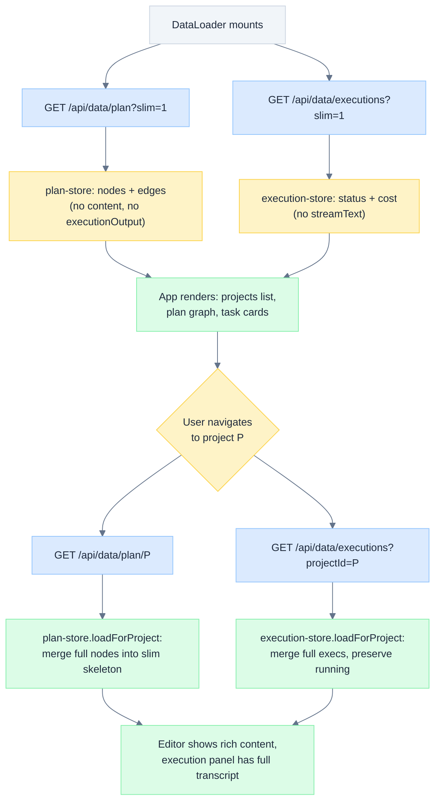
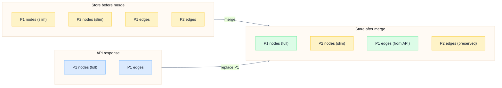
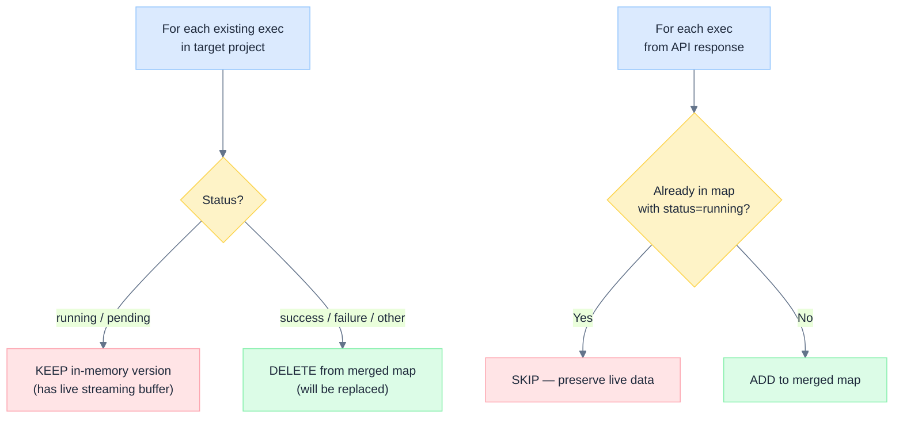

# Lazy Data Loading

> Two-tier loading architecture: slim global hydration at startup, full per-project load on navigation. Reduces initial page load data transfer by an order of magnitude for users with many projects.

---

## Overview

Astro loads all user data (projects, plan nodes, executions, etc.) at startup via the `DataLoader` component. As users accumulate projects, three fields dominate transfer size:

| Field | Table | Typical Size | Content |
|-------|-------|-------------|---------|
| `content` | `plan_nodes` | 5--50 KB per node | Rich HTML from tiptap editor (images, formatting) |
| `executionOutput` | `plan_nodes` | 1--20 KB per node | Raw agent output text |
| `streamText` | `task_executions` | 50--500 KB per execution | Full streaming transcript |

A user with 20 projects and 200 tasks could transfer 10--50 MB on every page load, even though they only view one project at a time.

**Lazy data loading** solves this with a two-tier strategy:
1. **Slim global load**: Startup fetches all data but excludes the three large fields. The projects list, plan graph, and execution status are all available immediately.
2. **Full per-project load**: When the user navigates to a specific project, a hook fetches the complete data for just that project and merges it into the store.

---

## Architecture



---

## Backend: Additive Query Parameters

All changes are **additive** -- endpoints return full data by default, and slim mode is opt-in via query parameters. This ensures backward compatibility with the CLI and any external consumers.

### Plan Endpoint

**`GET /api/data/plan`** accepts `?slim=1`:

```typescript
// server/routes/data.ts, line ~508-518
executionOutput: slim ? null : n.executionOutput,
content: slim ? null : n.content,
```

All other fields (title, status, position, dates, priority, estimates, etc.) are always included.

**`GET /api/data/plan/:projectId`** -- new endpoint for per-project full load:

- Verifies project access via `teamScopeFilter`
- Returns all nodes and edges for the project with all fields
- Includes `actualStartDate` and `actualEndDate` (parity with global endpoint)

### Executions Endpoint

**`GET /api/data/executions`** accepts `?slim=1` and `?projectId=X`:

```typescript
// server/routes/data.ts, line ~1806-1812
const columns = {
  executionId: taskExecutions.executionId,
  nodeClientId: taskExecutions.nodeClientId,
  projectId: taskExecutions.projectId,
  status: taskExecutions.status,
  ...(!slim ? { streamText: taskExecutions.streamText } : {}),
  // ... other small fields always included
}
```

The `projectId` filter is validated against the user's team-scoped projects before querying, preventing cross-team data leakage.

| Parameter | Effect | Default |
|-----------|--------|---------|
| `slim=1` | Excludes `streamText` from SQL SELECT | Include all columns |
| `projectId=X` | Filter to one project (validated against team scope) | All team projects |

---

## Frontend: Store Merge Logic

### plan-store.loadForProject



Key implementation details from `src/stores/plan-store.ts` (line 310-340):

1. **Fetch full data**: `dataClient.getProjectPlan(projectId)` calls `GET /api/data/plan/:projectId`
2. **Rebuild dependencies**: Edges are the source of truth for `node.dependencies`. The method iterates edges and rebuilds the `dependencies` array for each node.
3. **Ensure positions**: Calls `ensurePositions()` so nodes without saved positions get auto-layout.
4. **Merge by replacement**: Splits existing data into "this project" and "other projects". Keeps other projects' data intact, replaces the target project entirely with fresh full data.
5. **Edge filtering checks both source AND target**: `existingEdges.filter((e) => !projectNodeIds.has(e.source) && !projectNodeIds.has(e.target))`. This prevents duplicate edges when cross-project references exist.

### execution-store.loadForProject

The execution store merge (`src/stores/execution-store.ts`, line 1832-1874) has one critical difference: **running execution protection**.



**Why this matters**: When a task is actively executing, the in-memory execution object has a live `streamText` buffer being appended to by the SSE handler. The DB snapshot returned by the API would contain stale data (whatever was persisted at the last checkpoint). Replacing the in-memory object would cause the activity panel to jump backward or lose recent output.

---

## Content Sync: Slim to Full Transition

When `loadForProject` completes, `node.content` changes from `null` (slim) to the full HTML string. Components using `useState(initialContent)` face a problem: React's `useState` only uses the initial value on first render. Subsequent changes to `initialContent` are ignored.

### The Pattern

The `task-content-tab.tsx` uses React's recommended "adjust state during render" pattern (line 50-59):

```typescript
// Track the last-known initialContent to detect changes
const [prevInitialContent, setPrevInitialContent] = useState(initialContent)
if (initialContent !== prevInitialContent) {
  setPrevInitialContent(initialContent)
  // Only sync if user hasn't diverged from the last-synced content
  if (draftContent === prevInitialContent) {
    setDraftContent(initialContent)
  }
}
```

This avoids `useEffect` + `setState` (which triggers the `react-hooks/set-state-in-effect` lint rule) and correctly handles the user-edit guard: if `draftContent` has diverged from `prevInitialContent`, the user has typed something and we must not overwrite their work.

<details>
<summary>Text diagram</summary>

```
Timeline: slim → full content sync

  t=0: Component mounts with slim data
       initialContent = "" (node.content is null)
       draftContent = ""
       prevInitialContent = ""

  t=1: User starts typing
       draftContent = "<p>User notes</p>"
       prevInitialContent = "" (unchanged)

  t=2: loadForProject completes, node.content arrives
       initialContent = "<p>Full DB content</p>"
       prevInitialContent ≠ initialContent → sync check:
         draftContent ("<p>User notes</p>") ≠ prevInitialContent ("")
         → User has edited! Do NOT overwrite.
       prevInitialContent updated to "<p>Full DB content</p>"

  t=2 (alt): If user had NOT typed:
       draftContent ("") === prevInitialContent ("")
       → Safe to sync: draftContent = "<p>Full DB content</p>"
```

</details>

---

## useProjectData Hook

The `useProjectData` hook (`src/hooks/use-project-data.ts`) is the orchestrator. It is called from `plan-view.tsx` and `task-detail.tsx`.

```typescript
export function useProjectData(projectId: string | undefined) {
  const loadPlanForProject = usePlanStore((s) => s.loadForProject)
  const loadExecsForProject = useExecutionStore((s) => s.loadForProject)
  const planLoaded = usePlanStore((s) => s.loaded)
  const execsLoaded = useExecutionStore((s) => s.loaded)
  const loadedRef = useRef<Set<string>>(new Set())
  const loadingRef = useRef<Set<string>>(new Set())

  useEffect(() => {
    if (!projectId || !planLoaded || !execsLoaded) return
    if (loadedRef.current.has(projectId) || loadingRef.current.has(projectId)) return
    loadingRef.current.add(projectId)

    Promise.all([
      loadPlanForProject(projectId),
      loadExecsForProject(projectId),
    ]).then(() => {
      loadedRef.current.add(projectId)
    }).catch(() => {
      // Allow retry on next mount/navigation
    }).finally(() => {
      loadingRef.current.delete(projectId)
    })
  }, [projectId, planLoaded, execsLoaded, loadPlanForProject, loadExecsForProject])
}
```

| Behavior | Implementation |
|----------|---------------|
| **Wait for global load** | Guards on `planLoaded && execsLoaded` to avoid racing the slim load |
| **Load once per project** | `loadedRef` tracks successfully loaded projects |
| **Dedup concurrent calls** | `loadingRef` prevents a second fetch while one is in flight |
| **Retry on failure** | Failed loads do not add to `loadedRef`, so next navigation retries |
| **Parallel fetch** | `Promise.all` loads plan and executions concurrently |

---

## Data Available at Each Page

| Page | What renders | Data needed | Available in slim? |
|------|-------------|-------------|-------------------|
| **Projects list** | Project cards with task counts, status badges | `title`, `status`, `projectId` | Yes |
| **Plan graph** | React Flow nodes and edges | `title`, `status`, `position`, edges | Yes |
| **Task list** | Table rows with title, status, priority, dates | `title`, `status`, `priority`, `estimate`, `dueDate` | Yes |
| **Task detail (content tab)** | Rich text editor with task instructions | `content`, `description` | No -- needs full load |
| **Task detail (activity tab)** | Execution transcript, tool traces | `streamText`, `activityEvents` | No -- needs full load |
| **Task detail (overview)** | Execution output summary | `executionOutput` | No -- needs full load |

---

## Test Coverage

31 unit tests in `tests/lazy-data-loading.test.ts`:

| Test Group | Count | Covers |
|-----------|-------|--------|
| Slim mode field filtering | 3 | `content`, `executionOutput`, `streamText` exclusion |
| Per-project endpoint field parity | 2 | `actualStartDate`/`actualEndDate` inclusion |
| Plan store merge logic | 4 | Node replacement, edge preservation, cross-project edge filtering, empty project |
| Execution store merge | 4 | Completed replacement, running preservation, pending preservation, cross-project isolation |
| Content sync | 4 | Slim-to-full sync, user edit preservation, no-op, re-sync |
| Page navigation simulation | 6 | Slim data availability, full load merge, multi-project, dedup, concurrent, retry |
| Backfill summary no-op | 2 | Slim mode no-op, full mode backfill |
| URL parameter construction | 5 | Slim, projectId, combined, empty params |

---

## Key Files

| File | Role |
|------|------|
| `server/routes/data.ts` | Backend: `?slim=1` filtering on `/plan` and `/executions`, new `/plan/:projectId` endpoint |
| `src/lib/data-client.ts` | API client: `getAllPlans({ slim })`, `getProjectPlan(id)`, `getExecutions({ slim, projectId })` |
| `src/stores/plan-store.ts` | `load()` uses slim mode; `loadForProject()` merges full data |
| `src/stores/execution-store.ts` | `load()` uses slim mode; `loadForProject()` merges with running protection |
| `src/hooks/use-project-data.ts` | Hook: orchestrates per-project loading with dedup and retry |
| `src/components/task-detail/task-content-tab.tsx` | Render-time content sync for slim-to-full transition |
| `src/components/task-detail/expandable-task-panel.tsx` | useEffect content sync for the expandable panel variant |
| `tests/lazy-data-loading.test.ts` | 31 unit tests covering all merge, sync, and navigation logic |

---

*See also: [[Frontend Architecture]] | [[Data Flow]] | [[Data Model]] | [[Streaming Events]]*
