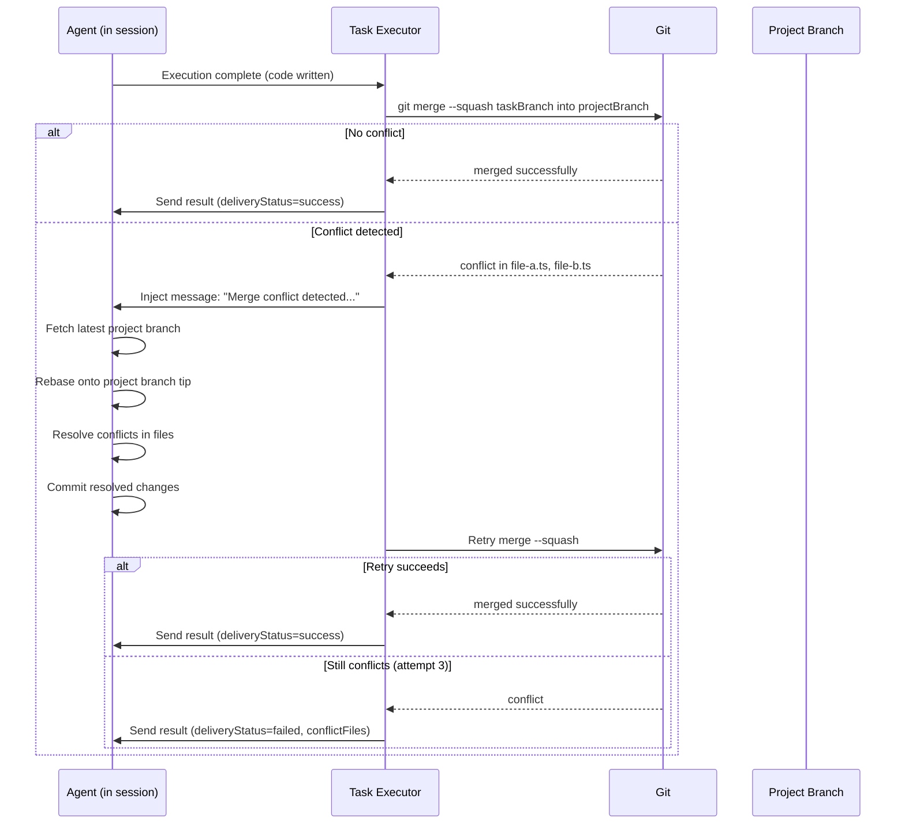

# Merge Conflict Resolution Design

> How AI agents should detect, resolve, and retry merge conflicts across both local and GitHub delivery modes.

**Status:** Proposed
**Issue:** #722
**Related:** PR #721 (merge-only lock), `docs/design/GITHUB_WORKFLOW.md`

---

## Problem Statement

Astro's accumulative branch model has parallel tasks merging into a shared project branch. When two tasks modify overlapping files, the second task's merge will conflict. Currently, conflicts are handled by **immediately failing** — the AI agent never sees the conflict and can't resolve it.

This creates a poor experience: the agent did the work correctly, but delivery fails because of a mechanical merge issue that the agent could easily fix.

The same problem exists at two levels:
1. **Per-task merge** (task branch → project branch) — parallel tasks conflict
2. **Final delivery** (project branch → base branch) — project branch diverges from main

---

## Current Behavior

### Level 1: Per-Task Merge (task branch → project branch)

#### Local Mode (`branch`)

```
Agent finishes → result sent → agent session OVER
         |
         v
localMergeIntoProjectBranch()      (task-executor.ts:1063)
         |
         v
git merge --squash taskBranch      (local-merge.ts:74)
         |
    Conflict?
    /        \
  NO          YES
   |           |
   v           v
commit       git status --porcelain (find UU/AA/DD files)
   |           |
   v           v
success      return { merged: false, conflict: true, conflictFiles }
              |
              v
           deliveryStatus = 'failed'
           deliveryError = "Merge conflict in: file-a.ts, file-b.ts"
           NO RETRY. Agent is already gone.
```

#### GitHub Mode (`pr`)

```
Agent finishes → result sent → agent session OVER
         |
         v
pushAndCreatePR() with autoMerge: true   (task-executor.ts:1125)
         |
         v
git push → gh pr create → gh pr merge --squash
         |
    Merge fails?
    /        \
  NO          YES
   |           |
   v           v
success      autoMergeFailed = true
              |
              v
           deliveryStatus = 'failed'
           deliveryError = "PR created but auto-merge into project branch failed"
           NO RETRY. Agent is already gone.
```

### Level 2: Final Delivery (project branch → base branch)

#### GitHub Mode — "Push to GitHub" Node

The "Push to GitHub" task IS an AI agent task with prompt instructions:
```
"After creating the PR, wait for CI checks. If any check fails or a reviewer
requests changes, read the feedback, fix the issues, push to the project branch,
and re-check — up to 3 retry cycles."
```

**Gap:** The prompt only mentions CI failures and reviewer feedback. It does NOT mention merge conflicts. If `main` has diverged while the project ran, the PR may have conflicts and the agent has no explicit instructions to rebase.

#### Local Mode — No Final Delivery Step

There is no "Push to GitHub" equivalent in local mode. The project branch IS the deliverable. Users must manually merge it. No conflict detection or resolution.

---

## Proposed Solution

### P1: Per-Task Merge Conflict Resolution (Both Modes)

**Core idea:** Move the merge attempt into the agent's session, BEFORE the result is sent. On conflict, inject a message telling the agent to resolve it.

#### Architecture Change

```
Current:
  Agent executes → send result → merge (mechanical, post-session) → fail on conflict

Proposed:
  Agent executes → attempt merge (pre-result) → conflict? → tell agent → agent resolves → retry merge → send result
```



#### Implementation Details

**Step 1: Pre-result merge attempt in task-executor.ts**

Currently, the delivery phase runs AFTER the provider adapter returns. Move it to run while the agent session is still active:

```typescript
// CURRENT (simplified):
const agentResult = await providerAdapter.execute(task);
// Agent session is now OVER
const mergeResult = await localMergeIntoProjectBranch(...);
// Can't ask agent to fix conflicts

// PROPOSED:
const agentResult = await providerAdapter.execute(task, {
  onBeforeResult: async () => {
    // Called after agent thinks it's done but before session closes
    return await attemptMergeWithRetry(task, providerAdapter);
  }
});
```

**Step 2: Conflict resolution message injection**

When a merge conflict is detected, inject a message into the agent's session:

```
MERGE CONFLICT DETECTED

Your task branch cannot be cleanly merged into the project branch because
parallel tasks have modified overlapping files.

Conflicting files:
- src/lib/api-client.ts
- src/stores/plan-store.ts

The project branch tip is at: astro/{projectId}

Please resolve this:
1. Run: git fetch origin && git rebase astro/{projectId}
2. Resolve the conflicts in each file
3. Run: git add <resolved-files> && git rebase --continue
4. Verify your changes still work (run tests if applicable)

After resolving, I will retry the merge automatically.
```

**Step 3: Retry loop**

```typescript
async function attemptMergeWithRetry(
  task: Task,
  adapter: ProviderAdapter,
  maxRetries: number = 3,
): Promise<LocalMergeResult> {
  for (let attempt = 1; attempt <= maxRetries; attempt++) {
    const result = await localMergeIntoProjectBranch(
      gitRoot, taskBranch, projectBranch, commitMessage,
    );

    if (result.merged || !result.conflict) {
      return result; // Success or non-conflict error
    }

    if (attempt === maxRetries) {
      return result; // Final failure
    }

    // Inject conflict resolution message into agent session
    await adapter.injectMessage(task.id, buildConflictResolutionPrompt(
      result.conflictFiles, projectBranch, attempt, maxRetries,
    ));

    // Wait for agent to resolve (it will call git rebase, edit files, etc.)
    await adapter.waitForIdle(task.id, { timeout: 300_000 }); // 5 min
  }
}
```

**Step 4: Provider adapter support**

The `injectMessage` capability is needed. Current support:

| Provider | `injectMessage` | Notes |
|----------|:--------------:|-------|
| Claude SDK | Yes | Uses `resumeTask` with injected user turn |
| Codex | No | Would need to signal via stdin or restart |
| OpenClaw | No | Would need extension |
| OpenCode | No | Would need extension |
| Claude Code CLI | No | No message injection API |

For providers without `injectMessage`, fall back to current behavior (fail immediately).

#### GitHub Mode Variant

For `pr` mode, the same pattern applies but with different git commands:

```
Conflict detected during gh pr merge --squash
         |
         v
Tell agent: "Your PR cannot be auto-merged because the project branch
has new commits. Please:
1. git fetch origin
2. git rebase origin/astro/{projectId}
3. Resolve conflicts
4. git push --force-with-lease
I will retry the PR merge."
         |
         v
Agent resolves, force-pushes
         |
         v
Retry gh pr merge --squash
```

---

### P2: Final PR Conflict Resolution (GitHub Mode)

**Core idea:** Update the "Push to GitHub" prompt to explicitly handle merge conflicts with main.

#### Current Prompt Gap

The current prompt says:
> "If any check fails or a reviewer requests changes, read the feedback, fix the issues..."

It doesn't mention merge conflicts with the base branch.

#### Proposed Prompt Addition

Add to the "Push to GitHub" task description in `prompt-templates.ts`:

```
Before creating the PR, ensure the project branch is up to date with the
base branch:
  git fetch origin ${target}
  git rebase origin/${target}

If the rebase has conflicts:
1. Resolve each conflicting file
2. git add <resolved-files> && git rebase --continue
3. git push --force-with-lease origin ${projectBranch}

After creating the PR, if GitHub reports merge conflicts:
1. Pull the latest base branch: git fetch origin ${target}
2. Rebase: git rebase origin/${target}
3. Resolve conflicts and force-push
4. Verify the PR is now mergeable

This conflict resolution should happen BEFORE waiting for CI checks.
```

#### Implementation

Edit `packages/core/src/prompt-templates.ts` — the `githubSection` in `buildInteractivePlanPrompt()`:

```typescript
- description: "Open a pull request on ${ghOwner}/${ghRepo} that merges
  the project branch into \`${target}\`. The PR description should include
  a comprehensive summary of every completed task..."

+ description: "Open a pull request on ${ghOwner}/${ghRepo} that merges
  the project branch into \`${target}\`. Before creating the PR, rebase
  the project branch onto the latest \`${target}\` to ensure a clean merge.
  If the rebase has conflicts, resolve them. The PR description should
  include a comprehensive summary of every completed task...
  After creating the PR, check if GitHub reports merge conflicts. If so,
  rebase onto the latest \`${target}\`, resolve conflicts, and
  force-push with --force-with-lease. Then wait for CI checks..."
```

---

### P3: Local Mode Final Delivery

**Current state:** No equivalent of "Push to GitHub" in local mode. The project branch is the deliverable.

#### Options

| Option | Description | Pros | Cons |
|--------|------------|------|------|
| **A: Keep as-is** | Project branch is deliverable, user merges manually | Simple, no risk | User must know git |
| **B: Auto-rebase** | After all tasks, rebase project branch onto main | Clean history | Could fail silently |
| **C: Suggest merge** | Show UI prompt: "Project branch ready. Merge into main?" | User in control | Requires UI work |

**Recommendation:** Option A for now (keep as-is). The local mode is for `git init` repos with no remote — these are typically single-developer projects where the user is comfortable with git. Add Option C as a future enhancement.

---

## Implementation Plan

### Phase 1: Prompt Fix (Low effort, high impact)

Update the "Push to GitHub" task description to include merge conflict resolution instructions. This is a one-line change in `prompt-templates.ts` that covers the **final PR** scenario immediately.

**Files:** `packages/core/src/prompt-templates.ts`
**Effort:** 1 hour

### Phase 2: Per-Task Merge Retry (Medium effort, high impact)

Restructure the delivery phase in `task-executor.ts` to attempt merge while the agent session is still active. Start with Claude SDK (which supports `injectMessage`), fall back to current behavior for other providers.

**Files:**
- `packages/agent-runner/src/lib/task-executor.ts` — restructure delivery timing
- `packages/agent-runner/src/lib/local-merge.ts` — no changes needed
- `packages/agent-runner/src/lib/git-pr.ts` — add retry-with-rebase for PR mode
- `packages/agent-runner/src/providers/claude-sdk-adapter.ts` — ensure injectMessage works post-execution

**Effort:** 1-2 days
**Prerequisite:** Provider adapter must support message injection while execution is "paused"

### Phase 3: Smart Pre-Merge Rebase (Future)

Before attempting the merge, proactively check if the project branch has diverged and rebase first — avoiding conflicts entirely in many cases.

```
Before merge:
  git fetch origin projectBranch
  git log projectBranch..origin/projectBranch --oneline
  If diverged → git rebase origin/projectBranch
```

**Effort:** 1 day (after Phase 2 infrastructure exists)

---

## Edge Cases

| Scenario | Current Behavior | Proposed Behavior |
|----------|-----------------|-------------------|
| Two tasks modify same file, different lines | Merge succeeds (git resolves) | No change needed |
| Two tasks modify same lines | `deliveryStatus='failed'`, no retry | Agent resolves, retry up to 3x |
| Three tasks, middle one conflicts | 2nd fails, 3rd may or may not | 2nd agent resolves, 3rd works |
| Agent can't resolve conflict | N/A (never tries) | After 3 retries → `deliveryStatus='failed'` with details |
| Provider doesn't support injectMessage | Fails immediately | Same (graceful fallback) |
| Final PR conflicts with main | Agent may not handle | Agent explicitly instructed to rebase |
| Local mode, project branch conflicts with main | User deals with it | Same (Phase 3 may add rebase option) |

---

## Key Files

| File | Current Role | Changes Needed |
|------|-------------|---------------|
| `packages/agent-runner/src/lib/task-executor.ts` | Delivery phase after agent completes | Restructure to attempt merge during session |
| `packages/agent-runner/src/lib/local-merge.ts` | Mechanical squash-merge | No changes |
| `packages/agent-runner/src/lib/git-pr.ts` | Push + PR + auto-merge | Add retry-with-rebase |
| `packages/core/src/prompt-templates.ts` | "Push to GitHub" description | Add conflict resolution instructions |
| `packages/agent-runner/src/providers/claude-sdk-adapter.ts` | Provider with injectMessage | Ensure post-execution injection works |
