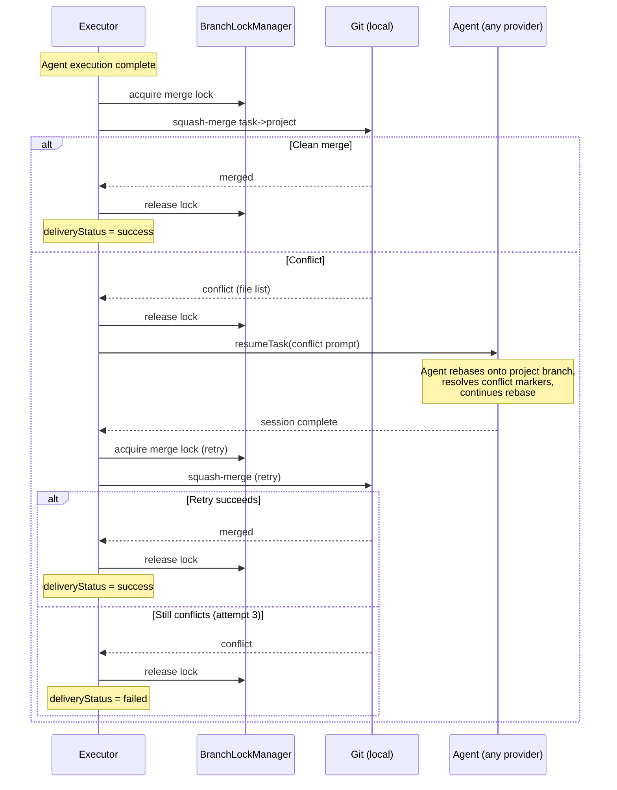
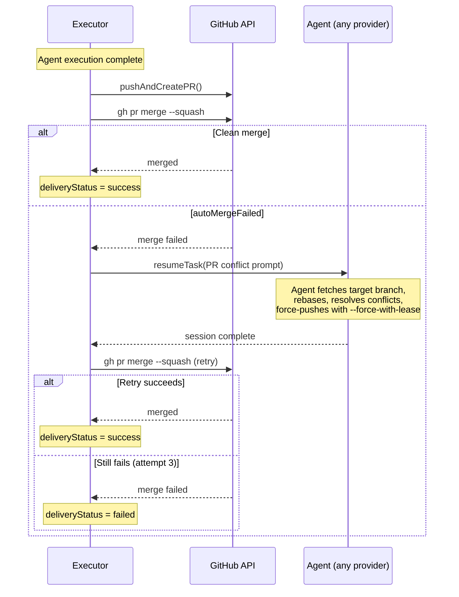

# Merge Conflict Resolution Design

> How AI agents detect, resolve, and retry merge conflicts across both local and GitHub delivery modes.

**Status:** Implemented
**Issues:** #722 (closed), #719 (closed)
**PRs:** #724 (astro: prompt enhancements), agent-runner #64 (merge-only lock), agent-runner #65 (conflict resolution retry loops)
**Related:** `docs/design/GITHUB_WORKFLOW.md`

---

## Problem Statement

Astro's accumulative branch model has parallel tasks merging into a shared project branch. When two tasks modify overlapping files, the second task's merge will conflict. Previously, conflicts were handled by **immediately failing** — the AI agent never saw the conflict and couldn't resolve it.

This creates a poor experience: the agent did the work correctly, but delivery fails because of a mechanical merge issue that the agent could easily fix.

The same problem exists at two levels:
1. **Per-task merge** (task branch -> project branch) — parallel tasks conflict
2. **Final delivery** (project branch -> base branch) — project branch diverges from main

---

## Solution Overview

### Per-Task Merge Conflict Resolution

**Core idea:** After the agent finishes execution, attempt the merge. On conflict, **resume the agent session** with conflict resolution instructions, then retry the merge. Up to 3 attempts.

This works for all 4 providers via `isResumableAdapter()` — each provider implements `resumeTask()` and `getTaskContext()`.

### Final PR Conflict Resolution

The "Push to GitHub" task prompt explicitly instructs the agent to rebase the project branch onto the target before creating the PR, and to resolve conflicts if GitHub reports them after PR creation.

---

## Architecture

### Branch Mode (Local) — `task-executor.ts`



Key properties:
- **Merge lock released during resolution** — agent may take minutes to resolve, lock held only during squash-merge (seconds)
- **Lock re-acquired for each retry** — serializes merge attempts across parallel tasks
- **Up to 3 attempts** — `MAX_MERGE_ATTEMPTS = 3`

### PR Mode (GitHub) — `task-executor.ts`



Key differences from branch mode:
- **No merge lock** — GitHub API handles serialization
- **Agent must force-push** — rebase changes branch history, needs `--force-with-lease`
- **PR already exists** — retry calls `mergePullRequest()` directly, not `pushAndCreatePR()`

### Provider Support

All 4 providers support session resume via `isResumableAdapter()`:

| Provider | `resumeTask()` | `getTaskContext()` | Resume mechanism |
|---|---|---|---|
| Claude SDK | Yes | Yes | SDK `resume` option with `sessionId` |
| Codex | Yes | Yes | `codex exec resume <threadId>` |
| OpenClaw | Yes | Yes | Generic CLI resume |
| OpenCode | Yes | Yes | Generic CLI resume |

The check is: `this.isResumableAdapter(adapter) && !!adapter.getTaskContext(task.id)?.sessionId`

If the adapter is not resumable or has no active session, the executor falls back to the previous behavior (immediate failure with conflict file list).

---

## Conflict Resolution Prompts

### Branch Mode Prompt (`buildConflictResolutionPrompt`)

```
MERGE CONFLICT DETECTED (attempt N/3)

Your task branch cannot be cleanly merged into the project branch because
parallel tasks have modified overlapping files since you branched.

Conflicting files:
- src/lib/api-client.ts
- src/stores/plan-store.ts

The project branch is: astro/7b19a9

Please resolve this:
1. Fetch the latest project branch: git fetch origin 2>/dev/null; git fetch . astro/7b19a9:astro/7b19a9 2>/dev/null || true
2. Rebase onto the project branch: git rebase astro/7b19a9
3. For each conflict, open the file, resolve the conflict markers
4. Stage resolved files: git add <resolved-files>
5. Continue the rebase: git rebase --continue
6. Verify your changes still work

IMPORTANT: Do NOT create a merge commit. Use rebase so the merge will be clean.
After you finish resolving, I will automatically retry the merge.
```

### PR Mode Prompt (`buildPRConflictResolutionPrompt`)

```
MERGE CONFLICT DETECTED ON GITHUB (attempt N/3)

Your pull request cannot be automatically merged into the project branch because
parallel tasks have modified overlapping files.

Your task branch is: astro/7b19a9-a3f2b1
The target branch is: astro/7b19a9

Please resolve this:
1. Fetch the latest target branch: git fetch origin astro/7b19a9
2. Rebase onto the target branch: git rebase origin/astro/7b19a9
3. For each conflict, resolve the conflict markers
4. Stage resolved files: git add <resolved-files>
5. Continue the rebase: git rebase --continue
6. Verify your changes still work
7. Force-push the rebased branch: git push --force-with-lease origin astro/7b19a9-a3f2b1

IMPORTANT: Do NOT create a merge commit. Use rebase so the history is clean.
After you force-push, I will automatically retry the GitHub merge.
```

### "Push to GitHub" Task Prompt

The "Push to GitHub" plan node description (in `prompt-templates.ts`) now includes:

> Before creating the PR, ensure the project branch is rebased onto the latest `main`:
> run `git fetch origin main && git rebase origin/main`. If the rebase has conflicts,
> resolve each conflicting file, then `git add` the resolved files and `git rebase --continue`.
> After resolving, force-push with `git push --force-with-lease origin <project-branch>`.
>
> After creating the PR, if GitHub reports merge conflicts, rebase onto the latest `main`,
> resolve conflicts, and force-push with `--force-with-lease`.

---

## Edge Cases

| Scenario | Behavior |
|----------|----------|
| Two tasks modify same file, different lines | Git auto-resolves, no conflict |
| Two tasks modify same lines | Agent resolves, retry up to 3x |
| Three parallel tasks, middle one conflicts | 2nd agent resolves, 3rd may also need to |
| Agent can't resolve conflict | After 3 retries, `deliveryStatus='failed'` with details |
| Provider doesn't support resume | Falls through to immediate failure (same as before) |
| Agent session has no sessionId | Not resumable, immediate failure |
| Agent resume throws an error | Retry loop breaks, `deliveryStatus='failed'` |
| No project branch set | Merge phase skipped entirely |
| Final PR conflicts with main | Agent instructed to rebase in "Push to GitHub" prompt |
| Playground (direct mode) | No git workflow, no merge, no conflicts |

---

## Key Files

| File | Role |
|------|------|
| `packages/agent-runner/src/lib/task-executor.ts` | Merge retry loops for both `branch` and `pr` modes |
| `packages/agent-runner/src/lib/local-merge.ts` | Squash-merge with conflict detection + file listing |
| `packages/agent-runner/src/lib/git-pr.ts` | Push + PR creation + `mergePullRequest()` for retry |
| `packages/agent-runner/src/lib/branch-lock.ts` | Merge-only lock manager |
| `packages/core/src/prompt-templates.ts` | "Push to GitHub" task description with conflict instructions |
| `packages/agent-runner/src/providers/*-adapter.ts` | All 4 providers implement `resumeTask()` + `getTaskContext()` |

---

## Implementation Phases

### Phase 1: Prompt Fix (Done)
Updated "Push to GitHub" task description in `prompt-templates.ts` to include rebase and conflict resolution instructions before and after PR creation.

### Phase 2: Per-Task Merge Retry (Done)
Restructured delivery phase in `task-executor.ts`:
- **Branch mode:** Retry loop with acquire-merge-release per attempt, agent resume on conflict
- **PR mode:** On `autoMergeFailed`, resume agent to rebase + force-push, retry `gh pr merge`
- Works with all 4 providers via `isResumableAdapter()`

### Phase 3: Smart Pre-Merge Rebase (Done)
`tryPreMergeRebase()` proactively rebases the task branch onto the latest project branch tip before the merge attempt. Handles the common non-overlapping case silently; on conflict, aborts and falls through to the agent resume retry loop. Added for both branch mode (local rebase) and PR mode (fetch + rebase before push).

### Phase 4: Git Ref Sanitization (Done)
`sanitizeGitRef()` strips shell metacharacters from branch names before embedding in conflict resolution prompts. Defense-in-depth against command injection if branch naming conventions are violated.
