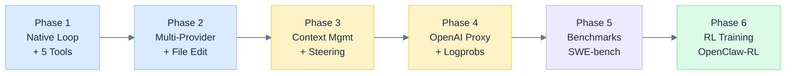
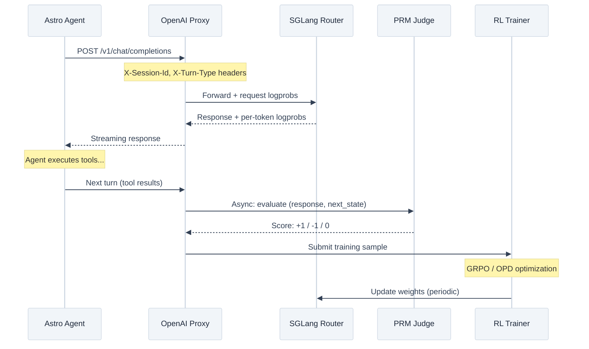
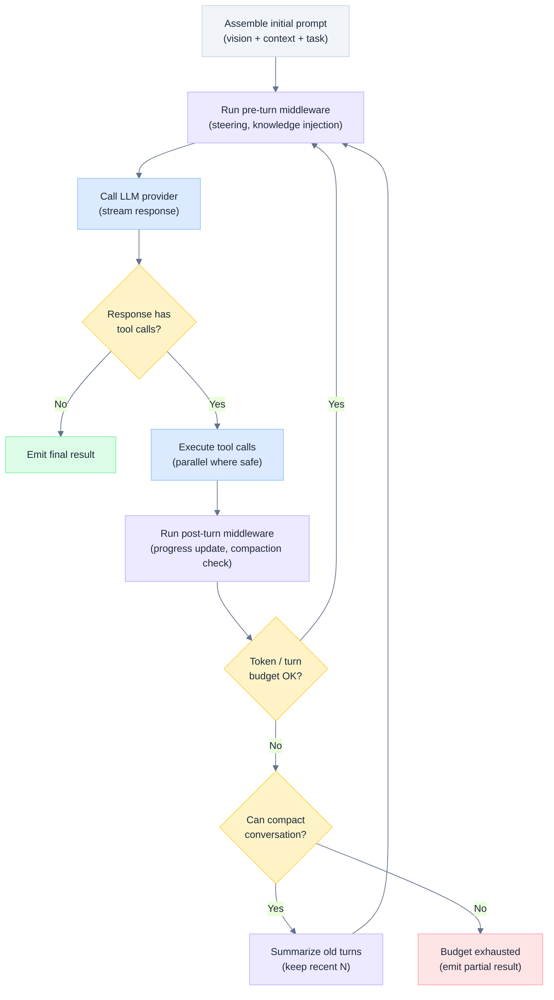
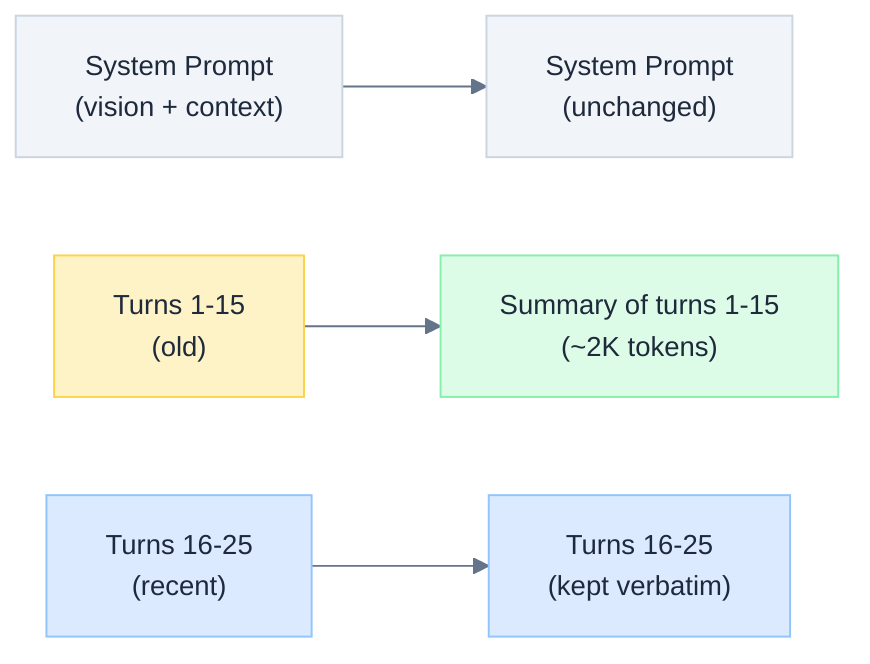
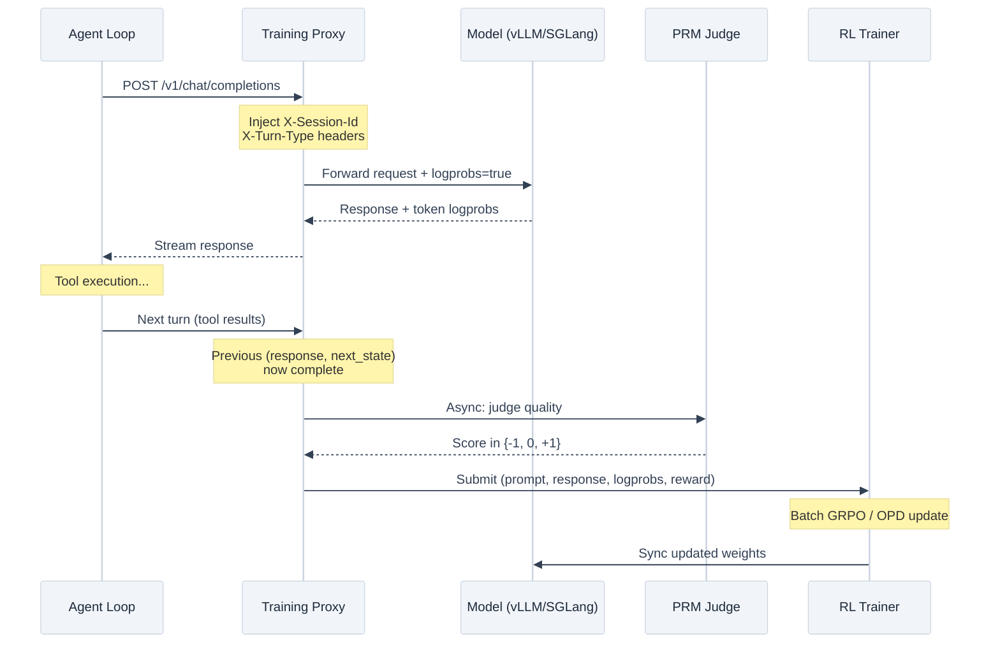
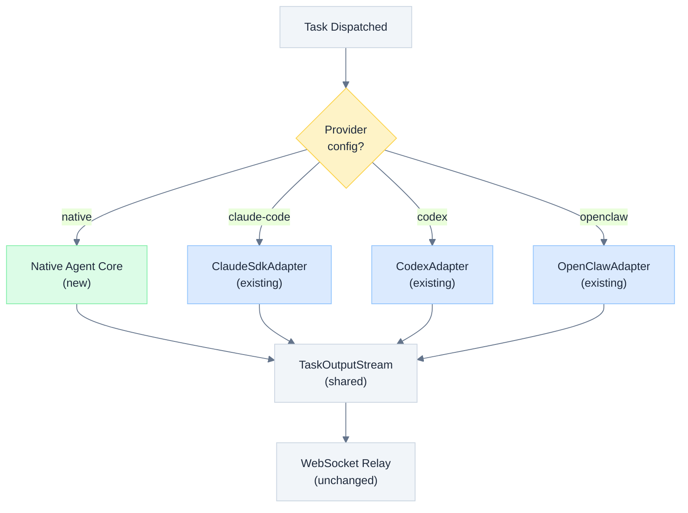

# Native Agent Core: From Wrapper to Engine

> North Star design document for building Astro's own native agent loop, replacing the current Claude Code SDK / Codex CLI wrapper architecture with a fully-owned execution engine that supports multi-provider routing, DAG-aware context management, benchmark evaluation, and reinforcement learning training.

---

## 1. Motivation

### 1.1 Current State

The Astro agent-runner (`packages/agent-runner/`, ~29.8K LOC TypeScript) is **95% wrapper, 5% orchestration, 0% agent reasoning**. All intelligence is delegated to external agent harnesses:

| Adapter | Subprocess | Reasoning Owner |
|---------|-----------|-----------------|
| `ClaudeSdkAdapter` | `@anthropic-ai/claude-agent-sdk` | Claude Code |
| `CodexAdapter` | `codex` CLI | OpenAI Codex |
| `OpenClawAdapter` | `openclaw` CLI | OpenClaw |
| `OpenCodeAdapter` | `opencode` CLI | OpenCode |

Each adapter spawns a subprocess, pipes in an assembled prompt (`ContextAssembler.buildExecutionPrompt()`), and parses streaming output back into Astro's event format (`TaskOutputStream`). The runner provides workspace isolation (git worktrees), WebSocket streaming to the relay server, PR/branch delivery modes, and approval routing via MCP — but cannot influence a single reasoning step.

### 1.2 What We Cannot Do Today

Because the agent is a black box subprocess:

- **No mid-task knowledge injection** — when a sibling task completes during execution, its output cannot be fed into the running agent
- **No token budget enforcement** — cannot limit cost per task or per session
- **No model routing per task** — an XS cleanup task uses the same Opus-class model as an XL architecture redesign
- **No fine-grained observability** — we see tool traces after the fact, but cannot observe or influence the LLM's reasoning chain
- **No conversation compaction** — if the subprocess exhausts its context window, it fails; we cannot intervene to summarize and continue
- **No RL training** — cannot capture logprobs, cannot insert reward signals, cannot modify the policy

### 1.3 Target Architecture

```
Native Loop → Multi-Provider → Benchmark Eval → RL Training
```

The end state is a fully-owned agent engine where Astro controls every turn of the agent loop, routes tasks to the optimal model, collects structured training data, and continuously improves through reinforcement learning.



---

## 2. Reference Implementations

Five codebases were analyzed to inform this design. Each demonstrates a different architectural pattern; the synthesis draws from all five.

### 2.1 Forgecode (~103.5K LOC, Rust)

Turn-based orchestrator with strongly-typed tool system.

| Aspect | Detail |
|--------|--------|
| **Core loop** | `orch.rs` — 376 LOC turn-based orchestrator |
| **Tool system** | Strongly-typed enum, ~15K LOC across 22 crates |
| **Provider abstraction** | Trait-based, multi-provider |
| **MCP** | Full MCP integration for external tools |
| **Middleware** | Lifecycle hooks (pre-turn, post-turn, on-error) |

**Key insight:** Even a production-grade agent with 22 tool crates has a core loop of only ~400 LOC. The complexity is in the tools, not the orchestration.

### 2.2 DeepAgents (~9.3K LOC, Python)

Middleware-first architecture built on LangGraph.

| Aspect | Detail |
|--------|--------|
| **Core loop** | ~316 LOC, LangGraph state machine |
| **Provider** | LangChain `BaseChatModel` abstraction (provider-agnostic) |
| **Middleware** | Filesystem (1,369 LOC), summarization (1,434 LOC), subagents (692 LOC), skills (834 LOC) |
| **Pattern** | Composable middleware stack, each layer wraps the next |

**Key insight:** Middleware composition provides clean extensibility — each concern (filesystem access, context summarization, sub-agent spawning) is an independent, testable layer.

### 2.3 Astro Agent Runner (~29.8K LOC, TypeScript)

The current system. What is reusable vs. what must be replaced:

| Reusable (keep) | Replace |
|-----------------|---------|
| Workspace isolation (git worktrees) | Claude Code subprocess spawning |
| WebSocket streaming to relay | JSONL stdout parsing per adapter |
| `TaskOutputStream` event protocol | Provider-specific stream handlers |
| `ContextAssembler` (vision doc, deps, graph position) | Black-box prompt injection |
| Approval routing via MCP | — |
| Delivery modes (PR, push, branch, copy) | — |
| Safety checks (`workdir-safety.ts`) | — |

### 2.4 OpenClaw-RL (Python, Slime Framework)

Fully asynchronous RL framework for training agents from conversational feedback.

| Aspect | Detail |
|--------|--------|
| **Architecture** | 4 decoupled components: Serving, Rollout, PRM Judging, Training |
| **API surface** | OpenAI-compatible proxy on port 30000 |
| **PRM** | Process Reward Model: `(response, next_state)` -> majority vote in {-1, 0, +1} |
| **Binary RL** | GRPO: uniform advantage broadcast, PPO clipped loss + KL penalty |
| **OPD** | On-Policy Distillation: token-level teacher-student logprob gap |
| **Session tracking** | Multi-turn with "at-least-one" sample guarantee per session |
| **Serving** | SGLang Router for high-throughput inference |
| **Training** | Ray + Megatron-LM for distributed optimization |

**Key insight:** The training loop sits behind an OpenAI-compatible API proxy. Any agent that speaks the OpenAI protocol can be trained — no code changes to the agent itself. This decoupling is essential.



### 2.5 MetaClaw (~3,349 LOC, Python)

Continuous learning system with skill evolution.

| Aspect | Detail |
|--------|--------|
| **Architecture** | FastAPI proxy + Tinker Cloud LoRA training |
| **Skill system** | 37 skills in SKILL.md format, template/embedding retrieval |
| **Skill evolution** | Failure analysis -> LLM generates new skills -> validate + persist |
| **Hot-swap** | New LoRA weights pushed to rollout worker without restart |
| **Training** | Importance sampling, PPO, CISPO loss functions |
| **No local GPU** | Training offloaded to Tinker Cloud |

**Key insight:** Two complementary improvement channels — weight updates (RL) and behavioral instruction updates (skill evolution). Skill evolution provides immediate improvement without retraining, while RL provides deeper capability gains.

### 2.6 Synthesis: What to Learn from Each

| Source | Pattern to Adopt |
|--------|-----------------|
| Forgecode | Minimal core loop (~400 LOC), strongly-typed tools, lifecycle hooks |
| DeepAgents | Middleware composition for context management, summarization, sub-agents |
| Astro Runner | Reuse workspace isolation, streaming, approvals, context assembly |
| OpenClaw-RL | OpenAI-compatible proxy pattern for RL training decoupling |
| MetaClaw | Skill evolution alongside RL, continuous deployment-time improvement |

---

## 3. Architecture

### 3.1 Package Structure

A new `packages/agent-core/` package owns the agent loop. The existing `packages/agent-runner/` becomes a thin CLI + WebSocket shell that delegates to `agent-core` for execution.

```
packages/agent-core/                    # NEW — the engine
├── src/
│   ├── loop.ts                         # Turn-based orchestrator (~400 LOC)
│   ├── types.ts                        # AgentConfig, TurnResult, StreamEvent
│   │
│   ├── providers/                      # LLM provider adapters
│   │   ├── provider.ts                 # Unified LLMProvider interface
│   │   ├── anthropic.ts               # Anthropic Messages API
│   │   ├── openai.ts                  # OpenAI Chat Completions API
│   │   └── vllm.ts                    # vLLM / any OpenAI-compatible endpoint
│   │
│   ├── tools/                          # Built-in tool implementations
│   │   ├── registry.ts                 # Tool registry + MCP bridge
│   │   ├── file-read.ts
│   │   ├── file-write.ts
│   │   ├── file-edit.ts               # Fuzzy-match editing (hardest tool)
│   │   ├── bash.ts                    # Shell execution with sandboxing
│   │   ├── glob.ts
│   │   ├── grep.ts
│   │   └── git.ts
│   │
│   ├── context/                        # Context window management
│   │   ├── manager.ts                 # Token counting + budget enforcement
│   │   ├── assembler.ts               # Re-exports from @astro/core
│   │   ├── compactor.ts              # Conversation summarization
│   │   └── knowledge.ts              # Cross-task knowledge injection
│   │
│   ├── middleware/                     # Turn-level middleware (DeepAgents pattern)
│   │   ├── types.ts                   # Middleware interface
│   │   ├── progress.ts               # DAG progress tracking
│   │   ├── steering.ts               # Mid-execution human steering
│   │   └── guard.ts                  # Safety guardrails per turn
│   │
│   └── training/                      # RL training integration
│       ├── proxy.ts                   # OpenAI-compatible proxy server
│       ├── collector.ts              # Rollout data + logprob collection
│       └── reward.ts                 # PRM / DAG reward signal integration
│
├── package.json                       # @astro/agent-core
└── tsconfig.json

packages/agent-runner/                  # EXISTING — becomes thin CLI shell
├── src/
│   ├── providers/
│   │   ├── native-adapter.ts          # NEW — delegates to agent-core loop
│   │   ├── claude-sdk-adapter.ts      # KEPT — fallback provider
│   │   ├── codex-adapter.ts           # KEPT — fallback provider
│   │   └── ...
│   └── ...
```

### 3.2 Core Agent Loop

The loop follows Forgecode's turn-based pattern: call LLM, dispatch tool calls, feed results back, repeat until the model emits a final response (no tool calls) or a budget is exhausted.



<details>
<summary>Text diagram</summary>

```
┌─────────────────────────────────────────────────────────┐
│                    AGENT CORE LOOP                        │
│                                                           │
│  1. Assemble system prompt (vision + deps + graph pos)    │
│  2. while (budget remaining):                             │
│     a. Run pre-turn middleware (steering, knowledge)       │
│     b. Call LLM(messages, tools) → stream response        │
│     c. If no tool_calls: break (final answer)             │
│     d. Execute tool calls (parallel when independent)     │
│     e. Append assistant + tool results to messages         │
│     f. Run post-turn middleware (progress, compaction)     │
│     g. If context near limit: summarize old turns          │
│  3. Emit result (success or budget-exhausted)             │
└─────────────────────────────────────────────────────────┘
```

</details>

**Pseudocode** (target: ~400 LOC):

```typescript
// packages/agent-core/src/loop.ts (simplified)
export async function* agentLoop(
  config: AgentConfig,
  provider: LLMProvider,
  tools: ToolRegistry,
  context: AssembledContext,
  middleware: Middleware[],
  signal: AbortSignal
): AsyncGenerator<AgentEvent> {
  const messages: Message[] = [
    { role: 'user', content: buildExecutionPrompt(context) }
  ];

  let turnCount = 0;
  let totalTokens = 0;

  while (!signal.aborted) {
    // Pre-turn middleware (steering injection, knowledge updates)
    for (const mw of middleware) {
      await mw.preTurn?.(messages, context);
    }

    // Call LLM
    const response = provider.sendMessage(messages, tools.getToolDefs(), {
      model: config.model,
      maxTokens: config.maxResponseTokens,
      // Request logprobs if training mode enabled
      logprobs: config.training?.collectLogprobs,
    });

    // Stream response events
    let assistantContent: ContentBlock[] = [];
    for await (const event of response) {
      yield { type: 'stream', event };
      // Accumulate content blocks (text + tool_use)
      assistantContent = mergeContent(assistantContent, event);
      totalTokens += event.tokenDelta ?? 0;
    }

    messages.push({ role: 'assistant', content: assistantContent });
    turnCount++;

    // Extract tool calls
    const toolCalls = assistantContent.filter(b => b.type === 'tool_use');
    if (toolCalls.length === 0) break; // Final answer

    // Execute tools (parallel when independent)
    const toolResults = await tools.execute(toolCalls, signal);
    for (const result of toolResults) {
      yield { type: 'tool_result', ...result };
    }
    messages.push({ role: 'user', content: toolResults });

    // Post-turn middleware (progress tracking, compaction check)
    for (const mw of middleware) {
      await mw.postTurn?.(messages, { turnCount, totalTokens });
    }

    // Budget check
    if (totalTokens > config.maxTotalTokens || turnCount > config.maxTurns) {
      if (canCompact(messages, config)) {
        messages = await compact(messages, provider);
        yield { type: 'compaction', summary: messages[0].content };
      } else {
        yield { type: 'budget_exhausted', turnCount, totalTokens };
        break;
      }
    }
  }
}
```

### 3.3 LLM Provider Abstraction

A unified interface that normalizes Anthropic, OpenAI, and vLLM into a single streaming protocol.

```typescript
// packages/agent-core/src/providers/provider.ts
export interface LLMProvider {
  readonly id: string;
  readonly name: string;

  sendMessage(
    messages: Message[],
    tools: ToolDefinition[],
    config: LLMConfig
  ): AsyncIterable<StreamChunk>;

  countTokens(messages: Message[]): Promise<number>;
}

export interface LLMConfig {
  model: string;
  maxTokens: number;
  temperature?: number;
  logprobs?: boolean;       // For RL training data collection
  stopSequences?: string[];
}

export interface StreamChunk {
  type: 'text_delta' | 'tool_use_start' | 'tool_input_delta' | 'tool_use_end' | 'usage';
  text?: string;
  toolName?: string;
  toolInput?: string;       // JSON fragment for streaming tool input
  toolId?: string;
  tokenDelta?: number;
  logprob?: number;         // Per-token logprob (when requested)
}
```

| Provider | API | Model Examples | Token Counting |
|----------|-----|---------------|----------------|
| **Anthropic** | Messages API (`/v1/messages`) | Claude Opus, Sonnet, Haiku | Anthropic tokenizer |
| **OpenAI** | Chat Completions (`/v1/chat/completions`) | GPT-4.1, o3, o4-mini | tiktoken |
| **vLLM** | OpenAI-compatible (`/v1/chat/completions`) | Qwen3, Llama, Kimi, DeepSeek | HuggingFace tokenizer |

**Model routing logic** — task metadata determines which provider and model:

```typescript
function selectModel(task: PlanNode, config: RoutingConfig): { provider: string; model: string } {
  // Estimate-based routing
  if (task.estimate === 'XS' || task.estimate === 'S') {
    return { provider: 'anthropic', model: 'claude-haiku-4-5' };
  }
  if (task.estimate === 'XL') {
    return { provider: 'anthropic', model: 'claude-opus-4-6' };
  }
  // Custom routing rules (user-configurable)
  if (config.preferLocalModels && task.tags?.includes('sensitive')) {
    return { provider: 'vllm', model: 'qwen3-30b' };
  }
  // Default
  return { provider: 'anthropic', model: 'claude-sonnet-4-6' };
}
```

### 3.4 Tool System

#### Built-in Tools

The core ~8 tools that every coding agent needs. These are the minimum viable set for Phase 1-2.

| Tool | Complexity | Notes |
|------|-----------|-------|
| `file_read` | Low | Read file contents with line range support |
| `file_write` | Low | Create or overwrite entire file |
| `file_edit` | **High** | Fuzzy-match search/replace with conflict detection. This is the hardest tool. |
| `bash` | Medium | Shell execution with timeout, sandboxing, output truncation |
| `glob` | Low | File pattern matching |
| `grep` | Low | Content search with regex |
| `git` | Medium | Status, diff, commit, push operations |
| `ask_user` | Low | Reuse existing MCP approval mechanism |

#### MCP Bridge

External tools connect via MCP servers, following the existing pattern in `server/lib/mcp/astro-tools-server.ts`. The tool registry unifies built-in and MCP tools into a single namespace:

```typescript
export interface ToolRegistry {
  /** Get all tool definitions (built-in + MCP) for the LLM */
  getToolDefs(): ToolDefinition[];

  /** Execute tool calls, returns results in same order */
  execute(calls: ToolCall[], signal: AbortSignal): Promise<ToolResult[]>;

  /** Register additional MCP tool servers */
  addMCPServer(config: MCPServerConfig): Promise<void>;

  /** Enable/disable tools dynamically based on task type */
  setFilter(filter: (tool: ToolDefinition) => boolean): void;
}
```

#### OpenClaw Tool Integration

OpenClaw's tool implementations (bash, file I/O, sandbox access) can be imported as an MCP server or adapted directly. The selection of which tools to expose is task-type dependent — research tasks may get data analysis tools, coding tasks get file editing tools.

### 3.5 Context Management

This is the hardest engineering challenge — harder than the loop itself.

#### Token Budget System

Each task gets a token budget based on its estimate:

| Estimate | Max Total Tokens | Max Turns | Max Response Tokens |
|----------|-----------------|-----------|-------------------|
| XS | 50K | 10 | 4K |
| S | 200K | 30 | 8K |
| M | 500K | 60 | 16K |
| L | 1M | 100 | 16K |
| XL | 2M | 200 | 32K |

#### Conversation Compaction

When approaching the context limit, old turns are summarized while preserving recent context:



Compaction preserves:
- The full system prompt (vision doc, task description, instructions)
- A summary of older turns (key decisions, files modified, errors encountered)
- The most recent N turns verbatim (for continuity)

#### Cross-Task Knowledge Injection

DAG-aware middleware that monitors sibling task completions and injects relevant outputs mid-execution:

```typescript
// packages/agent-core/src/middleware/knowledge.ts
export class KnowledgeInjectionMiddleware implements Middleware {
  async preTurn(messages: Message[], context: AssembledContext): Promise<void> {
    // Check if any sibling tasks completed since last turn
    const newOutputs = await this.checkSiblingCompletions(context.node.id);
    if (newOutputs.length > 0) {
      // Inject as a system message between turns
      const injection = newOutputs.map(o =>
        `[Update: Task "${o.title}" just completed]\n${o.summary}`
      ).join('\n\n');
      messages.push({ role: 'user', content: injection });
    }
  }
}
```

### 3.6 Observability and Storage

#### Per-Turn Telemetry

Every LLM call and tool execution is logged with structured data:

| Event | Fields |
|-------|--------|
| `llm_call` | model, prompt_tokens, completion_tokens, latency_ms, cost, logprobs (optional) |
| `tool_exec` | tool_name, input_hash, output_size, duration_ms, success |
| `compaction` | turns_summarized, tokens_before, tokens_after |
| `budget_check` | tokens_used, tokens_remaining, turns_used |

All events flow through the existing `TaskOutputStream` interface and are persisted to the `streaming_events` table. No new database tables are required for Phase 1-3.

#### Training Data Collection

When training mode is enabled, additional fields are captured:

| Field | Source | Purpose |
|-------|--------|---------|
| `prompt_tokens[]` | Tokenizer | Input to RL training |
| `response_tokens[]` | Tokenizer | Output to RL training |
| `response_logprobs[]` | LLM API (logprobs=true) | Importance sampling baseline |
| `loss_mask[]` | Middleware | Which turns are trainable ("main" vs "side") |
| `reward` | PRM / DAG verification | Advantage estimation |

---

## 4. Path to RL Training

### 4.1 Phase 4: OpenAI-Compatible Proxy

The native agent loop can optionally route LLM calls through an OpenAI-compatible proxy instead of calling the provider directly. This proxy intercepts requests, collects logprobs, and forwards to the actual model:



This is the exact pattern used by OpenClaw-RL and MetaClaw. Because the proxy speaks the OpenAI protocol, Astro's native loop requires zero changes to participate in RL training — it just points its provider URL at the proxy instead of the model directly.

### 4.2 Phase 5: Benchmark Integration

Benchmarks are automated evaluation pipelines that create Astro projects, dispatch tasks, and measure outcomes.

| Benchmark | Pipeline | Reward Signal |
|-----------|----------|--------------|
| **SWE-bench** | GitHub issue -> plan (1 task) -> execute -> run tests | Test pass/fail (binary) |
| **TerminalBench** | Terminal task -> execute -> verify output | Output match (binary) |
| **Custom Enterprise** | JSONL task suite -> plan -> execute -> verify | PRM judge + custom validator |

SWE-bench integration:

```
1. Load SWE-bench instance (repo, issue, test patch)
2. Create Astro project with repo as working directory
3. Create single-task plan: "Fix the issue described below: {issue_text}"
4. Dispatch to native agent loop
5. Apply test patch, run tests
6. Reward = 1 if tests pass, 0 otherwise
```

### 4.3 Phase 6: RL Training Environment

The full RL pipeline combines Astro's DAG execution with OpenClaw-RL's training infrastructure:

#### Reward Sources

Astro has uniquely rich reward signals compared to standard coding benchmarks:

| Signal | Source | Granularity |
|--------|--------|------------|
| **Task verification** | Tiered verification system (auto-verify, human judgment) | Per-task binary |
| **DAG completion** | Did the full plan succeed? | Per-plan binary |
| **PRM scoring** | External judge evaluates (response, next_state) | Per-turn in {-1, 0, +1} |
| **Human steering** | Did the user need to intervene/correct? | Per-session signal |
| **Cost efficiency** | Tokens used vs. estimate budget | Per-task continuous |

#### Skill Evolution (MetaClaw Pattern)

Parallel to RL weight updates, a skill evolution system improves behavioral instructions:

```
1. Collect batch of failed tasks (reward <= 0)
2. Analyze failure patterns (common tool errors, context misses)
3. Generate new skills via LLM: "Given these failures, write a SKILL.md that would help"
4. Validate skill quality (no duplication, actionable instructions)
5. Inject into future tasks via existing skill injection pipeline
6. Track skill effectiveness over time
```

This provides immediate improvement without model retraining — new skills take effect on the next task dispatch.

#### Training Data from Astro Traces

Astro's `streaming_events` table contains structured execution traces from every task ever run. This is a natural training dataset:

| Data Point | Table/Field | Volume |
|-----------|-------------|--------|
| Full conversation history | `streaming_events.data` | Per-task, ~50-500 turns |
| Tool call patterns | `streaming_events` where `event_type = 'tool_use'` | Per-turn |
| Task success/failure | `plan_nodes.status` | Per-task |
| Human corrections | `streaming_events` where `event_type = 'steer'` | Per-intervention |
| Planning patterns | `plan_nodes` + `plan_edges` | Per-project |

---

## 5. Migration Strategy

The native loop runs alongside existing adapters. No big-bang migration.



Migration phases:

1. **Canary** — opt-in per-project: `provider: 'native'` in project settings
2. **A/B test** — same tasks dispatched to both native and Claude Code, compare outcomes
3. **Default** — native becomes default for new projects, Claude Code available as override
4. **Sunset** — remove subprocess adapters once native loop matches or exceeds quality on benchmarks

---

## 6. Effort Estimates

| Phase | Scope | Effort | Outcome |
|-------|-------|--------|---------|
| **Phase 1** | Core loop + 5 tools (read, write, bash, glob, grep) + Anthropic provider | 2-3 weeks | Execute simple coding tasks natively |
| **Phase 2** | File edit tool + OpenAI/vLLM providers + DAG progress tracking | 3-4 weeks | Multi-provider execution, DAG-aware |
| **Phase 3** | Context management + conversation compaction + mid-execution steering | 2-3 weeks | Production-ready context handling |
| **Phase 4** | OpenAI-compatible proxy + logprob collection + training data pipeline | 2 weeks | RL-training ready |
| **Phase 5** | SWE-bench + TerminalBench integration + custom benchmark runner | 2-3 weeks | Automated evaluation |
| **Phase 6** | OpenClaw-RL integration + PRM scoring + skill evolution | 3-4 weeks | Continuous model improvement |

**Total: ~14-19 weeks** from wrapper to trainable native agent.

### Dependencies Between Phases

```mermaid
%%{init: {'theme': 'base', 'themeVariables': {
  'primaryColor': '#dbeafe',
  'primaryBorderColor': '#93c5fd',
  'primaryTextColor': '#1e293b',
  'lineColor': '#64748b',
  'textColor': '#334155',
  'fontSize': '14px',
  'fontFamily': 'Inter, -apple-system, BlinkMacSystemFont, sans-serif'
}}}%%
gantt
    title Native Agent Core — Phased Roadmap
    dateFormat X
    axisFormat %s

    section Foundation
    Phase 1: Core loop + 5 tools       :p1, 0, 21
    Phase 2: File edit + multi-provider :p2, after p1, 28

    section Production
    Phase 3: Context mgmt + steering    :p3, after p2, 21

    section Training
    Phase 4: Proxy + logprobs           :p4, after p2, 14
    Phase 5: Benchmarks                 :p5, after p3, 21
    Phase 6: RL pipeline                :p6, after p4, 28
```



Phase 4 can start in parallel with Phase 3 since the proxy is independent of context management.

---

## 7. Key Risks and Mitigations

| Risk | Severity | Mitigation |
|------|----------|-----------|
| **File edit tool quality** — fuzzy matching and conflict detection is the hardest tool to build correctly | High | Start with exact-match only; add fuzzy matching incrementally. Benchmark against Claude Code's edit tool on real diffs. |
| **Context window exhaustion** — long tasks with many tool calls can exceed limits | High | Conversation compaction (Phase 3). Token budget enforcement. Aggressive output truncation for tool results. |
| **RL training instability** — online RL from deployment data is notoriously finicky | Medium | Start with supervised fine-tuning on Astro execution traces. Move to RL only after SFT baseline is stable. Use conservative KL penalty (beta=0.02). |
| **Provider API differences** — Anthropic and OpenAI have different tool_use formats | Medium | Normalize at the provider adapter layer. Comprehensive integration tests per provider. |
| **Performance regression** — native loop may underperform Claude Code on complex tasks initially | Medium | A/B testing with automatic fallback. Keep Claude Code as a provider option indefinitely. |
| **Maintenance burden** — owning tools means owning bugs in file editing, bash, etc. | Medium | MCP-first approach: delegate complex tools to external servers where possible. |

---

## 8. Key Files (Current System)

| File | Role |
|------|------|
| `packages/core/src/dispatch/context-assembler.ts` | Assembles execution prompt (vision doc, deps, graph position) |
| `packages/core/src/dispatch/types.ts` | `AssembledContext`, `GraphPosition`, `DependencyOutput` types |
| `packages/agent-runner/src/providers/base-adapter.ts` | `ProviderAdapter` and `TaskOutputStream` interfaces |
| `packages/agent-runner/src/providers/claude-sdk-adapter.ts` | Current Claude Code wrapper (~95% of execution logic) |
| `packages/agent-runner/src/lib/worktree.ts` | Git worktree isolation (reusable) |
| `packages/agent-runner/src/lib/workdir-safety.ts` | Working directory safety checks (reusable) |
| `packages/core/src/db/schema.ts` | `streaming_events` table schema (training data source) |
| `server/lib/mcp/astro-tools-server.ts` | MCP server for `ask_user_question` approval tool |
| `server/lib/dispatch/` | Dispatch queue, machine selection, result routing |
| `server/lib/streaming-event-log.ts` | Persists streaming events to database |

---

*See also: [[Agent Runner]] | [[Execution Strategies]] | [[AI Provider Pathways]] | [[Skills System]] | [[Observability]]*
