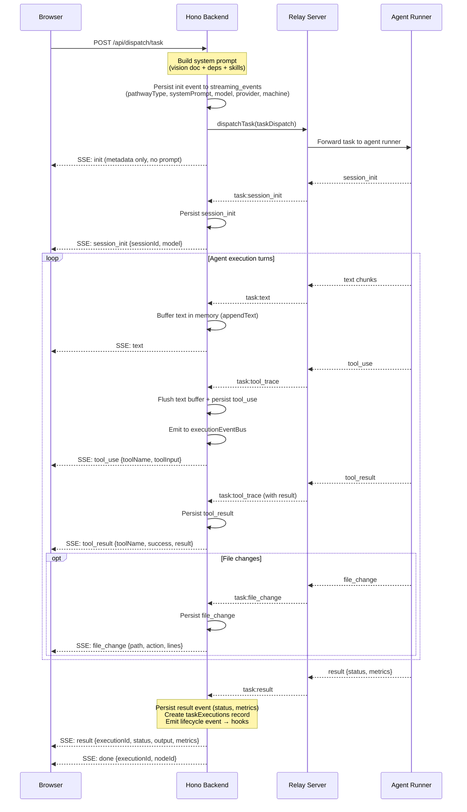
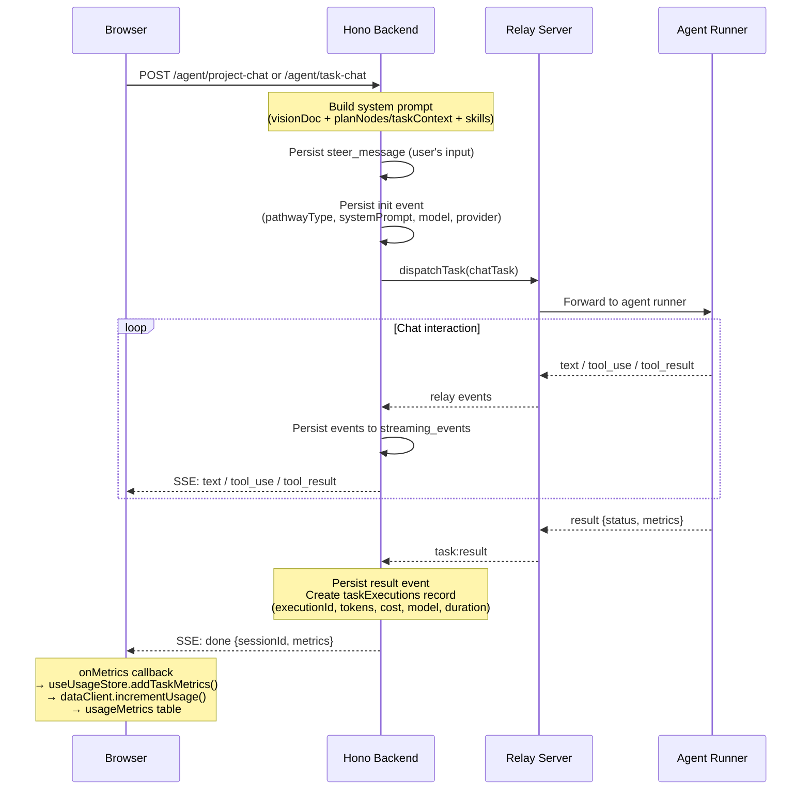
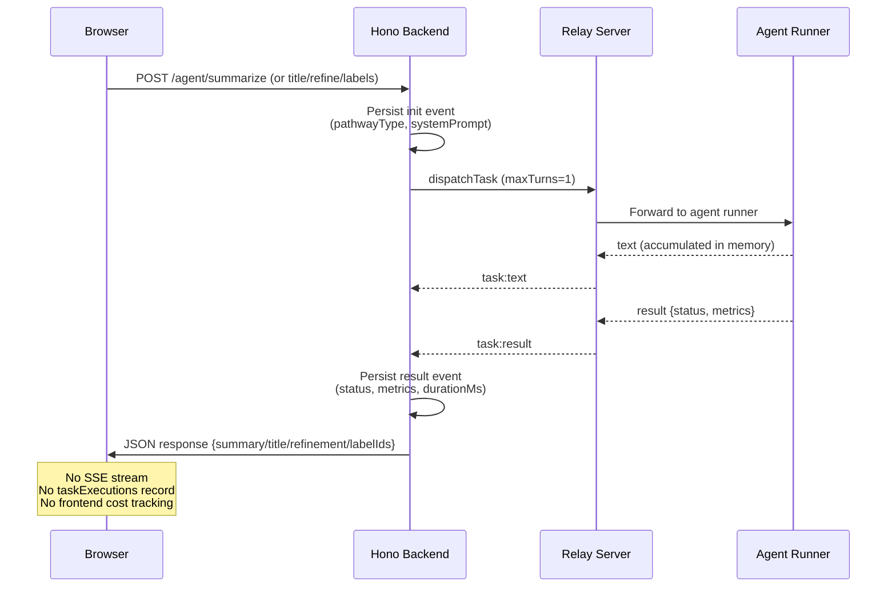
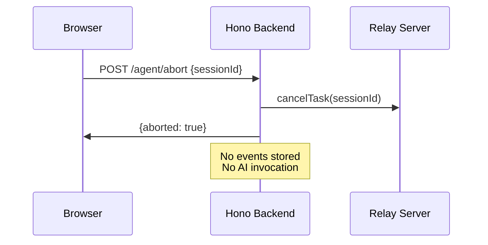
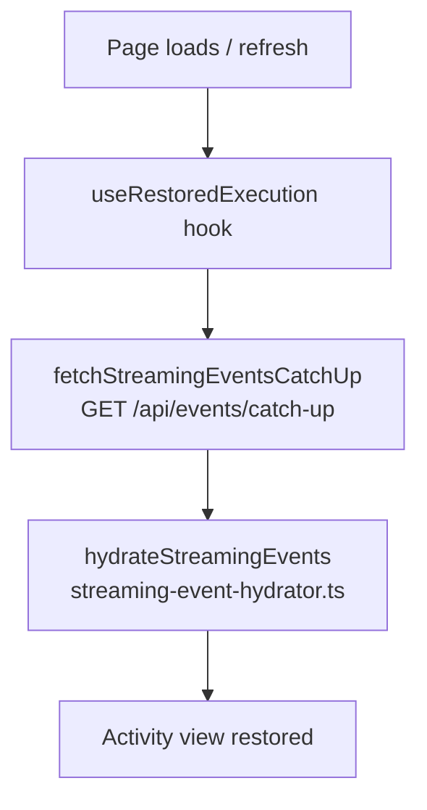
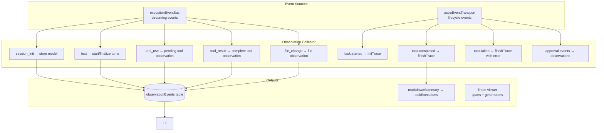
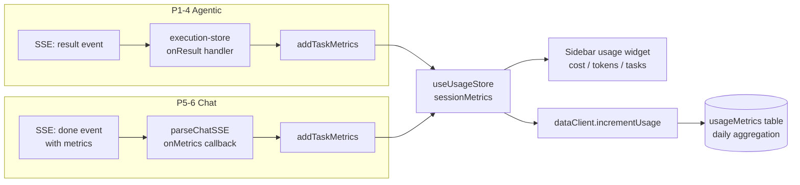

# Observability — Design Document

> **Status: IMPLEMENTED** — Core observability infrastructure is live across all 11 AI pathways.
>
> Related docs: [AI_PROVIDER_PATHWAYS.md](./AI_PROVIDER_PATHWAYS.md), [COST_TRACKING.md](./COST_TRACKING.md), [DATA_MODEL.md](./DATA_MODEL.md)

## 1. Overview

Astro's observability system captures, persists, and surfaces data from every AI interaction. The system answers three questions:

1. **What happened?** — Full trajectory of every AI session (prompts, responses, tool calls, file changes)
2. **What did it cost?** — Token counts, model, duration, and estimated cost per pathway
3. **Can I recover?** — Page refresh, SSE disconnect, and crash resilience via event replay

The system operates across three storage layers, each serving different query patterns:

| Layer | Table | Purpose | Consumers |
|-------|-------|---------|-----------|
| **Event Log** | `streaming_events` | Append-only SSE events | Page refresh recovery, catch-up hydration, activity replay |
| **Execution Summary** | `taskExecutions` | Per-execution cost/status record | Cost dashboards, usage metrics, project totals |
| **Structured Traces** | `observationEvents` | Turn-level generation tracking | Trace viewer, turn-level analysis |

## 2. The 11 AI Pathways

Each pathway is classified by its execution model and observability depth:

| # | Pathway | Route | Type | Turns | Streaming | Observability Level |
|---|---------|-------|------|-------|-----------|-------------------|
| P1 | Task Execution | `POST /api/dispatch/task` | Agentic | Multi | SSE | Full |
| P2 | Playground | `POST /api/dispatch/task` | Agentic | Multi | SSE | Full |
| P3 | Interactive Plan | `POST /api/dispatch/task` | Agentic | Multi | SSE | Full |
| P4 | HPC | `POST /api/dispatch/task` | Agentic | Multi | SSE | Full |
| P5 | Project Chat | `POST /api/agent/project-chat` | Chat | Multi | SSE | Standard |
| P6 | Task Chat | `POST /api/agent/task-chat` | Chat | Multi | SSE | Standard |
| P7 | Summarize | `POST /api/agent/summarize` | One-shot | 1 | JSON | Minimal |
| P8 | Title Gen | `POST /api/agent/generate-title` | One-shot | 1 | JSON | Minimal |
| P9 | Refine | `POST /api/agent/refine` | One-shot | 1 | JSON | Minimal |
| P10 | Label Suggest | `POST /api/agent/suggest-labels` | One-shot | 1 | JSON | Minimal |
| P11 | Abort | `POST /api/agent/abort` | Steering | 0 | JSON | None |

**Observability levels:**
- **Full** — init event, session_init, per-turn text/tool/file events, result with metrics, taskExecutions record, observation traces (turn-level generations)
- **Standard** — init event, steer_message, text/tool events, result with metrics, taskExecutions record, metrics in SSE done event
- **Minimal** — init event, result event (stored in streaming_events for trajectory), no SSE stream
- **None** — No AI invocation, no events stored

## 3. Data Flow Diagrams

### 3.1 Agentic Pathways (P1–P4): Full Observability

### 3.2 Chat Pathways (P5–P6): Standard Observability

### 3.3 One-Shot Pathways (P7–P10): Minimal Observability

### 3.4 Steering (P11): No Observability

### 3.5 Recovery: Page Refresh Hydration

### 3.6 Observation Collector Pipeline

### 3.7 Frontend Cost Display Pipeline

## 4. Storage Layer Details

### 4.1 streaming_events (Append-Only Log)

The primary persistence layer for SSE event recovery. All events written here can reconstruct the full activity view on page refresh.

**Schema:** `packages/core/src/db/schema.ts`

| Column | Type | Description |
|--------|------|-------------|
| `seq` | SERIAL PK | Auto-increment sequence number |
| `executionId` | TEXT NOT NULL | Routing key (taskId or streamId) |
| `eventType` | TEXT NOT NULL | Event type identifier |
| `data` | JSONB | Event payload |
| `createdAt` | TIMESTAMP | Default now() |

**Event types by pathway:**

| Event Type | P1-4 | P5-6 | P7-10 | Content |
|------------|:----:|:----:|:-----:|---------|
| `init` | yes | yes | yes | `{ pathwayType, projectId, nodeId, model, providerId, machineId, systemPrompt, computeBackend }` |
| `session_init` | yes | yes | — | `{ sessionId, model }` — Claude SDK session ID |
| `steer_message` | yes* | yes | — | `{ message }` — user's input text |
| `text` | yes | yes | — | `{ text }` — buffered, flushed on structural events |
| `tool_use` | yes | yes | — | `{ toolName, toolInput }` |
| `tool_result` | yes | yes | — | `{ toolName, success, result }` |
| `file_change` | yes | — | — | `{ path, action, linesAdded, linesRemoved }` |
| `progress` | yes | — | — | `{ message, percentage }` |
| `result` | yes | yes | yes | `{ sessionId, status, error?, metrics }` |
| `plan_result` | yes† | yes† | — | `{ nodes, edges }` — extracted plan JSON |
| `approval_request` | yes | — | — | `{ requestId, message, options }` |
| `approval_response` | yes | — | — | `{ requestId, answer }` |
| `safety_prompt` | yes | — | — | `{ tier, message, options }` |
| `safety_response` | yes | — | — | `{ decision }` |
| `error` | yes | yes | — | `{ error, recoverable }` |

\* steer_message for dispatch pathways is written via the `/steer` endpoint
† plan_result only for interactive plan generation pathway

**Text buffering:** Text events are buffered in memory (`appendText()`) and only flushed to DB when a structural event arrives (tool_use, tool_result, file_change, result) or on heartbeat/disconnect. This reduces write frequency by ~100x during active streaming.

### 4.2 taskExecutions (Summary Records)

Per-execution summary with cost metrics. Used for dashboards, project-level cost aggregation, and usage tracking.

**Schema:** `packages/core/src/db/schema.ts`

| Column | Type | Description |
|--------|------|-------------|
| `id` | UUID PK | Auto-generated |
| `executionId` | TEXT UNIQUE | Links to streaming_events |
| `nodeClientId` | TEXT NOT NULL | Plan node ID or `__pathway:<type>` sentinel |
| `projectId` | UUID NOT NULL | FK → projects |
| `status` | TEXT | `pending`, `running`, `success`, `failure`, `cancelled` |
| `streamText` | TEXT | Accumulated raw output |
| `error` | TEXT | Error message if failed |
| `startedAt` / `completedAt` | TIMESTAMP | Timing |
| `sessionId` | TEXT | Claude SDK session ID |
| `providerId` / `model` | TEXT | Provider and model used |
| `durationMs` | INTEGER | Wall-clock duration |
| `inputTokens` / `outputTokens` / `tokensUsed` | INTEGER | Token counts |
| `estimatedCostUsd` | REAL | Cost estimate from relay |
| `turnsUsed` | INTEGER | Number of agent turns |
| `markdownSummary` | TEXT | Generated by observation collector |

**Creation points:**
- **P1-4 (dispatch):** Created by dispatch engine's result handler (`server/lib/dispatch/result-router.ts`)
- **P5-6 (chat):** Created by `streamChatViaRelay.onResult` in `agent.ts`
- **P7-10 (one-shot):** Not created (no project context; these are utility calls)

**nodeClientId sentinel:** For chat pathways without a task node, `nodeClientId` uses a prefixed sentinel like `__pathway:project-chat`. This satisfies the NOT NULL constraint while remaining easily filterable.

### 4.3 observationEvents (Structured Traces)

Turn-level generation tracking for deep analysis. Created by the observation collector, not by the route handlers directly.

**Schema:** `packages/core/src/db/schema.ts`

| Column | Type | Description |
|--------|------|-------------|
| `id` | UUID PK | Auto-generated |
| `traceId` | TEXT | Groups all events for one execution |
| `parentObservationId` | UUID | Tree structure for nested spans |
| `type` | TEXT | `span`, `generation`, `tool`, `event` |
| `name` | TEXT | Human-readable label |
| `startTime` / `endTime` | TIMESTAMP | Timing |
| `input` / `output` | JSONB | Turn input/output data |
| `model` | TEXT | Model used for generation |
| `inputTokens` / `outputTokens` | INTEGER | Per-generation token counts |
| `estimatedCostUsd` | REAL | Per-generation cost |
| `level` | TEXT | `debug`, `default`, `warning`, `error` |
| `projectId` / `nodeId` | TEXT | Context |
| `metadata` | JSONB | Additional context |

**Coverage:** Only P1-4 (agentic pathways) get full observation traces. Chat and one-shot pathways have minimal or no observation records.

### 4.4 usageMetrics (Daily Aggregation)

Per-user daily cost totals. Updated incrementally from the frontend.

| Column | Type | Description |
|--------|------|-------------|
| `userId` | TEXT | User identifier |
| `sessionDate` | DATE | Aggregation day |
| `totalCostUsd` | REAL | Daily cost total |
| `totalInputTokens` / `totalOutputTokens` | INTEGER | Token totals |
| `tasksCompleted` / `tasksFailed` | INTEGER | Task counts |

**Update flow:** Frontend `useUsageStore.addTaskMetrics()` → `dataClient.incrementUsage()` → `POST /api/data/usage/increment` → `usageMetrics` table.

## 5. What Each Pathway Captures

### 5.1 Prompt & System Context

| Pathway | System Prompt | Vision Doc | Skills | Plan Context | Task Context | Dependencies |
|---------|:---:|:---:|:---:|:---:|:---:|:---:|
| P1-4 Dispatch | yes | yes | yes | — | yes | yes |
| P5 Project Chat | yes | yes | yes | planNodes + planEdges | — | — |
| P6 Task Chat | yes | optional | yes | — | title + description + output | — |
| P7-10 One-shot | yes | — | — | — | varies | — |
| P11 Abort | — | — | — | — | — | — |

**System prompt storage:** The full system prompt is stored in the `init` event's `data.systemPrompt` field in `streaming_events`. This means every AI session's prompt is recoverable — including injected skills, vision doc, and context. The system prompt is stored server-side only (not sent to the browser via SSE).

### 5.2 AI Provider Input/Output

| Data Point | P1-4 | P5-6 | P7-10 | How Captured |
|------------|:---:|:---:|:---:|---|
| Input tokens | yes | yes | yes* | `metrics.inputTokens` from relay result |
| Output tokens | yes | yes | yes* | `metrics.outputTokens` from relay result |
| Model used | yes | yes | yes* | `metrics.model` from relay result |
| Cost estimate | yes | yes | yes* | `metrics.totalCost` from relay result |
| Duration | yes | yes | yes | `startTime` → result arrival |
| Turn count | yes | yes | 1 | `metrics.numTurns` from relay result |
| Full text output | yes | yes | in memory | streaming_events `text` events |
| Tool calls | yes | yes | — | streaming_events `tool_use` + `tool_result` |
| File changes | yes | — | — | streaming_events `file_change` |

\* One-shot pathways get metrics from the relay result but don't create `taskExecutions` records (no project context).

### 5.3 Frontend Display

| UI Component | Pathways | Data Source | Shows |
|---|---|---|---|
| Activity feed | P1-4, P5-6 | Live SSE + streaming_events catch-up | Text, tools, files, errors, approvals |
| Trace viewer | P1-4 | observationEvents | Per-turn generations, tool calls, durations |
| Usage sidebar | P1-6 | useUsageStore (in-memory + usageMetrics DB) | Session cost, token counts, task counts |
| Project cost | P1-6 | taskExecutions aggregated by projectId | Total project spend |
| Task execution card | P1-4 | taskExecutions + streaming_events | Status, duration, cost, summary |
| Chat panel | P5-6 | Session messages + SSE | Conversation history |
| Plan result | P3, P5 | plan_result event | Generated plan graph |

## 6. Recovery Mechanisms

### 6.1 Page Refresh Recovery

The `useRestoredExecution` hook tries two paths:

1. `fetchStreamingEventsCatchUp([executionIds], lastSeq)` → `GET /api/events/catch-up` → hydrate via `hydrateStreamingEvents()`

### 6.2 SSE Disconnect Catch-Up

When the SSE stream drops mid-execution, the frontend tracks `lastSeq` (from SSE `id:` field) and on reconnect fetches `fetchStreamingEventsCatchUp([executionId], lastSeq)` — returns only events after the last seen seq, replayed into the activity view.

### 6.3 Crash Resilience

| Failure Mode | Protection |
|---|---|
| Browser tab close | Text buffer flushed on `stream.onAbort()` |
| SSE timeout | Heartbeat every 15s; flushes text buffer |
| Server SIGTERM/SIGINT | `streamingEventLog.flushAll()` in shutdown handler |
| Uncaught exception | `streamingEventLog.flushAll()` with 3s timeout before `process.exit(1)` |
| Unhandled rejection | `streamingEventLog.flushAll()` (non-fatal) |
| Agent runner disconnect | `machine:disconnected` event → error SSE |

### 6.4 Text Buffering Strategy

Text events arrive at high frequency during streaming. Rather than persisting each chunk individually:

1. `appendText()` buffers text in memory (keyed by executionId)
2. Buffer is flushed to a single `text` event when:
   - A structural event arrives (tool_use, tool_result, file_change, result)
   - Heartbeat fires (every 15s)
   - Client disconnects (onAbort)
   - Server shuts down (flushAll)
3. This reduces DB writes by ~100x during active streaming

## 7. Hook Registration

The backend registers observability hooks on startup via `astroEventTransport`:

| Hook | Subscribes To | Action |
|------|--------------|--------|
| `observability` | Lifecycle + streaming events | Builds turn-level traces in `observationEvents`, generates markdown summaries |
| `usage-metrics` | `task.completed` | Aggregates cost + tokens |
| `sse-notification` | All lifecycle events | Pushes to frontend via SSE |
| `audit-log` | All lifecycle events | Writes audit trail |
| Plus | PR creation, merge queue, git pull, channel notification, GitHub issue close, field sync, PR body update, project completion, PR auto-link | Various automation hooks |

## 8. Observability Gaps and Future Work

### 8.1 Currently Deferred

| Gap | Description | Priority |
|---|---|---|
| Duplicate event audit | Verify no double-writes when SSE reconnects overlap with global relay fallback | Medium |
| `pathway_type` column | Optional indexed column on streaming_events for efficient filtering by pathway | Low |
| One-shot cost tracking | P7-10 don't create taskExecutions — could be added if cost visibility needed | Low |
| Chat observation traces | P5-6 don't have turn-level observation records (only streaming_events) | Medium |
| Failed-execution metrics | Metrics for failed chat sessions aren't sent to frontend (server-side tracking works) | Low |

### 8.2 Data Points Not Yet Captured

| Data Point | Pathways Affected | Potential Value |
|---|---|---|
| Token usage per turn | P5-6 (chat) | Identify expensive conversation turns |
| Prompt template version | All | Track prompt engineering changes |
| Cache hit rate | P1-4 | Measure prompt caching effectiveness |
| Time to first token | P1-6 (streaming) | Latency monitoring |
| Retry count | All | Detect flaky relay/agent issues |

## 9. Key File Reference

| File | Role |
|---|---|
| `server/routes/agent.ts` | Chat + one-shot route handlers, `streamChatViaRelay`, `executeViaRelay` |
| `server/routes/dispatch.ts` | Agentic dispatch, `dispatchViaRelay` |
| `server/routes/events.ts` | Global SSE relay (fallback after dispatch stream closes) |
| `server/lib/streaming-event-log.ts` | Append-only event persistence with text buffering |
| `server/lib/observability/observation-collector.ts` | Turn-based trace construction |
| `server/lib/events/astro-event-transport.ts` | Lifecycle event bus |
| `server/lib/events/hooks/usage-metrics-hook.ts` | Cost aggregation hook |
| `server/routes/observations.ts` | Observation query API |
| `src/stores/execution-store.ts` | Frontend execution state + metrics |
| `src/stores/usage-store.ts` | Frontend session cost tracking |
| `src/lib/sse-parser.ts` | SSE parsing with `onMetrics` callback |
| `src/hooks/use-restored-execution.ts` | Page refresh recovery |
| `src/components/activity-blocks.tsx` | Activity rendering |
| `packages/core/src/db/schema.ts` | All table schemas |
