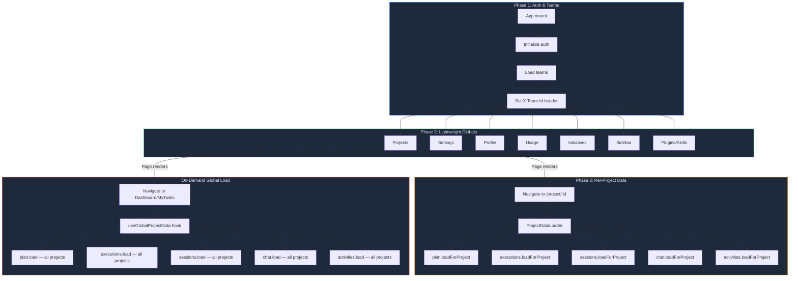

# Project-Scoped Lazy Loading — Design Document

**Status**: Implemented (PR #1030)
**Scope**: Frontend refactoring + minimal backend query-parameter support
**Related**: `DATA_FLOW.md`, `FRONTEND.md`, `REFRESH_ROBUSTNESS.md`

---

## 1. Problem

On every page load, the DataLoader fetched **all** plan nodes, edges, executions, sessions, chat history, and activities for **every** project the user owns. For power users with dozens of projects and hundreds of tasks, this meant:

- **358 executions**, **200+ nodes**, **100+ sessions** loaded on first paint
- **30+ second** page load time on production (Fly.io → Supabase round-trip)
- The user only looks at **one project at a time** — 95% of the data is never rendered

```
BEFORE: Page load timeline
──────────────────────────────────────────────────────────────
0s        5s        10s       15s       20s       25s       30s
│         │         │         │         │         │         │
├─ Teams ─┤                                                 │
│         ├─ Projects ─┤                                    │
│         ├─ Settings ──┤                                   │
│         ├─ Profile ───┤                                   │
│         ├───── ALL Plans (200+ nodes) ─────────────┤      │
│         ├───── ALL Executions (358) ───────────────┤      │
│         ├───── ALL Sessions (100+) ────────────────┤      │
│         ├───── ALL Chat ───────────────────────────┤      │
│         ├───── ALL Activities ─────────────────────┤      │
│         │                                          │      │
│  Phase1 │              Phase 2 (blocking)          │ Done │
──────────────────────────────────────────────────────────────
                                              Page renders ──┘
```

## 2. Solution

**Load data for only the project the user is viewing.** Cross-project pages (Dashboard, My Tasks) trigger a full global load on demand.

```
AFTER: Page load timeline (navigating to /project/abc)
──────────────────────────────────────────────────────────────
0s        1s        2s        3s
│         │         │         │
├─ Teams ─┤                   │
│         ├─ Projects ─┤      │
│         ├─ Settings ──┤     │
│         ├─ Profile ───┤     │
│         │             │     │
│  Phase1 │  Phase 2    │     │
│         │  (lightweight)    │
│         │             │     │
│         │    Page renders ──┤
│         │             │     │
│         │             ├─ Plan (project abc only) ──┤
│         │             ├─ Executions (abc only) ────┤
│         │             ├─ Sessions (abc only) ──────┤
│         │             ├─ Chat (abc only) ──────────┤
│         │             ├─ Activities (abc only) ────┤
│         │             │                            │
│         │             │  Phase 3 (per-project,     │
│         │             │  non-blocking)             │
──────────────────────────────────────────────────────────────
```

**Result**: Page renders in ~2s instead of ~30s. Project data loads in the background while the user already sees the UI.

---

## 3. This Is a Frontend Refactoring

The change is **95% frontend**. The backend receives a single, additive modification:

| Layer | Changes | Scope |
|-------|---------|-------|
| **Frontend** | 8 files modified, 2 new files | Stores, hooks, routing, DataLoader |
| **Backend** | 1 file modified (`server/routes/data.ts`) | Added optional `?projectId=` filter to 5 existing endpoints |
| **Database** | None | No schema changes, no migrations |
| **API contract** | Backward-compatible | Existing calls without `?projectId` work identically |

The backend change is a **query parameter pass-through** — it narrows the existing team-scoped SQL `WHERE` clause. No new endpoints, no new tables, no new auth logic. The access control path is unchanged: `getUserProjectIds(user)` always filters by team scope first, then optionally intersects with the requested `projectId`.

```
Backend change (conceptual):

BEFORE:  SELECT * FROM nodes WHERE projectId IN (user's projects)
AFTER:   SELECT * FROM nodes WHERE projectId IN (user's projects)
                                AND projectId = :requestedProjectId   -- optional
```

---

## 4. Architecture

### 4.1 Three Loading Phases



### 4.2 What Each Page Loads

```
Page                    Route              Data Loaded              Mechanism
─────────────────────── ────────────────── ──────────────────────── ─────────────────────
                         ALWAYS LOADED (Phase 1 + 2)
                         │ teams, projects, settings, profile,
                         │ usage, initiatives, sidebar, plugins,
                         │ skills, examples, agent
                         │
┌─ PROJECT VIEWS ────────┼──────────────────────────────────────────────────────────────┐
│                        │                                                              │
│  Plan (graph)          │ /project/:id       plan + exec + sessions  ProjectLayout     │
│  Plan (list)           │ /project/:id/list  + chat + activities     (shared, no       │
│  Plan (timeline)       │ /project/:id/timeline  for THIS project    remount on        │
│  Plan (board)          │ /project/:id/board     only                view switch)      │
│  Plan (overview)       │ /project/:id/overview                                        │
│  Knowledge             │ /project/:id/knowledge                                       │
│  Repo                  │ /project/:id/repo                                            │
│  Task Detail           │ /project/:id/task/:nodeId                                    │
│                        │                                                              │
└────────────────────────┼──────────────────────────────────────────────────────────────┘
                         │
┌─ CROSS-PROJECT ────────┼──────────────────────────────────────────────────────────────┐
│                        │                                                              │
│  Dashboard             │ /dashboard          plan + exec + sessions  useGlobalProject │
│  My Tasks              │ /tasks              + chat + activities     Data() hook       │
│  Active Tasks          │ /active             for ALL projects        (triggers full    │
│  Initiatives           │ /initiatives        (global load)           load on first     │
│  Projects              │ /projects                                   visit)            │
│  Agents                │ /agents (removed?)                                           │
│  New Plan              │ /plan, /welcome                                              │
│                        │                                                              │
└────────────────────────┼──────────────────────────────────────────────────────────────┘
                         │
┌─ GLOBAL-ONLY ──────────┼──────────────────────────────────────────────────────────────┐
│                        │                                                              │
│  Playground            │ /playground          Phase 2 globals only   DataLoader only   │
│  Settings              │ /settings            (no plan/exec/         (no additional    │
│  Environments          │ /environments         session data needed)   loading)         │
│  Workflows             │ /workflows                                                   │
│  Examples              │ /examples                                                    │
│  Community             │ /community                                                   │
│                        │                                                              │
└────────────────────────┴──────────────────────────────────────────────────────────────┘
```

### 4.3 Store Flag System

Each of the 5 "heavy" stores has two boolean flags:

| Flag | Set by | Meaning |
|------|--------|---------|
| `loaded` | `load()` or `loadForProject()` | "Some data is present — OK to render" |
| `globallyLoaded` | `load()` only | "All data for all projects is present" |

This prevents the key bug: if a user visits `/project/A` first (which sets `loaded: true`), then navigates to Dashboard, `useGlobalProjectData()` checks `globallyLoaded` (still `false`) and triggers the full load.

```
Scenario: User visits /project/A then /dashboard

/project/A mount:
  loadForProject("A") → sets loaded=true, globallyLoaded stays false

/dashboard mount:
  useGlobalProjectData() checks globallyLoaded → false → triggers load()
  load() fetches ALL data → sets loaded=true AND globallyLoaded=true

Subsequent /project/B mount:
  loadForProject("B") checks globallyLoaded → true → SKIPS (data already loaded)
```

### 4.4 ProjectLayout Route Architecture

```
BEFORE (9 duplicate instances, remount on view switch):

<Route path="project/:id"          element={<><ProjectDataLoader /><PlanView /></>} />
<Route path="project/:id/graph"    element={<><ProjectDataLoader /><PlanView /></>} />
<Route path="project/:id/list"     element={<><ProjectDataLoader /><PlanView /></>} />
<Route path="project/:id/timeline" element={<><ProjectDataLoader /><PlanView /></>} />
...9 total copies

AFTER (single layout route, persists across view switches):

<Route path="project/:id" element={<ProjectLayout />}>
  <Route index element={<PlanView />} />
  <Route path="graph" element={<PlanView />} />
  <Route path="list" element={<PlanView />} />
  <Route path="timeline" element={<PlanView />} />
  ...
</Route>
```

`ProjectLayout` renders `<ProjectDataLoader />` + `<Outlet />`. Since it's a layout route, it persists when switching between graph/list/timeline — no remount, no redundant data fetches.

---

## 5. Non-Interference Analysis

**Does this interfere with existing logic?** No. Here's why:

### 5.1 API Contract Is Unchanged

Every endpoint works identically without `?projectId=`. The parameter is optional and additive — it narrows the result set, never broadens it. Existing callers (CLI, agent-runner, other frontends) are unaffected.

### 5.2 Store Merge Semantics Are Additive

`loadForProject()` **merges** new data into the existing store state. It never clears data for other projects:

```typescript
// plan-store.loadForProject:
const otherNodes = existingNodes.filter(n => n.projectId !== projectId)  // keep others
set({ nodes: [...otherNodes, ...newNodes] })                             // add this project

// execution-store.loadForProject:
const merged = new Map(existing)
for (const [id, exec] of newExecs) merged.set(id, exec)                 // merge, don't replace
set({ executions: merged })
```

If the user visits `/project/A`, then `/project/B`, the store contains data for both A and B.

### 5.3 SSE Streaming Is Unaffected

Live execution streaming (`startExecution` → SSE → `handleStreamEvent`) writes directly to the execution-store by `nodeId`. It doesn't depend on the store being globally loaded — it creates entries on-the-fly as events arrive.

### 5.4 Realtime Sync Is Unaffected

Supabase Realtime and the WebSocket relay push changes that get merged into stores via `mergeNodeFromDB()`, `handleStreamEvent()`, etc. These methods operate on individual records, not on the global load state.

### 5.5 Page Refresh Recovery Is Unaffected

`useRestoredExecution()` hydrates from the `streaming_events` table, not from the store's `loaded` flag. It's triggered per-execution when a task detail view mounts, independent of whether the global store was loaded.

### 5.6 Backward Compatibility

| Feature | Before | After | Compatible? |
|---------|--------|-------|-------------|
| Global load (all data) | Always, on page load | On-demand via `useGlobalProjectData()` | Yes — same data, just deferred |
| Per-project load | Not supported | New: `loadForProject(id)` | Additive — new capability |
| DataLoader Phase 1 | Teams → sets X-Team-Id | Unchanged | Yes |
| DataLoader Phase 2 | All stores in parallel | Lightweight stores only | Yes — heavy stores deferred |
| Store `loaded` flag | Set by `load()` | Set by `load()` or `loadForProject()` | Yes — superset |
| Store reset on sign-out | Clears all stores | Clears all stores + `globallyLoaded` + `loadedProjectIds` | Yes |

---

## 6. Data Volume Comparison

```
Store           Global Load (30 projects)    Per-Project Load (1 project)
─────────────── ──────────────────────────── ────────────────────────────
Plan nodes      200+ nodes, ~2 MB            5-20 nodes, ~50 KB
Plan edges      300+ edges, ~100 KB          10-30 edges, ~5 KB
Executions      358 records, ~500 KB         10-15 records, ~20 KB
Sessions        100+ sessions, ~1 MB         3-5 sessions, ~50 KB
Chat            50+ sessions, ~200 KB        1-3 sessions, ~10 KB
Activities      1000 events, ~100 KB         50-100 events, ~10 KB
─────────────── ──────────────────────────── ────────────────────────────
TOTAL           ~4 MB + network overhead     ~150 KB + network overhead
                ~30s load time               ~1-2s load time
```

---

## 7. Known Tradeoffs

### 7.1 Sidebar Shows Incomplete Counts

The sidebar reads plan nodes and execution statuses to display per-project progress bars and active task badges. After this change, unvisited projects show 0% progress until a global load is triggered. This is an intentional tradeoff — the sidebar data is cosmetic, not functional.

**Mitigation**: When the user visits any cross-project page (Dashboard, My Tasks), `useGlobalProjectData()` triggers a full load, populating the sidebar for all projects.

### 7.2 First Cross-Project Page Is Slower

The first time a user visits Dashboard after a fresh page load, they trigger the full global load (~30s). Subsequent visits are instant because `globallyLoaded=true` prevents re-fetching.

**Mitigation**: Most users land on a project page directly (deep link, bookmark, notification click). They see their project in ~2s. The Dashboard load happens in the background later.

### 7.3 getUserProjectIds Called Multiple Times

The backend helper `getUserProjectIds()` makes a `SELECT id FROM projects` query. It's called once per filtered endpoint. When `ProjectDataLoader` fires 5 parallel requests, this query runs 5 times.

**Mitigation**: The query is lightweight (`SELECT id` only, indexed). Future optimization: per-request caching via Hono context.

---

## 8. File Inventory

| File | Role | Change |
|------|------|--------|
| `src/app.tsx` | DataLoader, route definitions | Removed heavy stores from Phase 2; switched to `ProjectLayout` route |
| `src/components/project-data-loader.tsx` | Per-project data loading | New: `ProjectLayout` (layout route) + `ProjectDataLoader` (side-effect) |
| `src/hooks/use-global-project-data.ts` | Cross-project page loading | New: triggers global load for Dashboard-class pages |
| `src/stores/plan-store.ts` | Plan nodes/edges | Added `loadForProject()`, `globallyLoaded`, extracted `prepareNodesAndEdges()` |
| `src/stores/execution-store.ts` | Task executions | Added `loadForProject()`, `globallyLoaded`, `loadedProjectIds` |
| `src/stores/session-store.ts` | Chat/execution sessions | Added `loadForProject()`, `globallyLoaded` |
| `src/stores/task-chat-store.ts` | Task chat history | Added `loadForProject()`, `globallyLoaded` |
| `src/stores/activity-store.ts` | Activity events | Added `loadForProject()`, `globallyLoaded` |
| `src/lib/data-client.ts` | API client | Added optional `projectId` param to 5 methods |
| `server/routes/data.ts` | Backend API | Added `?projectId=` filter + `getUserProjectIds()` helper |
| `src/pages/project-new-plan.tsx` | New plan page | Added `useGlobalProjectData()` |
| `src/pages/dashboard.tsx` | Dashboard | Added `useGlobalProjectData()` |
| `src/pages/my-tasks.tsx` | My Tasks | Added `useGlobalProjectData()` |
| `src/pages/active-tasks.tsx` | Active Tasks | Added `useGlobalProjectData()` |
| `src/pages/projects.tsx` | Projects list | Added `useGlobalProjectData()` |
| `src/pages/initiatives.tsx` | Initiatives | Added `useGlobalProjectData()` |
| `src/pages/agents.tsx` | Running Agents | Added `useGlobalProjectData()` |
