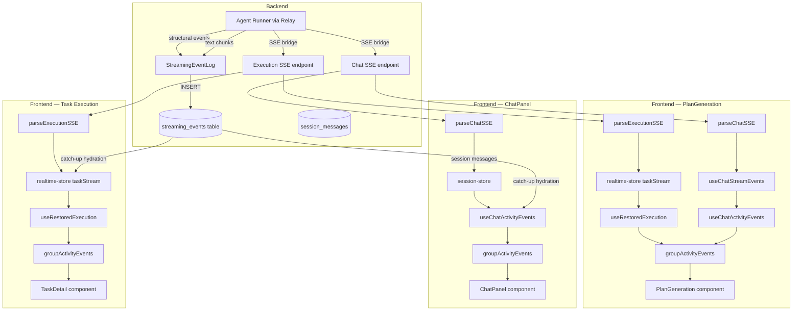
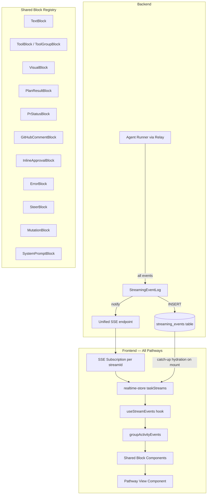

# Unified Streaming Pipeline

> **Last updated:** 2026-03-18
> **Status:** Proposal — not yet implemented.
> **Author:** Architecture review
> **Related:** [ARCHITECTURE.md](ARCHITECTURE.md), [PLAN_AND_REPLAN.md](PLAN_AND_REPLAN.md), [EVENT_DUPLICATION_ANALYSIS.md](EVENT_DUPLICATION_ANALYSIS.md)

A design for unifying the four frontend streaming/rendering pathways (PlanGeneration, ChatPanel, Playground, Task Execution) into a single architecture where the `streaming_events` table is the sole authority and all pathways share one rendering pipeline.

---

## Table of Contents

1. [Problem Statement](#1-problem-statement)
2. [Current Architecture](#2-current-architecture)
3. [Target Architecture](#3-target-architecture)
4. [Detailed Design](#4-detailed-design)
5. [Migration Plan](#5-migration-plan)
6. [Risks and Mitigations](#6-risks-and-mitigations)
7. [Non-Goals](#7-non-goals)
8. [Open Questions](#8-open-questions)

---

## 1. Problem Statement

Astro has four frontend pathways that consume streaming AI output. Each pathway implements its own combination of SSE parsing, event persistence, hydration (page-refresh recovery), and rendering. This creates seven categories of problems:

**1. Divergent source-of-truth.** ChatPanel uses session messages (`SessionMessage[]`) as its primary data source, falling back to `streaming_events` only when streaming events exist. PlanGeneration and Task Execution use `streaming_events` via the realtime store. This means ChatPanel sessions created before the streaming migration have no `streaming_events` rows and must be reconstructed from session messages -- a wholly separate code path.

**2. Dual SSE coordination.** PlanGeneration opens two SSE streams (execution SSE for the relay + chat SSE for refinement turns). These must be coordinated carefully: the execution stream writes to `streaming_events` via `StreamingEventLog`, but the chat stream writes to the realtime store's in-memory `taskStreams` via `pushChatEvent`. The two are stitched together in the component via `useChatStreamEvents` + `useChatActivityEvents` + `useRestoredExecution`, creating a fragile three-hook composition.

**3. Deduplication hacks.** `findSummaryBlockIndices()` exists in `activity-blocks.tsx` to detect and remove duplicate "Executive Summary" text blocks that appear when catch-up hydration overlaps with live events. `deduplicateTextBlocks()` in `streaming-event-hydrator.ts` removes text blocks longer than 50 characters that appear more than once. These are symptoms of the persistence layer not guaranteeing exactly-once delivery.

**4. Inconsistent text preprocessing.** ChatPanel strips tool XML tags and converts `uuid` references to `astro:node:uuid` links. PlanGeneration extracts plan JSON from text via `applyPlanFromText()`. Playground deduplicates summary blocks. Task Execution renders `PrStatusCard` and `GitHubCommentBlock`. None of these transformations are shared.

**5. Pathway-specific special blocks.** `PlanResultCard` is only rendered in PlanGeneration. `PrStatusCard` and `GitHubCommentBlock` only appear in Task Detail. `InlineApprovalCard` appears in both PlanGeneration and Task Execution but not in ChatPanel. A plan mutation made in Playground chat has no way to render a `PlanResultCard`.

**6. Divergent status tracking.** PlanGeneration derives status from `execution.status` (execution store). ChatPanel derives status from `session.status` (session store). Playground derives from both. Task Execution derives from `planNode.status` (plan store) cross-referenced with `taskStream.status` (realtime store). There is no single status model.

**7. Two plan mutation mechanisms.** `applyPlanFromText()` parses JSON/mutation blocks from raw assistant text and applies them to the plan store. `PLAN_MUTATING_TOOLS` in `session-store.ts` detects `create_task`, `update_task`, `delete_task`, `create_dependency`, and `Bash` tool calls and triggers a plan refresh. These two mechanisms can conflict or produce duplicate mutations.

### Cost of the status quo

- Every new feature (e.g., a new special block type, a new tool visualization) must be implemented in up to four places.
- Bugs in one pathway (e.g., text duplication) do not get fixed in others because the root cause is structural.
- Page-refresh recovery works differently per pathway, leading to data loss in some and duplication in others.
- The codebase has ~15 hooks and stores involved in streaming, making it difficult to reason about data flow.

---

## 2. Current Architecture

### 2.1 Pathway Comparison

| Dimension | PlanGeneration (P3+P7) | ChatPanel (P6) | Playground (P2) | Task Execution (P1) |
|---|---|---|---|---|
| **Agent-runner type** | `plan` | `chat` | `playground` | `undefined` (execution) |
| **SSE streams** | Dual (execution + chat) | Single (chat) | Dual (execution + chat) | Execution + task chat |
| **Persistence target** | `streaming_events` (execution), in-memory (chat) | Session messages (primary), `streaming_events` (fallback) | `streaming_events` (execution), in-memory (chat) | `streaming_events` |
| **Hydration hook** | `useRestoredExecution` + `useChatActivityEvents` | `useChatActivityEvents` (fallback: session messages) | `useRestoredExecution` + `useChatActivityEvents` | `useRestoredExecution` |
| **Text batching** | ~20fps via realtime store | ~20fps via `useChatStreamEvents` | ~20fps via realtime store / `useChatStreamEvents` | ~20fps via realtime store |
| **Plan mutations** | `applyPlanFromText()` + CLI tools | `PLAN_MUTATING_TOOLS` + `applyPlanFromText()` | None currently | None currently |
| **Special blocks** | `PlanResultCard`, `InlineApprovalCard` | Mutation blocks, uuid-link conversion | Visual blocks, summary dedup | `SummaryCard`, `PrStatusCard`, `GitHubCommentBlock`, `InlineApprovalCard` |
| **Status source** | `execution.status` | `session.status` | `execution.status` + `session.status` | `planNode.status` + `taskStream.status` |

### 2.2 Current Data Flow



### 2.3 Key Files (Current)

| File | Role |
|---|---|
| `server/lib/streaming-event-log.ts` | Backend: persist events to `streaming_events` table |
| `server/routes/agent.ts` | Backend: SSE bridge from relay to browser |
| `src/lib/sse-parser.ts` | Frontend: `parseSSEStream`, `parseChatSSE`, `parseExecutionSSE` |
| `src/lib/streaming-event-hydrator.ts` | Frontend: convert `streaming_events` rows to `TaskActivityEvent[]` |
| `src/stores/realtime-store.ts` | Frontend: global SSE event bus, `taskStreams` map |
| `src/stores/session-store.ts` | Frontend: session messages, chat SSE orchestration |
| `src/stores/execution-store.ts` | Frontend: dispatch + execution lifecycle |
| `src/hooks/use-restored-execution.ts` | Frontend: merge live + hydrated execution events |
| `src/hooks/use-chat-activity-events.ts` | Frontend: merge live + hydrated chat events |
| `src/hooks/use-chat-stream-events.ts` | Frontend: in-memory event accumulation for chat turns |
| `src/components/activity-blocks.tsx` | Frontend: `groupActivityEvents`, `DisplayBlock` types, block components |
| `src/lib/plan-extraction.ts` | Frontend: `applyPlanFromText()` text-based plan mutation |

---

## 3. Target Architecture

### 3.1 Core Principles

1. **Database is the sole authority.** Every streaming event -- from every pathway -- is persisted to `streaming_events` before the frontend sees it. The frontend never uses session messages or in-memory-only events as a primary data source.

2. **One persistence path.** All pathways (plan generation, chat, playground, task execution) write events through the same `StreamingEventLog` on the backend. Chat SSE endpoints that currently bypass persistence must be updated to persist first.

3. **One hydration path.** A single hook (`useStreamEvents`) replaces `useRestoredExecution`, `useChatActivityEvents`, and `useChatStreamEvents`. It subscribes to a stream ID, hydrates from the DB on mount, and merges live SSE events as they arrive.

4. **One rendering pipeline.** All pathways use `groupActivityEvents()` with the same preprocessing. Special blocks (PlanResultCard, PrStatusCard, InlineApprovalCard, GitHubCommentBlock, VisualWidget) are available in all pathways. The pathway only controls which blocks are *relevant* (via the tools available to the agent), not which blocks are *renderable*.

5. **Plan mutations via CLI only.** `applyPlanFromText()` is removed. All plan mutations flow through `astro-cli` MCP tools (`create_task`, `update_task`, `delete_task`, `create_dependency`), which produce `tool_use`/`tool_result` events that are persisted like any other event. Plan refresh is triggered by detecting these tool names in the event stream.

6. **Status derived from events.** A single `deriveStreamStatus()` function computes `idle | streaming | completed | error | awaiting_approval` from the event sequence. No pathway-specific status logic.

### 3.2 Target Data Flow



### 3.3 Pathway Differences (Target)

After unification, pathways differ only in:

| Dimension | How it differs | Where configured |
|---|---|---|
| **Prompt template** | Each pathway uses a different system prompt | `server/routes/agent.ts` (backend) |
| **Available tools** | Plan: read-only + astro-cli. Chat: all + MCP. Execution: all + MCP | `server/routes/agent.ts` (backend) |
| **Delivery mode** | Only task execution does git-based delivery | Agent-runner config |
| **Layout** | PlanGeneration has a graph sidebar. ChatPanel is a drawer. Task Execution has file changes panel | View components (frontend) |
| **Input affordances** | Plan gen has steer. Chat has message input. Task execution has steer + abort | View components (frontend) |

Everything else -- event persistence, SSE transport, hydration, rendering, status tracking -- is identical.

---

## 4. Detailed Design

### 4.1 Unified Event Schema

The `streaming_events` table schema is unchanged. The `eventType` column already supports all needed types. We formalize the canonical set:

| eventType | Data shape | Emitted by |
|---|---|---|
| `init` | `{ machineId, pathwayType, systemPrompt? }` | All pathways |
| `session_init` | `{ sessionId, model }` | All pathways |
| `text` | `{ text }` | All pathways |
| `tool_use` | `{ toolName, toolInput, toolUseId }` | All pathways |
| `tool_result` | `{ toolName, result, success, toolUseId, duration? }` | All pathways |
| `file_change` | `{ path, action, diff?, linesAdded?, linesRemoved? }` | Execution, Playground |
| `plan_result` | `{ nodes, edges, projectName? }` | Plan generation |
| `approval_request` | `{ requestId, question, options, machineId? }` | All pathways (via AskUserQuestion) |
| `approval_response` | `{ requestId, answer }` | All pathways |
| `steer_message` | `{ message, status }` | All pathways (user input during streaming) |
| `progress` | `{ percentage, message }` | Execution |
| `result` | `{ status, output, error, branchName?, prUrl?, prNumber?, deliveryStatus?, finalStatus?, summary? }` | All pathways |
| `error` | `{ error }` | All pathways |
| `safety_prompt` | `{ safetyTier, warning?, options }` | Execution |
| `safety_response` | `{ decision }` | Execution |
| `compaction` | `{ originalCount, compactedCount, summary }` | Chat (long conversations) |
| `chat_user` | `{ message }` | Chat, Plan refinement |
| `metrics` | `{ durationMs, inputTokens, outputTokens, totalCost, model, numTurns }` | All pathways |

New additions vs. current:
- `chat_user`: currently only in session messages; now persisted as a streaming event so chat history is fully reconstructible from `streaming_events`.
- `metrics`: currently embedded in the `done` SSE event; now a separate persisted event type for clean querying.
- `compaction`: currently an SSE-only event; now persisted for observability.

### 4.2 Backend: Unified Persistence in `streamChatViaRelay`

Currently, `streamChatViaRelay` in `server/routes/agent.ts` persists execution events via `streamingEventLog` but chat events have gaps. The change:

**Before:** Chat SSE endpoints persist some events (text, tool_use, tool_result via relay bridge) but not `chat_user` messages. Session messages are the authoritative record for conversation history.

**After:** Every event that flows through `streamChatViaRelay` is persisted to `streaming_events` via `streamingEventLog`, including:
- `chat_user` events (persisted when the user sends a message, before the SSE stream starts)
- `metrics` events (persisted when the relay reports usage at stream end)
- `compaction` events (persisted when conversation history is compacted)

The `streamId` parameter (already supported) becomes mandatory for all chat sessions. It serves as the `executionId` in `streaming_events`, linking all events for a session turn to a recoverable identifier.

```
// Pseudocode for the persistence guarantee
async function streamChatViaRelay(c, opts) {
  const persistId = opts.streamId  // required, no fallback to taskId

  // Persist user message BEFORE starting the relay stream
  if (opts.type === 'chat' || opts.type === 'plan') {
    await streamingEventLog.append(persistId, 'chat_user', { message: opts.prompt })
  }

  // ... relay dispatch and SSE bridge (existing code) ...
  // All relay events already flow through streamingEventLog.append()

  // Persist metrics at stream end
  if (metrics) {
    await streamingEventLog.append(persistId, 'metrics', metrics)
  }
}
```

### 4.3 Frontend: `useStreamEvents` Hook

A single hook replaces `useRestoredExecution`, `useChatActivityEvents`, and `useChatStreamEvents`.

```typescript
interface StreamEventsResult {
  activityEvents: TaskActivityEvent[]
  displayBlocks: DisplayBlock[]
  toolTraces: ToolTrace[]
  fileChanges: FileChange[]
  pendingApprovals: PendingApproval[]
  status: StreamStatus  // 'idle' | 'streaming' | 'completed' | 'error' | 'awaiting_approval'
  metadata: StreamMetadata  // machineId, sessionId, model, progress, etc.
  isHydrating: boolean
}

type StreamStatus = 'idle' | 'streaming' | 'completed' | 'error' | 'awaiting_approval'

function useStreamEvents(streamId: string | undefined): StreamEventsResult
```

**Lifecycle:**

1. **Mount / streamId change:** Call `hydrateFromCatchUp([streamId], 0)` to load all persisted events from the DB into the realtime store's `taskStreams` map.
2. **Live streaming:** The global SSE subscription (realtime store's `connect()`) pushes events into `taskStreams` as they arrive. No pathway-specific SSE parsing -- the realtime store handles all event types uniformly.
3. **Status derivation:** `deriveStreamStatus(activityEvents)` scans the event list:
   - No events and no active SSE = `idle`
   - Has events, no `result`/`error`/`done` event = `streaming`
   - Has `approval_request` without matching `approval_response` = `awaiting_approval`
   - Has `result` event = `completed`
   - Has `error` event = `error`
4. **Display blocks:** `groupActivityEvents(activityEvents)` is called once, producing `DisplayBlock[]` consumed by the view.

**What this replaces:**

| Current | Replaced by |
|---|---|
| `useRestoredExecution(executionId, execution, taskStream)` | `useStreamEvents(streamId)` |
| `useChatActivityEvents(streamId, sessionMessages, isStreaming)` | `useStreamEvents(streamId)` |
| `useChatStreamEvents()` | Removed -- events flow through realtime store |
| `isChatSessionStream()` guard in realtime store | Removed -- all streams handled uniformly |

### 4.4 Frontend: Unified Block Registry

All `DisplayBlock` types and their rendering components are shared across pathways. The current block types in `activity-blocks.tsx` already cover most cases. The changes:

**Move pathway-specific blocks to the shared registry:**
- `PlanResultCard` (currently only in `plan-generation/`): move to `activity-blocks.tsx` as `PlanGraphBlock` (already partially done).
- `PrStatusCard` (currently only in task detail): move to `activity-blocks.tsx`.
- `GitHubCommentBlock` (currently only in task detail): already in `activity-blocks.tsx`.
- `InlineApprovalCard` (currently in plan-generation and task detail): move to `activity-blocks.tsx`.

**Rendering decision:** Each view component renders `DisplayBlock[]` using a shared `<ActivityBlockRenderer blocks={blocks} />` component. The renderer maps each block type to its component. If a block type is irrelevant to a pathway (e.g., `pr_status` in ChatPanel), it simply never appears in the event stream because the agent does not have access to the tools that produce it.

```typescript
// Shared renderer — all pathways use this
function ActivityBlockRenderer({ blocks }: { blocks: DisplayBlock[] }) {
  return blocks.map((block, i) => {
    switch (block.type) {
      case 'text': return <TextBlock key={i} block={block} />
      case 'tool': return <ToolBlock key={i} block={block} />
      case 'tool_group': return <ToolGroupBlock key={i} block={block} />
      case 'visual': return <VisualWidget key={i} block={block} />
      case 'plan_result': return <PlanGraphBlock key={i} block={block} />
      case 'pr_status': return <PrStatusBlock key={i} block={block} />
      case 'github_comment': return <GitHubCommentBlock key={i} block={block} />
      case 'approval_request': return <InlineApprovalBlock key={i} block={block} />
      case 'approval_response': return <ApprovalResponseBlock key={i} block={block} />
      case 'steer': return <SteerBlock key={i} block={block} />
      case 'error': return <ErrorBlock key={i} block={block} />
      case 'chat_user': return <ChatUserBlock key={i} block={block} />
      case 'mutation': return <MutationBlock key={i} block={block} />
      case 'system_prompt': return <SystemPromptBlock key={i} block={block} />
      case 'json_render_spec': return <JsonRenderBlock key={i} block={block} />
      default: return null
    }
  })
}
```

### 4.5 Plan Mutations: CLI-Only Path

**Current state:** Two mutation mechanisms coexist:
1. `applyPlanFromText()` in `src/lib/plan-extraction.ts`: regex-parses assistant text for JSON plan objects and mutation blocks, then applies them to the plan store. Used by PlanGeneration and execution store.
2. `PLAN_MUTATING_TOOLS` in `session-store.ts`: detects `create_task`, `update_task`, etc. tool calls and triggers `loadPlanForProject()` to refresh from the DB. Used by ChatPanel.

**Target state:** Only mechanism (2) survives, extended to all pathways:

- `applyPlanFromText()` is deleted. The plan generation prompt is updated to use `astro-cli` tools (`create_task`, `update_task`, `delete_task`, `create_dependency`) instead of emitting raw JSON blocks.
- The plan-mutating tool detection moves from `session-store.ts` to `groupActivityEvents()` or the `useStreamEvents` hook, so it works for all pathways.
- When a `tool_result` event for a plan-mutating tool is detected, the hook calls `usePlanStore.loadPlanForProject(projectId)` to refresh the plan graph from the DB.

**Why this is better:**
- Single code path for plan mutations.
- Tool calls are persisted as `tool_use`/`tool_result` events in `streaming_events`, making them recoverable after page refresh.
- The plan store always reflects the DB state, not a fragile text-extraction result.
- Plan mutations become available in all pathways (Playground can modify plans, Task Execution can add follow-up tasks).

**Migration concern:** The plan generation prompt currently produces a full JSON plan object. Switching to per-node tool calls may increase token usage and latency for initial plan generation. See [Risks](#6-risks-and-mitigations) for mitigation.

### 4.6 Exactly-Once Delivery

The current deduplication hacks exist because:
1. `StreamingEventLog.flushText()` could race before the synchronous-delete fix.
2. SSE reconnect catch-up can overlap with live events.
3. The frontend merges events from multiple sources (execution store, realtime store, session messages).

**Target guarantees:**

**Backend:** `StreamingEventLog` already handles (1) with synchronous buffer deletion. No change needed.

**Frontend:** With a single event source (`streaming_events` via realtime store), overlap (2) and (3) are addressed:
- The SSE reconnect sends `Last-Event-ID` (the seq number of the last received event). The server queries `WHERE seq > lastSeq` and streams only new events.
- The frontend's `taskStreams` map is keyed by `streamId`. Hydration replaces the entire stream (not appends to it), preventing duplication from re-hydration.
- `deduplicateTextBlocks()` in the hydrator is kept as a safety net for legacy data but should not trigger for new streams.
- `findSummaryBlockIndices()` is removed after migration.

### 4.7 Multi-Tab and Multi-Device Consistency

**Current:** No explicit multi-tab handling. Each tab opens its own SSE connection and maintains its own realtime store state. Two tabs viewing the same execution will both show live events, but hydration state is independent.

**Target (no change for Phase 1):** Multi-tab behavior remains the same. Each tab subscribes via SSE and hydrates independently. This is acceptable because:
- `streaming_events` is append-only and seq-ordered, so multiple readers see a consistent view.
- SSE connections are cheap (one per tab, not per stream).
- Supabase Realtime subscription (Phase 3, future) could replace SSE for true cross-tab push, but this is out of scope.

### 4.8 Active Dispatch Stream Suppression

**Current problem:** When a dispatch is in progress, events arrive via two paths: (a) the direct SSE response from the dispatch endpoint, and (b) the global SSE event bus. `isChatSessionStream()` and `activeDispatchStreams` prevent double-delivery.

**Target:** The global SSE event bus is the *only* path for events to reach the frontend. The dispatch endpoint returns immediately after starting the relay task and does not stream events directly. Instead:
1. Backend: `streamChatViaRelay` persists events to `streaming_events` and publishes to the SSE event bus (via Redis pub/sub for multi-instance).
2. Frontend: The dispatch action (in execution-store or session-store) starts the dispatch via `POST`, receives the `streamId` in the response, and begins subscribing to events via the global SSE bus.
3. `activeDispatchStreams` and `isChatSessionStream()` are removed.

**Trade-off:** This adds a small latency (events go through DB + pub/sub instead of direct SSE). For text streaming at ~20fps, this is imperceptible. The benefit is a single event path with no suppression logic.

**Alternative considered:** Keep the direct SSE path for low-latency text streaming but have the global bus handle only structural events. Rejected because it reintroduces the dual-path problem.

---

## 5. Migration Plan

Migration is split into four phases. Each phase is independently deployable and backward-compatible. The entire migration can be paused or reverted at any phase boundary.

### Phase 1: Persist All Chat Events (Backend)

**Goal:** Make `streaming_events` the complete record for all pathways, including ChatPanel.

**Changes:**
1. In `server/routes/agent.ts`, persist `chat_user` events to `streaming_events` before starting the relay stream.
2. Persist `metrics` and `compaction` events at stream end.
3. Ensure `streamId` is always set for chat sessions (already the case for new sessions; backfill is not needed since old sessions use the session-message fallback).

**Validation:** After deployment, verify that new chat sessions have complete event history in `streaming_events` by querying the DB.

**No frontend changes.** ChatPanel continues to use session messages as primary source. The newly persisted events are "write-ahead" data for Phase 2.

**Estimated scope:** ~50 lines changed in `agent.ts`.

### Phase 2: Unified Frontend Hydration

**Goal:** Replace the three hydration hooks with `useStreamEvents`.

**Changes:**
1. Create `src/hooks/use-stream-events.ts` implementing the `useStreamEvents` hook.
2. Create `src/components/activity-block-renderer.tsx` implementing the shared block renderer.
3. Add `deriveStreamStatus()` to the hook or a utility module.
4. Update PlanGeneration to use `useStreamEvents(streamId)` instead of the three-hook composition.
5. Update ChatPanel to use `useStreamEvents(streamId)` with a fallback to session messages for pre-migration sessions.
6. Update Playground and Task Execution similarly.
7. Move `PlanResultCard`, `PrStatusCard`, `InlineApprovalCard` into the shared block registry.

**Validation:** Each pathway is updated and tested independently. The old hooks remain in the codebase until all consumers are migrated.

**Estimated scope:** ~300 lines new code, ~500 lines removed. Spread across 4-6 PRs (one per pathway + shared infrastructure).

### Phase 3: Eliminate Direct SSE Streaming

**Goal:** All events flow through the global SSE bus. Dispatch endpoints no longer stream directly.

**Changes:**
1. Modify `streamChatViaRelay` to return a `streamId` via a JSON response instead of streaming SSE. Events are delivered via the global SSE bus.
2. Update execution-store and session-store dispatch actions to use `POST` + subscribe pattern instead of SSE streaming.
3. Remove `activeDispatchStreams` and `isChatSessionStream()`.
4. Remove `parseChatSSE` and `parseExecutionSSE` wrappers (the global SSE handler in `realtime-client.ts` handles all events).

**Risk:** This is the highest-risk phase. See [Risks](#6-risks-and-mitigations).

**Validation:** End-to-end test: dispatch a task, verify events appear in the UI via global SSE only.

**Estimated scope:** ~400 lines changed across backend and frontend.

### Phase 4: CLI-Only Plan Mutations

**Goal:** Remove `applyPlanFromText()` and make all plan mutations flow through `astro-cli` tools.

**Changes:**
1. Update plan generation prompt (`buildInteractivePlanPrompt`) to use `astro-cli` tools instead of emitting raw JSON.
2. Move plan-mutating tool detection from `session-store.ts` to the `useStreamEvents` hook.
3. Delete `src/lib/plan-extraction.ts` (`applyPlanFromText`, `extractPlanJson`, `extractMutations`).
4. Delete `findSummaryBlockIndices()` from `activity-blocks.tsx`.
5. Update tests.

**Validation:** Generate a plan, verify nodes/edges are created via tool calls. Refine a plan in ChatPanel, verify mutations via tool calls. Page-refresh recovery works.

**Estimated scope:** ~200 lines new (prompt changes), ~600 lines removed.

### Phase Summary

| Phase | What | Risk | Reversible | Dependencies |
|---|---|---|---|---|
| 1 | Persist all chat events | Low | Yes (extra writes are harmless) | None |
| 2 | Unified frontend hydration | Medium | Yes (old hooks still exist) | Phase 1 |
| 3 | Eliminate direct SSE | High | Yes (can re-enable direct SSE) | Phase 2 |
| 4 | CLI-only plan mutations | Medium | Partial (prompt changes are hard to revert) | Phase 1 |

Phase 4 can proceed in parallel with Phases 2-3 since it is backend/prompt focused.

---

## 6. Risks and Mitigations

### R1: Latency increase from indirect SSE (Phase 3)

**Risk:** Routing all events through DB + pub/sub adds latency vs. direct SSE streaming. Text streaming may feel sluggish.

**Mitigation:**
- Measure baseline latency (direct SSE) and target latency (DB + pub/sub) before committing to Phase 3.
- If latency is unacceptable, keep direct SSE for text events only and use pub/sub for structural events. This is a partial win (still removes most suppression logic).
- The DB insert is already happening in parallel today; the additional cost is the pub/sub notification, which is sub-millisecond for Redis.

### R2: Plan generation token increase (Phase 4)

**Risk:** Switching from a single JSON block to per-node `create_task` tool calls increases token usage and latency for plan generation.

**Mitigation:**
- Measure token usage before and after on a sample of plan generation prompts.
- Consider a hybrid: the agent emits a `plan_result` event with the full plan JSON (for fast display), and the backend applies it to the DB via `astro-cli` tools internally. This preserves the single-response efficiency while keeping the CLI-only mutation path.
- The `plan_result` event type already exists and is already rendered by the hydrator.

### R3: Breaking legacy chat sessions (Phase 2)

**Risk:** Old ChatPanel sessions have no `streaming_events` rows. Switching to `useStreamEvents` would show an empty session.

**Mitigation:**
- `useStreamEvents` falls back to session messages when `streaming_events` returns zero rows for a given `streamId`.
- This fallback is clearly marked as legacy and can be removed after a migration window (e.g., 3 months).

### R4: Multi-instance event ordering (Phase 3)

**Risk:** With 2 Fly.io instances, a dispatch request may land on Instance A while the SSE subscription is on Instance B. Events must flow A -> Redis -> B in order.

**Mitigation:**
- Events are ordered by `seq` (auto-incrementing identity column in Postgres). The frontend sorts by `seq` after hydration.
- Redis pub/sub delivers messages in order within a channel. Cross-channel ordering is not needed because each stream has its own `streamId`.
- The existing `MACHINE_INSTANCE` + Redis pub/sub infrastructure already handles this for execution events.

### R5: Increased DB write volume (Phase 1)

**Risk:** Persisting `chat_user` and `metrics` events for every chat turn increases write volume to `streaming_events`.

**Mitigation:**
- These are small events (< 1KB each). The `streaming_events` table already handles high-volume text and tool events.
- The existing cleanup job (`streamingEventLog.cleanup()`) removes events older than a configurable threshold.
- Monitor table size after Phase 1 deployment.

---

## 7. Non-Goals

The following are explicitly out of scope for this design:

1. **Changing the agent-runner or relay protocol.** The relay WebSocket protocol and agent-runner event format are unchanged. This refactor is purely about how the backend persists events and how the frontend consumes them.

2. **Changing delivery mode.** Git-based delivery (PR, push, branch, copy, direct) remains in the agent-runner. The CLI-based delivery alternative was evaluated and rejected.

3. **Supabase Realtime for streaming.** Using Supabase's built-in Realtime subscription to push `streaming_events` changes to the frontend is a future optimization. This design uses the existing SSE infrastructure.

4. **Changing the `streaming_events` table schema.** The table structure (seq, executionId, eventType, data, createdAt) is sufficient. No columns are added or removed.

5. **Removing session messages.** The `SessionMessage` type and session store continue to exist for conversation history (passed back to the agent as context). The change is that session messages are no longer the *primary display source* -- streaming events are.

6. **Real-time collaboration / conflict resolution.** Multi-user editing of the same plan is handled by Supabase Realtime at the plan-store level, not the streaming pipeline.

7. **Observation/trace system changes.** The `observation_events` table and trace infrastructure are separate from `streaming_events` and are not affected.

8. **Backward-incompatible API changes.** All SSE endpoints remain available during migration. New endpoints are added alongside old ones, not replacing them.

---

## 8. Open Questions

**Q1: Should the global SSE bus use Server-Sent Events or WebSocket?**
Currently SSE. WebSocket would allow bidirectional communication (steer messages, approval responses) without separate POST endpoints. However, SSE is simpler, works through CDNs, and the existing POST-based steer/approval flow works well. Recommendation: keep SSE.

**Q2: How long should `streaming_events` rows be retained?**
Currently cleaned up by `streamingEventLog.cleanup()` with a caller-specified cutoff. With chat events now persisted, the table grows faster. Options:
- 7 days (current default for execution events)
- 30 days (to support "show me last month's chat history")
- Per-session TTL (chat sessions retain longer than execution events)

Recommendation: 30 days for all event types, with a future option for per-session TTL.

**Q3: Should `streamId` be the session ID or a separate identifier?**
Currently, `streamId` is set to `{sessionId}-{turnIndex}` for chat sessions and `executionId` for executions. For the unified model, using `sessionId` directly (with events ordered by seq) would simplify the mapping. However, this loses the ability to distinguish turns within a session.

Recommendation: Keep `streamId = sessionId` for the DB key, and use `seq` ordering to distinguish turns. A `chat_user` event marks the start of each turn.

**Q4: What is the upgrade path for the plan generation prompt?**
Phase 4 requires the plan generation agent to use `astro-cli` tools instead of emitting JSON. This is a significant prompt engineering effort. Should we:
- (a) Update the prompt and rely on the agent to figure it out, or
- (b) Keep the JSON output format but have the *backend* parse it and execute the CLI tools, or
- (c) Introduce a `create_plan` tool that accepts the full plan JSON in one call?

Recommendation: Option (c) -- a single `create_plan` tool that accepts `{ nodes, edges }` and applies them atomically. This preserves the efficiency of single-response plan generation while routing through the tool system for consistency.

---

## Appendix: File Impact Summary

Files that will be **created:**
- `src/hooks/use-stream-events.ts`
- `src/components/activity-block-renderer.tsx`
- `src/lib/stream-status.ts` (status derivation utility)

Files that will be **significantly modified:**
- `server/routes/agent.ts` (persist chat_user, metrics, compaction events)
- `src/stores/realtime-store.ts` (remove `isChatSessionStream`, handle all event types uniformly)
- `src/stores/session-store.ts` (remove streaming infrastructure, keep session/message management)
- `src/stores/execution-store.ts` (remove direct SSE parsing, use global bus)
- `src/components/activity-blocks.tsx` (add shared block components)
- `src/components/plan-generation/plan-generation.tsx` (simplify to use `useStreamEvents`)

Files that will be **deleted** (Phase 4):
- `src/lib/plan-extraction.ts`
- `src/hooks/use-chat-stream-events.ts`

Files that will be **deprecated then deleted** (after migration):
- `src/hooks/use-restored-execution.ts`
- `src/hooks/use-chat-activity-events.ts`
