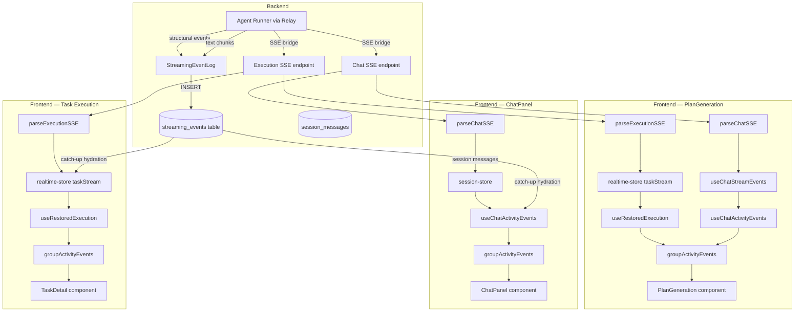
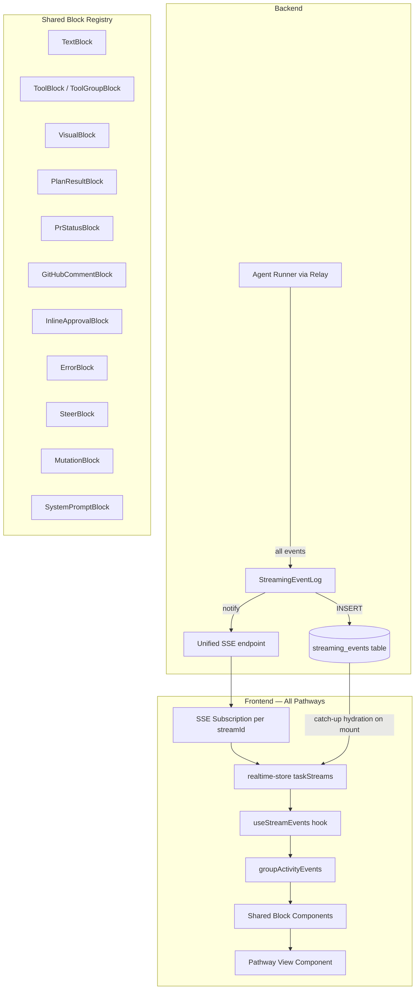

# Unified Streaming Pipeline

> **Last updated:** 2026-03-19
> **Status:** All phases (1, 2, 2.5, 3 including 3.4, and 4) are **COMPLETE**. All main pathways now read through the unified stream/store path. Phase 3.4 (POST + subscribe) shipped: all chat/dispatch endpoints return plain JSON, and events flow exclusively through the global SSE bus (`/api/events/stream` → `realtime-store` → `useStreamEvents`). `parseChatSSE` / `parseExecutionSSE` removed. `streaming-event-replay.ts` removed. The `stream-watcher.ts` utility enables stores and components to subscribe to stream events for side effects (session messages, plan refresh, title generation). The main deliberate exception is structural, not functional: `pr_status` still renders through task-detail-specific context instead of becoming a fully generic shared block. Build passes (`tsc -b` clean). CLI v0.3.0 end-to-end tested locally against PGlite (plan create/list/tree/create-node/update-node/delete-node/add-edge/remove-edge all verified). See Section 10 for visual rendering reference.
> **Author:** Architecture review
> **Related:** [ARCHITECTURE.md](ARCHITECTURE.md), [PLAN_AND_REPLAN.md](PLAN_AND_REPLAN.md), [EVENT_DUPLICATION_ANALYSIS.md](EVENT_DUPLICATION_ANALYSIS.md)

A design for unifying the four frontend streaming/rendering pathways (PlanGeneration, ChatPanel, Playground, Task Execution) into a single architecture where the `streaming_events` table is the sole authority and all pathways share one rendering pipeline.

---

## Table of Contents

1. [Problem Statement](#1-problem-statement)
2. [Current Architecture](#2-current-architecture)
3. [Target Architecture](#3-target-architecture)
4. [Detailed Design](#4-detailed-design)
5. [Migration Plan](#5-migration-plan)
6. [Implementation Status](#6-implementation-status)
7. [Risks and Mitigations](#7-risks-and-mitigations)
8. [Non-Goals](#8-non-goals)
9. [Open Questions](#9-open-questions)

---

## 1. Problem Statement

Astro has four frontend pathways that consume streaming AI output. Each pathway implements its own combination of SSE parsing, event persistence, hydration (page-refresh recovery), and rendering. This creates seven categories of problems:

**1. Divergent source-of-truth.** ChatPanel uses session messages (`SessionMessage[]`) as its primary data source, falling back to `streaming_events` only when streaming events exist. PlanGeneration and Task Execution use `streaming_events` via the realtime store. This means ChatPanel sessions created before the streaming migration have no `streaming_events` rows and must be reconstructed from session messages -- a wholly separate code path.

**2. Dual SSE coordination.** PlanGeneration opens two SSE streams (execution SSE for the relay + chat SSE for refinement turns). These must be coordinated carefully: the execution stream writes to `streaming_events` via `StreamingEventLog`, but the chat stream writes to the realtime store's in-memory `taskStreams` via `pushChatEvent`. The two are stitched together in the component via `useChatStreamEvents` + `useChatActivityEvents` + `useRestoredExecution`, creating a fragile three-hook composition.

**3. Deduplication hacks.** `findSummaryBlockIndices()` exists in `activity-blocks.tsx` to detect and remove duplicate "Executive Summary" text blocks that appear when catch-up hydration overlaps with live events. `deduplicateTextBlocks()` in `streaming-event-hydrator.ts` removes text blocks longer than 50 characters that appear more than once. These are symptoms of the persistence layer not guaranteeing exactly-once delivery.

**4. Inconsistent text preprocessing.** ChatPanel strips tool XML tags and converts `uuid` references to `astro:node:uuid` links. PlanGeneration extracts plan JSON from text via `applyPlanFromText()`. Playground deduplicates summary blocks. Task Execution renders `PrStatusCard` and `GitHubCommentBlock`. None of these transformations are shared.

**5. Pathway-specific special blocks.** `PlanResultCard` is only rendered in PlanGeneration. `PrStatusCard` and `GitHubCommentBlock` only appear in Task Detail. `InlineApprovalCard` appears in both PlanGeneration and Task Execution but not in ChatPanel. A plan mutation made in Playground chat has no way to render a `PlanResultCard`.

**6. Divergent status tracking.** PlanGeneration derives status from `execution.status` (execution store). ChatPanel derives status from `session.status` (session store). Playground derives from both. Task Execution derives from `planNode.status` (plan store) cross-referenced with `taskStream.status` (realtime store). There is no single status model.

**7. Two plan mutation mechanisms.** `applyPlanFromText()` parses JSON/mutation blocks from raw assistant text and applies them to the plan store. `PLAN_MUTATING_TOOLS` in `session-store.ts` detects `create_task`, `update_task`, `delete_task`, `create_dependency`, and `Bash` tool calls and triggers a plan refresh. These two mechanisms can conflict or produce duplicate mutations.

### Cost of the status quo

- Every new feature (e.g., a new special block type, a new tool visualization) must be implemented in up to four places.
- Bugs in one pathway (e.g., text duplication) do not get fixed in others because the root cause is structural.
- Page-refresh recovery works differently per pathway, leading to data loss in some and duplication in others.
- The codebase has ~15 hooks and stores involved in streaming, making it difficult to reason about data flow.

---

## 2. Current Architecture

### 2.1 Pathway Comparison

| Dimension | PlanGeneration (P3+P7) | ChatPanel (P6) | Playground (P2) | Task Execution (P1) |
|---|---|---|---|---|
| **Agent-runner type** | `plan` | `chat` | `playground` | `undefined` (execution) |
| **SSE streams** | Dual (execution + chat) | Single (chat) | Dual (execution + chat) | Execution + task chat |
| **Persistence target** | `streaming_events` (execution), in-memory (chat) | Session messages (primary), `streaming_events` (fallback) | `streaming_events` (execution), in-memory (chat) | `streaming_events` |
| **Hydration hook** | `useRestoredExecution` + `useChatActivityEvents` | `useChatActivityEvents` (fallback: session messages) | `useRestoredExecution` + `useChatActivityEvents` | `useRestoredExecution` |
| **Text batching** | ~20fps via realtime store | ~20fps via `useChatStreamEvents` | ~20fps via realtime store / `useChatStreamEvents` | ~20fps via realtime store |
| **Plan mutations** | `applyPlanFromText()` + CLI tools | `PLAN_MUTATING_TOOLS` + `applyPlanFromText()` | None currently | None currently |
| **Special blocks** | `PlanResultCard`, `InlineApprovalCard` | Mutation blocks, uuid-link conversion | Visual blocks, summary dedup | `SummaryCard`, `PrStatusCard`, `GitHubCommentBlock`, `InlineApprovalCard` |
| **Status source** | `execution.status` | `session.status` | `execution.status` + `session.status` | `planNode.status` + `taskStream.status` |

### 2.2 Current Data Flow



### 2.3 Key Files (Current)

| File | Role |
|---|---|
| `server/lib/streaming-event-log.ts` | Backend: persist events to `streaming_events` table |
| `server/routes/agent.ts` | Backend: SSE bridge from relay to browser |
| `src/lib/sse-parser.ts` | Frontend: `parseSSEStream`, `parseChatSSE`, `parseExecutionSSE` |
| `src/lib/streaming-event-hydrator.ts` | Frontend: convert `streaming_events` rows to `TaskActivityEvent[]` |
| `src/stores/realtime-store.ts` | Frontend: global SSE event bus, `taskStreams` map |
| `src/stores/session-store.ts` | Frontend: session messages, chat SSE orchestration |
| `src/stores/execution-store.ts` | Frontend: dispatch + execution lifecycle |
| `src/hooks/use-restored-execution.ts` | Frontend: merge live + hydrated execution events (**deleted in Phase 2.5**) |
| `src/hooks/use-chat-activity-events.ts` | Frontend: merge live + hydrated chat events (**deleted in Phase 2.5**) |
| `src/hooks/use-chat-stream-events.ts` | Frontend: in-memory event accumulation for chat turns (**deleted in Phase 2.5**) |
| `src/components/activity-blocks.tsx` | Frontend: `groupActivityEvents`, `DisplayBlock` types, block components |
| `src/lib/plan-extraction.ts` | Frontend: `applyPlanFromText()` text-based plan mutation |

---

## 3. Target Architecture

### 3.1 Core Principles

1. **Database is the sole authority.** Every streaming event -- from every pathway -- is persisted to `streaming_events` before the frontend sees it. The frontend never uses session messages or in-memory-only events as a primary data source.

2. **One persistence path.** All pathways (plan generation, chat, playground, task execution) write events through the same `StreamingEventLog` on the backend. Chat SSE endpoints that currently bypass persistence must be updated to persist first.

3. **One hydration path.** A single hook (`useStreamEvents`) replaces `useRestoredExecution`, `useChatActivityEvents`, and `useChatStreamEvents`. It subscribes to a stream ID, hydrates from the DB on mount, and merges live SSE events as they arrive.

4. **One rendering pipeline.** All pathways use `groupActivityEvents()` with the same preprocessing. Special blocks (PlanResultCard, PrStatusCard, InlineApprovalCard, GitHubCommentBlock, VisualWidget) are available in all pathways. The pathway only controls which blocks are *relevant* (via the tools available to the agent), not which blocks are *renderable*.

5. **Plan mutations via CLI only.** `applyPlanFromText()` is removed. All plan mutations flow through `astro-cli plan` commands (`plan create`, `plan create-node`, `plan update-node`, `plan delete-node`, `plan add-edge`, `plan remove-edge`) invoked via the `Bash` tool, which produce `tool_use`/`tool_result` events persisted like any other event. Plan refresh is triggered by detecting `Bash` in the event stream (already in `PLAN_MUTATING_TOOLS`).

6. **Status derived from events.** A single `deriveStreamStatus()` function computes `idle | streaming | completed | error | awaiting_approval` from the event sequence. No pathway-specific status logic.

### 3.2 Target Data Flow



### 3.3 Pathway Differences (Target)

After unification, pathways differ only in:

| Dimension | How it differs | Where configured |
|---|---|---|
| **Prompt template** | Each pathway uses a different system prompt | `server/routes/agent.ts` (backend) |
| **Available tools** | Plan: read-only + astro-cli. Chat: all + MCP. Execution: all + MCP | `server/routes/agent.ts` (backend) |
| **Delivery mode** | Only task execution does git-based delivery | Agent-runner config |
| **Layout** | PlanGeneration has a graph sidebar. ChatPanel is a drawer. Task Execution has file changes panel | View components (frontend) |
| **Input affordances** | Plan gen has steer. Chat has message input. Task execution has steer + abort | View components (frontend) |

Everything else -- event persistence, SSE transport, hydration, rendering, status tracking, **tool access**, **permission mode** -- is identical.

> **Architectural decision (2026-03-18): Same permissions for all pathways.** Plan generation previously restricted tools to read-only (no Write, Edit, MCP) and used `permissionMode: 'plan'`. This was security theater — the agent had `Bash` which can do anything. The restriction added complexity (special tool filtering in `claude-sdk-adapter.ts`, `type: 'plan'` relay field, separate permission mode) without meaningful safety. All pathways now use `permissionMode: 'bypassPermissions'` with the full tool set. The prompt alone controls whether the agent plans or executes.

---

## 4. Detailed Design

### 4.1 Unified Event Schema

The `streaming_events` table schema is unchanged. The `eventType` column already supports all needed types. We formalize the canonical set:

| eventType | Data shape | Emitted by |
|---|---|---|
| `init` | `{ machineId, pathwayType, systemPrompt? }` | All pathways |
| `session_init` | `{ sessionId, model }` | All pathways |
| `text` | `{ text }` | All pathways |
| `tool_use` | `{ toolName, toolInput, toolUseId }` | All pathways |
| `tool_result` | `{ toolName, result, success, toolUseId, duration? }` | All pathways |
| `file_change` | `{ path, action, diff?, linesAdded?, linesRemoved? }` | Execution, Playground |
| `plan_result` | `{ nodes, edges, projectName? }` | Plan generation |
| `approval_request` | `{ requestId, question, options, machineId? }` | All pathways (via AskUserQuestion) |
| `approval_response` | `{ requestId, answer }` | All pathways |
| `steer_message` | `{ message, status }` | All pathways (user input during streaming) |
| `progress` | `{ percentage, message }` | Execution |
| `result` | `{ status, output, error, branchName?, prUrl?, prNumber?, deliveryStatus?, finalStatus?, summary? }` | All pathways |
| `error` | `{ error }` | All pathways |
| `safety_prompt` | `{ safetyTier, warning?, options }` | Execution |
| `safety_response` | `{ decision }` | Execution |
| `compaction` | `{ originalCount, compactedCount, summary }` | Chat (long conversations) |
| `chat_user` | `{ message }` | Chat, Plan refinement |
| `metrics` | `{ durationMs, inputTokens, outputTokens, totalCost, model, numTurns }` | All pathways |
| `operational` | `{ message, source: 'astro' \| 'git' \| 'delivery' }` | Execution (agent-runner + backend heartbeat) |

New additions vs. current:
- `chat_user`: currently only in session messages; now persisted as a streaming event so chat history is fully reconstructible from `streaming_events`.
- `operational`: currently emitted as `text` events with `── [Prefix]` formatting; now a distinct event type for type-safe rendering without regex detection (Section 4.11).
- `metrics`: currently embedded in the `done` SSE event; now a separate persisted event type for clean querying.
- `compaction`: currently an SSE-only event; now persisted for observability.

### 4.2 Backend: Unified Persistence in `streamChatViaRelay`

Currently, `streamChatViaRelay` in `server/routes/agent.ts` persists execution events via `streamingEventLog` but chat events have gaps. The change:

**Before:** Chat SSE endpoints persist some events (text, tool_use, tool_result via relay bridge) but not `chat_user` messages. Session messages are the authoritative record for conversation history.

**After:** Every event that flows through `streamChatViaRelay` is persisted to `streaming_events` via `streamingEventLog`, including:
- `chat_user` events (persisted when the user sends a message, before the SSE stream starts)
- `metrics` events (persisted when the relay reports usage at stream end)
- `compaction` events (persisted when conversation history is compacted)

The `streamId` parameter (already supported) becomes mandatory for all chat sessions. It serves as the `executionId` in `streaming_events`, linking all events for a session turn to a recoverable identifier.

```
// Pseudocode for the persistence guarantee
async function streamChatViaRelay(c, opts) {
  const persistId = opts.streamId  // required, no fallback to taskId

  // Persist user message BEFORE starting the relay stream
  if (opts.type === 'chat' || opts.type === 'plan') {
    await streamingEventLog.append(persistId, 'chat_user', { message: opts.prompt })
  }

  // ... relay dispatch and SSE bridge (existing code) ...
  // All relay events already flow through streamingEventLog.append()

  // Persist metrics at stream end
  if (metrics) {
    await streamingEventLog.append(persistId, 'metrics', metrics)
  }
}
```

### 4.3 Frontend: `useStreamEvents` Hook

A single hook replaces `useRestoredExecution`, `useChatActivityEvents`, and `useChatStreamEvents`.

```typescript
interface StreamEventsResult {
  activityEvents: TaskActivityEvent[]
  displayBlocks: DisplayBlock[]
  toolTraces: ToolTrace[]
  fileChanges: FileChange[]
  pendingApprovals: PendingApproval[]
  status: StreamStatus  // 'idle' | 'streaming' | 'completed' | 'error' | 'awaiting_approval'
  metadata: StreamMetadata  // machineId, sessionId, model, progress, etc.
  isHydrating: boolean
}

type StreamStatus = 'idle' | 'streaming' | 'completed' | 'error' | 'awaiting_approval'

function useStreamEvents(streamId: string | undefined): StreamEventsResult
```

**Lifecycle:**

1. **Mount / streamId change:** Call `hydrateFromCatchUp([streamId], 0)` to load all persisted events from the DB into the realtime store's `taskStreams` map.
2. **Live streaming:** The global SSE subscription (realtime store's `connect()`) pushes events into `taskStreams` as they arrive. No pathway-specific SSE parsing -- the realtime store handles all event types uniformly.
3. **Status derivation:** `deriveStreamStatus(activityEvents)` scans the event list:
   - No events and no active SSE = `idle`
   - Has events, no `result`/`error`/`done` event = `streaming`
   - Has `approval_request` without matching `approval_response` = `awaiting_approval`
   - Has `result` event = `completed`
   - Has `error` event = `error`
4. **Display blocks:** `groupActivityEvents(activityEvents)` is called once, producing `DisplayBlock[]` consumed by the view.

**Implementation note (2026-03-18):** The shipped hook now owns the live/hydrated event path across the main views. It still intentionally remains slightly hybrid in two places: it keeps the legacy `SessionMessage[]` fallback for pre-migration chat sessions, and `deriveStreamStatus()` still accepts `taskStream` metadata so terminal status remains correct even when the most recent terminal signal arrives via store metadata first.

**What this replaces:**

| Current | Replaced by |
|---|---|
| `useRestoredExecution(executionId, execution, taskStream)` | `useStreamEvents(streamId)` |
| `useChatActivityEvents(streamId, sessionMessages, isStreaming)` | `useStreamEvents(streamId)` |
| `useChatStreamEvents()` | Removed -- events flow through realtime store |
| `isChatSessionStream()` guard in realtime store | Removed -- all streams handled uniformly |

### 4.4 Frontend: Unified Block Registry

All `DisplayBlock` types and their rendering components are shared across pathways. The current block types in `activity-blocks.tsx` already cover most cases. The changes:

**Move pathway-specific blocks to the shared registry:**
- `PlanResultCard` (currently only in `plan-generation/`): move to `activity-blocks.tsx` as `PlanGraphBlock` (already partially done).
- `PrStatusCard` (currently only in task detail): move to `activity-blocks.tsx`.
- `GitHubCommentBlock` (currently only in task detail): already in `activity-blocks.tsx`.
- `InlineApprovalCard` (currently in plan-generation and task detail): move to `activity-blocks.tsx`.

**Rendering decision:** Each view component renders `DisplayBlock[]` using a shared `<ActivityBlockRenderer blocks={blocks} />` component. The renderer maps each block type to its component. If a block type is irrelevant to a pathway (e.g., `pr_status` in ChatPanel), it simply never appears in the event stream because the agent does not have access to the tools that produce it.

```typescript
// Shared renderer — all pathways use this
function ActivityBlockRenderer({ blocks }: { blocks: DisplayBlock[] }) {
  return blocks.map((block, i) => {
    switch (block.type) {
      case 'text': return <TextBlock key={i} block={block} />
      case 'tool': return <ToolBlock key={i} block={block} />
      case 'tool_group': return <ToolGroupBlock key={i} block={block} />
      case 'visual': return <VisualWidget key={i} block={block} />
      case 'plan_result': return <PlanGraphBlock key={i} block={block} />
      case 'pr_status': return <PrStatusBlock key={i} block={block} />
      case 'github_comment': return <GitHubCommentBlock key={i} block={block} />
      case 'approval_request': return <InlineApprovalBlock key={i} block={block} />
      case 'approval_response': return <ApprovalResponseBlock key={i} block={block} />
      case 'steer': return <SteerBlock key={i} block={block} />
      case 'error': return <ErrorBlock key={i} block={block} />
      case 'chat_user': return <ChatUserBlock key={i} block={block} />
      case 'mutation': return <MutationBlock key={i} block={block} />
      case 'system_prompt': return <SystemPromptBlock key={i} block={block} />
      case 'json_render_spec': return <JsonRenderBlock key={i} block={block} />
      default: return null
    }
  })
}
```

**Implementation note (2026-03-18):** The shared renderer cutover is complete for the unified activity views. `pr_status` remains the one deliberate exception because it still needs task-detail-specific API-backed context before it can be promoted into a fully generic shared block.

### 4.5 Plan Mutations: CLI-Only Path

> **Correction (2026-03-18):** Post-audit initially concluded that the CLI lacked mutation commands. After syncing `packages/cli` to latest main (v0.3.0, PR #9 `feat/plan-mutations`), the CLI has a **complete plan mutation surface**: `plan create` (atomic full-plan), `plan create-node`, `plan update-node`, `plan delete-node`, `plan add-edge`, `plan remove-edge`. All commands support `--json` for structured output and include node ID validation. The original "CLI-Only" design was correct — the CLI just needed to be updated.

**Implemented state:** The text-parsing fallback is gone. The agent now uses `astro-cli plan` commands via `Bash` for all plan mutations:

- **For initial plan generation:** The agent calls `astro-cli plan create --project-id <id> --json` with the full `{ nodes, edges }` piped via stdin. This is atomic (one command creates the entire plan) and returns the short-ID-to-UUID mapping in JSON.
- **For plan refinements:** The agent calls `astro-cli plan create-node`, `update-node`, `delete-node`, `add-edge`, `remove-edge` as needed.
- `applyPlanFromText()` is deleted.
- The plan-mutating tool detection (already in `useStreamEvents` lines 272-287) triggers `usePlanStore.loadPlanForProject(projectId)` when it sees `Bash` tool results containing `astro-cli plan` commands. `PLAN_MUTATING_TOOLS` already includes `Bash`.

**CLI plan commands available (v0.3.0):**

| Command | Purpose | Key flags |
|---|---|---|
| `plan create` | Create/replace entire plan from JSON | `--project-id`, `--file` or stdin pipe |
| `plan create-node` | Create single node | `--title`, `--type`, `--dependency`, `--milestone-id`, `--estimate`, `--verification`, etc. |
| `plan update-node <id>` | Update node fields | `--title`, `--status`, `--add-dependency`, `--remove-dependency`, etc. |
| `plan delete-node <id>` | Delete a node | — |
| `plan add-edge` | Add dependency edge | `--source`, `--target`, `--type` (with node ID validation) |
| `plan remove-edge` | Remove dependency edge | `--source`, `--target` |

All commands support `--json` for structured machine-readable output. `plan create` handles short-ID-to-UUID mapping (e.g., agent emits `n1`, CLI maps to UUIDs and returns the mapping).

**Why CLI via Bash is better than MCP for plan mutations:**
- **Already works:** Plan tasks have `Bash` access. No agent-runner config change needed.
- **Complete surface:** All CRUD operations + edge management + ID validation already implemented.
- **Atomic plan creation:** `plan create` accepts `{ nodes, edges }` atomically — same efficiency as the proposed MCP `create_plan` tool.
- **Structured output:** `--json` flag returns `{ ok: true, nodeCount, edgeCount, idMapping }` — parseable by the agent for follow-up operations.
- **Frontend detection:** `PLAN_MUTATING_TOOLS` already includes `Bash`. When `useStreamEvents` sees a `Bash` tool_result, it triggers a plan refresh.
- **Observable:** CLI commands appear as `tool_use` (Bash) / `tool_result` events in `streaming_events`, making them recoverable after page refresh.

**Why not MCP?** The MCP server (`astro-tools-server.ts`) also has mutation tools (`create_task`, `update_task`, etc.), but:
- MCP tools are currently excluded from plan-type tasks in `claude-sdk-adapter.ts`.
- The MCP tools use different names (`create_task`) than the CLI (`plan create-node`), requiring frontend detection updates.
- The CLI's `plan create` command (atomic full-plan creation with ID mapping) has no MCP equivalent.
- Adding MCP access to plan tasks is an unnecessary config change when `Bash` already works.
- MCP adds a server process + transport layer; CLI is a direct subprocess with no ongoing connection.

**Migration concern:** None for token usage — `plan create` accepts the same JSON the agent currently emits in text, just routed through a CLI command instead. The prompt change is: "call `astro-cli plan create --project-id {id} --json` with the plan JSON piped to stdin" instead of "emit the plan JSON in your response text."

### 4.6 Exactly-Once Delivery

The current deduplication hacks exist because:
1. `StreamingEventLog.flushText()` could race before the synchronous-delete fix.
2. SSE reconnect catch-up can overlap with live events.
3. The frontend merges events from multiple sources (execution store, realtime store, session messages).

**Target guarantees:**

**Backend:** `StreamingEventLog` already handles (1) with synchronous buffer deletion. No change needed.

**Frontend:** With a single event source (`streaming_events` via realtime store), overlap (2) and (3) are addressed:
- The SSE reconnect sends `Last-Event-ID` (the seq number of the last received event). The server queries `WHERE seq > lastSeq` and streams only new events.
- The frontend's `taskStreams` map is keyed by `streamId`. Hydration replaces the entire stream (not appends to it), preventing duplication from re-hydration.
- `deduplicateTextBlocks()` in the hydrator was removed once the legacy dual-path suppression layer was deleted.
- `findSummaryBlockIndices()` is removed after migration.

### 4.7 Real-Time Delivery Architecture

Astro's streaming pipeline maps to the standard real-time messaging architecture used by chat and collaboration apps:

| Layer | Standard Pattern | Astro Implementation |
|---|---|---|
| **Transport (client↔server)** | WebSocket (bidirectional) or SSE (server→client) | **SSE** for server→client push (`events.ts`), **POST** for client→server actions (steer, abort, approvals). WebSocket reserved for relay (agent-runner↔backend). |
| **Cross-instance fan-out** | Pub/Sub broker (Redis, Kafka) | **Redis Pub/Sub** (`redis-pubsub.ts`). Server A receives events from relay → publishes to `TASK_STREAMING` channel → Server B receives → pushes to its SSE clients. |
| **Persistence** | Message store (DB) | **`streaming_events` table** (append-only, seq-ordered). Source of truth for hydration, catch-up, and page-refresh recovery. |
| **Offline/background recovery** | Push notifications + catch-up on reconnect | **SSE reconnect with `Last-Event-ID`** + DB catch-up via `hydrateFromCatchUp()`. **Browser notifications** for approval requests (`showApprovalNotification`). Tab visibility handler re-hydrates on foreground. |
| **Optimistic UI** | Render before server confirms | **Partial.** Chat messages render via `chatEventsRef` before SSE confirmation. Steer messages rendered optimistically. Plan creation not yet optimistic. |

#### 4.7.1 Two-Channel Event Delivery

A critical architectural distinction governs how events reach browser clients on a different backend instance from where they were produced:

| Event category | Transport (same instance) | Transport (cross-instance) |
|---|---|---|
| `text`, `tool_use`, `tool_result`, `file_change`, `session_init`, `progress` | In-process `relayServer` EventEmitter | **DB catch-up** — receiver queries `streaming_events` via `fetchStreamingEventsCatchUp()` |
| `node_status_changed`, `task_init`, `task_ready`, `plan_result`, `error` | In-process `executionEventBus` | **Redis pub/sub** (`relay:task:streaming` channel) |

**Why the split?** High-frequency streaming events (text chunks, tool calls) do not need sub-100ms cross-instance delivery — if Instance B's browser client reconnects and asks for catch-up, the DB query returns all events in sequence order. The Redis pub/sub channel is reserved for low-frequency coordination events that must trigger UI state transitions (plan rendered, task status changed, error injected) on all connected clients immediately.

**`StreamingEventMessage` shape** (the Redis payload):

```typescript
interface StreamingEventMessage {
  instanceId: string              // publisher's instanceId — used for application-level self-dedup
  eventType: StreamingEventType
  taskId: string
  userId?: string                  // for cross-instance user isolation checks in events.ts
  data: Record<string, unknown>
  dbSeq?: number                   // DB seq number when available; used as SSE Last-Event-ID
}
```

**Self-dedup pattern:** Redis delivers messages to ALL subscribers, including the publisher. `events.ts` applies an application-level check before forwarding to browser clients:

```typescript
const onRedisStreaming = async (msg: StreamingEventMessage) => {
  if (msg.instanceId === redisPubSub.getInstanceId()) return  // self-dedup
  // ... ownership check + SSE delivery
}
```

The publisher instance already delivered the event in-process via `relayServer` EventEmitter, so skipping the Redis echo is correct.

**`publishToRedis` wrapper** in `relay-server.ts` — used for all streaming event types except `result` and synthetic errors:

```typescript
private async publishToRedis(event: Omit<StreamingEventMessage, 'instanceId' | 'userId'>) {
  const userId = await executionContextStore.getUserIdForTaskWithFallback(event.taskId)
  try {
    await redisPubSub.publishStreamingEvent({ ...event, userId })
  } catch (err) {
    console.error('[relay] Redis publish error:', err)
    // Local delivery already happened — Redis failure is non-fatal
  }
}
```

`handleTaskResult` bypasses the wrapper to snapshot `userId` *before* `this.emit('task:result')`, since `dispatch.ts`'s `onResult` handler removes execution context synchronously during the emit, creating a race.

#### 4.7.2 Multi-Tab Consistency

Each tab opens its own SSE connection and maintains its own realtime store state. Two tabs viewing the same execution will both show live events, but hydration state is independent. This is acceptable because:
- `streaming_events` is append-only and seq-ordered, so multiple readers see a consistent view.
- SSE connections are cheap (one per tab, not per stream).
- Supabase Realtime subscription could replace SSE for true cross-tab push in the future, but is out of scope.

#### 4.7.3 Background Client Notifications (Future)

Currently, task completion notifications only appear when the tab is focused. If a 2-hour execution finishes while the user is in another app, they don't know until they switch back.

**Current coverage:**
- Approval requests: `showApprovalNotification()` fires a browser `Notification` (works when tab is backgrounded but browser is open).
- Task completion: Toast only (visible only when tab is focused).

**Future improvement:**
- Extend `showApprovalNotification` pattern to task completion and plan generation completion.
- Consider browser Push API (via service worker) for notifications when the browser is closed entirely. This requires a push notification backend (FCM/VAPID) which is out of scope for the streaming pipeline design but noted for future work.

#### 4.7.4 Optimistic UI Patterns

| Action | Current UX | Optimistic improvement |
|---|---|---|
| Send chat message | Message appears in `chatEventsRef` immediately (optimistic) | Already optimistic |
| Send steer message | Steer event rendered immediately in activity feed | Already optimistic |
| Create plan (CLI) | Wait for `plan_result` event via SSE (~1-2s round-trip) | Could render "Plan creating..." skeleton when `Bash` tool_use containing `astro-cli plan create` is detected, before tool_result arrives |
| Abort task | Wait for synthetic `result` event via SSE | Could optimistically mark as "aborting" on button click, before SSE confirms |

These optimistic patterns are not blocking for Phase 4 but improve perceived responsiveness.

### 4.8 Active Dispatch Stream Suppression

**Current problem:** When a dispatch is in progress, events arrive via two paths: (a) the direct SSE response from the dispatch endpoint, and (b) the global SSE event bus. `isChatSessionStream()` and `activeDispatchStreams` prevent double-delivery.

**Target:** The global SSE event bus is the *only* path for events to reach the frontend. The dispatch endpoint returns immediately after starting the relay task and does not stream events directly. Instead:
1. Backend: `streamChatViaRelay` persists events to `streaming_events` and publishes to the SSE event bus (via Redis pub/sub for multi-instance).
2. Frontend: The dispatch action (in execution-store or session-store) starts the dispatch via `POST`, receives the `streamId` in the response, and begins subscribing to events via the global SSE bus.
3. `activeDispatchStreams` and `isChatSessionStream()` are removed.

**Trade-off:** This adds a small latency (events go through DB + pub/sub instead of direct SSE). For text streaming at ~20fps, this is imperceptible. The benefit is a single event path with no suppression logic.

**Alternative considered:** Keep the direct SSE path for low-latency text streaming but have the global bus handle only structural events. Rejected because it reintroduces the dual-path problem.

### 4.9 Stream Lifecycle & Reliability

The original design focused on data flow correctness but did not address failure modes. Post-implementation audit revealed three gaps that must be addressed before Phase 3.

#### 4.9.1 Stream Watchdog (Stale Stream Cleanup)

**Problem:** If an agent runner crashes, the relay drops, or a network partition occurs mid-stream, the stream never receives a terminal event (`result` or `error`). The frontend shows "in progress" indefinitely. The `streaming_events` rows accumulate without cleanup.

**Current state:** `streamingEventLog.cleanup(olderThan)` is time-based only. The relay has heartbeat monitoring for machine connections (45-60s grace) but no per-task watchdog. The frontend has no timeout in `useStreamEvents`.

**Design:**

1. **Backend watchdog job** (runs every 60s, `server/lib/execution-watchdog.ts`):
   - Uses Redis leader election (`SETNX relay:leader:watchdog`) — only one backend instance runs the watchdog at a time. Prevents duplicate synthetic events in multi-instance deployments.
   - Query `streaming_events` for streams where `MAX(createdAt) < NOW() - interval '15 minutes'` AND no terminal event (`result`, `error`) exists.
   - For each stale stream, insert a synthetic `error` event: `{ error: 'Stream timed out — no events received for 15 minutes', synthetic: true, recoverable: true }`.
   - The 15-minute window is configurable via `STREAM_WATCHDOG_TIMEOUT_MS` env var.
   - Log the timeout for observability.

2. **Frontend timeout** (defense in depth):
   - `useStreamEvents` starts a 20-minute inactivity timer on mount. Reset on every new event.
   - If the timer fires, derive status as `error` with a "stream may have stalled" indicator.
   - This is UI-only — does not write to the DB. The backend watchdog is the authoritative closer.

3. **Relay disconnect cleanup:**
   - When `relay-server.ts` detects a machine disconnect (heartbeat timeout), enumerate all active tasks for that machine and insert `error` events for any that lack terminal events.
   - This catches the common case (machine goes offline) faster than the 15-minute watchdog.

#### 4.9.2 Stream Cancellation

**Problem:** Users cannot abort a stuck or runaway stream from the frontend. The `/api/agent/abort` endpoint exists but only signals the relay — there is no guarantee the agent runner stops, and the frontend has no feedback loop.

**Current state:** `POST /api/agent/abort` calls `relayServer.cancelTask(id)` and returns immediately. No terminal event is guaranteed. The frontend must poll or wait for the stream to eventually produce a `result` or `error`.

**Design:**

1. **Abort with synthetic terminal event:**
   - When `/api/agent/abort` is called, after forwarding to the relay, also insert a `result` event with `{ status: 'aborted', synthetic: true }` into `streaming_events`.
   - This guarantees the frontend sees a terminal state even if the relay/agent never responds.
   - If the agent later sends its own terminal event, it is appended but `deriveStreamStatus()` already returns the first terminal state encountered (scanning backwards), so the abort wins.

2. **Frontend abort UX:**
   - All pathways surface an abort button when `status === 'streaming'`.
   - On click: `POST /api/agent/abort`, then optimistically set local status to `'completed'` (abort).
   - The SSE bus delivers the synthetic `result` event, confirming the abort.

#### 4.9.3 Text Buffer Loss on Relay Crash

**Problem:** `StreamingEventLog` buffers text chunks in memory and flushes to DB when the next structural event arrives or on a heartbeat timer. If the relay process crashes between flushes, buffered text is lost.

**Current state:** On flush failure, chunks are re-inserted into the buffer (line 46-53 of `streaming-event-log.ts`). But if the process itself dies, the in-memory buffer is gone.

**Mitigation (acceptable risk):**
- The text buffer typically holds < 1 second of text (heartbeat flushes every ~5s, structural events flush more frequently).
- Lost text is at most one partial sentence — not catastrophic for the user experience.
- A full fix (write-ahead log or per-chunk persistence) would add latency to every text chunk and is not worth the trade-off.
- `flushAll()` is called on graceful shutdown (SSE disconnect handler), covering the normal disconnect case.
- **Decision:** Accept this as a known limitation. Document it but do not fix it.

### 4.10 Hydration Safety & Resource Limits

#### 4.10.1 Hydration/Live Event Race Condition

**Problem:** When `useStreamEvents` mounts, it (1) triggers `hydrateFromCatchUp()` to load persisted events from the DB and (2) subscribes to live SSE events via the realtime store. Events arriving between the DB query and the SSE subscription could be duplicated (present in both) or lost (present in neither).

**Current state:** The race is partially mitigated:
- Hydration uses `afterSeq` from `realtimeClient.lastSeq`, so catch-up queries only events newer than the last SSE event received.
- On reconnect, the realtime store deduplicates by building a set of `seq` numbers from both existing and hydrated events (lines 583-627 of `realtime-store.ts`).
- For initial mount (not reconnect), hydrated events replace the stream only if existing is empty.

**Remaining gap:** If events arrive via SSE *during* the hydration fetch (which is async), both the SSE handler and the hydration callback write to `taskStreams`. The dedup logic runs in the hydration callback, but SSE events pushed after the dedup completes are not checked.

**Mitigation (acceptable):**
- `seq`-based ordering means duplicates are visually identical (same content, same position). `groupActivityEvents()` produces the same `DisplayBlock[]` regardless of duplicates.
- The remaining live/catch-up overlap is handled by the unified store's stream replacement and seq-aware hydration flow rather than content-level text dedup.
- A lock-based solution (pause SSE writes during hydration) would add complexity and latency. Not worth it given the visual-equivalence property.
- **Decision:** Accept. The current unified path is sufficient without `deduplicateTextBlocks()`.

#### 4.10.1.1 Text Format Mismatch in Catch-Up Paths

**Problem:** Live SSE sends raw strings for `text` events (`data: Hello world`). The DB stores `{ text: "Hello world" }` as a JSON object. Catch-up paths (polling reconnect, steer error recovery) read from the DB and call `JSON.stringify(row.data)`, producing `'{"text":"Hello world"}'` — which the frontend renders literally as JSON instead of plain text.

**Current state (PR #1140):** Introduced `extractStreamingEventData()` in `streaming-event-hydrator.ts` to normalize DB rows back to the raw string format that `handleSSEEvent`/`replayEvent` expect. All catch-up paths must use this utility instead of raw `JSON.stringify(row.data)`.

**Files affected:**
- `src/lib/streaming-event-hydrator.ts` — new `extractStreamingEventData()` utility
- `src/stores/execution-store.ts` — polling reconnect catch-up
- `src/components/task-detail/unified-activity-view.ts` — steer catch-up

**Root cause:** The streaming pipeline has a format asymmetry by design — SSE `data` is a raw string for text events, but the DB `data` column is always a JSON object. Any code path that reads from the DB and feeds events back into the SSE event handlers must account for this mismatch.

#### 4.10.2 Event Pagination & Memory Pressure

**Problem:** Long-running tasks (hours of execution) can produce thousands of events. Does the system handle this?

**Current state (better than initially assessed):**
- **Catch-up pagination exists:** `fetchStreamingEventsCatchUp()` fetches up to 50 pages of 1000 events each (50,000 events max). This is sufficient for all practical execution durations.
- **In-memory accumulation:** All events for a stream are held in `taskStreams[streamId].activityEvents[]`. For a 12-hour execution, this could be 10,000-50,000 events. Modern browsers handle arrays of this size without issue (~5-50MB).
- **Rendering:** `groupActivityEvents()` collapses many events into fewer `DisplayBlock[]` (e.g., consecutive text events become one TextBlock). The rendering list is much shorter than the event list.

**Known limits:**
- **50,000 event hard cap:** Streams exceeding this lose older events on catch-up hydration. In practice, no execution has approached this limit.
- **No virtual scrolling:** `ActivityBlockRenderer` renders all blocks. For extremely long outputs (1000+ display blocks), scrolling performance may degrade.
- **No event compaction:** Unlike chat (which has `compaction` events), execution streams have no mechanism to summarize/discard old events.

**Recommendations (future, not blocking):**
- Add virtual scrolling to `ActivityBlockRenderer` if users report scroll lag on long executions.
- Consider execution-level compaction: after a task completes, collapse tool traces into summaries. This is a UX improvement, not a correctness issue.
- The 50,000 event cap is sufficient. Do not increase it.

#### 4.10.3 Seq Ordering Across Instances

**Problem:** `seq` is a global auto-incrementing identity column, not per-execution. With 2 Fly.io instances, concurrent writes from different instances interleave `seq` numbers across executions.

**Why this is fine:**
- Within a single execution, events are ordered by `seq` and the ordering is correct because a single execution flows through a single relay connection on a single instance.
- Cross-execution interleaving of `seq` is harmless — each execution's events are queried with `WHERE executionId = ?` and sorted by `seq`.
- The `GENERATED ALWAYS AS IDENTITY` column in Postgres guarantees monotonicity within a single connection. Since each relay task holds a single connection for its lifetime, per-execution ordering is guaranteed.
- **Decision:** No change needed. The design doc's claim that "`seq` orders events within a stream" is correct despite `seq` being global.

#### 4.10.4 Tab Visibility & Recovery

**Problem:** When a browser tab is hidden, the SSE connection stays open but heartbeat monitoring is disabled. If a task completes while the tab is hidden, the reconnect handler only catches up streams with `status === 'running'`.

**Current state:** `realtime-client.ts` defers reconnection when hidden and schedules it 1 second after visibility returns. But catch-up only runs for streams the store believes are active.

**Fix (Phase 2.5):**
- On visibility change to `visible`, trigger catch-up hydration for *all* streams currently displayed in the UI, not just those with `status === 'running'`.
- `useStreamEvents` should re-derive status from the hydrated events, catching transitions that occurred while hidden.
- This is a small change in `realtime-store.ts`'s `onReconnect` handler: remove the status filter, or have `useStreamEvents` trigger its own catch-up on visibility change.

### 4.11 Operational Messages as First-Class Events

#### 4.11.1 Problem

Operational messages (`── [Astro] Preparing worktree...`, `── [Git] Rebased onto main`, `── [Delivery] Changes applied in-place`) are system-level status lines emitted by the agent-runner and backend. They are **not** AI-generated content, but the pipeline treats them identically to AI text — they're emitted via `stream.text()`, persisted as `eventType: 'text'`, and detected in the frontend renderer via a regex heuristic (`/──\s*\[/`).

This is fragile for four reasons:

1. **False positives.** If the AI generates text matching `── [`, the entire text block flips to blue monospace operational styling. There is no way to distinguish AI text from platform messages by content inspection alone.
2. **All-or-nothing rendering.** The regex test is applied to the merged text of all consecutive text events in a `DisplayBlock`. If a block contains *any* operational message mixed with AI text, the entire block is rendered as operational — or the operational messages are rendered as markdown. Neither is correct.
3. **Fragile format contract.** The `── [Prefix]` format is an informal convention across ~25 call sites in `task-executor.ts` and `worktree.ts`. Any change to the prefix (e.g., a new source like `── [Docker]`) requires updating the regex. The format is not enforced by types or interfaces.
4. **No structured metadata.** The frontend cannot programmatically filter, group, or style operational messages by source (`Astro` vs `Git` vs `Delivery`) because the source is embedded in free-text content.

#### 4.11.2 Design: `operational` Event Type

Operational messages become a distinct event type at every layer of the pipeline.

**Streaming event schema (new row in Section 4.1 table):**

| eventType | Data shape | Emitted by |
|---|---|---|
| `operational` | `{ message: string, source: 'astro' \| 'git' \| 'delivery' }` | Execution (agent-runner + backend heartbeat) |

**TaskActivityEvent (new variant):**

```typescript
| { type: 'operational'; message: string; source: 'astro' | 'git' | 'delivery'; timestamp: Date; seq?: number }
```

**DisplayBlock (new type):**

```typescript
| { type: 'operational'; events: Array<Extract<TaskActivityEvent, { type: 'operational' }>> }
```

**Changes by layer:**

| Layer | File(s) | Change |
|---|---|---|
| **Agent-runner: stream interface** | `packages/agent-runner/src/types/` | Add `operational(message: string, source: string): void` to the stream callback interface |
| **Agent-runner: emitters** | `task-executor.ts` (~20 sites), `worktree.ts` (~5 sites) | Replace `stream.text("── [Astro] Preparing worktree...\n")` with `stream.operational("Preparing worktree: branch foo", "astro")` |
| **Agent-runner: relay bridge** | SSE bridge code | Emit `event: operational` SSE events (not `event: text`) |
| **Backend: heartbeat** | `server/routes/agent.ts:471`, `server/routes/dispatch.ts:2421` | Emit `operational` event via `streamingEventLog.append()` instead of `appendText()` |
| **Backend: persistence** | `server/lib/streaming-event-log.ts` | No change — `append()` already handles arbitrary `eventType` |
| **Core: types** | `packages/core/src/types.ts` | Add `operational` variant to `TaskActivityEvent` union |
| **Frontend: hydrator** | `src/lib/streaming-event-hydrator.ts` | Map `eventType: 'operational'` → `{ type: 'operational', message, source }` |
| **Frontend: grouping** | `src/components/activity-blocks.tsx` | `groupActivityEvents()`: group consecutive `operational` events into one `DisplayBlock` (same pattern as text grouping) |
| **Frontend: renderer** | `src/components/activity-blocks.tsx` | New `OperationalBlock` component — renders messages as blue monospace lines with source prefix. Remove the `/──\s*\[/` regex branch from `TextBlock` |
| **Frontend: block renderer** | `src/components/activity-block-renderer.tsx` | Add `case 'operational': return <OperationalBlock .../>` |

**OperationalBlock component (replaces regex branch in TextBlock):**

```typescript
function OperationalBlock({ events }: { events: Array<Extract<TaskActivityEvent, { type: 'operational' }>> }) {
  return (
    <div className="px-4 py-1 space-y-0.5">
      {events.map((e, i) => (
        <div key={i} className="text-xs font-mono text-blue-400 dark:text-blue-400/80">
          ── [{e.source === 'astro' ? 'Astro' : e.source === 'git' ? 'Git' : 'Delivery'}] {e.message}
        </div>
      ))}
    </div>
  )
}
```

The `── [Source]` prefix is now a **rendering concern**, not a data concern. The source is structured data; the visual prefix is reconstructed in the component.

#### 4.11.3 Backward Compatibility

Old `streaming_events` rows (before this change) store operational messages as `eventType: 'text'` with content like `"── [Astro] Preparing worktree...\n"`. The hydrator needs a **migration shim**:

```typescript
// In hydrateStreamingEvents(), when processing a 'text' row:
if (row.eventType === 'text') {
  const text = row.data.text
  // Migration shim: detect legacy operational messages and emit as 'operational' type
  const opMatch = text.match(/^──\s*\[(Astro|Git|Delivery)\]\s*(.+?)[\n]*$/)
  if (opMatch) {
    return {
      type: 'operational' as const,
      source: opMatch[1].toLowerCase() as 'astro' | 'git' | 'delivery',
      message: opMatch[2].trim(),
      timestamp: row.createdAt,
      seq: row.seq,
    }
  }
  // ... normal text handling
}
```

This shim can be removed after the 30-day retention window (all old `text` rows containing operational messages will have been cleaned up).

**Mixed blocks:** During the migration window, a single flushed `text` DB row may contain both AI text and operational messages concatenated together (because `StreamingEventLog.flushText()` joins all buffered chunks). The shim handles this by splitting on `\n` and classifying each line independently — lines matching the operational pattern become `operational` events, others become `text` events. This is the only place where the regex is used, and it's explicitly marked as legacy.

#### 4.11.4 Why Not Just Fix the Newlines?

All operational messages already include trailing `\n` in the source code. The line-breaking issue described in PR #1140 (`── [Astro] Created branch── [Astro] Pushing to remote`) does not reproduce with current code. Adding a split on `── [` lookahead in the renderer would mask the real problem: **operational messages are not text and should not share the text event pipeline.** The robust fix is type-level separation, not better regex.

---

## 5. Migration Plan

Migration is split into five phases. Each phase is independently deployable and backward-compatible. The entire migration can be paused or reverted at any phase boundary.

### Phase 1: Persist All Chat Events (Backend) -- COMPLETE

**Goal:** Make `streaming_events` the complete record for all pathways, including ChatPanel.

**Changes:**
1. In `server/routes/agent.ts`, persist `chat_user` events to `streaming_events` before starting the relay stream.
2. Persist `metrics` and `compaction` events at stream end.
3. Ensure `streamId` is always set for chat sessions (already the case for new sessions; backfill is not needed since old sessions use the session-message fallback).

**Validation:** After deployment, verify that new chat sessions have complete event history in `streaming_events` by querying the DB.

**No frontend changes.** ChatPanel continues to use session messages as primary source. The newly persisted events are "write-ahead" data for Phase 2.

**Estimated scope:** ~50 lines changed in `agent.ts`.

### Phase 2: Unified Frontend Hydration -- COMPLETE

**Goal:** Land the unified hook/store primitives and migrate pathways onto them, even if a few view-local shims remain temporarily.

**Changes:**
1. Create `src/hooks/use-stream-events.ts` implementing the `useStreamEvents` hook.
2. Create `src/components/activity-block-renderer.tsx` implementing the shared block renderer.
3. Add `deriveStreamStatus()` to `src/lib/stream-status.ts`.
4. Update PlanGeneration to use `useStreamEvents(streamId)` instead of the three-hook composition.
5. Update ChatPanel to use `useStreamEvents(streamId)` with a fallback to session messages for pre-migration sessions.
6. Update Playground and Task Execution similarly.
7. Move `PlanResultCard`, `PrStatusCard`, `InlineApprovalCard` into the shared block registry.

**What actually shipped:**
- `useStreamEvents`, `deriveStreamStatus`, and `ActivityBlockRenderer` landed.
- All four pathways now render through the unified stream/store path.
- The old hook trio (`useRestoredExecution`, `useChatActivityEvents`, `useChatStreamEvents`) has been deleted.
- `ActivityBlockRenderer` is the shared renderer for the unified activity surfaces. `pr_status` is the only deliberate view-owned exception.

**Validation:** `npx tsc --noEmit` and targeted eslint pass on the migrated surfaces.

**Estimated scope:** ~300 lines new code, ~500 lines removed. Spread across 4-6 PRs (one per pathway + shared infrastructure).

### Phase 2.5: Last-Mile Convergence + Reliability Hardening -- COMPLETE

**Goal:** Finish the last-mile Phase 2 cutover and address the cross-cutting reliability gaps identified in post-implementation audit (Sections 4.9-4.11). These gaps exist regardless of Phase 3 and should be fixed first.

**What shipped:**

0. **Finish the Phase 2 cutover** (Sections 4.3, 4.4):
   - Remove local `chatEventsRef` / `pushChatEvent` shims from `plan-generation.tsx`, `playground.tsx`, and `task-detail/unified-activity-view.tsx`.
   - Route remaining frontend-only live events (`chat_user`, inline `plan_result`, task-chat recovery errors) through the unified store/persistence path instead of view-local refs.
   - Adopt `ActivityBlockRenderer` in the remaining views, or explicitly document any intentional pathway exceptions.
   - Decide whether `pr_status` becomes fully shared or remains a deliberate task-detail-only rendering exception.
   - Estimated: ~150 lines changed, ~250 lines removed.

1. **Stream watchdog** (Section 4.9.1):
   - Add a periodic job (60s interval) in the backend that detects stale streams (no events for 15 minutes, no terminal event) and inserts a synthetic `error` event.
   - Add relay disconnect cleanup: when a machine heartbeat times out, close its active streams with synthetic `error` events.
   - Estimated: ~80 lines in `server/lib/streaming-event-log.ts` + `server/lib/relay-server.ts`.

2. **Abort with terminal event** (Section 4.9.2):
   - Update `POST /api/agent/abort` to insert a `result` event with `{ status: 'aborted', synthetic: true }` in addition to forwarding to the relay.
   - Estimated: ~15 lines in `server/routes/agent.ts`.

3. **Tab visibility recovery** (Section 4.10.4):
   - On visibility change to `visible`, catch up *all* displayed streams, not just those with `status === 'running'`.
   - Estimated: ~20 lines in `realtime-store.ts`.

4. **Delete old hooks:**
   - Delete `src/hooks/use-restored-execution.ts`, `src/hooks/use-chat-activity-events.ts`, `src/hooks/use-chat-stream-events.ts`.
   - Remove all imports and usages (should be zero after Phase 2, but verify).
   - Delete `findSummaryBlockIndices()` from `activity-blocks.tsx`.
   - Estimated: ~600 lines removed, 0 new.

5. **Operational messages as first-class events** (Section 4.11):
   - Agent-runner: add `stream.operational(message, source)` to the stream interface; replace ~25 `stream.text("── [Astro/Git/Delivery] ...")` call sites in `task-executor.ts` and `worktree.ts`.
   - Backend: emit `operational` events for elapsed heartbeats in `agent.ts` and `dispatch.ts` (2 call sites).
   - Core: add `operational` variant to `TaskActivityEvent` union in `packages/core/src/types.ts`.
   - Frontend: add hydration mapping, `OperationalBlock` component, `groupActivityEvents()` grouping rule; remove `/──\s*\[/` regex branch from `TextBlock`.
   - Legacy shim in hydrator for old `text` rows containing operational messages (removable after 30 days).
   - Estimated: ~120 lines new (across 3 repos), ~30 lines removed (regex branch).

**Risk:** Low. The watchdog and abort changes are additive, and the operational-message migration kept the legacy hydrator shim for old rows.

**Validation:**
- Watchdog: Kill an agent-runner mid-task, verify the stream transitions to `error` within 15 minutes.
- Abort: Click abort, verify the stream shows "aborted" immediately (without waiting for the relay).
- Tab recovery: Start a task, hide the tab, wait for completion, show the tab, verify final state appears.
- Last-mile cutover: verify PlanGeneration, Playground, and Task Detail no longer need local `chatEventsRef` buffers and still render the same activity history.
- Old hooks: `npm run build` passes with no imports of deleted files.
- Operational messages: Run a task, verify worktree/delivery status lines render as blue monospace. Hydrate an old execution (pre-migration), verify operational messages still render correctly via the legacy shim.

**Estimated scope:** ~370 lines new, ~880 lines removed. 2-4 PRs.

### Phase 3: SSE Path Simplification -- IMPLEMENTED (OPTIONAL STEP 4 DEFERRED)

**Goal:** ~~All events flow through the global SSE bus.~~ Reduce the dual-path complexity incrementally without a big-bang migration. The direct SSE path remains as a latency optimization, but the suppression/coordination logic is eliminated.

**Strategic change:** The original Phase 3 proposed converting dispatch endpoints from SSE streaming to `POST` + subscribe. Post-audit analysis shows this is high-risk for marginal benefit — the dual-path problem is already mitigated by Phase 2 (all pathways read from `useStreamEvents`, which consumes `taskStreams` regardless of how events arrived). The real cost of the dual path is the suppression logic (`isChatSessionStream()`, `activeDispatchStreams`), not the path itself.

**What actually shipped:**

1. **Remove frontend chat-stream suppression:**
   - `isChatSessionStream()` is gone.
   - Task/chat live rendering no longer depends on view-local `pushChatEvent` duplication into the realtime store.

2. **Remove backend active-stream suppression:**
   - `activeDispatchStreams` and its Redis bookkeeping are gone.
   - `events.ts` now forwards relay-originated streaming events unconditionally.

3. **Stop duplicating relay-originated events into `executionEventBus`:**
   - `dispatch.ts` / `agent.ts` no longer mirror relay text/tool/file/session events into the global bus.
   - `streaming-event-log.ts` now provides idempotent append helpers for terminal and prompt events so multiple listeners can safely converge on the same DB rows.

4. **Step 4: POST + subscribe** — **COMPLETE (2026-03-19)**:
   - All chat/dispatch endpoints (`projectChatWithAgent`, `chatWithTask`, `startExecution`, `startPlanGeneration`, etc.) now return plain JSON (`{ taskId, streamId }` or `{ executionId }`).
   - Removed `parseChatSSE`, `parseExecutionSSE` from `sse-parser.ts` (kept `parseSSEStream` for global SSE bus).
   - Removed `streaming-event-replay.ts` entirely (no remaining callers).
   - Created `src/lib/stream-watcher.ts` — subscribes to `realtime-store.taskStreams` for a given `streamId`, firing callbacks on text chunks, tool events, completion, and errors. Used by session-store and components for side effects (session messages, plan mutation detection, title generation).
   - Removed ~1000 lines of dead SSE/reconnection infrastructure from `execution-store.ts` (`processSSEStreamWithReconnect`, `handleSSEEvent`, `processCatchUpEvents`, text batching, page unload detection).
   - Execution summary generation (`requestExecutionSummary`) moved to `realtime-store.ts` `task:result` handler — fires when task completes via global SSE bus.
   - Latency concern was a non-issue: agent runner returns blocks (not individual tokens), so the DB + pub/sub path adds negligible perceived latency.

**Why this is better than the original Phase 3:**
- Each step is independently deployable and independently revertible.
- Steps 1-3 remove the suppression layer without changing the transport contract.
- Step 4 removes the dead SSE parsing layer and aligns the frontend with the backend reality (JSON endpoints + global SSE bus).

**Risk:** Low (all steps). Step 4 was lower risk than originally estimated because the backend already returned JSON — the SSE parser on JSON responses was a no-op.

**Validation:** After each step, run the full test suite + manual smoke test of all 4 pathways. Verify no duplicate events in the UI.

**Estimated scope:** Steps 1-3: ~50 lines new, ~80 lines removed. Step 4: ~1000 lines removed, ~70 lines created (`stream-watcher.ts`).

### Phase 4: CLI-Only Plan Mutations -- COMPLETE

**Goal:** Remove `applyPlanFromText()` and make all plan mutations flow through `astro-cli plan` commands via Bash.

**What shipped:**
- `packages/cli` now exposes `astro-cli plan create` for atomic full-plan creation.
- The interactive planning prompt instructs the agent to call `astro-cli plan create --project-id <id> --json` instead of emitting raw JSON in chat text.
- `server/routes/data.ts` emits `plan_result` from the authoritative plan write path and performs YOLO auto-dispatch there.
- `applyPlanFromText()` and its callers were removed.
>
> With CLI-based plan creation, the JSON goes to `astro-cli` via Bash — NOT into `accumulatedText`. So `extractPlanJsonFromText` finds nothing, no `plan_result` event is emitted, and the plan graph doesn't render inline.

**Solution: End-to-end `plan_result` event from data API**

The CLI creates plans via `PUT /api/data/plan/{projectId}`. By passing `executionId` from the CLI's environment, the data API can emit a `plan_result` streaming event directly — no text parsing needed.

```
Agent calls Bash: astro-cli plan create --project-id <id> --json
                        │
                        ▼
CLI reads ASTRO_EXECUTION_ID from env (set by agent-runner)
CLI calls: PUT /api/data/plan/{projectId}
           Body: { nodes, edges, executionId }
                        │
                        ▼
Backend data.ts setPlan endpoint:
  1. Upsert nodes/edges in DB (existing logic)
  2. IF executionId provided:
     a. streamingEventLog.append(executionId, 'plan_result', { nodes, edges, projectName })
        → persisted to streaming_events table
        → SSE bus auto-broadcasts to frontend
     b. Frontend useStreamEvents sees plan_result
        → renders PlanGraphBlock inline
        → triggers usePlanStore.load() from DB
     c. YOLO pipeline detects plan_result
        → plan nodes already in DB (created in step 1)
        → dispatches root tasks immediately (no polling needed)
```

**Three changes across 3 repos:**

| Repo | File | Change | Lines |
|------|------|--------|-------|
| agent-runner | `claude-sdk-adapter.ts:848` | Add `ASTRO_EXECUTION_ID: task.id` to session env (alongside `ASTRO_AUTH_TOKEN`) | +1 |
| CLI | `client.ts:setPlan()` | Read `ASTRO_EXECUTION_ID` from env, pass as `executionId` in request body | +3 |
| Backend | `data.ts:setPlan` endpoint | If `executionId` in body, call `streamingEventLog.append(executionId, 'plan_result', ...)` | +10 |

**Why this is robust:**
- `plan_result` event is persisted to `streaming_events` → survives page refresh
- SSE bus broadcasts automatically → all tabs/devices see the plan immediately
- Plan nodes are already in DB before the event → YOLO dispatch needs no polling
- No text parsing, no regex extraction, no Bash input sniffing
- Falls back gracefully: if `ASTRO_EXECUTION_ID` is not set (interactive CLI use), no event emitted and plan is created normally

**Changes shipped:**
1. `buildInteractivePlanPrompt` now instructs the agent to call `astro-cli plan create --project-id {id} --json` with plan JSON piped to stdin.
2. `applyPlanFromText()` and all call sites were removed.
3. `PLAN_MUTATING_TOOLS` remains only as the post-mutation refresh trigger for Bash-driven CLI plan changes.

**Validation:** Generate a plan, verify nodes/edges are created via `Bash` tool call containing `astro-cli plan create` (visible as `tool_use`/`tool_result` in streaming events). Refine a plan in ChatPanel, verify mutations via CLI commands. Page-refresh recovery works (tool events hydrated from DB).

**Estimated scope:** ~100 lines new (prompt changes), ~800 lines removed.

### Phase Summary

| Phase | What | Risk | Reversible | Dependencies | Status |
|---|---|---|---|---|---|
| 1 | Persist all chat events | Low | Yes | None | **COMPLETE** |
| 2 | Unified frontend hydration (core hook/store) | Medium | Yes | Phase 1 | **COMPLETE** |
| 2.5 | Last-mile convergence + reliability hardening | Low | Yes | Phase 2 | **COMPLETE** |
| 3 | SSE path simplification (steps 1-3) | Low | Yes | Phase 2 | **COMPLETE** |
| 3.4 | POST + subscribe | Low | Yes | Phase 3 steps 1-3 | **COMPLETE** |
| 4.0 | Solve `plan_result` pipeline for CLI | Medium | Yes | Phase 2 | **COMPLETE** |
| 4.1 | Prompt change + delete `applyPlanFromText` | Medium | Partial | Phase 4.0 + CLI v0.3.0 | **COMPLETE** |

All phases are **COMPLETE**. The unified stream/store path is the sole frontend model — all events flow through the global SSE bus, with no direct SSE parsing from chat/dispatch endpoints.

---

## 6. Implementation Status

*Post-implementation audit conducted 2026-03-18. This section tracks what shipped, what remains, and what the audit uncovered.*

### 6.1 What Shipped

| Component | File | Status |
|---|---|---|
| Backend: `chat_user` persistence | `server/routes/agent.ts:136-138` | Shipped |
| Backend: `metrics` persistence | `server/routes/agent.ts:211-221` | Shipped |
| Backend: `compaction` persistence | `server/routes/agent.ts:419-424` | Shipped |
| `useStreamEvents` hook | `src/hooks/use-stream-events.ts` (306 lines) | Shipped |
| `ActivityBlockRenderer` | `src/components/activity-block-renderer.tsx` (220 lines) | Shipped and adopted by the unified activity views |
| `deriveStreamStatus()` | `src/lib/stream-status.ts` (62 lines) | Implemented (hybrid: events + `taskStream.status`) |
| PlanGeneration migration | `src/components/plan-generation/plan-generation.tsx:168-220` | Shipped |
| ChatPanel migration | `src/components/agent/chat-panel.tsx:225-250` | Shipped |
| Playground migration | `src/pages/playground.tsx:353-401` | Shipped |
| Task Execution migration | `src/components/task-detail/unified-activity-view.tsx:212-272` | Shipped |
| Plan-mutating tool detection in `useStreamEvents` | `src/hooks/use-stream-events.ts:272-287` | Shipped (early) |
| Backend `setPlan -> plan_result` emission | `server/routes/data.ts:806-843` | Shipped and used by CLI-driven plan creation |
| CLI `plan create` full-plan command | `packages/cli/src/commands/plan.ts` | Shipped |
| Interactive planning prompt cutover to CLI | `packages/core/src/prompt-templates.ts` | Shipped |
| `operational` event pipeline | relay, SSE, hydrator, renderer | Shipped |
| Stream watchdog terminal error injection | `server/lib/execution-watchdog.ts`, `server/lib/relay-server.ts` | Shipped |
| Idempotent terminal/prompt event persistence | `server/lib/streaming-event-log.ts` | Shipped |
| Removal of `applyPlanFromText()` fallback | `src/lib/plan-extraction.ts`, stores | Shipped |
| Removal of suppression layer (`isChatSessionStream`, `activeDispatchStreams`) | frontend + backend stream routes | Shipped |
| Bug fix: `flushChatEvents()` stale call removed from AbortError handler | `src/components/plan-generation/plan-generation.tsx:482` | Fixed 2026-03-19 |
| Bug fix: `Extract<DisplayBlock, { type: 'pr_status' }>` resolves to `never` (not a discriminated union) | `src/components/task-detail/unified-activity-view.tsx:637` | Fixed 2026-03-19 |
| Bug fix: `seq` field missing from `TaskStream.toolTraces` / `TaskStream.fileChanges` inline types | `src/stores/realtime-store.ts:121-136` | Fixed 2026-03-19 |
| Bug fix: `get()` called inside `handleRealtimeEvent` which only receives `set` | `src/stores/realtime-store.ts:1149` → `useRealtimeStore.getState()` | Fixed 2026-03-19 |
| Missing PGlite migration for `uq_plan_edges_project_client` unique index | `drizzle/0031_add_plan_edges_unique_index.sql` | Fixed 2026-03-19 |
| Cross-instance streaming: `RedisPubSub` class with pub/sub, machine registry, leader election, execution context | `server/lib/redis-pubsub.ts` (896 lines) | Shipped |
| Cross-instance event bridge: `initRedisEventBridge()` bridges `executionEventBus` → Redis for `node_status_changed`, `task_init`, `task_ready` | `server/lib/redis-event-bridge.ts` | Shipped |
| Dual-layer execution context store (local Map + Redis write-through, 4h TTL) for cross-instance userId lookup | `server/lib/execution-context-store.ts` | Shipped |
| `publishToRedis` wrapper in relay-server: snapshots `userId` before emit to avoid race with `dispatch.ts` `onResult` context removal | `server/lib/relay-server.ts` | Shipped |
| `dbSeq` passthrough in `StreamingEventMessage` for SSE `Last-Event-ID` on cross-instance events | `server/lib/redis-pubsub.ts`, `server/routes/events.ts` | Shipped |
| `userId` passthrough in `StreamingEventMessage` for cross-instance user isolation checks in `events.ts` | `server/lib/redis-pubsub.ts`, `server/routes/events.ts` | Shipped |
| Steer message lifecycle: `claimPendingSteers()` (atomic UPDATE RETURNING), `updateSteerStatus()`, `updateSentSteersStatus()` | `server/lib/streaming-event-log.ts` | Shipped |
| `streaming-event-replay.ts`: DB row → SSE format bridge helper (`replayStreamingEvent()`) | `src/lib/streaming-event-replay.ts` | Removed (Phase 3.4) |
| Unit tests for `RedisPubSub`, `redis-event-bridge`, `events.ts` self-dedup, relay-server publish integration | `tests/redis-event-bridge.test.ts` | Shipped |
| E2E tests for cross-instance streaming with real Redis (auto-skip when Redis unavailable) | `tests/redis-e2e.test.ts` | Shipped |
| **Phase 3.4: POST + subscribe** | | |
| `stream-watcher.ts`: subscribe to `realtime-store.taskStreams` for side effects | `src/lib/stream-watcher.ts` | Shipped |
| Removed `parseChatSSE` / `parseExecutionSSE` from SSE parser | `src/lib/sse-parser.ts` | Shipped |
| Removed dead SSE/reconnection infrastructure (~1000 lines) from execution store | `src/stores/execution-store.ts` | Shipped |
| Converted `projectChatWithAgent` / `chatWithTask` to return JSON (no SSE callbacks) | `src/lib/api-client.ts` | Shipped |
| Converted all chat callers to POST + `watchStream()` | `plan-generation.tsx`, `unified-activity-view.tsx`, `session-store.ts` | Shipped |
| Execution summary generation triggered from `task:result` in realtime store | `src/stores/realtime-store.ts` | Shipped |
| Deleted `streaming-event-replay.ts` (no remaining callers) | `src/lib/streaming-event-replay.ts` | Shipped |
| Updated SSE parser tests (removed `parseChatSSE`/`parseExecutionSSE` tests) | `tests/sse-parser.test.ts` | Shipped |

### 6.2 What Remains (Tech Debt)

| Item | File | Blocked by |
|---|---|---|
| `pr_status` still rendered with task-detail-specific context | `src/components/task-detail/unified-activity-view.tsx`, `src/pages/task-detail.tsx` | Intentional structural exception |
| `PLAN_MUTATING_TOOLS` still drives plan refresh after CLI mutations | `src/hooks/use-stream-events.ts`, `src/stores/session-store.ts` | Acceptable steady-state behavior |

### 6.3 Gaps Discovered in Audit

The following concerns were not addressed in the original design and have been added as Sections 4.9 and 4.10:

| Gap | Severity | Section | Resolution |
|---|---|---|---|
| No cleanup for stale/hung streams | High | 4.9.1 | Resolved: watchdog + disconnect cleanup now inject synthetic terminal `error` events |
| No abort with guaranteed terminal event | High | 4.9.2 | Resolved: synthetic abort terminal event path is implemented |
| Text buffer loss on relay crash | Low | 4.9.3 | Accepted — < 1s of text at risk |
| Hydration/live event race condition | Medium | 4.10.1 | Accepted — seq dedup is sufficient |
| Event pagination limits | Low | 4.10.2 | 50k cap is sufficient for all practical use |
| Seq ordering across instances | Low | 4.10.3 | Per-execution ordering is guaranteed |
| Tab visibility recovery incomplete | Medium | 4.10.4 | Resolved in `useStreamEvents` visibility catch-up |
| Session message divergence during Phase 2 | Medium | — | Session messages remain for agent context; `streaming_events` is display source. Divergence is acceptable since they serve different purposes. |
| No explicit turn boundaries in chat | Low | — | `chat_user` events are sufficient turn markers. Formal `turn_start` event not needed. |
| Orphaned `tool_use` without `tool_result` | Low | — | UI already renders in-flight tools as "running". No timeout needed — the stream watchdog catches the parent stream. |
| Text format mismatch in catch-up paths | High | 4.10.1.1 | `extractStreamingEventData()` utility (PR #1140) |
| Operational messages detected by regex, not type | Medium | 4.11 | First-class `operational` event type in Phase 2.5 |

---

## 7. Risks and Mitigations

### R1: Latency increase from indirect SSE (Phase 3)

**Risk:** Routing all events through DB + pub/sub adds latency vs. direct SSE streaming. Text streaming may feel sluggish.

**Mitigation:**
- Measure baseline latency (direct SSE) and target latency (DB + pub/sub) before committing to Phase 3.
- If latency is unacceptable, keep direct SSE for text events only and use pub/sub for structural events. This is a partial win (still removes most suppression logic).
- The DB insert is already happening in parallel today; the additional cost is the pub/sub notification, which is sub-millisecond for Redis.

### R2: Plan generation token increase (Phase 4) -- RESOLVED

**Risk:** ~~Switching from a single JSON block to per-node `create_task` tool calls increases token usage and latency for plan generation.~~

**Resolution:** `astro-cli plan create` accepts the full `{ nodes, edges }` JSON piped via stdin — same payload as the current text-emitted JSON, just routed through a Bash tool call. No per-node calls needed for initial plan generation. Token usage is comparable. For plan refinements, `plan create-node`, `update-node`, `delete-node` handle individual mutations.

### R3: Breaking legacy chat sessions (Phase 2)

**Risk:** Old ChatPanel sessions have no `streaming_events` rows. Switching to `useStreamEvents` would show an empty session.

**Mitigation:**
- `useStreamEvents` falls back to session messages when `streaming_events` returns zero rows for a given `streamId`.
- This fallback is clearly marked as legacy and can be removed after a migration window (e.g., 3 months).

### R4: Multi-instance event ordering (Phase 3)

**Risk:** With 2 Fly.io instances, a dispatch request may land on Instance A while the SSE subscription is on Instance B. Events must flow A -> Redis -> B in order.

**Mitigation:**
- Events are ordered by `seq` (auto-incrementing identity column in Postgres). The frontend sorts by `seq` after hydration.
- Redis pub/sub delivers messages in order within a channel. Cross-channel ordering is not needed because each stream has its own `streamId`.
- The existing `MACHINE_INSTANCE` + Redis pub/sub infrastructure already handles this for execution events.

### R5: Increased DB write volume (Phase 1)

**Risk:** Persisting `chat_user` and `metrics` events for every chat turn increases write volume to `streaming_events`.

**Mitigation:**
- These are small events (< 1KB each). The `streaming_events` table already handles high-volume text and tool events.
- The existing cleanup job (`streamingEventLog.cleanup()`) removes events older than a configurable threshold.
- Monitor table size after Phase 1 deployment.

### R6: Stale streams accumulate without watchdog (Phase 2.5)

**Risk:** Without the stream watchdog (Section 4.9.1), streams from crashed agents or dropped connections stay "in progress" indefinitely. Users see stale activity. The `streaming_events` table grows without bound for these streams.

**Mitigation:**
- Phase 2.5 introduces a backend watchdog (15-minute inactivity timeout) and relay disconnect cleanup.
- Until Phase 2.5 ships, the existing `streamingEventLog.cleanup(olderThan)` time-based deletion prevents unbounded table growth, but users may see stale "in progress" states.
- **Priority:** High. This is the most impactful gap from the audit.

### R7: Session message / streaming_events divergence

**Risk:** During Phase 2, both `SessionMessage` rows and `streaming_events` rows are written for the same chat turn. If one write fails and the other succeeds, the two sources diverge.

**Mitigation:**
- The two serve different purposes: `SessionMessage` is used for agent conversation context (passed back to Claude). `streaming_events` is used for UI display. They do not need to be byte-identical.
- `useStreamEvents` falls back to session messages only when `streaming_events` has zero rows — not when it has partial rows. So a partial streaming_events write still shows what was persisted.
- Phase 4 already removed the `applyPlanFromText()` coupling. The remaining divergence is acceptable because the two stores serve different roles.

### R8: Seq-based dedup may mask event loss (superseded)

**Risk:** The original Phase 3 draft proposed seq-based dedup in the realtime store. The shipped implementation instead removed the suppression layer by deleting relay-to-event-bus duplication and making terminal/prompt persistence idempotent at the event-log layer, so this specific risk no longer drives the design.

**Mitigation:**
- Keep DB-backed seq ordering for hydration/catch-up.
- Prefer source-level idempotent writes over frontend duplicate suppression when possible.

---

## 8. Non-Goals

The following are explicitly out of scope for this design:

1. **Changing the agent-runner or relay protocol.** The relay WebSocket protocol and agent-runner event format are largely unchanged. The one exception is the addition of the `operational` event type (Section 4.11), which adds a new event kind to the stream callback interface without changing the transport protocol.

2. **Changing delivery mode.** Git-based delivery (PR, push, branch, copy, direct) remains in the agent-runner. The CLI-based delivery alternative was evaluated and rejected.

3. **Supabase Realtime for streaming.** Using Supabase's built-in Realtime subscription to push `streaming_events` changes to the frontend is a future optimization. This design uses the existing SSE infrastructure.

4. **Changing the `streaming_events` table schema.** The table structure (seq, executionId, eventType, data, createdAt) is sufficient. No columns are added or removed.

5. **Removing session messages.** The `SessionMessage` type and session store continue to exist for conversation history (passed back to the agent as context). The change is that session messages are no longer the *primary display source* -- streaming events are.

6. **Real-time collaboration / conflict resolution.** Multi-user editing of the same plan is handled by Supabase Realtime at the plan-store level, not the streaming pipeline.

7. **Observation/trace system changes.** The `observation_events` table and trace infrastructure are separate from `streaming_events` and are not affected.

8. **Backward-incompatible API changes.** All SSE endpoints remain available during migration. New endpoints are added alongside old ones, not replacing them.

---

## 9. Open Questions

**Q1: Should the global SSE bus use Server-Sent Events or WebSocket?**

**Resolved: Keep SSE.** WebSocket would allow bidirectional communication (steer messages, approval responses) without separate POST endpoints. However, SSE is simpler, works through CDNs, and the existing POST-based steer/approval flow works well. The rescoped Phase 3 (incremental simplification) does not require changing the transport.

**Q2: How long should `streaming_events` rows be retained?**

**Resolved: 30 days, with watchdog cleanup for stale streams.** The time-based `streamingEventLog.cleanup()` will use a 30-day window for all event types. Additionally, the Phase 2.5 watchdog (Section 4.9.1) inserts terminal events for stale streams, ensuring they are properly closed before the 30-day cleanup sweeps them. No per-session TTL is needed — the 30-day window is sufficient for chat history ("show me last month's conversation") and execution debugging.

**Q3: Should `streamId` be the session ID or a separate identifier?**

**Resolved: Keep current `{sessionId}-{turnIndex}` for chat, `executionId` for execution.** The implementation confirmed that per-turn stream IDs work well with `useStreamEvents`. Using `sessionId` directly would require the hook to merge events across turns, adding complexity. The current approach keeps each turn's events isolated for clean hydration. `chat_user` events mark turn boundaries within the broader session, and `useStreamEvents` can be called with multiple stream IDs when the full session history is needed.

**Q4: What is the upgrade path for the plan generation prompt?**

**Resolved: CLI `plan create` command via Bash.** The original options were (a) update prompt for per-node tool calls, (b) backend-parsed JSON, or (c) a single atomic tool. We chose (c) — but via the CLI's `astro-cli plan create` command, which already exists in CLI v0.3.0 (PR #9). The agent pipes `{ nodes, edges }` JSON to stdin, and the CLI handles UUID generation, ID mapping, edge creation, and atomic DB persistence. The command returns a JSON `idMapping` so the agent can reference created nodes. No agent-runner config changes needed — plan tasks already have `Bash` access. The tool call produces a `tool_use`/`tool_result` pair in `streaming_events`, making plan creation recoverable after page refresh. The prompt change is minimal: replace "emit JSON in your text" with "call `astro-cli plan create --project-id {id} --json` with the plan piped to stdin."

**Q5: Should Phase 3 Step 4 (POST + subscribe) be pursued?**

**Resolved: Yes, shipped.** The latency concern was a non-issue because the agent runner delivers text in blocks (not individual tokens), so the DB + global SSE bus path adds negligible perceived latency. The backend endpoints already returned plain JSON (the frontend SSE parser on JSON responses was a no-op that immediately fell through to polling). Phase 3.4 removed ~1000 lines of dead SSE/reconnection code and aligned the frontend with the backend reality. All events now flow exclusively through the global SSE bus (`/api/events/stream` → `realtime-store` → `useStreamEvents` / `watchStream`).

**Q6: Should high-frequency streaming events (text, tool_use, tool_result, file_change, session_init, progress) ever go through Redis pub/sub?**

**Resolved: No.** See Section 4.7.1. These events travel via the in-process `relayServer` EventEmitter on the originating instance. Cross-instance clients catch up via DB queries (`fetchStreamingEventsCatchUp()`). Routing them through Redis would double the write load (DB insert + Redis publish) for the most frequent event types with no benefit — the DB is already authoritative and catch-up latency is acceptable (< 1s on reconnect). Only coordination events that must trigger immediate UI state transitions use Redis pub/sub.

---

## Appendix: File Impact Summary

Files **created** (Phase 1-2, shipped):
- `src/hooks/use-stream-events.ts` -- shipped
- `src/components/activity-block-renderer.tsx` -- shipped
- `src/lib/stream-status.ts` -- shipped

Files **created** (Phase 2.5, shipped):
- `server/lib/redis-pubsub.ts` -- shipped (cross-instance pub/sub, machine registry, leader election, execution context)
- `server/lib/redis-event-bridge.ts` -- shipped (bridges `executionEventBus` → Redis for coordination events)
- `server/lib/execution-context-store.ts` -- shipped (dual-layer userId lookup for cross-instance isolation)
- `server/lib/execution-watchdog.ts` -- shipped (stale stream cleanup, cross-instance leader election)
- `src/lib/streaming-event-replay.ts` -- shipped then removed (Phase 3.4: no remaining callers)
- `src/lib/stream-watcher.ts` -- shipped (Phase 3.4: subscribe to realtime-store for stream side effects)
- `tests/redis-event-bridge.test.ts` -- shipped (unit tests with mocked ioredis)
- `tests/redis-e2e.test.ts` -- shipped (real Redis E2E cross-instance tests, auto-skip)

Files **significantly modified** (Phase 1-2, shipped):
- `server/routes/agent.ts` -- shipped (persist chat_user, metrics, compaction events)
- `src/components/plan-generation/plan-generation.tsx` -- shipped (uses `useStreamEvents`)
- `src/components/agent/chat-panel.tsx` -- shipped (uses `useStreamEvents`)
- `src/pages/playground.tsx` -- shipped (uses `useStreamEvents`)
- `src/components/task-detail/unified-activity-view.tsx` -- shipped (uses `useStreamEvents`)

Files **modified** (Phase 2.5, shipped):
- `src/components/plan-generation/plan-generation.tsx` -- removed local event buffer, uses shared renderer
- `src/pages/playground.tsx` -- removed local event buffer, uses shared renderer
- `src/components/task-detail/unified-activity-view.tsx` -- removed local event buffer; `pr_status` kept as deliberate task-detail exception
- `src/components/agent/chat-panel.tsx` -- uses shared renderer
- `server/lib/streaming-event-log.ts` -- added steer message lifecycle (`claimPendingSteers`, `updateSteerStatus`); idempotent terminal/prompt appends
- `server/lib/relay-server.ts` -- added `publishToRedis` wrapper; Redis integration; disconnect cleanup; `emitSyntheticTaskError`
- `server/routes/agent.ts` -- abort with synthetic terminal event; `operational` events for heartbeat
- `server/routes/dispatch.ts` -- `operational` events for dispatch heartbeat
- `server/routes/events.ts` -- `onRedisStreaming` handler; `isProjectOwnedByUser` ownership checks; SSE cleanup on abort
- `src/stores/realtime-store.ts` -- tab visibility recovery; removed chat-stream suppression; Phase 3.4: added `requestExecutionSummary` call in `task:result` handler
- `src/stores/execution-store.ts` -- Phase 3.4: removed ~1000 lines of dead SSE/reconnection infrastructure (`processSSEStreamWithReconnect`, `handleSSEEvent`, `processCatchUpEvents`, text batching, page unload detection); exported `requestExecutionSummary`
- `src/stores/session-store.ts` -- Phase 3.4: converted `sendChatMessage` and `sendPlaygroundChat` to POST + `watchStream()`
- `src/lib/api-client.ts` -- Phase 3.4: removed SSE callbacks from `projectChatWithAgent` and `chatWithTask` (now return plain JSON)
- `src/lib/sse-parser.ts` -- Phase 3.4: removed `parseChatSSE` and `parseExecutionSSE` (kept `parseSSEStream` for global SSE bus)
- `packages/core/src/types.ts` -- added `operational` variant to `TaskActivityEvent`
- `src/lib/streaming-event-hydrator.ts` -- `operational` event type mapping + legacy shim for old `text` rows; `extractStreamingEventData()` utility
- `src/components/activity-blocks.tsx` -- added `OperationalBlock`; removed `/──\s*\[/` regex branch from `TextBlock`
- `src/components/activity-block-renderer.tsx` -- added `operational` case
- `server/index.ts` -- calls `initRedisEventBridge()` at startup (after Redis init, before relay start)

Files **modified** in Phase 3 (steps 1-3):
- `src/stores/realtime-store.ts` (remove chat-stream suppression, keep unified live/catch-up handling)
- `server/routes/agent.ts` (remove suppression bookkeeping and relay-event mirroring into `executionEventBus`)
- `server/routes/dispatch.ts` (same cleanup for execution/task relay streams)
- `server/routes/events.ts` (remove suppression guards and forward relay-originated events unconditionally)
- `server/lib/streaming-event-log.ts` (idempotent terminal/prompt appends)

Files **deleted** in Phase 2.5:
- `src/hooks/use-restored-execution.ts`
- `src/hooks/use-chat-activity-events.ts`
- `src/hooks/use-chat-stream-events.ts`

Files **modified** in Phase 4:
- `packages/core/src/prompt-templates.ts` (plan generation prompt now uses CLI commands)
- `packages/cli/src/commands/plan.ts` (adds `plan create`)
- `server/routes/data.ts` (authoritative `plan_result` + YOLO auto-dispatch on DB write)

Files **trimmed** in Phase 4:
- `src/lib/plan-extraction.ts` (text mutation path removed; export helpers retained)

Files to be **deleted** (Phase 3 step 4, if pursued):
- `parseChatSSE` and `parseExecutionSSE` from `src/lib/sse-parser.ts` (the base `parseSSEStream` remains)

---

## 10. Visual Reference: What Users See

This section documents what each pathway renders. All examples flow through `groupActivityEvents()` → `ActivityBlockRenderer` — no pathway-specific rendering logic.

### Team Architecture Note

All examples work identically whether the agent runs on:
- **User's own machine** — agent-runner registered with the user's account, `machineRegistry.userId === user.id`
- **Team shared machine** — agent-runner registered by another team member, `selectedMachineAccess` granted via `registered_machines` team-scope
- **Auto-selected** — `machineRegistry.findBestMachine()` picks the least-loaded available machine

The dispatch endpoint (`POST /api/dispatch/task`) applies the same access check (`ownerAllowed || sharedAllowed`) and the same streaming pipeline regardless of which machine executes the work. Plan tasks and chat sessions use the same `useStreamEvents` hook to read from `streaming_events` regardless of which backend instance received the relay events.

### Example 1: Plan Generation Session

```
┌─────────────────────────────────────────────────────┐
│ [System Prompt block - collapsible]                 │
│   ▸ System Prompt (planning)                        │
├─────────────────────────────────────────────────────┤
│ [Chat User bubble - right-aligned, primary bg]      │
│                                          ┌────────┐ │
│                                     You  │        │ │
│                                          │ Build  │ │
│                                          │ a todo │ │
│                                          │ app    │ │
│                                          └────────┘ │
├─────────────────────────────────────────────────────┤
│ [Text block - markdown rendered]                    │
│                                                     │
│ I'll create a plan for building a todo app...       │
│                                                     │
├─────────────────────────────────────────────────────┤
│ [Tool block - collapsed by default]                 │
│  ✓ Bash  astro-cli plan create --project-id ...     │
├─────────────────────────────────────────────────────┤
│ [Plan Result block - inline graph]                  │
│  ┌──────────┐    ┌──────────┐    ┌──────────┐      │
│  │ Setup DB │───▶│ Build UI │───▶│ MVP Done │      │
│  └──────────┘    └──────────┘    └──────────┘      │
└─────────────────────────────────────────────────────┘
```

**Rendering details:**
- System prompt: Collapsible, `text-[10px] font-mono text-muted-foreground`
- User message (`chat_user` event): Right-aligned bubble, `bg-primary text-primary-foreground`, "You" label above
- AI text: Markdown rendered via `StreamingMarkdown`, `text-xs leading-relaxed`
- Tool calls: Collapsed one-liner with status icon + tool name + input summary. Click to expand JSON.
- Plan graph: Inline React Flow mini-graph rendered from `plan_result` event (emitted by `data.ts:setPlan` when `ASTRO_EXECUTION_ID` is set)
- **How plan_result arrives:** Agent calls `astro-cli plan create --json` via Bash → CLI calls `PUT /api/data/plan/{projectId}` with `executionId` from env → backend emits `plan_result` to `streaming_events` → SSE broadcasts to frontend → `useStreamEvents` detects `plan_result` → renders `PlanGraphBlock`

### Example 2: Task Execution Session

```
┌─────────────────────────────────────────────────────┐
│ [Operational messages - blue monospace]             │
│                                                     │
│ ── [Astro] Preparing worktree: branch               │
│     astro/fix-todo-model                            │
│ ── [Astro] Fetching latest from origin...           │
│ ── [Astro] Worktree ready: /repo/.astro/worktrees/  │
│                                                     │
├─────────────────────────────────────────────────────┤
│ [Text block - agent thinking]                       │
│                                                     │
│ I'll fix the todo model by adding `completed`...    │
│                                                     │
├─────────────────────────────────────────────────────┤
│ [Tool group - collapsed, shows status dots]         │
│  ✓✓✓ 3 tools                                       │
│                                                     │
├─────────────────────────────────────────────────────┤
│ [File change block]                                 │
│  📝 schema.ts   src/db/schema.ts     +5 -0          │
│  📝 model.ts    src/models/model.ts  +12 -3         │
├─────────────────────────────────────────────────────┤
│ [Operational messages - blue monospace]             │
│                                                     │
│ ── [Astro] Delivering changes (mode: pr)...         │
│ ── [Git] Rebased onto origin/main                   │
│ ── [Git] PR created: https://github.com/.../pull/42 │
│ ── [Astro] Cleaning up worktree                     │
│                                                     │
├─────────────────────────────────────────────────────┤
│ [Summary card - green border]                       │
│  ✓ Summary [success]  2 files changed               │
└─────────────────────────────────────────────────────┘
```

**Operational message rendering:** `OperationalBlock` (`activity-blocks.tsx:493`) renders each `operational` event as `── [Source] message` in `text-xs font-mono text-blue-400`. The prefix `[Astro]`/`[Git]`/`[Delivery]` is reconstructed from the structured `source` field — it is not stored in the message text.

### Example 3: Mid-Execution Steer (User Guidance During Streaming)

```
┌─────────────────────────────────────────────────────┐
│ [Text block - agent working]                        │
│ I'll implement the API endpoint...                  │
├─────────────────────────────────────────────────────┤
│ [Steer bubble - pending, right-aligned]             │
│                              ┌───────────────────┐  │
│                              │ Actually use       │  │
│                              │ GraphQL instead    │  │
│                              └───────────────────┘  │
│                        ⏳ Queued — will deliver      │
│                           when agent is ready        │
├─────────────────────────────────────────────────────┤
│ [Chat User bubble - after acknowledgement]          │
│                              ┌───────────────────┐  │
│                         You  │ Actually use       │  │
│                              │ GraphQL instead    │  │
│                              └───────────────────┘  │
└─────────────────────────────────────────────────────┘
```

**Steer lifecycle (hydrator, `streaming-event-hydrator.ts:325`):**
- `status: 'pending'` → `steer` event with `accepted: undefined` → `SteerBlock`: `bg-primary/50` bubble + pulsing clock + "Queued" text
- `status: 'timed_out'` → `steer` event with `accepted: false` → `SteerBlock`: `bg-error/20` bubble + XCircle + "Timed out"
- `status: 'acknowledged'` or no status (legacy) → converted to `chat_user` event → `ChatUserBlock`: right-aligned `bg-primary` bubble with "You" label

### Example 4: Approval Request (Agent Asks a Question)

```
┌─────────────────────────────────────────────────────┐
│ [Text block]                                        │
│ I need to decide on the database. Which do you      │
│ prefer?                                             │
├─────────────────────────────────────────────────────┤
│ [Approval card - outlined, with buttons]            │
│ ┌─────────────────────────────────────────────┐     │
│ │ 🔵 Which database should I use?             │     │
│ │                                             │     │
│ │  [PostgreSQL]  [SQLite]  [MongoDB]          │     │
│ └─────────────────────────────────────────────┘     │
├─────────────────────────────────────────────────────┤
│ [Approval response - after answered]                │
│ ┌─────────────────────────────────────────────┐     │
│ │ ✓ Which database? → PostgreSQL              │     │
│ └─────────────────────────────────────────────┘     │
└─────────────────────────────────────────────────────┘
```

### Example 5: Error State

```
┌─────────────────────────────────────────────────────┐
│ [Error block - red bg, monospace]                   │
│ ⚠ Error: API rate limit exceeded. Please wait       │
│   60 seconds before retrying.                       │
└─────────────────────────────────────────────────────┘
```

The error block (`ErrorBlock` in `activity-blocks.tsx`) is produced by `error` events (from the agent) or synthetic `error` events injected by:
- The stream watchdog (`execution-watchdog.ts`) after 15 minutes of inactivity
- The relay disconnect handler when a machine goes offline mid-task
- `POST /api/agent/abort` inserting `{ status: 'aborted', synthetic: true }`

### Example 6: Long-Running Task Heartbeat

```
┌─────────────────────────────────────────────────────┐
│ [Tool block - in progress]                          │
│  ⟳ Bash  npm test                                   │
├─────────────────────────────────────────────────────┤
│ [Operational message - blue monospace]              │
│                                                     │
│ ── [Astro] Still working... (2m 30s elapsed)        │
│                                                     │
└─────────────────────────────────────────────────────┘
```

Heartbeats are emitted as `operational` events (not `text`) by `agent.ts` and `dispatch.ts`, so they don't contaminate the AI text stream.

### Example 7: Mutation Block (Plan Chat Edits Plan)

```
┌─────────────────────────────────────────────────────┐
│ [Text block]                                        │
│ I'll update the task and add a new dependency.      │
├─────────────────────────────────────────────────────┤
│ [Mutation block - muted bg]                         │
│  ✏️ Setup Database  status→in_progress              │
│  🔀 Added edge: Setup Database → Build API          │
│  ➕ Add Integration Tests  (task)                    │
└─────────────────────────────────────────────────────┘
```

### Example 8: GitHub Comment Block

```
┌─────────────────────────────────────────────────────┐
│ [GitHub comment - with avatar and reply]            │
│  🔵 @reviewer · 5 minutes ago  [review comment]    │
│  ┌──────────────────────────────────────┐           │
│  │ This function should handle the null │           │
│  │ case. Consider adding a guard.       │           │
│  └──────────────────────────────────────┘           │
│  📄 src/model.ts:42                     [↩ Reply]   │
└─────────────────────────────────────────────────────┘
```

### Complete Operational Message Catalog

All operational messages are structured `{ message: string, source: 'astro' | 'git' | 'delivery' }` events. The `── [Source]` prefix is a **rendering concern** added by `OperationalBlock`, not stored in the data.

**Worktree Setup** (`source: 'astro'`)
```
Preparing worktree: branch astro/task-branch-name
Fetching latest from origin...
Creating worktree from origin/main...
Worktree ready: /path/to/.astro/worktrees/abc123/
```

**Git Delivery — branch mode** (`source: 'git'`)
```
Merging into project branch main...
Rebased onto main
Rebase skipped (conflicts), retrying via merge
Merge conflict: file1.ts, file2.ts — agent resolving (attempt 1)...
Merged into main (abc1234)
```

**Git Delivery — push mode** (`source: 'git'`)
```
Pushing astro/my-branch to origin...
Pushed to origin: astro/my-branch
No changes to push
Push failed: permission denied
```

**Git Delivery — PR mode** (`source: 'git'`)
```
Rebased onto origin/main
Rebase skipped (conflicts), proceeding without rebase
Creating PR: astro/my-branch → main...
PR created: https://github.com/org/repo/pull/42
Auto-merge failed — agent resolving conflict (attempt 1)...
PR delivery failed: branch protection rules
No changes to deliver
```

**Delivery mode variants** (`source: 'delivery'`)
```
Changes applied in-place (direct mode)
Worktree preserved (copy mode)
Failed: error message
```

**Heartbeat / Elapsed** (`source: 'astro'`)
```
Still working... (30s elapsed)
Still working... (2m 15s elapsed)
Working... (45s elapsed)
```

**Cleanup** (`source: 'astro'`)
```
Cleaning up worktree (branch: astro/my-branch)...
```

### CLI v0.3.0 End-to-End Test Results (2026-03-19)

Verified against local PGlite backend (`npm run dev:backend`, local mode):

| Command | Result |
|---|---|
| `astro-cli plan create --project-id <uuid> --json` (piping `{ nodes, edges }`) | `{ ok: true, numbers: { n1: 1, ... }, nodeCount: 3, edgeCount: 2 }` |
| `astro-cli plan list --project-id <uuid>` | Shows 3 nodes with ID/title/type/status |
| `astro-cli plan tree --project-id <uuid>` | ASCII dependency tree |
| `astro-cli plan create-node --project-id <uuid> --title "Write Tests" --type task` | `{ ok: true, id: "node-...", title: "Write Tests" }` |
| `astro-cli plan add-edge --source n1 --target <nodeId> --json` | `{ ok: true, id: "edge-...", source: "n1", target: "..." }` |
| `astro-cli plan update-node <nodeId> --status in_progress --json` | `{ ok: true, updated: ["status"] }` |
| `astro-cli plan delete-node <nodeId>` | Node deleted |
| `astro-cli plan remove-edge --source n1 --target m1 --json` | `{ ok: true, source: "n1", target: "m1" }` |

**Note:** Edges in the plan JSON must include an `id` field (e.g., `"id": "e1"`) matching the prompt template format. The backend uses this as `clientId` for idempotent upserts.

**Fixed during this audit:** Missing PGlite drizzle migration `0031_add_plan_edges_unique_index.sql` for `uq_plan_edges_project_client` unique index (required for `ON CONFLICT` upserts on `plan_edges` table in local mode).
