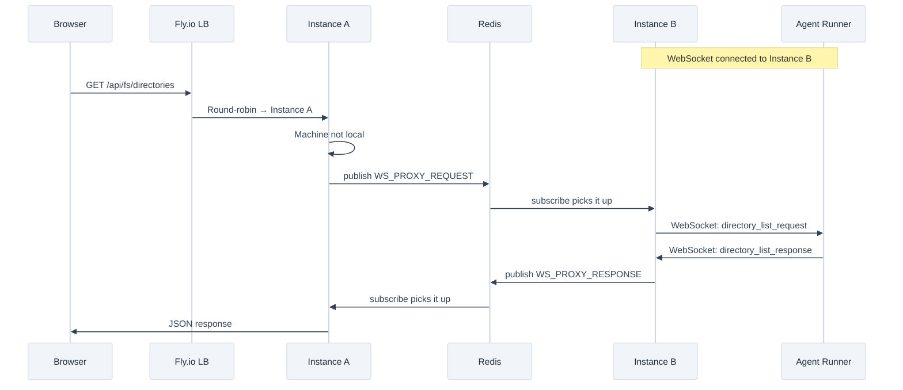
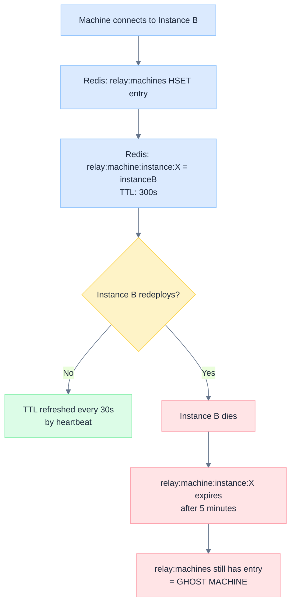

# Multi-Instance Relay Architecture

> How Astro's WebSocket relay scales across multiple Fly.io instances using Redis, and how to debug when things go wrong.

**Target audience:** Developers who are not infrastructure experts but need to understand and debug the production relay system.

---

## Overview

Astro runs two backend instances on Fly.io in the `sjc` (San Jose) region. Each instance runs both the HTTP API (port 3001) and the WebSocket relay (port 3002) in the same process.

The fundamental challenge: **HTTP requests are load-balanced round-robin, but WebSocket connections are sticky**. When a browser sends an HTTP request to list directories on a connected machine, that HTTP request might land on Instance A, but the machine's WebSocket lives on Instance B. Redis bridges this gap.



---

## Why Two Instances?

Fly.io configuration (`fly.toml`):

| Setting | Value | Why |
|---------|-------|-----|
| `min_machines_running` | 2 | Zero-downtime deploys; one instance restarts while the other serves |
| `primary_region` | sjc | Co-located with Upstash Redis for low latency |
| HTTP port 443 | Round-robin | Fly.io load balancer distributes HTTP evenly |
| WebSocket port 3002 | Sticky | Once connected, agent runner stays on the same instance |
| VM | shared-cpu-2x, 2GB RAM | Sufficient for relay + API workload |

Without Redis, each instance would only see its own connected machines. A directory listing request hitting Instance A would fail if the machine is connected to Instance B.

---

## Redis Data Structures

All Redis keys use the `relay:` prefix. There are two categories: **persistent state** (hashes, key-value) and **pub/sub channels** (ephemeral messages).

### Persistent State

| Key | Type | TTL | Purpose |
|-----|------|-----|---------|
| `relay:machines` | Hash | **None** | Machine registry — maps machineId to JSON entry (name, providers, load, userId) |
| `relay:machine:instance:<machineId>` | String | **5 min** | Maps machineId to instanceId — proves the machine is alive |
| `relay:instance:<instanceId>` | String | 1 min | Instance heartbeat — proves the instance process is alive |
| `relay:task:machine:<taskId>` | String | 24 hr | Maps taskId to machineId for dispatch routing |
| `relay:exec:context:<executionId>` | String | 4 hr | Execution context (userId, projectId) for cross-instance isolation |

### Pub/Sub Channels

| Channel | Direction | Purpose |
|---------|-----------|---------|
| `relay:ws:proxy:request` | Requester → Owner | "Send this message to machineId's WebSocket" |
| `relay:ws:proxy:response` | Owner → Requester | "Here's the response (matched by correlationId)" |
| `relay:machine:state` | Any → All | Machine connected/disconnected/updated |
| `relay:task:dispatch` | Any → Owner | Route task dispatch to correct instance |
| `relay:task:streaming` | Owner → All | Bridge SSE streaming events cross-instance |
| `relay:task:cancel` | Any → Owner | Cancel a running task |
| `relay:approval:response` | Any → Owner | Route approval answers to the correct agent |
| `relay:task:steer` | Any → Owner | Route steering messages to running agents |

### The Critical TTL Asymmetry

This is the most important thing to understand about the Redis data model:

- `relay:machines` (the hash) has **no TTL**. Entries persist until explicitly deleted.
- `relay:machine:instance:<id>` keys have a **5-minute TTL**. They expire unless refreshed.

This asymmetry is intentional — the machine registry is the source of truth for "what machines exist," while instance keys are proof-of-life. But it creates a failure mode: if an instance dies or redeploys without cleaning up, the machine registry entry survives while the instance key expires. This creates a **ghost machine**.



---

## Cross-Instance WebSocket Proxy

When an HTTP route handler needs to talk to a machine that's on another instance, it follows this pattern:

### Step-by-Step Flow

1. **Route handler** (e.g., `GET /api/fs/directories`) calls `relayServer.requestDirectoryList(machineId, path, correlationId)`

2. **Relay server checks local registry.** If the machine has a local WebSocket (`machineRegistry.isLocal(machineId)` is true), send directly. Done.

3. **If not local**, publish a `WS_PROXY_REQUEST` to Redis with the machineId, messageType, and payload.

4. **All instances receive the request** via Redis subscription. Each checks `machineRegistry.isLocal(event.machineId)`. Only the instance that owns the WebSocket handles it.

5. **The owning instance** calls `relayServer.handleWsProxyRequest()` to forward the message to the agent runner via WebSocket.

6. **The agent runner responds** via WebSocket. The owning instance's relay server emits the response event (e.g., `directory_list:response`).

7. **The response bridge** (in `server/index.ts`) listens for these events and publishes them to the `WS_PROXY_RESPONSE` Redis channel.

8. **All instances receive the response.** Each calls `relayServer.emit(event.responseType, payload)`. The instance that has a pending Promise with the matching `correlationId` resolves it.

### The `_fromProxy` Flag

Without this flag, you get an infinite loop:

1. Instance B receives response from agent runner → emits `directory_list:response`
2. Response bridge publishes to Redis `WS_PROXY_RESPONSE`
3. Instance B receives its own Redis message → emits `directory_list:response` again
4. Response bridge publishes to Redis again... (infinite loop)

The fix: when a response arrives via Redis proxy, it's tagged with `_fromProxy: true`. The response bridge skips events with this flag.

### Proxy Error Responses

If the owning instance receives a proxy request but the machine's socket is actually dead:

```typescript
// server/index.ts — WS_PROXY_REQUEST handler
if (!sent) {
  // Publish error response so the requester doesn't wait for timeout
  redisPubSub.publishWsProxyResponse({
    correlationId,
    responseType,
    payload: { correlationId, error: 'Machine not connected (socket closed)' },
  })
}
```

Without this, the requesting instance would wait for the full 10-second timeout before returning an error.

---

## The Ghost Machine Problem

### What Is a Ghost Machine?

A ghost machine is an entry in `relay:machines` (the Redis hash) that has no corresponding `relay:machine:instance:<id>` key. It appears to exist but cannot be reached.

### How Ghost Machines Appear

1. **Deploy/restart**: Instance B is serving machine X. During a Fly.io deploy, Instance B is killed. The `relay:machines` hash entry for X persists (no TTL), but the `relay:machine:instance:X` key expires after 5 minutes.

2. **Machine reconnects to new instance**: Machine X reconnects to Instance A after the deploy. Instance A creates a new `relay:machine:instance:X` key pointing to itself. The ghost is replaced — **this is the happy path**.

3. **Machine doesn't reconnect**: If the agent runner was stopped, or the machine is offline, the ghost entry stays in `relay:machines` forever.

### How Ghosts Cause the Spinner Bug

The "directory browser shows a perpetual spinner" bug manifested like this:

1. User opens the directory browser in the UI
2. Frontend sends `GET /api/fs/directories?machineId=X`
3. HTTP request lands on Instance A
4. Instance A sees machine X in registry (ghost entry from `relay:machines`) but not locally
5. Instance A publishes `WS_PROXY_REQUEST` to Redis
6. **No instance owns machine X** — the request goes unhandled
7. After 10 seconds, the timeout fires and returns an error
8. Frontend retries (up to 2 retries with 1.5s delay)
9. User sees a spinner for 30+ seconds, then an error

### The Three-Layer Fix

**Layer 1: Startup Hydration Cleanup** (`server/index.ts`)

When an instance starts, it hydrates remote machines from Redis but validates each one:

```typescript
const remoteMachines = await redisPubSub.getAllMachines()
for (const entry of remoteMachines) {
  const instanceId = await redisPubSub.getMachineInstance(entry.machineId)
  if (instanceId) {
    machineRegistry.registerRemote(entry.machineId, entry)  // Live — hydrate
  } else {
    redisPubSub.unregisterMachine(entry.machineId)  // Ghost — clean up
  }
}
```

**Layer 2: Fast-Fail Reachability Check** (`relay-server.ts`)

Before sending any proxy request, route handlers call `isMachineReachable()`:

```typescript
async isMachineReachable(machineId: string): Promise<boolean> {
  // Check local WebSocket first
  const connection = machineRegistry.getConnection(machineId);
  if (connection?.socket && connection.socket.readyState === WebSocket.OPEN) {
    return true;
  }
  // Check Redis for live instance key
  if (redisPubSub.isConnected()) {
    try {
      const instanceId = await redisPubSub.getMachineInstance(machineId);
      return !!instanceId;  // null = ghost, string = reachable
    } catch {
      return true;  // Redis error — optimistically allow proxy attempt
    }
  }
  return false;
}
```

This turns a 10-second timeout into an instant "Machine not connected" error.

**Layer 3: Heartbeat TTL Refresh** (`relay-server.ts`)

The relay heartbeat (every 30 seconds) now refreshes `MACHINE_INSTANCE` TTLs for all locally-connected machines:

```typescript
private startHeartbeatInterval(): void {
  this.heartbeatInterval = setInterval(() => {
    const localMachineIds: string[] = [];
    for (const machine of machineRegistry.getAll()) {
      if (machineRegistry.getConnection(machine.machineId)?.socket) {
        localMachineIds.push(machine.machineId);
        // ... send ping ...
      }
    }
    // Batch-refresh TTLs using Redis pipeline
    if (localMachineIds.length > 0 && redisPubSub.isConnected()) {
      redisPubSub.refreshMachineInstanceTTLs(localMachineIds);
    }
  }, 30_000);  // Every 30 seconds
}
```

Without this refresh, **every machine would become a ghost after 5 minutes** because the `MACHINE_INSTANCE` key was only set once during registration and never renewed.

---

## Troubleshooting Guide

### Symptom: Directory Browser Shows Spinner

**Most likely cause:** Ghost machines in Redis.

**Diagnosis:**

1. Check the health endpoint for connected machines:
   ```bash
   curl -s https://api.astroanywhere.com/api/health | jq '.relay'
   ```

2. Check Fly.io logs for proxy timeout messages:
   ```bash
   fly logs --app astro-backend-deploy | grep -i "timeout\|ghost\|not reachable\|proxy"
   ```

3. Look for the reachability fast-fail log:
   ```
   [fs] Machine <id> not reachable (ghost or disconnected)
   ```
   If you see this, the ghost detection is working — the machine is genuinely disconnected.

4. Look for proxy timeout logs:
   ```
   [fs] directory_list TIMEOUT cid=<uuid> machineId=<id>
   ```
   If you see this instead of the fast-fail, the ghost wasn't detected — the `MACHINE_INSTANCE` key might still be alive but the WebSocket is dead.

**Resolution:**

- If the machine should be connected: restart the agent runner on that machine
- If the machine is offline: the ghost will be cleaned up on the next server deploy (startup hydration)
- For immediate cleanup: the machine will drop from the registry when the agent runner reconnects or the next deploy triggers hydration

### Symptom: All Machines Become Ghosts After 5 Minutes

**Cause:** `MACHINE_INSTANCE` TTL not being refreshed (fixed in commit `7d26f320`).

**Verification:**

```bash
fly logs --app astro-backend-deploy | grep "refresh machine instance TTL"
```

If you see `Failed to refresh machine instance TTLs`, there's a Redis connectivity issue. Check `REDIS_URL` in Fly.io secrets.

### Symptom: Infinite Redis Echo Loop (CPU Spike)

**Cause:** Response bridge re-publishes proxy responses without the `_fromProxy` guard.

**Verification:** Look for rapidly repeating log messages with the same correlationId.

**Fix:** Ensure the `_fromProxy` check exists in the response bridge code (`server/index.ts`).

### Symptom: Requests Always Time Out (Never Fast-Fail)

**Possible causes:**

1. `isMachineReachable()` is not being called in the route handler
2. Redis is disconnected (machine appears as "remote" in the in-memory registry but can't be validated)
3. The `MACHINE_INSTANCE` key exists but points to a dead instance

**Diagnosis:** Check if the route handler has the reachability check before the request function:

```typescript
// This should be in the route handler BEFORE requestDirectoryList()
const reachable = await relayServer.isMachineReachable(machineId)
if (!reachable) {
  return c.json({ path, entries: [], error: 'Machine not connected' })
}
```

### Common Log Messages

| Log | Meaning | Action |
|-----|---------|--------|
| `[relay] Hydrated N remote machines from Redis (removed M stale)` | Startup cleanup worked | None — informational |
| `[relay] directory_list_request routing via REDIS proxy` | Cross-instance proxy in action | None — normal operation |
| `[relay] WS proxy: machine X not locally connected` | Proxy request arrived but socket is dead | Machine may have disconnected |
| `[fs] Machine X not reachable (ghost or disconnected)` | Fast-fail caught a ghost | Machine is offline |
| `[relay] Failed to refresh machine instance TTLs` | Redis error during heartbeat | Check Redis connectivity |

---

## The Journey: How We Found and Fixed This

This section documents the debugging history for future reference.

### Phase 1: Frontend Revert

The directory browser was slow and sometimes failed. Initial hypothesis: the frontend was loading too eagerly. A frontend PR was reverted.

### Phase 2: Frontend Lazy Loading

The frontend was refactored to use lazy loading — components and data are loaded on demand rather than all at once. This improved initial page load time but didn't fix the directory browser spinner.

### Phase 3: Discovery — The Bug Was Server-Side

After adding diagnostic logging to the relay server, the root cause became clear:

- Machine `64b81b94-*` was in the Redis `relay:machines` hash as a "remote" machine
- But its `relay:machine:instance:64b81b94-*` key had expired
- Every directory listing request was being proxied to Redis, where no instance handled it
- After 10 seconds, the timeout fired

The fix was three-fold:
1. Startup hydration validates machines against their instance keys (cleans ghosts)
2. `isMachineReachable()` fast-fails before attempting proxy (avoids 10s wait)
3. Heartbeat refreshes `MACHINE_INSTANCE` TTLs (prevents machines from becoming ghosts)

### Timeline

| Commit | What | Why |
|--------|------|-----|
| `efac345a` | Eliminate ghost machine timeouts | Startup hydration cleanup + reachability checks |
| `7d26f320` | Refresh MACHINE_INSTANCE TTLs | Prevent all machines from ghosting after 5 min |

---

## Key Files

| File | Role |
|------|------|
| `server/lib/relay-server.ts` | WebSocket server, message routing, `isMachineReachable()`, `requestDirectoryList()`, heartbeat TTL refresh |
| `server/lib/redis-pubsub.ts` | Redis adapter — channels, keys, `registerMachine()`, `refreshMachineInstanceTTLs()`, `publishWsProxyRequest/Response()` |
| `server/lib/machine-registry.ts` | In-memory registry — `register()`, `registerRemote()`, `isLocal()`, `getConnection()` |
| `server/index.ts` | Wiring — startup hydration, proxy request/response handlers, `_fromProxy` bridge |
| `server/routes/fs.ts` | HTTP route — `GET /directories`, calls `isMachineReachable()` before proxy |
| `server/routes/repo.ts` | HTTP route — `GET /detect`, same reachability pattern |
| `fly.toml` | Fly.io config — 2 instances, ports, concurrency limits |
| `src/components/remote-path-browser.tsx` | Frontend directory browser — retry logic, loading state |

---

*See also: [Relay Overview](./overview.md) | [Relay Protocol](./protocol.md)*
