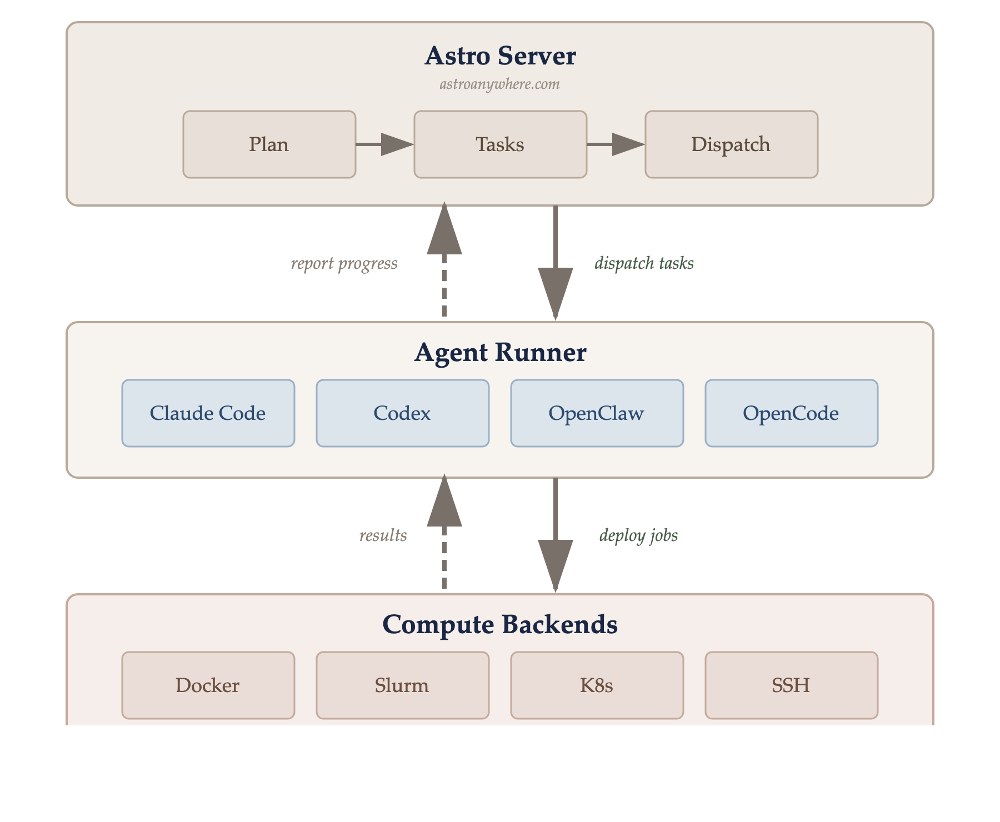
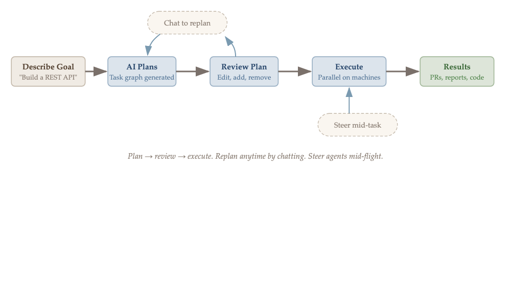
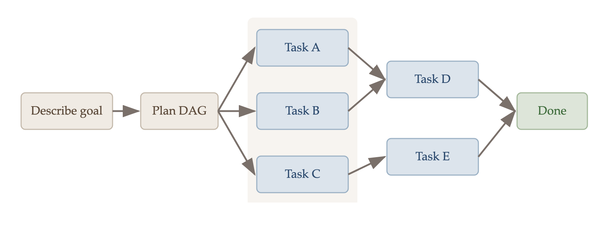
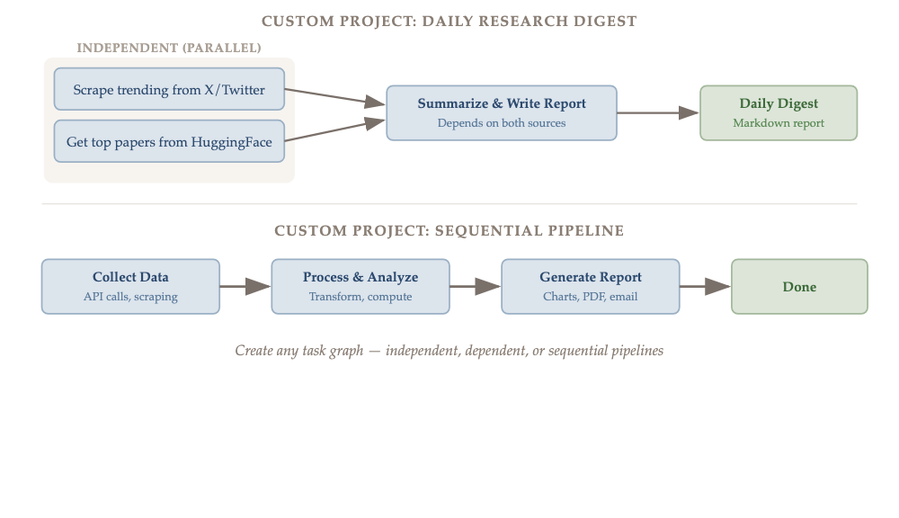
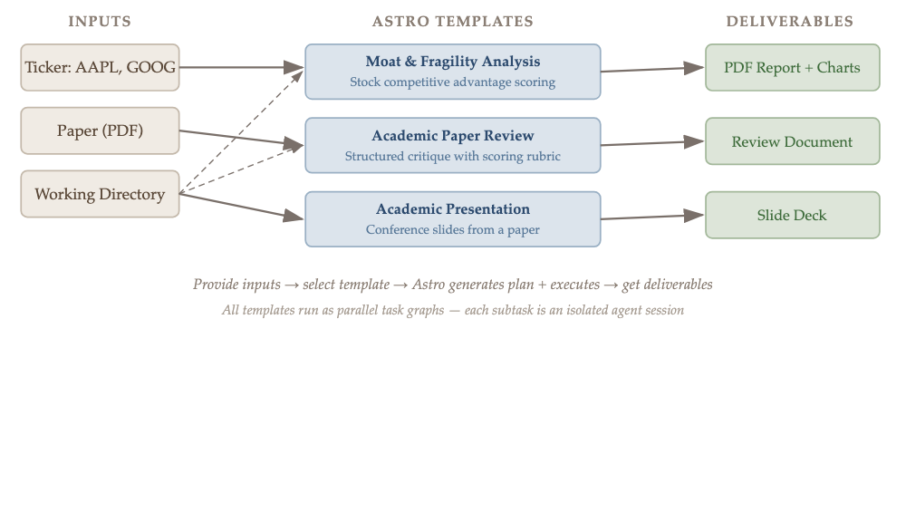

# Astro: AI 时代的 Mission Control

> Apollo 任务不是在聊天窗口里指挥的。

## 问题

现在用 AI coding agent 的体验是这样的：

一个 agent，一个聊天窗口，一次做一件事。你描述需求，然后坐在那等——引导、复制粘贴上下文、在窗口之间切换。瓶颈不是 AI 的能力，是协调。

你有一个复杂目标——比如做一个带认证、数据库和部署的完整应用。你得把它拆成小任务，一个一个喂给 agent，等它做完再喂下一个。你变成了人肉调度器。

## Astro 是什么

Astro 是一个 planning-first 的平台，坐在你的 coding agent 之上。

你描述一次目标，Astro 把它分解成一个依赖关系图（DAG）——不是平铺的 to-do list，而是一个有依赖、有并行、有里程碑的图。然后把任务 dispatch 到你的机器上，由你自己的 AI agent 并行执行。

关键点：**你的任务由你自己的 AI agent 执行**——Claude Code、Codex、OpenClaw。Astro 只做编排和并行调度。你的机器，你的 API key，Astro 服务器不调用 AI 模型，也不接触你的密钥。

## 工作流程

1. **用自然语言描述目标**——比如"做一个带认证和 Postgres 的实时 dashboard，部署到 Fly"
2. **AI 自动生成结构化的依赖图**——任务、依赖关系、里程碑。图，不是列表
3. **任务 dispatch 到你想要的计算环境**——本地、HPC 集群 (Slurm)、云端。注册一次，永久 dispatch
4. **每个任务在隔离环境中执行**——独立的 git worktree + PR，或者直接在你的本地文件夹
5. **随时审批、引导、调整方向**——浏览器、手机、iPad 都行

项目可以导出为 JSON，也可以加载社区分享的计划模板。

另外还有 OpenClaw 插件，可以通过 Telegram / Slack / Discord 管理一切。

## 并行执行

这是 Astro 和现有工具最大的区别。

当你描述一个复杂目标时，Astro 生成的不是一个线性的任务列表，而是一个 DAG。能并行的任务自动并行——在不同的 git worktree、不同的机器上同时执行。有依赖关系的任务等上游完成后自动触发。

> Tasks A, B, C 并行执行。Task D 等 A + B 完成。Task E 等 C 完成。总时间 = 最长路径，而不是所有任务时间之和。

每个完成的任务自动 commit、push、开 PR：

## 安全模型

Astro 的安全设计值得单独说一下：

- **你的机器，你的密钥**：Agent runner 在你的机器上执行，用你的 API key。Astro 服务器不调用 AI 模型，也不接触你的密钥
- **加密签名的 dispatch**：每次任务 dispatch 都由你的浏览器加密签名。Agent runner 验证签名后才执行，没人能伪造任务
- **开源可审计**：Agent runner 完全开源，你可以审查在你机器上跑的每一行代码

## 4 种使用方式

### 1. Plan & Execute

描述一个复杂目标，AI 生成依赖图，任务在你的机器上并行执行。适合构建功能、重构代码库、搭建研究管线。

### 2. Custom Task Graphs

自己构建任务图——独立任务、依赖任务、顺序流水线，随意组合。

### 3. Built-in Templates

我们内置了一些可以直接用的模板：

- **Moat & Fragility Analysis**——输入股票代码，输出包含竞争优势评分、7 Powers 框架评估和反脆弱性评级的 PDF 报告
- **Academic Paper Review**——输入论文 PDF 或 arXiv URL，输出结构化 peer review
- **Academic Presentation**——论文转会议演示幻灯片

每个模板都作为并行任务图执行——子任务在你的机器上同时跑。

### 4. Playground

单个 agent session，在你的任意注册机器上跑。完整的可观测性——从任何设备查看 session，不需要终端。

## 支持的 AI Agent

| Agent | 安装命令 |
|---|---|
| Claude Code | `npm i -g @anthropic-ai/claude-code` |
| Codex | `npm i -g @openai/codex` |
| OpenClaw | `npm i -g openclaw` |
| OpenCode | `bun i -g opencode` |

Astro 自动检测你机器上安装的 agent，dispatch 时自动选择。

## 多环境支持

任务可以 dispatch 到：

- **本地机器**——你的笔记本或工作站，零配置
- **HPC 集群 (Slurm)**——自动生成 SBATCH 脚本，实时监控
- **云端**——K8s、AWS、GCP，通过 device auth flow 注册
- **远程 SSH 主机**——`launch` 命令自动读取 `~/.ssh/config`，发现远程主机并安装 agent runner

## Quick Start

1. 安装至少一个 AI coding agent（Claude Code 或 Codex）
2. 去 [astroanywhere.com](https://astroanywhere.com) 注册
3. 终端运行 `npx @astroanywhere/agent`——自动检测 AI 工具、认证、连接
4. 打开 Mission Control，开始 planning

Agent runner 开源：[github.com/astro-anywhere/astro-agent](https://github.com/astro-anywhere/astro-agent)

网站：[astroanywhere.com](https://astroanywhere.com)

Twitter: [@0astroanywhere0](https://x.com/0astroanywhere0/status/2032157710213603592)

---

欢迎试用，期待反馈！
